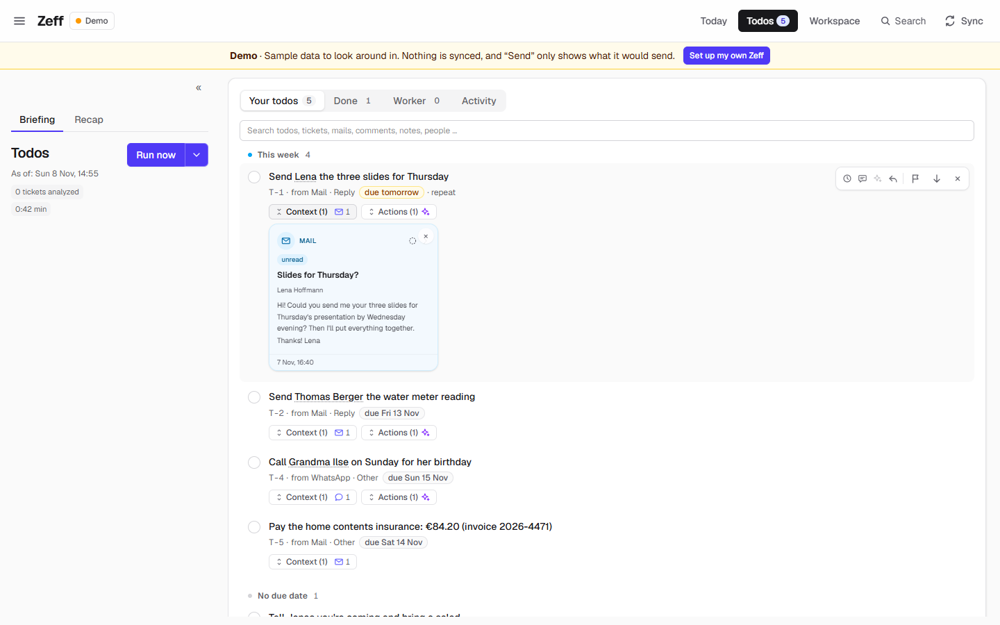
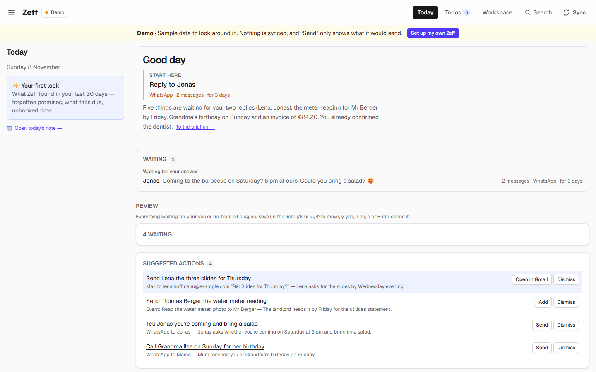
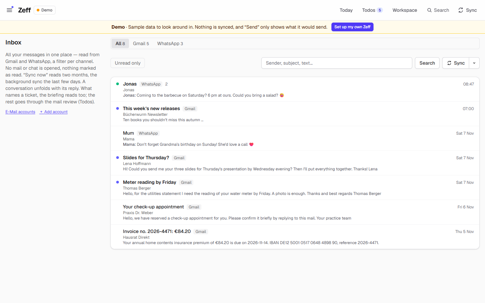
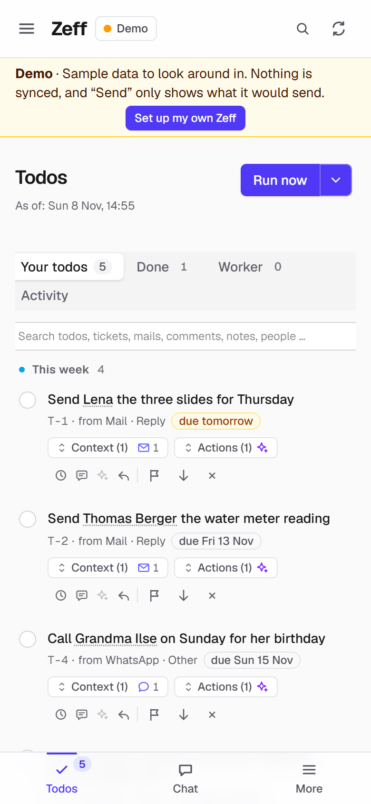
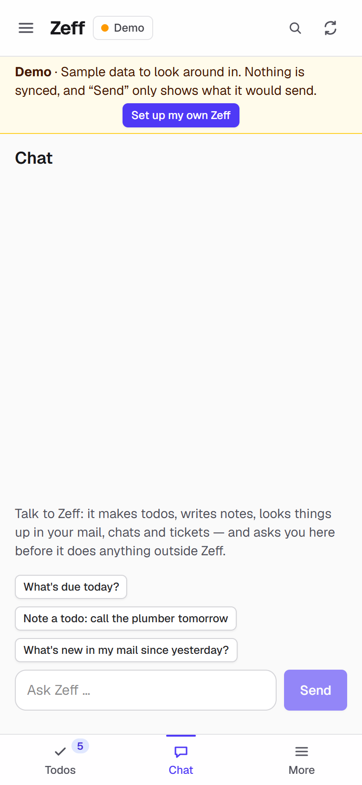

<p align="center">
  
</p>

<h1 align="center">Zeff</h1>

<p align="center">
  <b>Everything that reaches you becomes one todo list.<br>
  Mail, chats, tickets, comments, appointments, letters and bank statements flow in —<br>
  Zeff derives what is yours to do, tells you why, and puts the button that finishes it right beside it.<br>
  Locally, on your machine. Nothing leaves it unless you say so.</b>
</p>

<p align="center">
  <a href="https://getzeff.com">Website</a> ·
  <a href="https://github.com/269652/zeff-alpha/releases">Download (alpha)</a> ·
  <a href="#extensions">Extensions</a> ·
  <a href="docs/plugins/README.md">Write a plugin</a> ·
  <a href="LICENSE">Licence</a> ·
  <a href="mailto:info@getzeff.com">info@getzeff.com</a>
</p>

<p align="center">
  
</p>

---

Your day is spread over a dozen channels. Tickets in Jira. Mail in Outlook, Gmail and that old T-Online account. Chats
in Teams, WhatsApp and Signal. Review comments in GitLab. Two calendars. A letter with a file number. A bank statement
you keep meaning to look at. Somewhere in all of that is the one message you should answer today — and the promise
you made last Tuesday.

**You shouldn't have to turn that into a todo list by hand. Zeff does.** It reads every channel, locally, and derives
your todos from what actually comes in: who asked you for what, by when, in which message — and what already happened
since. A reply you sent, a ticket that moved, a payment that arrived: the todo settles itself. What's left is one calm
list, each item with its sources, its reason and a ready-made action.

```
  Outlook · Gmail · IMAP/POP3 ───┐
  Teams · WhatsApp · Signal ─────┤                           ┌────────────────────────────────────┐
  Jira · GitLab reviews ─────────┼──►  read · understood ───►│  Your todos                        │
  Calendars · documents · bank ──┤     matched · deduped     │  why · from where · by when · next │
  Workspace · journal · agents ──┘                           └────────────────────────────────────┘
```

Around that list sits everything you need to work it off: a mail client and chat view, a Notion-like workspace, AI
agents that take todos over in your own repos, and a **Studio** to build whatever else you need.

- 📥 **Every channel in, one list out.** Todos are a derivation of everything that arrives — not another inbox to
  feed by hand.
- 🏠 **Local first, for real.** A server on `127.0.0.1`, a desktop launcher, one SQLite file per account. No cloud
  account, no OAuth app to approve: connectors read the web apps you are already signed in to.
- ✋ **It never acts behind your back.** Automatic steps only read and propose; every write — a message, a comment,
  a booking — happens on your click. A test enforces it.
- 🤖 **Agents that actually work.** Claude Code, Codex and Copilot run on your todos with live sessions, worktrees,
  diffs and delivery — and they can ask you when they need a decision.
- 🔒 **Privacy you can see.** Every source and database carries a sensitivity (open, personal, secret) that the AI,
  the knowledge server, agents and MCP all respect.

## Screenshots

*Sample data — people, mails and chats made up for the demo.*

<table>
  <tr>
    <td width="50%"><br><b>Today</b> — where to start, who's waiting for you, the actions ready to go.</td>
    <td width="50%"><br><b>Every inbox, one place</b> — mail and chats in one list, a tab per channel.</td>
  </tr>
</table>

<table>
  <tr>
    <td width="33%"></td>
    <td width="33%"></td>
    <td width="34%"><b>On your phone</b><br><br>All of Zeff at <a href="https://app.getzeff.com">app.getzeff.com</a>, straight from your PC over an encrypted peer-to-peer connection — no cloud in between. Pair it with a QR code from the launcher, tick todos offline, and talk to Zeff in the chat: it makes todos, writes notes and looks things up for you.</td>
  </tr>
</table>

## Extensions

Everything in Zeff is an **extension** (a plugin) you turn on or off on **Menu → Plugins**. Each has a page in the docs
with what it does, how to set it up, its settings and **screenshots** — follow the link. All of them: [docs/extensions](docs/extensions/README.md).

### Your day

| Extension | Highlights |
| --- | --- |
| [**Todos**](docs/extensions/todos.md) | Derived from every channel, not typed · each says why, from where, by when · settles itself when the source shows it is done · one-click actions · hand it to an agent |
| [**Mail & Chat**](docs/extensions/mail-client.md) | One inbox for mail and chats · a real mail client and chat view · replies over the account's own SMTP · AI review turns what needs you into todos |
| [**Calendar**](docs/extensions/calendar.md) | Your calendars plus Outlook and Google in one week view · free slots for meeting suggestions · meetings become time entries |
| [**Agenda**](docs/extensions/agenda.md) | Notes on a timeline, in projects · pin, tick off, tag · reminders and today's events |
| [**Timeline**](docs/extensions/timeline.md) | One log across all sources, tied to people, tickets and projects · a marker for what is new |
| [**Open loops**](docs/extensions/loops.md) | Promises both ways, unanswered questions, requests · loops close by themselves |
| [**News**](docs/extensions/news.md) | Your feeds scored for your interests · muted words, trusted sources · a daily overview |

### People, matters & money

| Extension | Highlights |
| --- | --- |
| [**People**](docs/extensions/people.md) | A profile for everyone who matters · what Zeff knows across sources · dates with reminders · duplicates merged everywhere |
| [**Organisations, projects & places**](docs/extensions/entities.md) | Known under every name your sources use · each gathers its people, tickets, mails, money and hours |
| [**Cases**](docs/extensions/cases.md) | One place per matter, held together by a file number · the other party, what is owed, the next deadline · a GiroCode to pay |
| [**Finances**](docs/extensions/finances.md) | Whom you owe and who owes you · payment plans and the months ahead · the day you are debt-free |
| [**Documents**](docs/extensions/documents.md) | Drop PDFs, Office files, pictures, audio · text extracted (scans and audio too) · searchable, a source of todos |
| [**Time tracking**](docs/extensions/time-tracking.md) | Jobs and projects against your hours and absences · weekly and monthly reports · agents propose bookings |
| [**Correlations**](docs/extensions/correlations.md) | What goes with what in your days (mood, energy, meetings, spending) · real statistics, told only when it holds |
| [**Knowledge**](docs/extensions/knowledge.md) | A searchable wiki and graph of your data and Confluence · what you should know right now · questions answered with the rows behind them |

### Build and write

| Extension | Highlights |
| --- | --- |
| [**Workspace**](docs/extensions/workspace.md) | Pages and databases in a block editor · table, board, list, gallery, calendar, timeline, chart · formulas with units · **tables that transform** (table → transform → result, with data-flow marks, protection and a "calculated" look) · panels and *Wrap* · widgets the AI builds · pipelines, automations, agents · views of your own |
| [**Notebook**](docs/extensions/notebook.md) | **Code cells in any page**: Python, Node.js, Rust — each language a plugin, **Docker containers by default** · inputs and a returned output other blocks and widgets use · read and write Zeff **behind permissions you grant** (asked while the cell runs) · `sharedStorage` across languages · **`.znb`**: a Jupyter notebook with Zeff's blocks on top · a sticky *Run all* |
| [**Studio**](docs/extensions/studio.md) *(beta)* | Flows on a canvas · sandboxed Node.js lambdas with a web IDE · lifecycles · apps in one click · permissions you grant |
| [**Lookups**](docs/extensions/lookups.md) | Type a title, pick a suggestion: films, books, Wikipedia, web results become rows |
| [**Code**](docs/extensions/work.md) | AI workers on your todos in your repos · live sessions you can steer · branches, diffs, pushes and merge requests on a click |
| [**Admin sessions**](docs/extensions/work-elevated.md) *(beta)* | Live Claude sessions that run as Windows administrator |
| [**Jira briefing**](docs/extensions/jira-lage.md) | Your Jira boards as Workspace boards, each card with the AI's view of where it stands |

### AI

| Extension | Highlights |
| --- | --- |
| [**LLM**](docs/extensions/llm.md) | The layer every AI task goes through · backend and model per task · your instructions and context |
| [**AI backends**](docs/extensions/ai-backends.md) | Claude Code, ChatGPT (Codex CLI), GitHub Copilot CLI, local models (Ollama, LM Studio) |
| [**Auto actions**](docs/extensions/auto-actions.md) | A ready-made action for every open todo · you review, adjust, click |
| [**Actions**](docs/extensions/actions.md) | The one-click buttons on todos and rows — writes only on your click |

### Connectors

| Extension | Highlights |
| --- | --- |
| [Outlook](docs/extensions/outlook.md) · [Gmail](docs/extensions/gmail.md) · [IMAP / POP3](docs/extensions/imap-mail.md) | Mail from your accounts, replies on your click |
| [Microsoft Teams](docs/extensions/teams.md) · [WhatsApp](docs/extensions/whatsapp.md) · [Signal](docs/extensions/signal.md) | Chats read without opening them — no read marks, no blue ticks |
| [Google Calendar](docs/extensions/google-calendar.md) · [Google Drive](docs/extensions/google-drive.md) · [Google Keep](docs/extensions/keep.md) | Calendars, a copy of documents and backups in your own Drive, your Keep notes |
| [Jira](docs/extensions/jira.md) · [GitLab](docs/extensions/gitlab.md) | Tickets, boards, merge requests and review comments as context for todos and workers |
| [Revolut](docs/extensions/revolut.md) | Bank statements settle payments by themselves |
| [Web search](docs/extensions/web-search.md) · [Browser](docs/extensions/browser.md) *(beta)* | The AI searches the web and reads or clicks through public pages |
| [Time-sheet systems](docs/extensions/timesheets.md) | Your booked week exported to Chrono and Punch |

### System

| Extension | Highlights |
| --- | --- |
| [**Accounts**](docs/extensions/accounts.md) | Work and private side by side, each with its own database, browser profile, AI backends and plugins |
| [**Backups**](docs/extensions/backup.md) | Encrypted daily ZIPs, rotation, restore in one click, optionally a copy in your Drive |
| [**Languages**](docs/extensions/languages.md) | English, German and Spanish, with dates and numbers in your format |

**Safe by construction.** Every source and database carries a sensitivity (open, personal, secret) that the AI,
agents and MCP respect; automatic steps only read and propose — every write happens on your click (a test enforces
it); code that reads or writes Zeff's data waits for a permission you give.

## Get it

Download the archive for your system from the
**[releases](https://github.com/269652/zeff-alpha/releases)** — it brings the launcher, its own Node and Zeff,
built. No Node, npm or checkout needed.

| System | Archive | Start |
| --- | --- | --- |
| Windows 10/11 x64 | `Zeff-<version>-windows-x64.zip` | `Zeff\Zeff.exe` |
| Ubuntu 22.04+ x64 | `Zeff-<version>-linux-x64.tar.gz` | `Zeff/zeff` |
| macOS | `Zeff-<version>-macos-*.zip` (when built) | `Zeff.app` (unsigned: "Open Anyway" once) |

1. Unpack it anywhere (on Windows not into `Program Files` — Zeff keeps its data next to `Zeff.exe`).
2. Start it and say yes to the one-time setup of `https://zeff` (a hosts entry and Zeff's own certificate; without it
   Zeff runs on `https://127.0.0.1:1337`).
3. Follow **Setup** in the app: plugins, sign-ins, first data.

An update replaces the program and keeps the data (Windows `app\data`, macOS `~/Library/Application Support/Zeff`,
Linux `~/.local/share/zeff`). Every archive has a `.sha256` next to it and a `README.txt` inside.

**What your PC still needs** depends on the plugins you turn on — the **Plugins** and **Setup** pages show ✓ / ✗ with
a hint for each:

| For | Needs |
| --- | --- |
| Connectors that read web apps (Outlook, Teams, GitLab, Gmail, WhatsApp, Keep, Google Calendar) | a Chromium browser — Chrome, Edge, Brave or Chromium (`CHROME_PATH` overrides) |
| Work tab, Repos | `git` |
| Jira sync | `uvx` (uv) for `mcp-atlassian`, or any Jira MCP server via `JIRA_MCP_COMMAND` |
| AI | the Claude CLI, Codex CLI or Copilot CLI, signed in once |
| Scanned PDFs, audio | Poppler's `pdftoppm`; a transcriber such as Whisper |

## Make Zeff yours: plugins

External plugins are plain folders in Zeff's data folder. They appear under **Menu → Plugins** at once, and you turn
them on there after seeing what they ask for — no rebuild, no restart.

```
plugins/my-plugin/
  zeff-plugin.json   ← what it adds, and what it may do
  ui/index.html      ← a view of your own, inside Zeff
  rules.md           ← rules every Work worker gets
```

A plugin can add **rules** for every worker, **`/` commands**, **views** in the sidebar or as a session tab, **MCP
servers**, **event hooks** on runs and todos, and drive Zeff through **the API**. Views run in a sandboxed frame behind
a permission-checked bridge; hooks have time limits and no shell. The one permission that can't be contained is
`exec`, and Zeff says so before you enable it — [the trust model](docs/plugins/security.md).

Start with the [overview](docs/plugins/README.md) and the examples in [`examples/plugins/`](examples/plugins). Reference:
[manifest](docs/plugins/manifest.md) · [API](docs/plugins/api.md) · [panels](docs/plugins/panels.md) ·
[hooks](docs/plugins/hooks.md). `npm run plugin:check -- <folder>` validates a plugin. Integrations that must not live
in a public repo can be mounted as a git submodule under `integrations/` — [docs/integrations.md](docs/integrations.md).

## Connect an agent (MCP)

Every account has its own MCP endpoint; the `/mcp` page lists them with ready-to-paste config.

```bash
claude mcp add --transport http --scope user zeff http://127.0.0.1:9333/api/mcp
```

Agents can book time (`report_time`, `list_time_entries` …), work on todos (`list_todos`, `start_todo`,
`todo_context`, `finish_todo` …) and search knowledge (`search_knowledge`). Each endpoint takes the token of its
account (`Authorization: Bearer …`, Menu → MCP).

## How it works

```
 Web apps you're signed in to          Zeff (Next.js 16, 127.0.0.1)                You
 ─────────────────────────────         ───────────────────────────────            ─────
 Outlook · Teams · Gmail · Keep  ──►   drivers (MCP over stdio, CDP)  ──►  SQLite  ──►  Today · Todos · Mail
 WhatsApp · GitLab · Calendar           syncs ─► Lage (AI) ─► todos      per          Workspace · People
 Signal Desktop · Jira (MCP)            knowledge server · agents        account      Work (agents) · MCP
```

- **Drivers.** Each connector is a small MCP stdio server (`src/plugins/<id>/driver.mjs`) that attaches over CDP to
  the account's automation browser and reads the web app like you would. Sign-ins are yours — Zeff asks, never
  signs in itself. Signal is read from Signal Desktop's own objects, without opening chats or marking them read.
- **The Lage.** Syncs feed an AI pass that turns new activity into todos, loops and reviews. Prompt changes are
  checked with before/after evals on your own past decisions (`npm run eval`, [docs/evals.md](docs/evals.md)).
- **Knowledge.** A Next app of its own per account (`knowledge/`) compiles each page once per version — summary,
  concepts, entities, relations — and answers searches and questions.
- **The launcher.** Electron supervises Zeff and the knowledge servers, serves them as `https://zeff` and
  `https://knowledge.zeff`, restarts them after a crash, and starts with the OS.

Stack: Next.js 16 (App Router, Turbopack), React 19, Tailwind CSS 4, Drizzle ORM + better-sqlite3, MCP SDK v2,
Playwright over CDP, Electron.

## Develop

```bash
npm install
npm run dev                    # on a free port
npm test                       # each test file on its own temporary database
npm run test:server            # a disposable server: fresh database, free port, TTL
npm run e2e                    # the browser smoke suite
npm run deploy                 # typecheck, lint, tests, build, restart through the launcher, page probes
```

- **Migrations** are written by hand: `drizzle/00NN_name.sql` (statements separated by `--> statement-breakpoint`)
  plus an entry in `drizzle/meta/_journal.json` with a `when` greater than every earlier one. Don't run
  `db:generate` — its snapshots are long out of date.
- **Risky writes** are tested on a snapshot (`better-sqlite3` `backup()`, `DATABASE_PATH`), never on the live
  database.
- **Writes only on a click** is a test: `tests/safety.test.ts` fails when an automatic step reaches a write.
- **A release** is `npm run release` on the system it is for (native modules): it builds a commit from
  `git archive`, packs the archive with its `.sha256`, then unpacks and starts it with a bare `PATH` and checks
  pages, drivers, work hosts and migrations. `npm run release:check -- <archive>` runs that check alone.

```
src/app/          pages, API routes (api/mcp, api/ext/v1), server actions
src/plugins/<id>/ a built-in plugin: manifest, driver.mjs, server actions, UI
src/lib/          the core: entries, schedule, boards (the Lage), work, sync, mail, ext (external plugins)
src/db/           Drizzle schema, connections, accounts
knowledge/        the knowledge server
launcher/         the Electron launcher
docs/             documentation; docs/plugins is shipped with Zeff (/ext/docs)
examples/plugins/ plugins to copy
tests/  e2e/      node:test + tsx; Playwright smoke suite
```

## Status

Zeff is **alpha**. It is used every day, on Windows first; Linux builds are checked, macOS builds are not published
yet. Expect rough edges, migrations and the occasional breaking change.

## Disclaimer

**Zeff is provided "as is", without any warranty and without any liability.** You use it entirely at your own risk.
It can contain errors, lose or corrupt data, send or fail to send messages, miss or misread a todo, a deadline or a
payment, and stop working when a service it reads changes. Zeff is no substitute for your own checks: what it derives,
summarises or suggests — including anything the AI writes — may be wrong. Connectors that read third-party services
(WhatsApp, Signal, Teams, Outlook and others) may break those services' terms of use and can lead to your account being
restricted; using them, and getting the permission of your employer or IT department where needed, is your
responsibility. Keep backups.

To the extent permitted by applicable law, the author accepts no liability whatsoever for any damage arising from the
use of or the inability to use Zeff. Mandatory liability that cannot be excluded by law (under German law: for intent,
gross negligence and injury to life, body or health) remains unaffected. See sections 15 and 16 of the [AGPL](LICENSE).

## Licence

Zeff is free software under the [GNU AGPL-3.0](LICENSE): use it, at home or at work, change it and share it, as long
as what you pass on (or offer over a network) stays under the AGPL with its source. If that doesn't fit, for a closed
product, a hosted service without publishing your changes or a company that can't use AGPL software, there is a
[commercial licence](COMMERCIAL-LICENSE.md). How the two fit together is in [LICENSING.md](LICENSING.md);
contributions need the short agreement in [CONTRIBUTING.md](CONTRIBUTING.md). Commercial licences and questions:
[info@getzeff.com](mailto:info@getzeff.com). The landing page lives in [site/](site) and is published to
[getzeff.com](https://getzeff.com).
