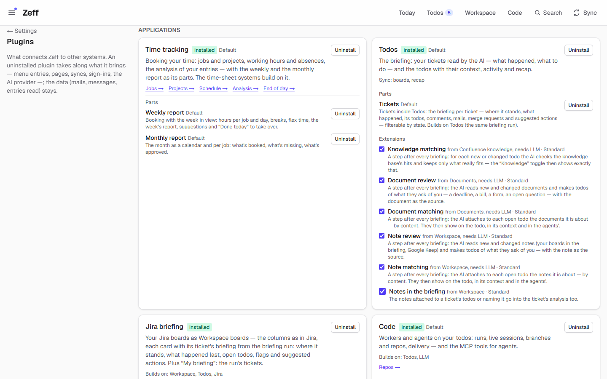

# Zeff's extensions

Almost everything Zeff does comes from an **extension** (a built-in plugin): the todo list, the inbox, the calendar,
each mail or chat service, the AI backends, Learn, time tracking. You switch them on and off on
**Menu → Plugins**; an extension you switch off takes its pages, syncs and menu entries with it, while the data it
already read (mails, messages, entries) stays.

Every page below has two halves:

- **For users** — what the extension is for, how to switch it on and set it up, how to use it day to day, its
  settings, and its limits (including what leaves your computer and what the AI sees).
- **Technical reference** — its manifest, files, data, sync steps, AI tasks, MCP tools and actions, the extension
  points it offers or uses, and its tests.

The screenshots come from Zeff's **demo** (the setup assistant’s *Look around with sample data first*): sample mails and chats, people, appointments,
the todos Zeff derived from them, and a Learn course on differential geometry a week in. Nothing in the demo is real
personal data.

New to the code? Read [the plugin system](../plugin-system.md) first — how an extension is declared, how it contributes
to other extensions' points, and how the generated indexes tie it together. External plugins (folders you drop in
without rebuilding Zeff) are documented separately in [docs/plugins](../plugins/README.md).

## Applications

| Extension | What it is | Default |
| --- | --- | --- |
| [Todos](todos.md) | The todo list, Today and Tickets: what to do, derived from your mails, chats and tickets — each with its source, reason and a ready action | on |
| [Workspace](workspace.md) | Pages, databases, boards, flows and routines — Zeff's notebook and the home of collections | on |
| [Calendar](calendar.md) | One calendar for everything — Zeff's own calendars and your sources' (Outlook, Google) — plus the meetings your todos propose | on |
| [Agenda](agenda.md) | Notes on a timeline, in projects, like the app *Agenda*: dated notes you pin, tick off and tag | off |
| [Mail & Chat](mail-client.md) | A mail client, a chat and a combined inbox for every mail and message Zeff reads | on |
| [Timeline](timeline.md) | One log of what happened across all sources, each event tied to its people, tickets and projects | on |
| [People](people.md) | A profile for everyone who matters to you — names, dates, circle and what Zeff learned from your messages | off |
| [Open loops](loops.md) | What is still open between you and others: promises both ways, unanswered questions and requests | off |
| [Organisations, projects & places](entities.md) | The organisations, projects and places your work hangs on, known under every name your sources use | off |
| [Cases](cases.md) | One place per matter: what belongs to a case number — its sources, the other side, what is owed, the next deadline | on |
| [Finances](finances.md) | Your debts and what you are owed — instalments, payment plans, when you are debt-free | on |
| [Documents](documents.md) | A store for your documents whose text Zeff reads: searchable, context for todos, a source of todos | off |
| [News](news.md) | News from public feeds, scored for your interests, sources and open todos | off |
| [Learn](learn.md) | Claude researches a topic and teaches it as a skill tree, with exercises built on the fly | off · beta |
| [Studio](studio.md) | Flows drawn on a canvas, lifecycles, lambdas, screens and secrets for your Zeff apps — by hand or with a copilot | off · beta |
| [Knowledge](knowledge.md) | What you should know right now, questions answered from your own data, and Confluence as a knowledge base | on |
| [Correlations](correlations.md) | What goes with what in your days — mood or energy against meetings, hours, spending, sleep | on |
| [Time tracking](time-tracking.md) | Book your time on jobs and projects against your hours and absences, with the weekly and monthly report | on |
| [Code](work.md) | AI workers and live coding sessions on your todos and tickets, with delivery on your click | on |
| [Admin sessions](work-elevated.md) | Live Claude sessions that run as Windows administrator | off · beta |
| [Jira briefing](jira-lage.md) | Your Jira boards as Workspace boards, each ticket card with the AI's view of where it stands | off |

## AI

| Extension | What it is | Default |
| --- | --- | --- |
| [LLM](llm.md) | The AI layer every AI task goes through: backend and model per task, your instructions and context | on |
| [AI backends](ai-backends.md) | Claude Code, ChatGPT (Codex CLI), GitHub Copilot CLI and local models (Ollama, LM Studio) | mixed |
| [Auto actions](auto-actions.md) | Ready-made actions for every open todo without a button — a message, a comment, a meeting, a hand-over | on |
| [Actions](actions.md) | The shared mechanism behind every one-click button on a todo or Workspace row | — |

## Connectors

| Extension | What it is | Default |
| --- | --- | --- |
| [Gmail](gmail.md) | Your Gmail in Zeff's inbox — via the automation Chrome or Google's API | off |
| [E-Mail (IMAP / POP3)](imap-mail.md) | Any mailbox over IMAP or POP3 (T-Online, GMX, WEB.DE …), replies sent over its own SMTP | off |
| [Outlook](outlook.md) | Your work Outlook: the inbox, and meetings to book as time entries | on |
| [Microsoft Teams](teams.md) | Where you were @mentioned and what colleagues wrote you in Teams; 1:1 replies on a click | on |
| [WhatsApp](whatsapp.md) | Your WhatsApp chats from WhatsApp Web, replies on your click | off |
| [Signal](signal.md) | Your Signal chats from Signal Desktop, replies on your click | off |
| [Google Calendar](google-calendar.md) | All your Google calendars in Zeff's calendar; writes only if you allow it | off |
| [Google Drive](google-drive.md) | A copy of your documents and backups in your own Drive, and files from Drive into Zeff | off · beta |
| [Google Keep Sync](keep.md) | Your Keep notes and lists as a read-only Workspace database | off |
| [Jira](jira.md) | A local copy of your Jira tickets and boards — the base for todos, jobs and metrics | off |
| [GitLab](gitlab.md) | Merge requests, review comments and branches — context for todos and workers, delivery on a click | on |
| [Revolut](revolut.md) | Revolut (or other banks') CSV statements into Cases, and a "Pay with Revolut" action | off |
| [Lookups](lookups.md) | Search fields for your Workspace views: films, books, Wikipedia, web results become rows | on |
| [Web search](web-search.md) | Web search and page reading for the AI — through your Claude login or a search API | off |
| [Browser](browser.md) | An automated Chrome the AI can use to open, read and click through public web pages | off · beta |
| [Time-sheet systems](timesheets.md) | Your booked week exported to the time-sheet systems Chrono and Punch | on |

## System

| Extension | What it is | Default |
| --- | --- | --- |
| [Accounts](accounts.md) | Several Zeffs on one computer (work, private), each with its own data | off |
| [Backups](backup.md) | Encrypted ZIP backups, daily/weekly/monthly, restored in one click | on |
| [Languages](languages.md) | Deutsch, English, Español — and how the UI is translated | on |
