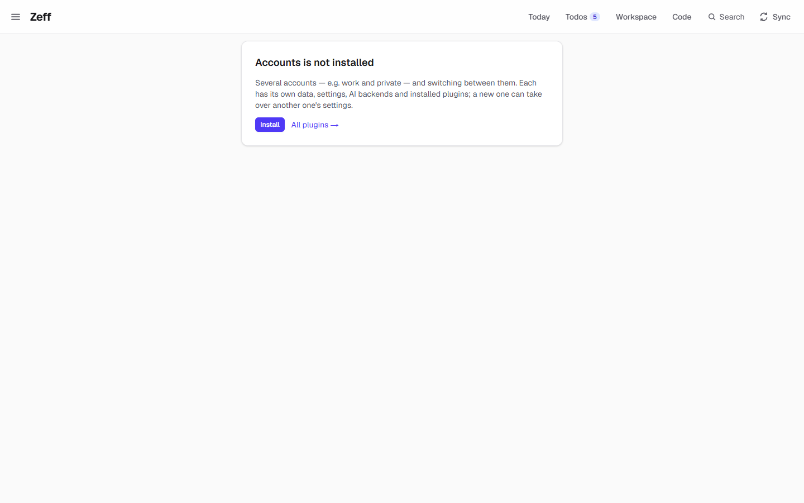
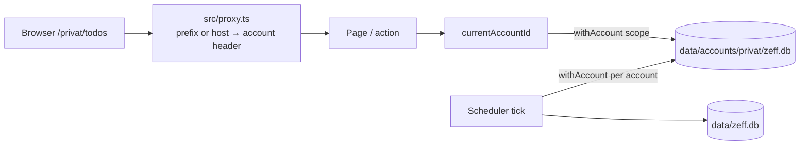

# Accounts

> Several Zeffs on one computer, for example work and private. Each has its own data, settings, AI backends and installed plugins, and you switch between them. **Category:** system · **On by default:** no · **Beta:** no · **Needs:** nothing

## For users

### What it does

Without this plugin, Zeff has one account: one database with your entries, todos, mails, people and settings. Accounts
lets you keep more than one, for example **Work** and **Private**. Each account is a Zeff of its own:

- its own **data**: entries, todos, mails, chats, the Workspace, the timeline;
- its own **settings**: AI backends, LLM instructions, report rules, working hours, the menu;
- its own **installed plugins**. A private account can have WhatsApp and Revolut, and a work account Jira and Chrono;
- its own **automation Chrome** (its own browser profile and sign-ins), unless you choose to share one;
- its own **knowledge server** if [Knowledge](knowledge.md) is installed;
- its own **backups**, made by its own [Backups](backup.md) settings.

All accounts keep running in the background. Each one syncs, briefs and backs up by its own schedule, whether you are
in it or not. Switching only changes which account the browser shows.

The demo shows the page before the plugin is installed. Installing it lists the first account, called *Default*, and
the *New account* form.

### Getting started

1. Open **Menu → Plugins** and install **Accounts**. You can also click **Install** on `/accounts`, as in the
   screenshot.
2. Open **Settings → Accounts** (`/accounts`). The list shows the first account, called *Default*.
3. Under **New account**, enter a name (for example "Private") and pick a colour. You can also choose an account under
   **Take over settings from**:
   - **none** gives an empty account with the default plugins;
   - **another account** copies its settings and configuration, but not its data. That covers settings, AI backends,
     LLM instructions, installed plugins, repos, boards, report rules, working hours, the calendar connection, the
     menu and the sync intervals. It copies no entries, todos or mails.
   - **Share the sign-ins** appears once you pick an account to copy from. The new account then uses that account's
     automation Chrome, where you are already signed in everywhere. Without it, the new account gets its own Chrome
     and you sign in again there.
4. Click **Create**. Zeff offers **Start setup**: the setup assistant switches to the new account and walks you through
   plugins, settings and sign-ins. At the end it fetches all the data and analyses it for the first time. **Later**
   skips that step for now.

### Using it

**Switching.** Once there is more than one account, the header shows an account chip next to the Zeff logo. Click it
to see all accounts and switch, or choose **Manage accounts…** to open `/accounts`. On the Accounts page, **Switch**
does the same. After switching, Zeff opens the new account's first tab, because each account can have different
plugins.

**Accounts side by side.** Every account also has a **route** of its own. The first account's pages are unprefixed
(`/workspace`), with `/standard/…` as an alias. Another account's pages are under its slug, for example
`/privat/workspace`. So you can keep each account open in its own browser tab at the same time. The link with the
account's route in the list opens it there. You can also give an account its own **host name**, such as
`privat.localhost`, as a fallback. (Google's sign-in clients do not accept wildcard sub-domains, which is why routes
are the main way.)

**Editing.** **Edit** on an account changes its:

| Field | What it does |
| --- | --- |
| Name | Shown in the list and the header chip; must be unique. |
| Colour | Indigo, emerald, amber, rose, sky or violet: the chip's colour. |
| Route | The slug its pages live under (`/<slug>/…`): lower-case letters, digits and dashes. It may not be one of Zeff's own top-level routes or another account's. Empty means the account's id. |
| Address (host name) | An optional host such as `privat.localhost` under which the account is served too. |
| Its workers may use this computer's setup | Whether [Code](work.md) workers in this account get Zeff's `.env` (its secrets, such as Jira or GitLab keys) and your own MCP servers. Off means they only reach this account's Zeff. The default is on for the first account and off for the others, so a private worker sees nothing of work. |

**Removing.** **Remove** takes an account off the list. Its folder (database and files) is *moved* to
`data/accounts/.deleted/<id>-<time>/`, not deleted. You cannot remove the first account or the one you are in.

### Settings

The plugin has no settings of its own beyond the per-account fields above. The Accounts page (`/accounts`) is its
settings page.

Uninstalling the plugin is only allowed once all accounts except the first are removed. Without the plugin, Zeff always
shows the first account.

### Tips & limits

- **Nothing is shared by accident.** Each account is a separate SQLite database. Agents get a token per account
  (`zm_…` for MCP, `zk_…` for the knowledge export). An agent working on a private todo gets the private token, and
  the work account's MCP endpoint refuses it.
- **Copying settings is a one-time copy.** Later changes in the original account are not carried over. To bring
  settings over later, use a config ZIP from [Backups](backup.md) ("Import configuration").
- **Sharing sign-ins** means both accounts drive the same automation Chrome. Logging out there logs out both.
- **Ports.** Each account other than the first gets its own automation Chrome debug port (from 9231 up; the first uses
  9222) and its own knowledge server port (from 9556 up; the first uses 9555).
- **The demo account** (sample data) never syncs, backs up or sends anything. "Send" there only says what it would
  have sent.
- Nothing leaves the machine through this plugin. The account list lives in `data/accounts.json`.

## Technical reference

### Overview

The **registry** (`data/accounts.json`, read and written by [src/db/accounts.ts](../../src/db/accounts.ts)) holds
the active account, whether the plugin is installed, and the list of accounts. The registry is kept in memory and read
again when the file changes. The web server, the sync host and scripts each keep their own copy. Writes always re-read
the file first (`fresh()`), so one process does not overwrite another's change.

**Which account a piece of code runs for** is decided by `currentAccountId()`, in this order:

1. the account set with `withAccount(id, fn)` (an `AsyncLocalStorage` scope), used by background work such as
   backups, syncs, copying settings and the scheduler's per-account loop;
2. the request's account: [src/proxy.ts](../../src/proxy.ts) maps the URL prefix (or host) to an account and sets a
   header, which is read synchronously from Next's request store;
3. the active account from the registry.

Every database access goes through this, so `getDb()` opens the right file: `data/zeff.db` for the first account and
`data/accounts/<id>/zeff.db` for the others. `inThisAccount(fn)` pins background work started by a click to the
account it was started in.

The installed state of the Accounts plugin itself is stored in the registry, not in an account's database, because it
applies to all accounts ([src/plugins/state.ts](../../src/plugins/state.ts)).

### Manifest

| Field | Value |
| --- | --- |
| id | `accounts` |
| category | `system` |
| order | 200 |
| defaultInstalled | `false` |
| dependsOn | none |
| settings | `/accounts`: "Create and switch accounts" |
| nav | `/accounts`: Accounts, "Switch & manage accounts" |
| routes | `/accounts` |
| syncSteps | none |
| features | none |

### Files

| File | What it does |
| --- | --- |
| [plugin.ts](../../src/plugins/accounts/plugin.ts) | The manifest. |
| [server-actions.ts](../../src/plugins/accounts/server-actions.ts) | Switch, create, update and remove (each checks that the plugin is on). |
| [AccountsManager.tsx](../../src/plugins/accounts/AccountsManager.tsx) | The list, edit form, "New account" form and "Start setup" prompt. |
| [AccountSwitcher.tsx](../../src/plugins/accounts/AccountSwitcher.tsx) | The account chip and menu in the header ([SiteHeader.tsx](../../src/components/SiteHeader.tsx)). |
| [src/app/accounts/page.tsx](../../src/app/accounts/page.tsx) | The `/accounts` page. |
| [src/db/accounts.ts](../../src/db/accounts.ts) | The registry: accounts, the active one, `withAccount`, per-account DB path, Chrome and knowledge ports, slugs and hosts. |
| [src/lib/accounts.ts](../../src/lib/accounts.ts) | Switching, creating (with a copied configuration) and removing an account. |
| [src/lib/account-routes.ts](../../src/lib/account-routes.ts) | Pure route logic: slugs, prefixes, reserved names (shared by proxy, server and browser). |
| [src/proxy.ts](../../src/proxy.ts) | Maps a request's prefix or host to an account. |
| [src/lib/account-tokens.ts](../../src/lib/account-tokens.ts) | Per-account tokens (`zm_`, `zk_`) derived by HMAC from one secret in `data/account-secret`. |
| [src/lib/sync/account-flags.ts](../../src/lib/sync/account-flags.ts) | Per-account "running" flags (mail sync, briefing run, mail review), so two accounts can run side by side. |

### Data

**`data/accounts.json`**: `{ active, installed, accounts: Account[] }`. Each `Account` has:

| Field | Meaning |
| --- | --- |
| `id` | A slug made from the name (`default` for the first account). |
| `name`, `color`, `createdAt` | As shown. |
| `chromePort` | Its automation Chrome's debug port (profile `chrome-<id>` in Zeff's user folder). |
| `knowledgePort` | Its knowledge server's port (data in `data/accounts/<id>/knowledge`). |
| `chromeFrom` | Another account whose Chrome (sign-ins) it uses. |
| `host`, `slug` | Its optional host name and route. |
| `workerSetup` | Whether its workers get this computer's `.env` and MCP servers. |
| `demo` | The sample-data account: nothing syncs or is sent. |

**Per account**: its folder `data/accounts/<id>/` holds `zeff.db` and its files (work logs, context files, backups by
default). **`data/account-secret`** holds the 32-byte secret behind the account tokens. Removed accounts are moved to
`data/accounts/.deleted/`.

When an account is created from another, `createAccount` copies the configuration tables of
[backup/config.ts](../../src/plugins/backup/config.ts) (`CONFIG_TABLES`). It also copies the preferences that count
as configuration (`menu`, `layout`, `auswerten`, `plugin:*`) and each sync's interval (`sync_state.every_minutes`).
It then resets the new account's `setupDoneAt`, so the setup assistant runs, and stores `setup:from`.

### Sync, jobs & AI tasks

None of its own. The scheduler ([src/lib/sync-scheduler.ts](../../src/lib/sync-scheduler.ts)) loops over all
accounts except the demo, inside `withAccount`, for backups, pipelines and syncs.

### MCP tools & actions

No tools or todo actions. The per-account MCP endpoint checks the bearer token with `bearerIs(header, "mcp", account)`.
The server actions are in [server-actions.ts](../../src/plugins/accounts/server-actions.ts): `switchAccountAction`,
`createAccountAction`, `updateAccountAction` and `deleteAccountAction`.

### Extension points

It provides no point. Other code takes part through `withAccount`, `currentAccountId` and `accountFlag` /
`setAccountFlag`. `accountChrome()` (each account's automation Chrome, used by browser drivers) and `accountKnowledge()`
(used by [Knowledge](knowledge.md)) live in [src/db/accounts.ts](../../src/db/accounts.ts).

### Tests

| Test | What it covers |
| --- | --- |
| [tests/accounts.test.ts](../../tests/accounts.test.ts) | An account made from another: settings copied, Chrome shared, setup to come. |
| [tests/account-routes.test.ts](../../tests/account-routes.test.ts) | Prefixes, slugs and reserved names. |
| [tests/account-hosts.test.ts](../../tests/account-hosts.test.ts) | Accounts side by side at their own host names. |
| [tests/account-pinning.test.ts](../../tests/account-pinning.test.ts) | Background work stays in the account it was started in. |
| [tests/mcp-account.test.ts](../../tests/mcp-account.test.ts) | The MCP endpoint per account and its tokens. |

Run one: `node --import tsx --test tests/accounts.test.ts`.
