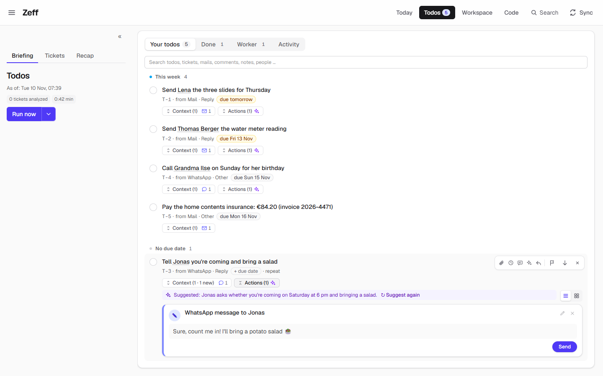
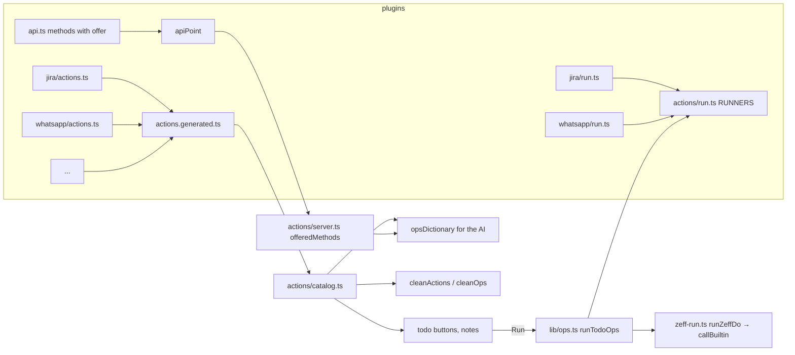

# Actions

> The shared mechanism behind every one-click button on a todo (and on Workspace rows): extensions contribute *actions* — send a WhatsApp message, post a Jira comment, open a mail draft, hand a todo to a worker, "Do in Zeff" — and the core gathers them into one catalog for the buttons, the AI's dictionary, the validation and the runner. **Category:** core mechanism (not a switchable extension) · **On by default:** always there · **Beta:** no · **Needs:** —

## For users

### What it does

A todo in Zeff can carry **actions**: concrete, finished steps that do it — "Send WhatsApp message to Lena: …", "Post
Jira comment on PROJ-415", "Meeting in Outlook, Thursday 10:00, 30 min", "Hand to Copilot: …". They come from three
places:

- the AI — the briefing and the [Auto actions](auto-actions.md) step propose them for each open todo;
- workers and delivery steps — a worker's result can leave a *Push branch* or *Open merge request* for you;
- you — editing an action or adding one.

Actions is not something you switch on. It is the place where all extensions put what they can do with one click, so
that every extension's actions look the same, are checked the same way, and can be proposed by the AI only while their
extension is installed.

The actions available today, by extension:

| Action | Extension | How it runs |
| --- | --- | --- |
| Change Jira status, Assign Jira ticket, Post Jira comment, Create Jira ticket | Jira | Zeff runs it |
| Reply to GitLab comment, Resolve GitLab thread | GitLab | Zeff runs it |
| Open merge request, Merge merge request | GitLab | Zeff runs it (delivery step) |
| Send Teams message | Teams | Zeff runs it |
| Mail draft in Outlook, Meeting in Outlook | Outlook mail / calendar | Opens pre-filled in your browser |
| Hand to Copilot (work instruction), Push branch, Commit changes, Merge into the main branch | [Work](work.md) | Zeff runs it (the last three: delivery steps) |
| Create note | Workspace (Keep notes extension) | Zeff runs it |
| Send WhatsApp message | WhatsApp | Zeff runs it |
| Send Signal message | Signal | Zeff runs it |
| Write mail (Gmail) | Gmail | Opens Gmail's compose window (or sends through Gmail's API from its own button, with write access) |
| Write mail (E-Mail) | IMAP mail | Opens a `mailto:` draft |
| Event in the Zeff calendar | Calendar | Zeff runs it |
| Event in Google Calendar | Google Calendar | Opens pre-filled (or enters it through the API from its button) |
| Pay with Revolut | Revolut | Opens a Revolut payment link |
| Transfer (GiroCode) | Cases | Opens Zeff's `/pay` page with a GiroCode |
| Create todo | [Todos](todos.md) | Zeff runs it |
| Do in Zeff | (Zeff's own) | Runs an API method an extension offers — see below |

### Getting started

Nothing to set up. Install the extensions whose actions you want (Menu → Plugins); their actions become available —
offered to the AI and runnable — while the extension is installed (an action of an extension's *feature*, like Keep's
*Create note*, while that feature is on).

### Using it

In the demo, the todo *Tell Jonas you're coming and bring a salad* (from WhatsApp) carries the action *WhatsApp
message to Jonas* — "Sure, count me in! I'll bring a potato salad" — with a *Send* button that Zeff runs itself, while
*Send Lena the three slides* carries a mail that opens in Gmail.

**Run a todo's actions.** On the Todos page a todo with actions shows *Actions (n)*. Each action shows a heading (what
and where), a line under it (recipient, ticket, time) and its text. Run all of them, or only one. Actions that open in
your browser (mail drafts, Outlook meetings, Gmail, Google Calendar, Revolut, GiroCode) stay on the todo and open
pre-filled for you to finish and send. The others run in Zeff, in order, each noted on the todo as it is done (✓ …);
at the first that fails it stops — the ones already done are taken off, so a retry doesn't do them twice.

**When an action finishes the todo.** A message, reply or comment (`comms`) that was the todo's whole point — you owed
an answer, a comment, a clarification — closes the todo once nothing else is left on it.

**Edit, mark done, dismiss.** Each action card has ✎ (edit the text before it runs), ✓ for an action you finished
yourself in the browser ("Done: the mail is sent — note it on the todo"; for a payment "the todo is done") and ✕
("Dismiss — takes the action off the todo, without a note").

**Workspace rows.** A row of the Workspace (a mail, a person, a case) can carry the same actions; its buttons run them
the same way ([Workspace](workspace.md)).

#### Do in Zeff

*Do in Zeff* is the one generic action. An extension can let the AI propose any of its API methods by adding an
*offer* to it — then a sentence like "from now on, name the branches after the code change, not the ticket title" in a
chat, a mail or a ticket can become an action *Adjust the AI step "Branch names"* on the todo, with the new
instructions written as an adjustment of the current ones. One click runs the method.

Methods offered today:

| Method | Extension | What it does |
| --- | --- | --- |
| `llm.steps.update` | [LLM](llm.md) | Changes the instructions and numbers of an AI step (briefing, mail review, branch names …). |
| `todos.add` | [Todos](todos.md) | Adds a todo. |
| `workspace.rows.add`, `workspace.rows.update` | [Workspace](workspace.md) | Adds or changes a database row by names. |
| `workspace.pages.create`, `workspace.pages.append` | [Workspace](workspace.md) | Creates a page or writes onto one. |
| `workspace.routines.run` | [Workspace](workspace.md) | Runs a routine. |
| `workspace.signals.send` | [Workspace](workspace.md) | Sends a signal. |
| `workspace.dossier.compile` | [Workspace](workspace.md) | Compiles a dossier. |

When the action runs, the method is checked again against what is offered *then* — if its extension was uninstalled
meanwhile, the action fails with "not offered".

### Settings

None of its own. Which actions exist depends on the installed extensions; which the AI proposes is up to
[Auto actions](auto-actions.md) and the briefing.

### Tips & limits

- **Nothing runs without your click.** The AI only proposes actions; running them is always you (or a worker you
  started).
- **What an AI proposes is checked:** each action's own `clean` rule drops incomplete proposals; at most six per todo;
  only actions of installed extensions survive.
- **Demo:** in the demo account no action really runs — it says what it would have done ("Demo — not really done: …").
- Your clicks are logged (the last 2000) — the timeline reads them as your actions.
- An action that opens in the browser is never run by *Run*: it waits for you to open it.

## Technical reference

### Overview

Each plugin describes its actions client-safe in an actions file (`export const <NAME>_ACTIONS = [action({...})]`) and
extends the operation union with `declare module "@/lib/todos/shared" { interface TodoOpMap { "<type>": {...} } }`.
`npm run plugins:index` collects the lists into [actions.generated.ts](../../src/plugins/actions.generated.ts);
[catalog.ts](../../src/plugins/actions/catalog.ts) orders them by the contributing plugin's `actionsOrder` (Jira 10,
GitLab 20, Teams 30, Outlook mail 40, Outlook calendar 50, Work 60, Workspace 70, WhatsApp 80, Signal 90, Gmail 100,
IMAP 105, Calendar 110, others 1000) — the AI's dictionary order.

An `ActionSpec` ([types.ts](../../src/plugins/actions/types.ts)) has: `type`, `plugin`, `label` and `verb` (English,
translated through [catalog-text.ts](../../src/plugins/catalog-text.ts)), an optional `offer` for the AI (`when`,
`fields`, `example`, `needs`), `clean` (what an AI handed over → a complete op or null), `title` and `note` (how it
reads), optional `href` (runs in your browser instead), `comms` (doing it is doing the todo) and `delivery` (a delivery
step).

How they run on the server: [run.ts](../../src/plugins/actions/run.ts) maps types to the plugins' runners (`RUNNERS`);
[lib/ops.ts](../../src/lib/ops.ts) `runTodoOps` / `runTodoOpsNow` run a todo's ops in order (Jira's in one session),
skip the `href` ones, write back the todo's *current* ops minus the ones done, stop at the first failure;
`runRowOp` / `runConvOp` run one action from a Workspace row or conversation. Actions with their own buttons that call
an API (Gmail send, Google Calendar insert) settle through [clicked.ts](../../src/plugins/actions/clicked.ts):
`clickedOp` checks the action is still on the todo, `settleClickedOp` takes it off, notes "✓ …", logs the click, records
an *accepted* verdict when [Auto actions](auto-actions.md) proposed it, and closes the todo when it was a reply.

Availability: `opAvailable(type)` ([plugins/ops.ts](../../src/plugins/ops.ts)) — the contributing plugin installed and,
for an extension's action, the extension on. `opsDictionary(opAvailable)` ([lib/todos/shared.ts](../../src/lib/todos/shared.ts))
renders the AI's dictionary from the offers, plus the extra lines `actions/server.ts` sets for offered API methods.

**Do in Zeff** ([zeff-do.ts](../../src/plugins/actions/zeff-do.ts), [server.ts](../../src/plugins/actions/server.ts),
[zeff-run.ts](../../src/plugins/actions/zeff-run.ts)): the op `zeff-do` = `{ method, args, title, body }`. On the server,
`offeredMethods()` reads every installed plugin's API methods with an `offer` from the `apiPoint` registry;
`setZeffDoCheck` validates an AI proposal with the method's `offer.check` and fills title/body from `offer.describe`;
`setOpsDictionaryExtras` adds one dictionary line per method; `offerContext({ ticket, text })` collects each method's
`offer.context` lines (e.g. the current step instructions, boards, knowledge hits) for the AI and for agents.
`runZeffDo` re-checks the method and runs it through `callBuiltin("auto-actions", method, params)`.

### Manifest

None — `src/plugins/actions/` has no `plugin.ts`; it is core code shared by all plugins. Plugins contribute through
their own manifests' `actionsOrder` and their actions files.

### Files

| File | What it is |
| --- | --- |
| [actions/types.ts](../../src/plugins/actions/types.ts) | `ActionSpec`, `ActionNote`, `CleanContext`, helpers (`str`, `ticketKey`, `noteId`), `action()`. Client-safe. |
| [actions/catalog.ts](../../src/plugins/actions/catalog.ts) | `ACTIONS` (ordered), `actionOf`, `OFFERED_ACTIONS`, `cleanActions`, `actionHref`. Client-safe. |
| [actions/run-types.ts](../../src/plugins/actions/run-types.ts) | `ActionResult`, `ActionContext`, `ActionRunner`, `NextTodo`. |
| [actions/run.ts](../../src/plugins/actions/run.ts) | `RUNNERS`: op type → plugin runner. Server only. |
| [actions/clicked.ts](../../src/plugins/actions/clicked.ts) | Settling an action its own button ran; the `action_clicks` log. |
| [actions/zeff-do.ts](../../src/plugins/actions/zeff-do.ts) | The `zeff-do` op type and action (`ZEFF_ACTIONS`). |
| [actions/server.ts](../../src/plugins/actions/server.ts) | `offeredMethods`, the check, the dictionary extras, `offerContext`. |
| [actions/zeff-run.ts](../../src/plugins/actions/zeff-run.ts) | `runZeffDo`. |
| [actions.generated.ts](../../src/plugins/actions.generated.ts) | Generated list of all plugins' action lists. |
| [plugins/ops.ts](../../src/plugins/ops.ts) | `opAvailable`. |
| [lib/ops.ts](../../src/lib/ops.ts) | `runTodoOps`, `runTodoOpsNow`, `runRowOp`, `runConvOp`. |
| [lib/todos/shared.ts](../../src/lib/todos/shared.ts) | `TodoOpMap`, `TodoOp`, `opPlugin`, `opsDictionary`, `cleanOps`. |
| [lib/plugins/api-kit.ts](../../src/lib/plugins/api-kit.ts) | `ApiOffer` — how a method is offered to the AI. |

### Data

| Where | What |
| --- | --- |
| `todos.ops` | JSON array of the todo's ops (`TodoOp`). |
| `todos.auto_ops_why` | Set when [Auto actions](auto-actions.md) proposed them. |
| `action_clicks` (made on first use) | `at`, `todo_id`, `type`, `what`, `op` — the last 2000 clicks. |

### Sync, jobs & AI tasks

None of its own. The dictionary it builds is used by the briefing (`ticket-lage`) and [Auto actions](auto-actions.md).

### MCP tools & actions

- MCP tool **`zeff_actions`** ([src/mcp/tools/knowledge.ts](../../src/mcp/tools/knowledge.ts)) — "What Zeff can be told
  to do — and what is set now": the offered methods with their fields and, for a `query`/`ticket`, the `offerContext`
  lines. Read-only. In the Workspace chat it is part of the tool group *Search what Zeff knows*.
- Server actions in the Todos plugin: `runTodoOpsAction` (run all or some), plus each plugin's own button actions.

### Extension points

- **Actions** — a plugin adds `export const <NAME>_ACTIONS = [action({ type, plugin, label, verb, offer?, clean, title, note, href?, comms?, delivery? })]`
  in its folder, the op type to `TodoOpMap`, a runner (its `run.ts`, listed in `RUNNERS`) unless it has an `href`, and
  `actionsOrder` in its manifest; then `npm run plugins:index`. The actions file must stay client-safe
  (tests/generated-actions-clientsafe.test.ts).
- **Context for the AI** — `offer.needs: { match, context: ["ticket.description"] }` asks the review to add context to
  matching todos.
- **Offered API methods** — any API method with an `offer` (`label`, `when`, `fields`, `example`, `check`, `describe`,
  `context?`) becomes proposable as *Do in Zeff*; see [docs/plugin-system.md](../plugin-system.md).

### Tests

| Test | Covers |
| --- | --- |
| [tests/zeff-do.test.ts](../../tests/zeff-do.test.ts) | An instruction becomes a `zeff-do` that adjusts an AI step on a click. |
| [tests/workspace-api-offers.test.ts](../../tests/workspace-api-offers.test.ts) | Workspace methods offered as `zeff-do`, from a row too. |
| [tests/ops-run.test.ts](../../tests/ops-run.test.ts) | Running one action; changes meanwhile kept; failures stay. |
| [tests/generated-actions-clientsafe.test.ts](../../tests/generated-actions-clientsafe.test.ts) | The actions files have no server-only imports. |
| [tests/push-ops.test.ts](../../tests/push-ops.test.ts), [tests/comment-ops.test.ts](../../tests/comment-ops.test.ts) | Delivery and GitLab comment ops. |
| [tests/google-writes-clicks.test.ts](../../tests/google-writes-clicks.test.ts) | Gmail / Google Calendar buttons settling their action. |
| [tests/plugin-index.test.ts](../../tests/plugin-index.test.ts) | The generated action list is current. |

Run one: `node --import tsx --test tests/zeff-do.test.ts`.
