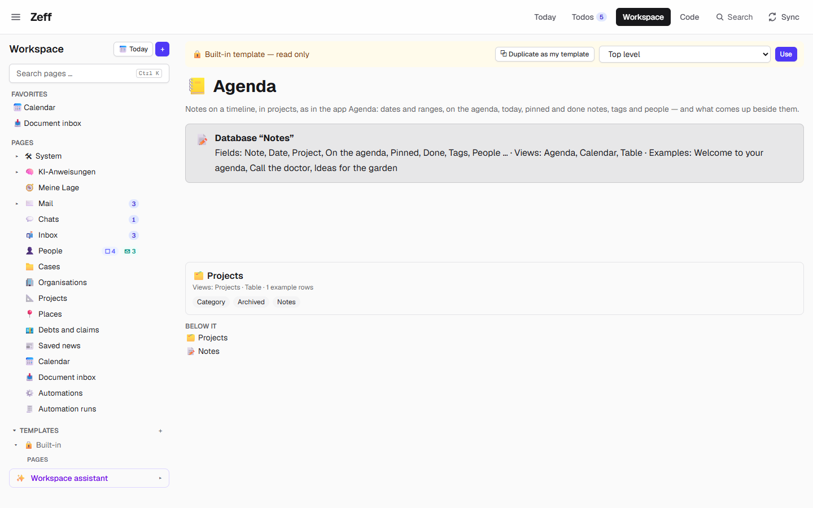
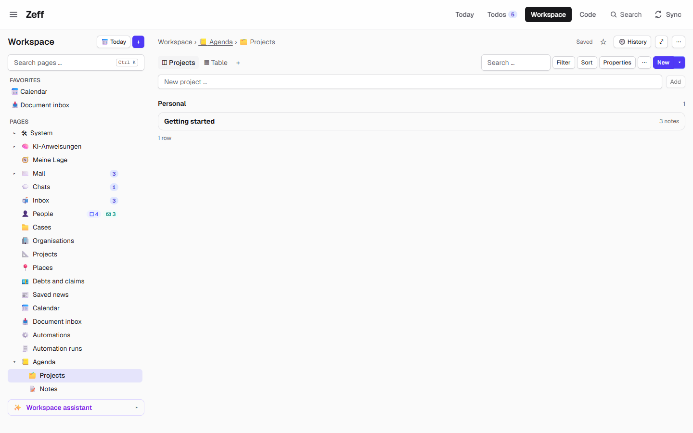

# Agenda

> Notes on a timeline, in projects, like the app *Agenda*: each note has a date or a range, can be put on the agenda, pinned and marked done, and has tags, people and a page of its own. **Category:** app · **On by default:** no · **Beta:** no · **Needs:** [Workspace](workspace.md). Uses [People](people.md) and [Calendar](calendar.md) when they are installed.

## For users

### What it does

Some notes belong to a day: "Call the doctor" tomorrow, the minutes of a meeting, ideas you want to come back to next
week. Agenda keeps such notes **on a timeline** and **in projects** (Personal, Family, Home, Work …). Each note:

- has a **date** (or a range from–until), or none;
- can be put **on the agenda** (●) — what matters now —, **pinned** (📌) to stay on top, and marked **done** (✓);
- has **tags** and **people**;
- can have a **reminder**: on that day the note is a todo in [Todos](todos.md) and on Today;
- can link to an **event** of the calendar;
- has a page of its own for text, checklists, tables, pictures and links to other notes. Its checklists become Zeff todos too.

Agenda is a Workspace template, so the notes are a normal Workspace database: you can also look at them as a calendar or
a table, filter, and use them in automations.

### Getting started

1. **Menu → Plugins → Agenda** to install it (it installs the [Workspace](workspace.md) if needed).
2. In the Workspace, start it from the template: on the Workspace start page under **Start from a template** pick
   **Agenda** (the template opens at `/workspace/templates/agenda`). The preview shows what will be made; **Use** makes it.
3. You get a page **Agenda** (📒) with two databases: **Projects** (🗂️, with a *Category* and *Archived*) and **Notes** (📝).
   A first project "Getting started" and three example notes show what a note can be: "Welcome to your agenda" (on the
   agenda and pinned), "Call the doctor" (tomorrow, with a checklist) and "Ideas for the garden" (no date).

The field names are made in your UI language. If you made an Agenda with an older version of the plugin, it is brought up
to date the next time you open it: the *Reminder* field and an *Event* link to the calendar are added, and the screen is
redrawn (only if you hadn't changed it yourself).

### Using it

**The notes screen.** The Agenda's first view has three parts:

- **Left — the overviews:** *All notes*, *On the agenda*, *Today*, *Coming up*, *Reminders*, *Done*, each with a count, and
  below them the **projects by category** with their open notes (archived projects and projects whose notes are all done
  are left out). Click one to narrow the list.
- **Middle — the notes as a timeline**, newest date first, pinned ones on top, 30 at a time (*Show more*). Search notes,
  *Show done ones*, and filter by tag or person (the chips appear once notes have tags or people). Each note shows its
  title (struck through when done), project, tags, people, reminder, event and the first lines of its text, with the buttons
  **○ On the agenda**, **○ Done**, **📌** and **Open**.
- **Right — at a glance:** what is *On the agenda* (tick ✓ to finish it), *Today in the calendar* (today's events from the
  Calendar database), the next six *Reminders* and the next eight notes *Coming up*.

**A new note.** Type a title into **New note …** above the list for a quick one, or use the toolbar's **New** for the form:
title, **Dated** with a date or a range (*Until*), quick picks *Today / Tomorrow / In a week*, the project, *On the agenda*,
*Pin to the top*, a **⏰ Reminder** ("On that day the note is a todo — in Todos and Today."), tags (pick existing ones or
type new ones separated by commas) and the note's text (`- [ ]` makes a checklist). **Ctrl+Enter** saves.

**Projects.** The *Projects* database has its own screen: the projects grouped by category with their number of notes,
and a field to add one. Tick *Archived* to hide a project from the Agenda.

**Other views.** The Notes database also has a **Calendar** view (by the note's date) and a **Table** view (newest first).

### Settings

Agenda has no settings page. What you can change:

| Where | What it changes |
| --- | --- |
| Menu → Plugins → Agenda | Installs it; without it the template isn't offered. Existing Agenda pages stay, as Workspace databases. |
| The Notes database's fields | You may rename fields; the screen finds them by name, otherwise by kind (first date, relation, checkboxes in order). |
| The view's template (⋯ → *Code*) | The screen is a Workspace view template; once you change it, upgrades leave it as it is. |
| Projects → *Category* options | Your own categories (the defaults are Personal, Family, Home, Work). |

### Tips & limits

- **Everything stays local**: it is a Workspace database in Zeff's SQLite file. No AI is involved in Agenda itself;
  the Workspace assistant and agents can read and write the notes like any other database, within the database's
  sensitivity.
- **People** is a person field (your [People](people.md) contacts) when People is installed, otherwise a multi-select of names.
- The **Event** link and *Today in the calendar* need the Calendar's Workspace database; without it they are left out.
- The example note's checklist is switched off as todos on purpose; your own checklists do become todos.
- The template makes one Agenda each time you use it; there is no merging of two Agendas.

## Technical reference

### Overview

Agenda is a thin plugin on top of the Workspace. `template.ts` builds the page with two databases (Projects; Notes with
`dataType: "agenda"`) and seeds them. The notes' main view is an **app view** `agenda` whose template is written in the
Workspace's view-template language (`view-template.meta.ts`: `<nav>`, `<panes>`, `<timeline>`, `<facets>`, `<quickadd>` …),
plus one part of its own, `agenda.new` (the new-note form in `ui/view-parts.tsx`), and app data (`data.ts`: projects by
category with open counts, and today's events from the Calendar database).

`upgrade.ts` (`ensureAgenda`) brings any Agenda database to the current shape when its data is loaded: it finds the
fields by name or kind, adds *Reminder* (date with time) and *Event* (relation to the Calendar database), sets the data
type, sets the database's **todo list** settings (`done` = Done, `due` = Reminder, `engine: true, dated: true`) so that
notes with a reminder and their checklists flow into Zeff's todos through the Workspace's todo engine, and redraws the
screen when it is one of an older `AGENDA_VERSION`.

### Manifest

| Field | Value |
| --- | --- |
| id | `agenda` |
| category | `app` |
| order | 268 |
| defaultInstalled | `false` |
| dependsOn | `workspace` |
| tabs, routes, settings, syncSteps, features | none — it lives in the Workspace (template `agenda`, app view `agenda`) |

### Files

| File | What it does |
| --- | --- |
| [plugin.ts](../../src/plugins/agenda/plugin.ts) | The manifest. |
| [template.ts](../../src/plugins/agenda/template.ts) | `agendaPage()`: the Agenda page, Projects and Notes databases, the projects screen, the example notes. |
| [view-template.meta.ts](../../src/plugins/agenda/view-template.meta.ts) | `AGENDA_VIEW`: the notes screen template (`agendaScreen`), field names (`agendaNames`), `AGENDA_VERSION`. |
| [upgrade.ts](../../src/plugins/agenda/upgrade.ts) | `ensureAgenda` / `ensureAgendas`: bring an Agenda database up to date; `isAgendaDb`. |
| [data.ts](../../src/plugins/agenda/data.ts) | `agendaData`: projects by category with open notes, today's calendar events. |
| [server-actions.ts](../../src/plugins/agenda/server-actions.ts) | `addAgendaNoteAction` (a note with fields, new tags and text in one undoable step), `agendaDataAction`. |
| [ui/view-parts.tsx](../../src/plugins/agenda/ui/view-parts.tsx) | The `agenda.new` form, the screen's data hook, the toolbar's New. |
| [workspace/templates.ts](../../src/plugins/workspace/templates.ts) | Registers the template `agenda` (offered while the plugin is installed). |
| [workspace/view-apps.ts](../../src/plugins/workspace/view-apps.ts), [workspace/app-views.ts](../../src/plugins/workspace/app-views.ts) | Register the app view `agenda` for `dataType: "agenda"`. |

### Data

No tables of its own. It makes Workspace pages (`ws_pages`):

| Database | Fields |
| --- | --- |
| Projects | title *Project*; *Category* (select: Personal, Family, Home, Work); *Archived* (checkbox); *Notes* (back-relation). Views: *Projects* (template), *Table*. |
| Notes (`dataType: "agenda"`) | title *Note*; *Date* (date or range); *Project* (relation); *On the agenda*, *Pinned*, *Done* (checkboxes); *Tags* (multi-select); *People* (person, or multi-select without People); *Reminder* (date with time); *Event* (relation to the Calendar database, if there is one). Views: *Agenda* (app), *Calendar*, *Table*. `todoList`: done = Done, due = Reminder. |

A note's text is the row's page content.

### Sync, jobs & AI tasks

None of its own. Notes with a reminder and checklist items become todos through the Workspace's todo engine
(`workspace/todo-engine.ts`, `syncDatabase`), which `agendaData` calls after an upgrade.

### MCP tools & actions

No MCP tools or actions of its own. Agents use the Workspace tools on the Notes database (`workspace_query_database`,
`workspace_add_row`, `workspace_update_row` …; see [Workspace](workspace.md)). Server actions: `addAgendaNoteAction`,
`agendaDataAction`. No API routes.

### Extension points

- Contributes a **template** to the Workspace's template catalog (`agenda`, offered while installed).
- Contributes an **app view** (`AGENDA_VIEW`: part `agenda.new`, action `agenda.new`, app data `app.projects`, `app.events`)
  to the Workspace's view apps.
- Reads the [Calendar](calendar.md)'s Workspace database (`dataType: "calendar"`) and uses [People](people.md)'s person field.

### Tests

[tests/workspace-agenda.test.ts](../../tests/workspace-agenda.test.ts): the page with projects and notes and its screen's
scopes; checklists becoming todos (and the switched-off example staying out); todo marks; upgrading an older Agenda
(type, reminder, screen; a note with a reminder is a todo of that day).

Run it: `node --import tsx --test tests/workspace-agenda.test.ts`.
