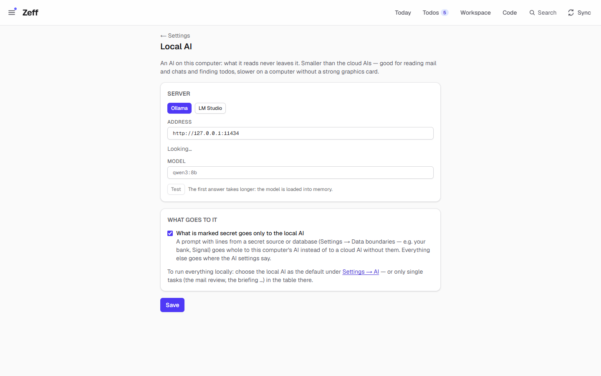

# AI backends

> The AIs Zeff's [LLM](llm.md) layer can talk to — Claude Code, ChatGPT through OpenAI's Codex CLI, GitHub Copilot CLI, and a model on this computer (Ollama, LM Studio) — each an extension of its own. **Category:** AI · **On by default:** GitHub Copilot CLI yes; Claude CLI, ChatGPT and Local AI no · **Beta:** no · **Needs:** [LLM](llm.md)

## For users

### What it does

Zeff does not ship an AI of its own. It drives AI tools you already have and are signed in to — the same command-line
programs you would use in a terminal — or a model running on your own computer. Each of these is a small extension:

| Extension | id | What it uses | Signs in with | Good for |
| --- | --- | --- | --- | --- |
| [Claude CLI](#claude-cli) | `claude-cli` | Anthropic's Claude Code (`claude`) | Your Claude login | Analyses (Sonnet is fast for the briefing), workers and live sessions on the Code tab, web search for the [Web search](web-search.md) extension |
| [ChatGPT (Codex CLI)](#chatgpt-codex-cli) | `codex-cli` | OpenAI's Codex CLI (`codex`) | Your ChatGPT account (`codex login`) | Analyses; workers as live sessions |
| [GitHub Copilot CLI](#github-copilot-cli) | `copilot-cli` | GitHub's Copilot CLI (`copilot`) | `copilot` → `/login` or a `GH_TOKEN` | Analyses; interactive workers (permissions, questions and modes on the Code tab) |
| [Local AI](#local-ai-ollama-lm-studio) | `local-ai` | Ollama, LM Studio, llama.cpp or any OpenAI-compatible server on this computer | Nothing — no account | Everything without a byte leaving the PC; or only what you marked secret |

Which backend runs what is set in the [LLM](llm.md) extension: one default backend for everything, and optionally a
backend and model of its own per task (e.g. the mail review on the local model, the briefing on Claude).

### Getting started

1. Install the tool on this computer and sign in once (see each section below).
2. Menu → Plugins → category *AI*: switch the backend's extension on. GitHub Copilot CLI is on by default.
3. Settings → AI → *Backends*: each installed backend shows *installed* (its program was found) or *not found* (with how
   to install it), a model picker and a **Test** button. Test sends the prompt "answer with ok = true" and shows the
   answer time, the model and — for Claude — the cost.
4. Pick the default backend there and press *Save*. If the chosen backend's extension is switched off later, Zeff falls
   back to the first installed one.

### Using it

Once a backend is set up there is nothing to do day to day: the briefing, the mail review, the auto actions and the
other AI tasks run through it on their own. Where you see the backend:

- **Settings → AI** — the default backend and its model, the per-task table ([LLM](llm.md)), *Usage & cost* by model.
- **Code tab** ([Work](work.md)) — the workers: Claude, Copilot and ChatGPT can each work on a todo in a repository.
  Claude and ChatGPT run there as *live sessions* (a conversation you can follow, answer and steer); Copilot as an
  interactive ACP session. See [Work](work.md) for the sessions themselves.
- **Privacy → What went to the AI** — which backend and model each prompt went to.

#### Claude CLI

Anthropic's Claude Code as Zeff's AI. Requires the Claude CLI (`claude`), signed in.

- **Install:** `npm install -g @anthropic-ai/claude-code`, then start `claude` once and sign in (your Claude login).
- **Models:** Default (the CLI's own), *Opus — most thorough*, *Sonnet — quick* (the default; a board briefing takes about
  45 s), *Haiku*.
- **Analyses** run as `claude -p` with JSON output against a JSON schema, closed: no tools, no MCP servers, no settings
  (so no hooks), no session kept, in an empty temporary folder. Only for reading a picture or a PDF does a run get the
  Read tool on one folder; only the [Web search](web-search.md) extension's search gets Claude's own web search tool.
- **Cost:** Claude reports the cost of each answer; Zeff shows it in *Usage & cost*. A task may set a budget; Claude
  honours it (`--max-budget-usd`).
- **Workers and live sessions:** on the Code tab Claude Code runs as you know it (stream-json in and out), with its
  permission modes — *Ask*, *Edits*, *Auto*, *Plan*, *Don't ask*, *Bypass* — model and effort switchable mid-session.
  It runs under a host outside Zeff's server, so a restart or deploy doesn't end it. See [Work](work.md).
- If Zeff does not find the CLI, set the environment variable `CLAUDE_CLI` to the full path of `claude.exe`.

#### ChatGPT (Codex CLI)

ChatGPT as Zeff's AI through OpenAI's Codex CLI, signed in with your ChatGPT account.

- **Install:** `npm install -g @openai/codex`, then `codex login` once.
- **Models:** the ones the CLI offers your account (`codex debug models`, read locally once an hour); default
  `gpt-6-luna`, or empty for ChatGPT's default.
- **Analyses** run as `codex exec --json` in a read-only sandbox, with none of your Codex configuration (no MCP
  servers, no rules), ephemeral (no session kept), in an empty temporary folder; the answer is held to a strict JSON
  schema. "Not signed in" (an HTTP 401) is reported as such.
- **Workers** with ChatGPT only run as live sessions (`codex app-server`): switch on Code settings → *Live sessions*.
  Without them a worker task set to ChatGPT goes to Claude or Copilot instead. Modes: *Ask*, *Auto*, *Read only* and —
  only when "Bypass may be picked" is on — *Full access*. On Windows, *Auto* needs Codex's Windows sandbox; without it
  every command asks, as in *Ask*.
- If Zeff does not find the CLI, set `CODEX_CLI` to its `.js` entry or program.

#### GitHub Copilot CLI

GitHub Copilot as Zeff's AI — the extension that is on by default.

- **Install:** `npm install -g @github/copilot`, then start `copilot` once and run `/login` (or set a `GH_TOKEN`).
- **Models:** the choices `copilot help config` lists (asked once an hour; nothing is sent), *Auto — Copilot picks*, or
  empty for Copilot's default. The picker groups them by family (Claude, GPT, Gemini, other).
- **Analyses** run as `copilot -s --no-ask-user` with the prompt on stdin and the JSON schema appended in words; without
  `--allow-all-tools` it can use no tools. An answer without JSON is asked for once more.
- **Prompt size:** Zeff keeps Copilot's prompts within 28 000 characters (`COPILOT_MAX_PROMPT`) and batches longer jobs
  (auto actions, matching) to fit.
- **Workers** run interactively as an Agent Client Protocol server (`copilot --acp`): what it does goes into the run's
  log as it happens; when it wants to do something not yet allowed it asks, and the question waits on the Code tab
  (and notifies you). Modes: *Agent*, *Plan*, *Autopilot*. Code settings decide whether Copilot workers run
  *interactive*, *autopilot* or *headless*.
- If Zeff does not find the CLI, set `COPILOT_CLI` to its `.js` entry or program.

#### Local AI (Ollama, LM Studio)

An AI that runs on this computer — Ollama, LM Studio, llama.cpp or any server with an OpenAI-compatible API. Nothing
leaves the machine.

1. Install [Ollama](https://ollama.com) and fetch a model in a terminal, e.g. `ollama pull qwen3:8b` (about 5 GB; with
   16 GB of memory or more `qwen3:14b`). Or start LM Studio's local server.
2. Switch on *Local AI (Ollama, LM Studio)* in Menu → Plugins.
3. Open **Settings → Local AI** (`/settings/local-ai`, also linked from the Local AI card on Settings → AI as "Address,
   model and what goes to it →"). The buttons *Ollama* and *LM Studio* fill in their usual address (Ollama's
   `http://127.0.0.1:11434` is the default, LM Studio's is port 1234); the page asks the server at the address
   ("Looking…") and lists the models it finds — or, when nothing answers, shows how to get started with Ollama. Pick one and press **Test** — the first answer takes longer while
   the model is loaded into memory. *Save*.
4. Decide how to use it:
   - **Only for what is secret** (on by default): *What is marked secret goes only to the local AI*. A prompt containing
     lines from a source or database labelled *secret* (Settings → Data boundaries — e.g. your bank, Signal) goes whole
     to the local AI instead of to a cloud AI with those lines removed. Everything else goes where the AI settings say.
   - **For single tasks:** pick *Local AI* as the backend of a task in the table on Settings → AI.
   - **For everything:** choose *Local AI* as the default backend on Settings → AI. Workers still go to a CLI backend —
     the local AI answers prompts, it doesn't work in a repository.

### Settings

| Setting | Where | Backend | What it changes |
| --- | --- | --- | --- |
| Default backend | Settings → AI → Backends | all | Which backend every task uses unless the task has its own ([LLM](llm.md)). |
| Claude model | Settings → AI → Backends | Claude | Default / Opus / Sonnet / Haiku. Default: Sonnet. |
| Copilot model | Settings → AI → Backends | Copilot | A model id (`claude-sonnet-4.5`, `gpt-5.4` …), *Auto*, or empty. |
| ChatGPT model | Settings → AI → Backends | ChatGPT | A model id the CLI lists, or empty. Default: `gpt-6-luna`. |
| Address | Settings → Local AI | Local | The server's address (http/https; only scheme, host and port are kept). Default `http://127.0.0.1:11434`. |
| Model | Settings → Local AI | Local | The model; empty = the first the server lists. |
| What is marked secret goes only to the local AI | Settings → Local AI | Local | On (default): prompts with secret lines go whole to the local AI. Off: those lines are left out and the prompt goes to the task's backend. |
| Live sessions, Copilot worker mode, Bypass may be picked | Code settings | Claude, ChatGPT, Copilot | How workers run — see [Work](work.md). |
| `CLAUDE_CLI`, `CODEX_CLI`, `COPILOT_CLI` | Environment | CLIs | Where the program is, when Zeff can't find it on the PATH. |

### Tips & limits

- **What leaves the machine:** with the three CLI backends, the prompt (with your instructions and context) goes to
  Anthropic, OpenAI or GitHub under your own account and its terms; their quotas and costs are yours. With the local AI
  nothing leaves the computer.
- **Closed analyses:** analyses never get tools, MCP servers or your CLI configuration — the data goes with the prompt
  and only an answer comes back. Workers on the Code tab are different: they are agents working in a repository.
- **Secret data** never goes to a cloud backend: its lines are removed (or the prompt goes whole to the local AI).
- **Local models are smaller:** prompts for Copilot and the local AI are batched to a third of the size used for Claude
  and ChatGPT (`promptRoom`); a local model may still answer without valid JSON more often — Zeff asks once more.
- **Ollama's context window** is set to 32 768 tokens for each request (its default would silently cut Zeff's prompts).
- *Test* uses a little of the backend's quota.
- A task set to a backend whose extension you switch off falls back to the default.

## Technical reference

### Overview

The four extensions are thin manifests with `aiProvider` set (`claude`, `codex`, `copilot`, `local`); `providerAvailable(p)`
in [plugins/state.ts](../../src/plugins/state.ts) is true while the extension carrying that provider is installed. Each
folder holds the runner the [LLM](llm.md) layer calls from [llm/run.ts](../../src/plugins/llm/run.ts):

| Backend | Runner | How |
| --- | --- | --- |
| Claude | `runClaude` ([claude-cli/cli.ts](../../src/plugins/claude-cli/cli.ts)) | `claude -p --output-format json --json-schema … --tools "" --strict-mcp-config --no-session-persistence --disable-slash-commands --setting-sources ""`, prompt on stdin, cwd a temp folder; `CLAUDECODE` removed from the environment so it isn't a nested session. Answer: `structured_output`, cost `total_cost_usd`, model = the one with the most output tokens. |
| ChatGPT | `runCodex` ([codex-cli/cli.ts](../../src/plugins/codex-cli/cli.ts)) | `codex exec --json --skip-git-repo-check --ephemeral --ignore-user-config --ignore-rules --sandbox read-only --output-schema <file>`; the schema made strict (`strictSchema`) and the answer turned back (`unstrict`). |
| Copilot | `runCopilot` ([copilot-cli/cli.ts](../../src/plugins/copilot-cli/cli.ts)) | `copilot -s --no-ask-user [--model]`, prompt + schema instruction on stdin, JSON found in the text (`jsonIn`). |
| Local | `runLocal` ([local-ai/client.ts](../../src/plugins/local-ai/client.ts)) | Ollama: `POST /api/chat` with `format: schema`, `num_ctx 32768`, temperature 0. Otherwise `POST /v1/chat/completions` with `response_format: json_schema` (retried without it on 400/422). `<think>` blocks removed. The server kind is probed (`/api/tags`, then `/v1/models`) and remembered a minute. |

Every runner rejects with a readable error (not found, not signed in, timeout — 10 minutes by default — or no JSON) and
is stopped with the sync step it runs in (`onAbort` → `killTree`).

The CLI plugins also hold the **live drivers** for the Code tab ([lib/work/live-driver.ts](../../src/lib/work/live-driver.ts)):
Claude's stream-json protocol ([claude-cli/live.ts](../../src/plugins/claude-cli/live.ts)) and Codex's `app-server`
JSON-RPC ([codex-cli/live.ts](../../src/plugins/codex-cli/live.ts), log reader [codex-cli/log.ts](../../src/plugins/codex-cli/log.ts)),
both on the shared core [lib/work/live-core.ts](../../src/lib/work/live-core.ts); and Copilot's ACP client
([copilot-cli/interactive.ts](../../src/plugins/copilot-cli/interactive.ts), state [live-state.ts](../../src/plugins/copilot-cli/live-state.ts)).
Those are documented with [Work](work.md).

### Manifest

| | Claude CLI | ChatGPT (Codex CLI) | GitHub Copilot CLI | Local AI |
| --- | --- | --- | --- | --- |
| id | `claude-cli` | `codex-cli` | `copilot-cli` | `local-ai` |
| category | `ai` | `ai` | `ai` | `ai` |
| order | 240 | 250 | 230 | 257 |
| defaultInstalled | `false` | `false` | `true` | `false` |
| dependsOn | `llm` | `llm` | `llm` | `llm` |
| aiProvider | `claude` | `codex` | `copilot` | `local` |
| requires | The Claude CLI, signed in | Codex CLI, `codex login` | Copilot CLI, `/login` | Ollama or LM Studio with a model |
| settings / routes | — (Settings → AI) | — (Settings → AI) | — (Settings → AI) | `/settings/local-ai` |
| syncSteps, features | — | — | — | — |

### Files

| File | What it is |
| --- | --- |
| [claude-cli/plugin.ts](../../src/plugins/claude-cli/plugin.ts) | Manifest. |
| [claude-cli/cli.ts](../../src/plugins/claude-cli/cli.ts) | `findClaudeCli` (CLAUDE_CLI, the npm package's native binary, PATH, `~/.local/bin`), `runClaude`. |
| [claude-cli/live.ts](../../src/plugins/claude-cli/live.ts) | Live Claude sessions (Code tab). |
| [codex-cli/plugin.ts](../../src/plugins/codex-cli/plugin.ts) | Manifest. |
| [codex-cli/cli.ts](../../src/plugins/codex-cli/cli.ts) | `findCodexCli`, `codexModels`, Windows sandbox state, `strictSchema`, `runCodex`. |
| [codex-cli/live.ts](../../src/plugins/codex-cli/live.ts) | Live Codex sessions over `codex app-server`; modes. |
| [codex-cli/log.ts](../../src/plugins/codex-cli/log.ts) | A Codex run's log as the Code tab reads it. |
| [copilot-cli/plugin.ts](../../src/plugins/copilot-cli/plugin.ts) | Manifest. |
| [copilot-cli/cli.ts](../../src/plugins/copilot-cli/cli.ts) | `findCopilotCli`, `copilotModels`, `COPILOT_MAX_PROMPT`, `runCopilot`. |
| [copilot-cli/interactive.ts](../../src/plugins/copilot-cli/interactive.ts) | Interactive workers over ACP. |
| [copilot-cli/live-state.ts](../../src/plugins/copilot-cli/live-state.ts) | A live worker's state as the pages see it. |
| [local-ai/plugin.ts](../../src/plugins/local-ai/plugin.ts) | Manifest. |
| [local-ai/config.ts](../../src/plugins/local-ai/config.ts) | Address, model, `secretLocal` (pref `local-ai`). |
| [local-ai/client.ts](../../src/plugins/local-ai/client.ts) | `probeLocalServer`, `runLocal`. |
| [local-ai/server-actions.ts](../../src/plugins/local-ai/server-actions.ts) | Save, probe, test. |
| [local-ai/LocalAiSettings.tsx](../../src/plugins/local-ai/LocalAiSettings.tsx) | The settings page's form. |
| [app/settings/local-ai/page.tsx](../../src/app/settings/local-ai/page.tsx) | `/settings/local-ai`. |
| [lib/ai/shared.ts](../../src/lib/ai/shared.ts) | Provider ids, labels, sign-in and install hints, Claude model aliases. |
| [components/AiSettingsForm.tsx](../../src/components/AiSettingsForm.tsx) | The Backends card on Settings → AI. |

### Data

| Where | What |
| --- | --- |
| `app_settings.ai_provider` | Default backend. |
| `app_settings.claude_model` / `copilot_model` / `codex_model` | Each CLI's model ("" = the CLI's own). |
| `app_settings.work_copilot_mode` | How Copilot workers run: `interactive`, `autopilot`, `headless`. |
| pref `local-ai` | `{ url, model, secretLocal }`. |
| Temp folders `zeff-boards`, `zeff-codex`, `zeff-ai` | Empty working folders for closed runs (Codex's also holds the schema file for a run). |
| Work logs (account folder `work/logs/<run>.jsonl`, `.in.jsonl`, `.err`) | Live sessions' output and what Zeff sent ([Work](work.md)). |

Model lists and the Codex sandbox state are cached in memory (an hour; ten minutes when empty).

### Sync, jobs & AI tasks

None of their own. They run every [LLM](llm.md) task they are chosen for, and the workers of [Work](work.md).

### MCP tools & actions

None. Server actions: `testAiAction` (the *Test* buttons, in the LLM plugin), and for the local AI
`saveLocalAiAction`, `probeLocalAiAction`, `testLocalAiAction`.

### Extension points

- A backend is a plugin with `aiProvider` in its manifest (see [plugins/define.ts](../../src/plugins/define.ts)); the
  set of providers is fixed in [lib/ai/shared.ts](../../src/lib/ai/shared.ts) (`AI_PROVIDERS`) and dispatched in
  [llm/run.ts](../../src/plugins/llm/run.ts) — adding a fifth backend means extending both.
- Live sessions: `registerLiveDriver()` in [lib/work/live-driver.ts](../../src/lib/work/live-driver.ts) takes a driver
  per provider (Claude's and Codex's are registered there).

### Tests

| Test | Covers |
| --- | --- |
| [tests/codex-cli.test.ts](../../tests/codex-cli.test.ts) | `runCodex`, strict schemas, errors (with [tests/fake-codex.mjs](../../tests/fake-codex.mjs)). |
| [tests/codex-live.test.ts](../../tests/codex-live.test.ts) | Live Codex sessions (with [tests/fake-codex-app-server.mjs](../../tests/fake-codex-app-server.mjs)). |
| [tests/work-live.test.ts](../../tests/work-live.test.ts), [tests/work-live-host.test.ts](../../tests/work-live-host.test.ts), [tests/live-driver.test.ts](../../tests/live-driver.test.ts) | Live Claude sessions and their host (fake CLIs [fake-claude-live.mjs](../../tests/fake-claude-live.mjs), [fake-claude-json.mjs](../../tests/fake-claude-json.mjs)). |
| [tests/claude-docker.test.ts](../../tests/claude-docker.test.ts) | Claude in Docker. |
| [tests/local-ai.test.ts](../../tests/local-ai.test.ts) | Probe, `runLocal` against fake Ollama / OpenAI servers, secret routing. |
| [tests/ai-login.test.ts](../../tests/ai-login.test.ts) | Signing the CLIs in. |
| [tests/ai-settings-form.test.ts](../../tests/ai-settings-form.test.ts) | The Backends card. |

Run one: `node --import tsx --test tests/local-ai.test.ts`.
