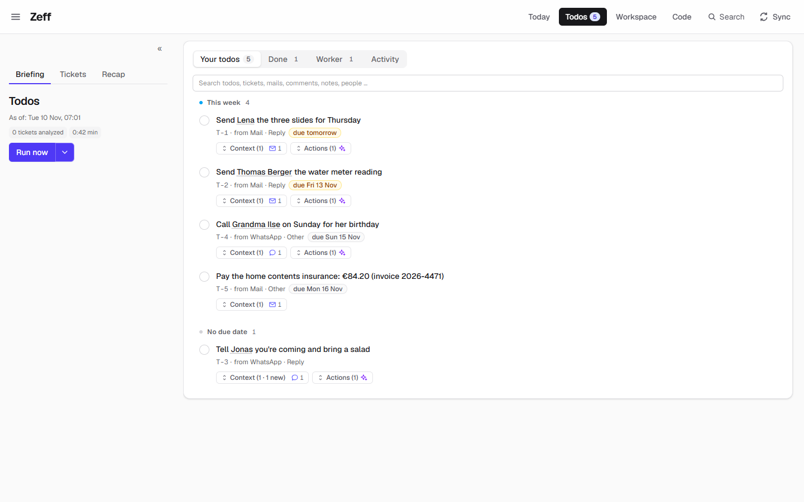
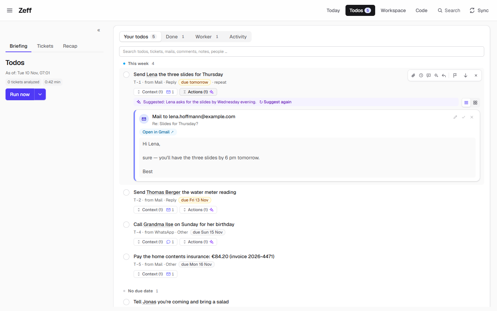
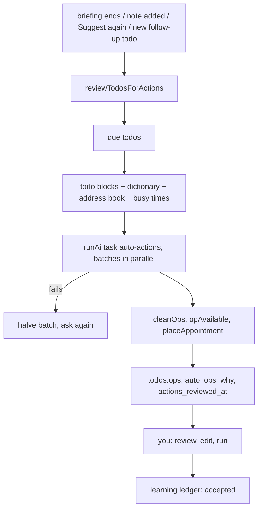

# Auto actions

> An AI step of its own after the briefing: every open todo without a button gets ready-made actions — a message, a comment, a mail draft, a meeting in a free slot, a hand-over to a worker — from what the installed extensions can do; one click and it's done. **Category:** AI · **On by default:** yes · **Beta:** no · **Needs:** [Todos](todos.md), [LLM](llm.md)

## For users

### What it does

A todo says what to do; it rarely does it. Auto actions closes that gap. After each briefing the AI goes through every
open todo that has no actions yet — with everything Zeff knows about it: its ticket (status, people, possible
transitions), where it comes from (the mail, the WhatsApp chat, the Teams message, the comment), your notes, earlier
reports, the people's languages and addresses, your calendar — and proposes the actions that do the todo or move it to
its next real step:

- a question or request to someone → the finished message (WhatsApp, Signal, Teams) or a mail draft (Outlook, Gmail,
  IMAP), in the language you write with that person;
- something to check together → a meeting in a free slot of your calendar;
- waiting for someone → a friendly follow-up to exactly the person you're waiting for;
- something only you can do → a time block in your calendar (work: weekdays 9–17; private: any day 8–21);
- ticket upkeep → a Jira comment, status change, assignment or new ticket;
- implement, fix, look into the code → a hand-over to a worker ([Work](work.md));
- a rule about how Zeff itself should work ("name branches after the code change") → a
  ["Do in Zeff"](actions.md#do-in-zeff) action that adjusts the setting.

Every action is complete — recipient, text, time — with nothing left as a placeholder. You see it on the todo, marked as
*suggested*, with one sentence of why. You check it, edit it if you like (✎), and run it with one click. The catalog of
actions it can choose from is the [Actions](actions.md) mechanism: only actions of installed extensions are offered.

In the demo, the todo *Send Lena the three slides for Thursday* (from a mail) carries a ready Gmail reply to Lena —
"Hi Lena, sure — you'll have the three slides by 6 pm tomorrow." — with the reason "Suggested: Lena asks for the slides
by Wednesday evening." Four of the five demo todos have such a suggestion (marked ✦ next to *Actions (1)*).

### Getting started

1. Auto actions is on by default (Menu → Plugins, category *AI*). It needs [Todos](todos.md) and [LLM](llm.md) with a
   working [AI backend](ai-backends.md).
2. Install the extensions whose actions you want: WhatsApp, Signal, Teams, Outlook, Gmail, an IMAP mailbox, Jira,
   GitLab, the Zeff calendar, Google Calendar, Revolut, Work … — each brings its own actions.
3. Run a sync (or wait for the next briefing). The *Auto actions* step runs as the briefing's last step.

### Using it

**Review and run suggested actions.** On the Todos page a todo with suggestions shows *Actions (n)* with a ✦ mark (its
tooltip: "Suggested by the auto-actions step — review, adjust (✎), then run"). Open it: the line *Suggested: …* gives
the AI's reason, with *↻ Suggest again* beside it, and each action is a card — what and to whom, the subject, a link
such as *Open in Gmail ↗*, and the full text — with buttons to edit the text (✎), mark it done (✓, for an action you
sent yourself: "Done: the mail is sent — note it on the todo") or dismiss it (✕, "takes the action off the todo, without
a note").

Actions that open in your browser (a mail draft in Outlook, a Gmail compose window, a meeting in Outlook, a Revolut payment, a GiroCode transfer) open
pre-filled for you to send; the others (a WhatsApp, Signal or Teams message, a Jira comment, a calendar entry, a note, a
hand-over) Zeff runs itself. What ran is taken off the todo and noted on it (✓ …). A reply or message that *is* the todo
(you owed an answer) closes the todo.

**Ask again.** *Suggest again* on a todo has the AI propose its actions once more with everything it knows now. Adding a
note to a todo does the same in the background, so "ask Anna in Spanish" or "she's on holiday until Monday" changes the
proposal.

**When it looks again by itself.** A todo is looked at when it is new or changed since its last review. Actions the AI
proposed (and you haven't run or edited) are proposed anew when the todo learned something: a note of yours, a newer
message in its source, or a bank account (IBAN, RevTag) of its people becoming known. All open todos without actions
are looked at again once when the set of available actions changes (an extension installed) or when the prompt changes.

**Adjust how it decides.** Settings → AI → *Auto actions* holds extra instructions for this step; the whole prompt is
the page *Auto-actions* in System → Prompts (variables `{{me}}` and `{{today}}`).

### Settings

| Setting | Where | What it changes |
| --- | --- | --- |
| On / off | Menu → Plugins | Whether the step runs and *Suggest again* is offered. |
| Backend and model of the task *Auto actions* | Settings → AI → Tasks | Which AI proposes the actions ([LLM](llm.md)). |
| Extra instructions | Settings → AI → *Auto actions* | Appended to the step's prompt. |
| The prompt | Workspace → System → Prompts → *Auto-actions* | The whole instructions (your version replaces the built-in one). |
| When it runs | Sync settings | With every briefing, as its last step (`autoactions`); on workdays, at the briefing's interval. |

### Tips & limits

- **What the AI sees:** for each todo its ticket, sources (the last messages of its chat or mail thread, both sides),
  notes, facts about its people, the address book of people the todos name (from mails read), their bank accounts (People
  details), your busy times of the next 14 days, and the dictionary of available actions. It goes to the backend set for
  the task; secret data is left out as for every [LLM](llm.md) task.
- **Nothing runs on its own.** Auto actions only proposes; every action waits for your click.
- At most six actions per todo; never a message to yourself; only people, addresses and user names that appear in the
  context.
- **Calendar suggestions are spread out:** at most three suggested appointments a day across all todos, never on top of
  your appointments or each other; a todo that recurs (its series is in the calendar) and an agent's follow-up todo get
  no appointment.
- Kanban cards (`KB-…`) are your own, not Jira tickets: no Jira actions for them.
- Actions proposed by the briefing, a worker or you are never replaced. For a todo that stands for open GitLab review
  comments only the missing replies are added.
- Todos are sent in batches (at most six per prompt, sized to the backend); a batch that fails is halved and asked again.

## Technical reference

### Overview

`reviewTodosForActions()` in [review.ts](../../src/plugins/auto-actions/review.ts) is the whole step. It runs once at a
time per account (a flag holds the running promise); a call for given ids waits for a running full review.

1. **What is due:** open todos with `actions_reviewed_at` null or older than `updated_at`; all open todos when the
   signature of available op types plus a hash of the prompt (`autoactions:offered` pref) changed.
2. **Which of them:** those without ops; those whose ops this step proposed (`auto_ops_why` set) when everything is
   re-reviewed or they *learned* something (a note, a newer source, a newly known account); review-comment todos missing
   `gitlab-reply` ops.
3. **Context per todo** (`todoBlocks`): ticket, sources, last good briefing run, notes, chat/mail history, facts, the
   knowledge's system addresses, the context actions ask for (`needs`), and the `offerContext` lines of the offered
   [Do in Zeff](actions.md#do-in-zeff) methods.
4. **Prompt** (`autoActionsPrompt`): the instructions (prompt page `auto-actions`, `{{me}}` = your Jira name, `{{today}}`)
   + the step's extra block, the actions dictionary `opsDictionary(opAvailable)`, address book, accounts, busy lines, the
   todo blocks. Batches by characters (`promptRoom(COPILOT_MAX_PROMPT − 9000)`, at most 6 todos), all batches in
   parallel through `runAi(…, { task: "auto-actions", timeoutMs: 10 min, maxBudgetUsd: 1 })`; a failing batch is halved.
5. **Clean and place:** `cleanOps` (each action's own `clean`), `withoutAppointments` for recurring and agent follow-up
   todos, `opAvailable`, no Teams message to yourself; appointments moved into free time by `placeAppointment`
   ([placing.ts](../../src/plugins/auto-actions/placing.ts)).
6. **Write:** `ops` and `auto_ops_why` only onto a todo that still has none (or whose ops were proposed here and may be
   replaced); `actions_reviewed_at` always; `emitChange("todos")`.

Callers: the sync step `autoactions` ([lib/sync/registry.ts](../../src/lib/sync/registry.ts)); a note on a todo
([lib/todos/refresh.ts](../../src/lib/todos/refresh.ts)); *Suggest again* and a recurring todo regenerated
([plugins/todos/server-actions.ts](../../src/plugins/todos/server-actions.ts)); todos a worker created
([lib/work/ensure-actions.ts](../../src/lib/work/ensure-actions.ts)). When you run an action it proposed, the learning
ledger records it as accepted (`autoActionsFeedback`, [actions/clicked.ts](../../src/plugins/actions/clicked.ts)).

### Manifest

| Field | Value |
| --- | --- |
| id | `auto-actions` |
| name | Auto actions |
| category | `ai` |
| order | 100 |
| defaultInstalled | `true` |
| dependsOn | `todos`, `llm` |
| routes, settings, features | — |
| syncSteps | `autoactions` |

### Files

| File | What it is |
| --- | --- |
| [plugin.ts](../../src/plugins/auto-actions/plugin.ts) | The manifest. |
| [review.ts](../../src/plugins/auto-actions/review.ts) | The review: `INSTRUCTIONS`, prompt, schema, `reviewTodosForActions`, address book, accounts, busy times. |
| [placing.ts](../../src/plugins/auto-actions/placing.ts) | `placeAppointment`: free slot, windows (work 9–17 weekdays, private 8–21), 3 a day. |
| [llm-tasks.ts](../../src/plugins/auto-actions/llm-tasks.ts) | The task `auto-actions`. |
| [sync-settings.ts](../../src/plugins/auto-actions/sync-settings.ts) | Its line in the Sync settings ("with every briefing (its last step)"). |

### Data

| Where | What |
| --- | --- |
| `todos.ops` | JSON list of the todo's actions (`TodoOp`), proposed or otherwise. |
| `todos.auto_ops_why` | Why the AI proposed them; non-null marks the ops as this step's (replaceable). |
| `todos.actions_reviewed_at` | When the step last looked at the todo. |
| pref `autoactions:offered` | The available op types + prompt hash at the last full review. |
| `action_clicks` | Your clicks on actions (see [Actions](actions.md)). |

### Sync, jobs & AI tasks

- **Sync step** `autoactions` — label *Auto actions*, links to `/todos`; runs with the briefing on workdays at the
  briefing's interval; reports "{reviewed} todos reviewed, {n} with actions".
- **AI task** `auto-actions` — "Turns todos into ready-made actions (message, comment, mail, meeting, hand-over)."
- **Prompt** page `auto-actions` (System → Prompts, group *Todos & Lage*, variables `me`, `today`); context step
  `autoactions` for extra instructions.
- Answer schema: `{ todos: [{ id, ops: [...], why }] }`.

### MCP tools & actions

No MCP tools. It uses the [Actions](actions.md) catalog (only actions with an `offer`) and the offered API methods
(`zeff-do`). Server actions in the Todos plugin: `suggestTodoActionsAction` (*Suggest again*),
`regenerateRecurringAction`.

### Extension points

None of its own. Other plugins extend what it can propose by contributing **actions** (`<NAME>_ACTIONS` with an
`offer`, see [Actions](actions.md)) or **API methods with an `offer`** (proposed as *Do in Zeff*). An action can ask for
extra context per todo with `offer.needs` (`{ match, context: ["ticket.description"] }`) — no edit of the review needed.

### Tests

| Test | Covers |
| --- | --- |
| [tests/appointment-spread.test.ts](../../tests/appointment-spread.test.ts) | `placeAppointment`: three a day, busy times avoided, none for an agent's follow-ups. |
| [tests/todo-recurring.test.ts](../../tests/todo-recurring.test.ts) | Recurring todos: their proposed actions made again, no appointments. |
| [tests/calendar-move-proposed.test.ts](../../tests/calendar-move-proposed.test.ts) | A proposed appointment moved stays the AI's suggestion. |
| [tests/review-todos.test.ts](../../tests/review-todos.test.ts) | Proposed ops (`auto_ops_why`) when a todo is reviewed. |
| [tests/ops-run.test.ts](../../tests/ops-run.test.ts) | Running one action leaves the others; changes made meanwhile are kept. |
| [tests/comment-ops.test.ts](../../tests/comment-ops.test.ts) | GitLab replies on review-comment todos. |

Run one: `node --import tsx --test tests/review-todos.test.ts`.
