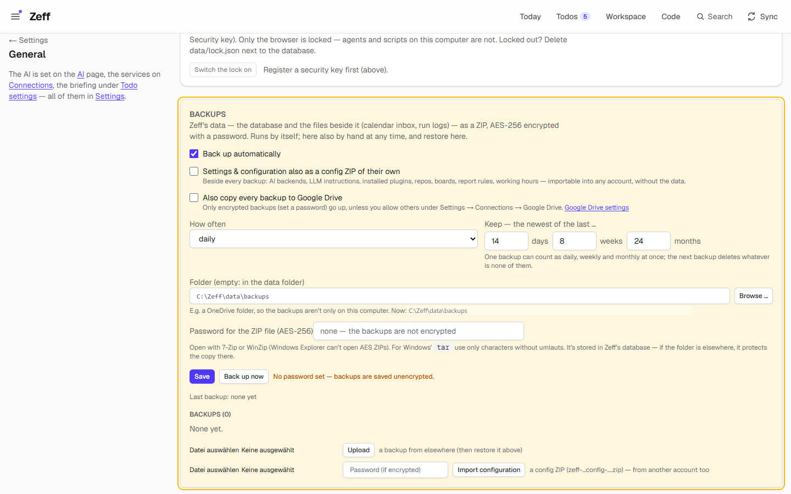
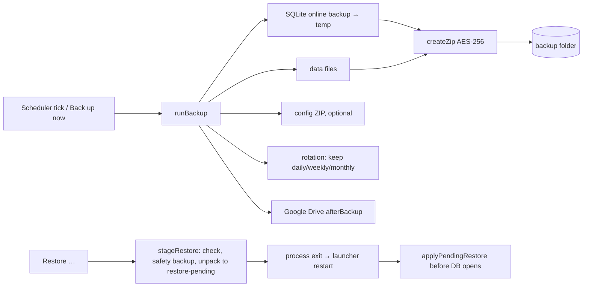

# Backups

> Zeff's data (the database and the files beside it) backed up as a ZIP, AES-256 encrypted with a password. It runs by itself, keeps daily, weekly and monthly copies, and restores in one click. **Category:** system · **On by default:** yes · **Beta:** no · **Needs:** nothing ([Google Drive](google-drive.md) optional, for an off-site copy)

## For users

### What it does

Everything Zeff knows is in one SQLite database plus a few files next to it: the calendar inbox, run logs and context
files. If that disk fails or a change goes wrong, it is all gone. Backups saves a consistent snapshot of the database
and those files into a ZIP at a set interval (daily by default), encrypted if you set a password.

Old backups are thinned out grandfather-father-son style. Zeff keeps the newest backup of each of the last N days,
weeks and months. One backup can count as daily, weekly and monthly at once. Anything that falls out of all three is
deleted when the next backup is made.

Restoring is one click plus a confirmation. Zeff checks the backup, saves the current state first, and puts the backup
in place when it restarts.

The screenshot shows the demo before any backup was made: automatic backups on, no password ("No password set —
backups are saved unencrypted"), and "Last backup: none yet".

### Getting started

Backups is installed and on by default. Open **Settings → General → Backups** (`/preferences#backups`) and:

1. **Set a password** under *Password for the ZIP file (AES-256)* and click **Save**. Without one, backups are written
   unencrypted and the page warns you.
2. Optionally choose a **folder**, for example a OneDrive folder, so the backups are not only on this computer. Empty
   means `data\backups` in the account's data folder. **Browse …** opens a folder picker. Backups already in the old
   folder move to the new one when you save.
3. Click **Back up now** to make the first one right away.

### Using it

**The list.** Under *Backups (n)* every backup is shown, newest first, with its time, size, whether it is encrypted,
and why it is kept (daily / weekly / monthly / by hand). A backup with no reason will be removed by the next backup.

**Restore.** Click **Restore …** on a backup, enter its password if it differs from the current one, and confirm with
**Yes, restore**. Zeff then:

1. opens the ZIP and checks it: it must contain `zeff.db`, the database must have Zeff's tables, and SQLite's
   `quick_check` must pass;
2. makes a backup of the current state, labelled `vor-wiederherstellung` (German for "before restore"), which is
   always kept;
3. unpacks the files into `data/restore-pending/` and restarts. The launcher starts Zeff again, and the backup is put
   in place before the database is opened.

**Upload.** A backup from elsewhere (another computer, an old copy) can be uploaded with **Upload**. It is stored in
the backup folder with `upload` in its name, kept apart from the rotation, and can then be restored from the list.

**Configuration only.** With *Settings & configuration also as a config ZIP of their own* on, every backup gets a
second, small ZIP next to it. It holds your settings without the data: AI backends, LLM instructions, installed
plugins, repos, boards, report rules, working hours and the calendar connection. **Import configuration** takes such a
ZIP (with its password, if encrypted) into the account you are in. This works across [accounts](accounts.md), and the
same mechanism copies settings when you create an account from another one.

**Google Drive.** *Also copy every backup to Google Drive* installs the [Google Drive](google-drive.md) plugin if
needed and switches on its backup extension. Only encrypted backups are uploaded, unless you allow others in the
Google Drive settings.

### Settings

All on Settings → General → Backups (`/preferences#backups`), stored per account:

| Setting | Default | What it changes |
| --- | --- | --- |
| Back up automatically | on | Off: backups only by hand. |
| Settings & configuration also as a config ZIP of their own | off | Writes `zeff-config-….zip` beside each backup. |
| Also copy every backup to Google Drive | off | Turns on the Google Drive plugin's backup copy. |
| How often | daily | Hourly, every 6 hours, every 12 hours, daily or weekly (1 hour to 30 days are accepted). |
| Keep — days / weeks / months | 14 / 8 / 24 | How many daily, weekly and monthly backups the rotation keeps (0–365 / 0–260 / 0–240; at least one tier must be above 0). |
| Folder | empty (`data\backups`) | An absolute path. It must be writable, and existing backups move along. |
| Password for the ZIP file | none | AES-256 password. On Windows use characters without umlauts if you want to open the ZIP with Windows' `tar`. |

The interval also appears on the **Sync settings** page as the *Backup* row (off, 1 h, 3 h, 6 h, 12 h, daily or
weekly). Setting it there turns automatic backups on or off and sets the interval.

### Tips & limits

- **Opening a backup by hand:** use 7-Zip or WinZip. Windows Explorer cannot open AES-encrypted ZIPs.
- **The password is stored in Zeff's database**, in plain text, so Zeff can make backups unattended. That protects the
  copies in another folder or in the cloud, not the computer itself.
- **What is in a backup:** the account's database (a live SQLite online backup, WAL included) and every file in the
  account's data folder, except databases, `*.log` files, the backup folder, `restore-pending`, the work scratch
  folder, other accounts' folders and `accounts.json`.
- **Per account:** each [account](accounts.md) backs up its own folder with its own settings, even while you are in
  another one. Its files are named `zeff-konto-<id>-backup-…` (the first account's `zeff-backup-…`), so several
  accounts can share one folder.
- **Size limit:** no ZIP64, so each file and the whole archive must be under 4 GB.
- **The demo account** never backs up by itself.
- **Restore needs a launcher**: Zeff exits after staging a restore and relies on its launcher to start it again.
- Nothing leaves the machine unless you choose a cloud-synced folder or the Google Drive copy.

## Technical reference

### Overview

[backup.ts](../../src/plugins/backup/backup.ts) does the work. `runBackup(label?)` opens the database read-only, runs
SQLite's online backup into a temp file, collects the data files, and builds the ZIP with
[zip.ts](../../src/plugins/backup/zip.ts). That is a small ZIP writer and reader with WinZip AES-256 (AE-2: PBKDF2-SHA1
keys, AES-256-CTR, an HMAC-SHA1 per file), which 7-Zip, WinZip and libarchive can open. The file is written as `.part`
and then renamed. If enabled, a config ZIP is written alongside. Then the rotation (`rotation()`) decides what to keep
and removes the rest together with their config ZIPs. Only one backup runs per account at a time. A second call gets
the running one's promise.

The **scheduler** ([src/lib/sync-scheduler.ts](../../src/lib/sync-scheduler.ts)) checks on every tick, for every
account except the demo and inside `withAccount`, whether the plugin is installed and `backupDue()`. That is true when
backups are on and the last one is at least the interval ago. If so, it runs `runBackup()`. After a successful backup
the Google Drive plugin's `afterBackup()` hook is called.

A **restore** is staged by `stageRestore()` and applied by `applyPendingRestore()` in
[src/db/index.ts](../../src/db/index.ts) before the database opens. It copies the database (deleting the old
`-wal`/`-shm`) and the data files back, then removes `restore-pending/`.

### Manifest

| Field | Value |
| --- | --- |
| id | `backup` |
| category | `system` |
| order | 110 |
| defaultInstalled | `true` |
| dependsOn | none |
| settings | `/preferences#backups`: "Where, how many, password" |
| nav | `/preferences#backups`: Backups, "Encrypted backups & restore" |
| routes | none (a section of `/preferences`) |
| syncSteps | none (its interval is a row in the Sync settings, see [sync-settings.ts](../../src/plugins/backup/sync-settings.ts)) |
| features | none |

### Files

| File | What it does |
| --- | --- |
| [plugin.ts](../../src/plugins/backup/plugin.ts) | The manifest. |
| [backup.ts](../../src/plugins/backup/backup.ts) | Settings, `runBackup`, rotation, listing, upload, `stageRestore`, `importConfigZip`. |
| [zip.ts](../../src/plugins/backup/zip.ts) | ZIP writer and reader with WinZip AES-256. |
| [config.ts](../../src/plugins/backup/config.ts) | Export and import of settings and configuration (`CONFIG_TABLES`, `zeff-config.json`). |
| [server-actions.ts](../../src/plugins/backup/server-actions.ts) | Save settings, back up now, restore, upload, import configuration, Google Drive switch. |
| [BackupSettings.tsx](../../src/plugins/backup/BackupSettings.tsx) | The settings section and backup list on `/preferences`. |
| [sync-settings.ts](../../src/plugins/backup/sync-settings.ts) | The *Backup* interval row on the Sync settings page. |
| [src/db/index.ts](../../src/db/index.ts) | `applyPendingRestore` at database open. |
| [src/lib/sync-scheduler.ts](../../src/lib/sync-scheduler.ts) | Runs due backups per account. |

### Data

Columns on `app_settings` ([src/db/schema.ts](../../src/db/schema.ts)), per account:

| Column | Meaning |
| --- | --- |
| `backup_enabled` | Automatic backups on (default true). |
| `backup_every_hours` | Interval in hours (default 24). |
| `backup_keep_daily`, `backup_keep_weekly`, `backup_keep_monthly` | Rotation (14 / 8 / 24). `backup_keep` is an older single count, no longer used for rotation. |
| `backup_config` | Also write the config ZIP. |
| `backup_dir` | The folder ("" means `data/backups`). |
| `backup_password` | The ZIP password ("" means unencrypted). |
| `backup_last_at`, `backup_last_ok`, `backup_last_result` | When the last backup ran, whether it worked, and its summary or error. |

**Files**: `zeff-backup-YYYY-MM-DD_HHMMSS[-label].zip` (other accounts: `zeff-konto-<id>-backup-…`),
`zeff-config-….zip` beside them, and `data/restore-pending/` with a `.ready` mark while a restore waits.

**Config ZIP**: one `zeff-config.json` with `{ zeff: "config", version: 1, exportedAt, account, tables }` for
`app_settings`, `work_schedule`, `entry_types`, `teams_settings`, `gitlab_settings`, `report_settings`,
`board_settings`, `jira_boards`, `repos`, `plugins` and `calendar_connections`. State columns (`last_*`,
`backup_last_*`, `synced_at`, `member_count`) are left out on import, and unknown columns are dropped.

### Sync, jobs & AI tasks

No sync step and no AI. The backup job runs from the scheduler tick, as described above. The *Backup* interval on the
Sync settings page maps to `backup_enabled` / `backup_every_hours` (choices: off, 1 h, 3 h, 6 h, 12 h, 1 day, 1 week;
it runs "at any hour, at night too").

### MCP tools & actions

None for agents. Server actions in [server-actions.ts](../../src/plugins/backup/server-actions.ts):
`saveBackupSettingsAction`, `runBackupAction`, `restoreBackupAction` (stages the restore and exits the process after
0.8 s), `uploadBackupAction`, `importConfigAction` and `setDriveBackupAction`. Each refuses with "Backups are not
installed" when the plugin is off.

### Extension points

It provides no formal point. Two plugins hook in directly:

- [Google Drive](google-drive.md): `afterBackup()` in `plugins/google-drive/after` runs after every successful
  backup, and its `google-drive:backup-sync` extension is switched by the Backups settings.
- [Accounts](accounts.md): reuses `exportConfig` / `importConfig` to copy settings into a new account.

### Tests

There is no test file for this plugin alone. It is covered indirectly by:

| Test | What it covers |
| --- | --- |
| [tests/google-drive.test.ts](../../tests/google-drive.test.ts) | Backups copied to Drive (uses the backup server actions). |
| [tests/accounts.test.ts](../../tests/accounts.test.ts) | Configuration export and import when an account is made from another. |

Run one: `node --import tsx --test tests/google-drive.test.ts`.
