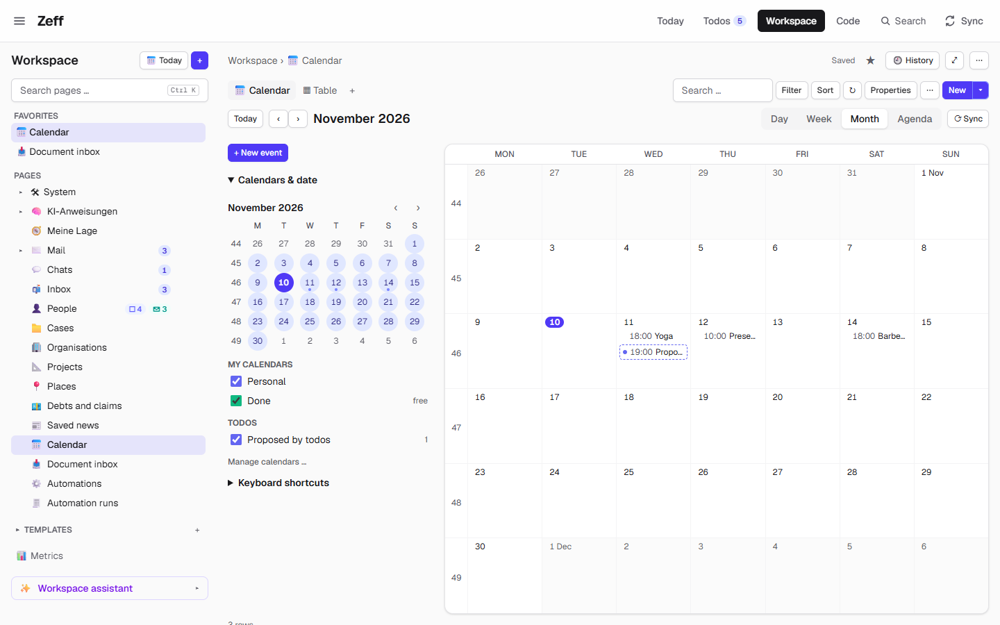
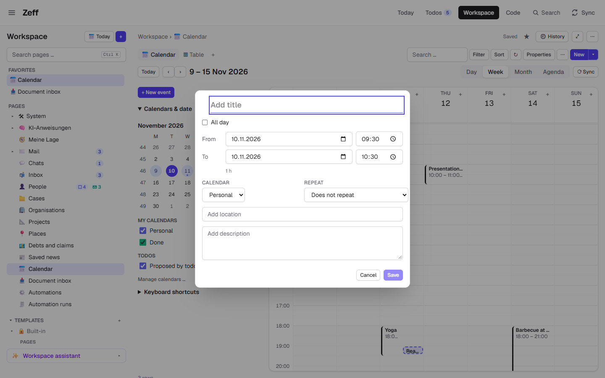
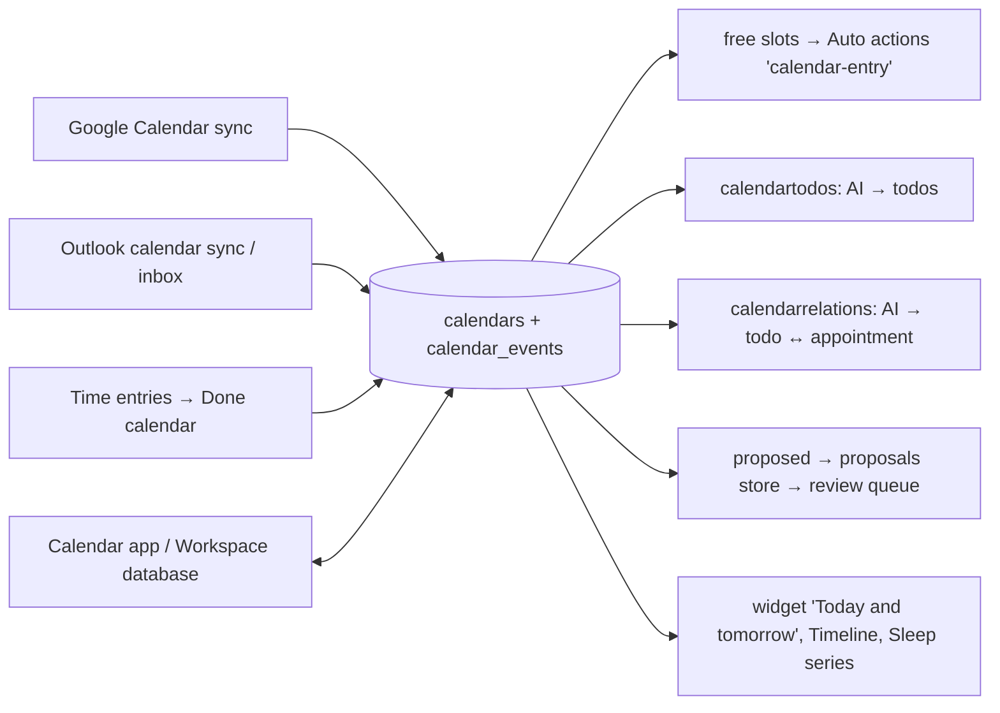

# Calendar

> One calendar for everything: Zeff's own calendars and those of your sources (Outlook, Google Calendar) in one view, each with a colour, plus the appointments your todos propose. **Category:** app · **On by default:** yes · **Beta:** no · **Needs:** nothing. Reads more with [Google Calendar](google-calendar.md) and [Outlook](outlook.md); lives in the [Workspace](workspace.md) when that is installed.

## For users

### What it does

Appointments come from several places: a work Outlook calendar, a private Google calendar, a family calendar, and things
you enter yourself. The Calendar reads all of them into **one model inside Zeff** and shows them in one day, week, month or
agenda view, each calendar in its own colour, each to show or hide.

Because every appointment is in that one model, the rest of Zeff can use it:

- **Free slots.** When [Auto actions](auto-actions.md) suggest a meeting, a time block or a reminder for a todo, they look
  for a free slot in the calendars that count as *busy*. One click puts it into your Zeff calendar.
- **Todos from appointments.** For the calendars set to *Todos*, the AI reads each of today's and tomorrow's appointments
  and makes a todo on its day, but only when it gives you something to do ("bring the filled-in form") — not for a "Lunch
  break" blocker.
- **Appointments at your todos.** After each briefing, *Calendar matching* links each open todo to the appointments it is
  about, so you see the meeting next to the todo and its mails.
- **Proposals.** The day plan on [Today](todos.md) and assistants can propose appointments. They show **dashed** until you
  accept or dismiss them, and block no time meanwhile.
- **Booking meetings.** Calendars set to *Book* offer their meetings for booking in [Time tracking](time-tracking.md).

In the demo, the week of 9–15 November shows a presentation on Thursday morning, yoga on Wednesday evening and the
barbecue at Jonas' on Saturday, plus one dashed appointment a todo proposed. The calendars are *Personal* (Zeff's own)
and *Done* (the time entries; marked "free").

### Getting started

The Calendar is on by default (**Menu → Plugins → Calendar**). Out of the box you have Zeff's own calendar; to see others:

- **Google Calendar**: install [Google Calendar](google-calendar.md) and sign in to Google in the automation Chrome (or
  connect Google's API there). Its calendars appear under "Google Calendar".
- **Outlook**: the [Outlook](outlook.md) calendar sync (Sync menu) brings your Outlook calendar. It is read-only in Zeff.
- **More calendars of your own**: *Manage calendars …* (Settings → Calendar, `/settings/calendar`) → type a name such as
  "Personal" → **Create**.

Where it shows up:

- With the **Workspace** installed (the default), the calendar is a **database "Calendar"** in the Workspace whose first
  view is the calendar app; its tab in the header gives way, and `/kalender` takes you to that database. The appointments
  are the rows: you can also look at them as a table or use them in pipelines and automations.
- Without the Workspace, the **Calendar** tab (`/kalender`) shows the app on its own.
- A widget **"Today and tomorrow"** for Workspace pages lists the next appointments.

### Using it

**Move around.** **Today** jumps to today, **‹ ›** go back and forth, the tabs switch between **Day, Week, Month and Agenda**.
The small month in the sidebar picks a day (days with appointments are dotted). Keyboard: `T` today, `←`/`→` back/next,
`D` `W` `M` `A` for the views, `N` new event, `Esc` close (listed under *Keyboard shortcuts* in the sidebar).

**Show or hide calendars.** The sidebar lists the calendars by source: *My calendars* (Zeff's), *Google Calendar*,
*Outlook*. Each has a switch in its colour; a calendar that doesn't count as busy says "free". The switch *Proposed by
todos* (with a count) shows or hides the dashed proposals.

**Make an appointment.** **+ New event** (or `N`, or click into the grid) opens the editor: title, all day or from/to,
calendar, location, description and **Repeat** (daily, weekly on chosen days, monthly, yearly, every n, ending never, on
a date or after a number of times). A new appointment in a Google calendar also takes guests (mail addresses); series for
Google calendars are made in Google. When proposing is offered, **As a proposal** puts it in dashed, blocking no time,
and **+ Another option** adds the same thing at another time (Option A, B …): accepting one option dismisses the others.

**Change one.** Drag an appointment to move it or drag its edge to change its end. Without a mouse: focus it and press
`Alt+↑/↓` (±15 minutes), `Alt+←/→` (±1 day), `Shift+Alt+↑/↓` (its end ±15 minutes). Click it to see its details
(organiser, attendees, online meeting, your answer, the todo it was made for, *Open in source ↗*) and **Edit (E)** or
**Delete**. For a series you choose this event, this and following, or all events.

**Answer an invitation.** In a Google calendar Zeff can write to, the details offer **Accept / Maybe / Decline**; the
organiser is told by Google.

**Accept or dismiss a proposal.** A dashed appointment has **Accept** and **Dismiss** buttons. Accepted: in Zeff's
calendar it simply stays; in a Google calendar it is written to Google; Outlook's calendar is read-only, so it goes into
Zeff's own calendar instead. Dismissed: it is taken out and not proposed again unchanged. The same proposals are in the
review queue on Today ("Calendar proposals").

**Sync now.** With Google Calendar installed, the toolbar's **Sync** reads Google's calendars now (also for an older month
you navigated to).

### Settings

On **Settings → Calendar** (`/settings/calendar`, also *Manage calendars …* in the sidebar):

| Setting | What it changes |
| --- | --- |
| Name, colour | How the calendar is called and drawn (Zeff's own calendars can be renamed). |
| **Show** | Whether its appointments are drawn in the calendar. |
| **Busy** | Whether its appointments block time for free-slot search and meeting suggestions. Turn it off for birthdays or holidays. |
| **Book** | Whether its meetings show under *Book meetings* in Time tracking (Outlook's by default). |
| **Todos** | Whether its appointments of today and tomorrow become todos on their day (Zeff's own calendars by default). |
| Delete | Removes one of Zeff's own calendars with all its events (asks first). |
| New calendar | Creates another Zeff calendar with a name and colour. |
| Google account, Weeks to read, Months back, **Sync now** | With [Google Calendar](google-calendar.md): which Google account in the automation Chrome is read, how many weeks ahead, how many months back. |
| Todos from appointments: days ahead (1–30) | How far ahead appointments are looked at for todos. |
| Sync menu → *Calendar matching* | Runs with every briefing; can be turned off or run by hand there. |
| Menu → Plugins → Calendar → *Event in the Zeff calendar* | The extension for [Auto actions](auto-actions.md) that offers "Event in the Zeff calendar" for todos (on by default). |
| LLM settings → *Appointments to todos*, *Calendar matching* | The AI backend and model for the two AI tasks ([LLM](llm.md)). |

### Tips & limits

- **Outlook appointments are read-only** in Zeff. Change them in Outlook; an accepted proposal in Outlook's calendar is put
  into Zeff's own calendar instead.
- **Zeff never deletes Google events.** Delete them in Google Calendar. Series for Google calendars are made in Google too.
- **Proposals block no time** and are never written to their source until you accept them.
- **What the AI sees:** the two AI tasks send an appointment's title, time, place and description (and, for matching, the
  open todos) to the AI backend you chose in [LLM](llm.md). A local backend keeps it on your machine.
- **A "Done" calendar** appears with Time tracking installed: each time entry with a start time as an appointment of what
  you actually did. It is derived; nothing there is entered by hand, and it does not count as busy.
- **Sleep**: a calendar named "Sleep" or "Schlaf" (as Sleep as Android writes) gives [Correlations](correlations.md) the
  series *Hours slept*, *Bedtime* and *Woke up*. They count as personal data.
- The calendar database in the Workspace holds appointments from a month back to three months ahead.

## Technical reference

### Overview

The core is the calendar model ("IR") in [src/lib/calendar/ir.ts](../../src/lib/calendar/ir.ts): the tables `calendars`
and `calendar_events`, written by each source's adapter (Google Calendar's sync, Outlook's inbox read in again whenever it
changed, the derived Done calendar) and by the app. The app, free-slot search, meeting suggestions, booking and the todo
steps read only this model. Series of Zeff's own calendars are kept as a rule on the first appointment and expanded when
read (`recurrence.ts`); occurrences changed on their own carry `seriesId`, left-out days are `exdates`.

The app is a **view template** of the Workspace's view language (`view-template.meta.ts`): the toolbar and sidebar are
template tags, and the plugin brings the parts that need more (`calendar.grid`, `calendar.minimonth`, `calendar.toggle`)
and the actions `calendar.new` and `calendar.sync`. With the Workspace installed, a database "Calendar" is made once
(`workspace/calendar-database.ts`) whose rows come from the Workspace source `calendar` (`workspace-source.ts`): a two-way
view in which edits to rows in Zeff's own calendars are written to the appointment, a new row is a new appointment and a
deleted row deletes it; Google's and Outlook's rows are read-only.

Proposed appointments are flagged `proposed` and mirrored into the shared proposals store (`lib/calendar/proposed.ts`);
the plugin's proposal source (`proposals.ts`) accepts or dismisses them through `decide()`, used by both the calendar's
buttons and the review queue, and feeds the learning ledger.

### Manifest

| Field | Value |
| --- | --- |
| id | `calendar` |
| category | `app` |
| order | 320 |
| actionsOrder | 110 |
| defaultInstalled | `true` |
| dependsOn | none |
| tabs | `/kalender` "Calendar" (short "Cal.") — hidden while `workspace` is installed |
| routes | `/kalender` |
| settings | `/settings/calendar` — "Your calendars, their colours, which count as busy and get booked" |
| syncSteps | `calendarrelations`, `calendartodos` |
| extensions | `entry-action` for `auto-actions`: "Event in the Zeff calendar", on by default, brings the action `calendar-entry` |

### Files

| File | What it does |
| --- | --- |
| [plugin.ts](../../src/plugins/calendar/plugin.ts) | The manifest. |
| [server.ts](../../src/plugins/calendar/server.ts) | Registers the Workspace source, widgets, sleep series and proposal source. |
| [CalendarApp.tsx](../../src/plugins/calendar/CalendarApp.tsx), [CalendarBody.tsx](../../src/plugins/calendar/CalendarBody.tsx) | The stand-alone app (without the Workspace). |
| [TimeGrid.tsx](../../src/plugins/calendar/TimeGrid.tsx), [MonthGrid.tsx](../../src/plugins/calendar/MonthGrid.tsx), [AgendaList.tsx](../../src/plugins/calendar/AgendaList.tsx), [MiniMonth.tsx](../../src/plugins/calendar/MiniMonth.tsx) | Day/week grid with dragging, month grid, agenda list, the small month. |
| [EventEditor.tsx](../../src/plugins/calendar/EventEditor.tsx), [EventDetails.tsx](../../src/plugins/calendar/EventDetails.tsx), [ProposalButtons.tsx](../../src/plugins/calendar/ProposalButtons.tsx) | New/edit form (series, options, proposals), details with answers, accept/dismiss. |
| [CalendarSettings.tsx](../../src/plugins/calendar/CalendarSettings.tsx) | Settings → Calendar. |
| [server-actions.ts](../../src/plugins/calendar/server-actions.ts) | Save, delete, respond, propose, move proposals, calendar CRUD, sync, the view's data. |
| [view-data.ts](../../src/plugins/calendar/view-data.ts), [view-shared.ts](../../src/plugins/calendar/view-shared.ts), [app-data.ts](../../src/plugins/calendar/app-data.ts) | What a view shows around a day; ranges and titles; the template's `app.*` data. |
| [view-template.meta.ts](../../src/plugins/calendar/view-template.meta.ts), [ui/view-parts.tsx](../../src/plugins/calendar/ui/view-parts.tsx), [ui/calendar-embed.tsx](../../src/plugins/calendar/ui/calendar-embed.tsx) | The calendar as a Workspace view template and its parts. |
| [workspace-source.ts](../../src/plugins/calendar/workspace-source.ts) | Appointments as a two-way Workspace source. |
| [widgets.ts](../../src/plugins/calendar/widgets.ts) | Widget `calendar.agenda` ("Today and tomorrow"). |
| [proposals.ts](../../src/plugins/calendar/proposals.ts) | Proposal source: accept (keep / write to Google / copy to Zeff's), dismiss, options. |
| [actions.ts](../../src/plugins/calendar/actions.ts), [run.ts](../../src/plugins/calendar/run.ts) | Actions `calendar-entry` and `gcal-event` (the latter belongs to Google Calendar) and running `calendar-entry`. |
| [llm-tasks.ts](../../src/plugins/calendar/llm-tasks.ts) | AI tasks `calendar-todos`, `calendar-relations`. |
| [sync-settings.ts](../../src/plugins/calendar/sync-settings.ts) | The "Calendar matching" entry in the Sync settings. |
| [nudge.ts](../../src/plugins/calendar/nudge.ts) | Keyboard moves of an appointment. |
| [sleep-series.ts](../../src/plugins/calendar/sleep-series.ts) | Sleep series for Correlations. |
| [src/lib/calendar/](../../src/lib/calendar/) | The model (`ir.ts`, `ir-shared.ts`), series (`recurrence.ts`), proposals (`proposed.ts`), todos from appointments (`todos.ts`), matching (`relations.ts`), the Done calendar (`done.ts`), Outlook inbox/bookmarklet (`inbox.ts`, `bookmarklet.ts`), Microsoft Graph (`microsoft.ts`, `config.ts`). |
| [src/app/kalender/page.tsx](../../src/app/kalender/page.tsx), [src/app/settings/calendar/page.tsx](../../src/app/settings/calendar/page.tsx) | The pages. |

### Data

| Table / pref | Fields |
| --- | --- |
| `calendars` | `key` (`zeff:<id>`, `google:<calendar id>`, `outlook`, `zeff:done`), `source` (`zeff` / `google` / `outlook`), `name`, `color`, `visible`, `busy` (blocks time), `book` (offered for booking), `todos` (appointments become todos). |
| `calendar_events` | `calendar_id`, `key` (the source's id), `title`, `start`/`end` (local `YYYY-MM-DDTHH:MM`; all-day: days, end exclusive), `all_day`, `location`, `description`, `show_as` (busy/free/tentative/oof/workingElsewhere), `cancelled`, `response` (your answer), `private`, `online`, `organizer`, `attendees` (JSON), `url` (open in source), `raw` (the source's record), `todo_id` (the todo it was made for), `recurrence` (rule JSON), `exdates`, `series_id`, `proposed`. |
| `calendar_connections` | The Microsoft Graph OAuth connection for Outlook (used by the Outlook calendar). |
| Pref `workspace.calendarDb` | The id of the Workspace database "Calendar". |
| Proposals store | Open proposals with source `calendar` (see `lib/proposals`). |

### Sync, jobs & AI tasks

| Step / task | When | What |
| --- | --- | --- |
| `calendartodos` ("Appointment review") | Workdays, with the briefing | Reads Outlook again, then AI task **`calendar-todos`** ("Appointments to todos") decides per appointment or series whether it gives you something to do; only those become todos due on their day. Without an AI plugin every appointment is a todo. |
| `calendarrelations` ("Calendar matching") | Workdays, with the briefing | AI task **`calendar-relations`** links each open todo to appointments of the last two weeks and the next month (the likeliest 6 per todo pre-selected by shared words), stored as the todo's `cal:<id>` refs. |
| Google / Outlook calendar syncs | Their own steps (`gcalendar`, `calendar`) | Belong to [Google Calendar](google-calendar.md) and [Outlook](outlook.md); they write into the model. |
| Workspace database refresh | After changes in the app or a sync | The calendar database's pipeline re-reads rows (no AI). |

The prompts are German, in `src/lib/calendar/todos.ts` (`INSTRUCTIONS`) and `src/lib/calendar/relations.ts`.

### MCP tools & actions

- **Action `calendar-entry`** ("Event in the Zeff calendar", verb *Add*): calendar name, title, start, minutes (15–600),
  body. Offered by Auto actions for a todo; on your click it adds the appointment to that Zeff calendar with the todo
  linked and notes it on the todo.
- **Action `gcal-event`** is defined here but belongs to the Google Calendar plugin (opens Google's form, filled in).
- **MCP:** no tools of its own. Agents reach appointments through the Workspace database tools (`workspace_query_database`,
  `workspace_add_row` …) on the Calendar database, and through [Timeline](timeline.md) (`meeting` events).
- **API routes:** `/api/calendar/connect`, `/api/calendar/callback` (Microsoft OAuth) and `/api/calendar/ingest` (the
  Outlook bookmarklet's events) serve the Outlook calendar.

### Extension points

Contributes to:

- `workspaceSources` — source `calendar` (appointments as rows, two-way).
- `workspaceWidgets` — `calendar.agenda` "Today and tomorrow" (settings: days ahead, words, calendar, how many).
- `correlationSeries` — `calendar.sleep` (hours slept, bedtime, woke up).
- `proposalSources` — "Calendar proposals" (review queue on Today).
- The Workspace's view apps — the `calendar` view template with parts and actions; [Agenda](agenda.md) links its notes to
  this database's events.
- Auto actions — the `calendar-entry` action via its extension.

### Tests

`tests/calendar.test.ts`, `calendar-view.test.ts`, `calendar-series.test.ts`, `calendar-proposals.test.ts`,
`calendar-move-proposed.test.ts`, `calendar-todos-ai.test.ts`, `calendar-merge-done.test.ts`, `calendar-a11y.test.ts`,
`done-calendar.test.ts`, `sleep-series.test.ts`, `workspace-calendar.test.ts`. End-to-end: `e2e/calendar.e2e.mjs`
(`npm run e2e`, which starts its own test server).

Run one: `node --import tsx --test tests/calendar.test.ts`.
