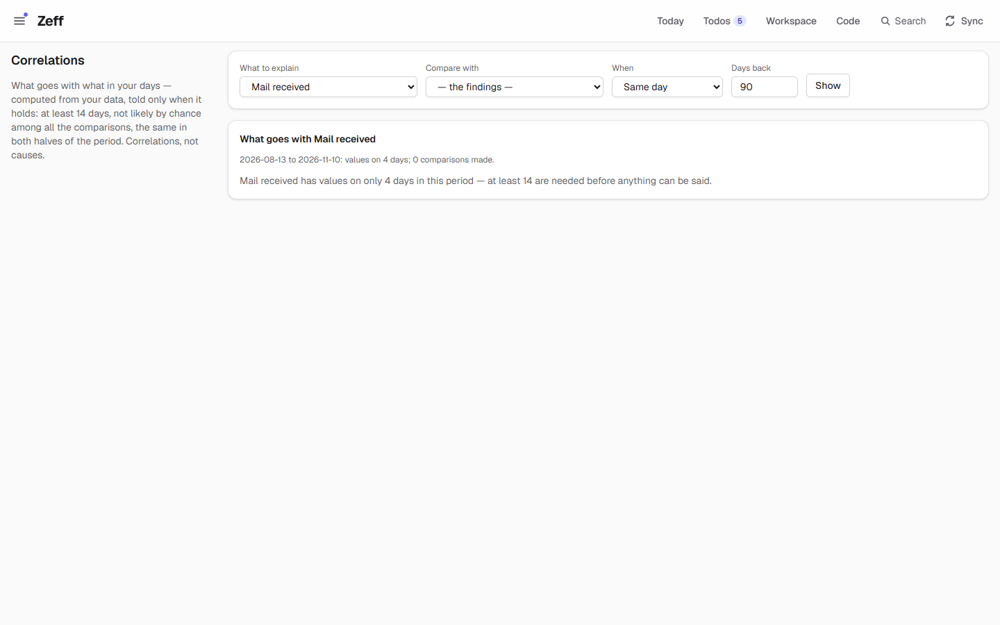
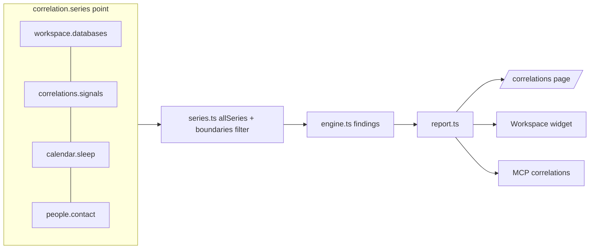

# Correlations

> What goes with what in your days: a journal's energy or mood against your meeting hours, booked hours, messages, todos, spending, sleep and the other fields of your Workspace databases — computed in code, told only when it holds over enough days. **Category:** App · **On by default:** yes · **Beta:** no · **Needs:** [Workspace](workspace.md)

## For users

### What it does

You keep a journal in the Workspace with an *Energy* or *Mood* field. Do you feel worse on days with many meetings? Better
the day after you slept longer? Worse after evenings with many messages? Correlations answers such questions from your
own data, with numbers, and stays quiet when the data doesn't support an answer.

It compares one **target** ("what to explain") against every other **daily series** Zeff has, for the same day and for
the day before:

- **your Workspace databases** kept by hand with a date (a journal, a workout log, a sleep diary): each number field
  (also formulas and rollups), a select or status as its option's place (Hard = 1 … Great = 5), a checkbox and each tag
  of a multi-select as yes/no, a date-with-time field as the hour of the day (22:45 → 22.75; the day turns at 4:00, so
  0:30 is 24.5), and the number of entries per day;
- **Zeff's own signals:** meeting hours, booked hours, messages received and sent per channel (mail, WhatsApp, Signal,
  Teams), todos created and done, spending (with Finances), the first and last activity of the day;
- **what other extensions add:** sleep from a sleep tracker's calendar (Calendar: hours slept, bedtime, woke up),
  contact with a person (People).

Only findings that **hold** are shown: at least 14 days with values, a strength of at least 0.3 (Spearman's ρ or the
rank-biserial effect of a group comparison), unlikely by chance among all the comparisons made (a permutation test with
a false-discovery-rate correction, q ≤ 0.1), and pointing the same way in both halves of the period. Each finding is a
plain sentence with its numbers and n — in this form (made-up numbers): "Energy is lower on days with Journal › Tags: Work: 2.8 vs 3.6 otherwise
(12 vs 30 days, rank-biserial −0.42, q = 0.04)." No AI is involved. Correlations, not causes.

The demo is only a few days old, so the page says "Mail received has values on only 4 days in this period — at least 14
are needed before anything can be said."

### Getting started

1. Correlations is on by default (Menu → Plugins, category *App*); it needs the [Workspace](workspace.md).
2. Keep a journal (Workspace → templates) or another database with a date and some number, select or tag fields — or
   just let Zeff sync your calendar, time tracking and messages for a few weeks.
3. Open **Correlations** from the menu (`/correlations`).

### Using it

**See what goes with a target.** On `/correlations`, pick *What to explain* (your journal's fields come first), leave
*Compare with* at "— the findings —", choose *Days back* (default 90) and press *Show*. The card lists the findings that
hold, strongest and most reliable first (at most 8), or says why nothing can be said (too few days, nothing reliable).

**Explore one pair.** Pick a series under *Compare with* and *When* (*Same day* or *The day before*): the page shows a
scatter plot of the days (or the two groups' means for a yes/no series) and the pair in words — whether it holds or
not. A finding's link leads there too.

**As a Workspace widget.** Add the widget *Correlations* to a Workspace page (e.g. your journal's): choose *What to
explain*, *Days back* (14–730, default 90) and *How many* (1–10, default 4). It shows the findings with a tiny chart of
the two groups' means and a link to explore the pair.

**For agents.** The MCP tool `correlations` lets an agent (e.g. a journal's weekly review routine) quote computed
findings instead of guessing: give it a database and field (`Journal`, `Energy`), a period, optionally one other
series.

### Settings

No settings page. The choices live on the page (target, comparison, lag, days back) and in each widget (target, days
back, how many).

### Tips & limits

- **Correlations, not causes** — the page says so; a finding means two things went together on your days.
- **Privacy:** everything is computed on this computer, no AI and no outside service. Series carry the data-boundary
  label of their source: a journal database is personal by default, as are WhatsApp, Signal and bank spending; *secret*
  series are left out for everyone, *personal* ones are shown to you and to agents whose routine may read personal data.
  The first/last activity series read chats, Teams and booked time, so they carry the strictest of those labels.
- Databases filled by a source (mails, messages, calendars) and todo lists are not diaries and are left out; a day
  without an entry has no value (not 0), except the entry count.
- Zeff's signals start at their first record: before it there is nothing to say; after it a day without anything is 0.
- Group comparisons need at least 5 days in each group.

## Technical reference

### Overview

- **Series** ([series-point.ts](../../src/plugins/correlations/series-point.ts)): a `SeriesProvider` has an `id`, a
  quick `catalog()` (series without values, for pickers) and `series(range)` (values: day → number). A series is
  `{ id, label, group, kind: number | ordinal | binary, unit?, levels?, values }`. [series.ts](../../src/plugins/correlations/series.ts)
  gathers all installed providers' series (a failing provider is logged and skipped), filtered by
  [boundaries.ts](../../src/plugins/correlations/boundaries.ts).
- **Statistics** ([stats.ts](../../src/plugins/correlations/stats.ts), pure, no library): ranks, Pearson, Spearman, a
  seeded permutation test (999 rounds), rank-biserial for group comparisons, a split-half stability check,
  Benjamini–Hochberg.
- **Engine** ([engine.ts](../../src/plugins/correlations/engine.ts), pure): for the target against every other series at
  lag 0 and 1 — measures by Spearman (with the days above/below the median as groups), binary series as group
  comparisons; thresholds `MIN_DAYS = 14`, `MIN_STRENGTH = 0.3`, `MAX_Q = 0.1`, same sign in both halves; ranked by
  strength × reliability; `comparePair` for one pair.
- **Report** ([report.ts](../../src/plugins/correlations/report.ts)): period (`days` or from–to, the day before included
  for lag 1), target by database and field name, `reportText` / `pairText` for agents.
- **Page** [app/correlations/page.tsx](../../src/app/correlations/page.tsx), **widget**
  [widgets.ts](../../src/plugins/correlations/widgets.ts) (`correlations.findings`), **MCP**
  [mcp.ts](../../src/plugins/correlations/mcp.ts).

### Manifest

| Field | Value |
| --- | --- |
| id | `correlations` |
| name | Correlations |
| category | `app` |
| order | 128 |
| defaultInstalled | `true` |
| dependsOn | `workspace` |
| nav | `/correlations` — "Correlations", "What goes with what in your days" |
| routes | `/correlations` |
| settings, syncSteps, features | — |

### Files

| File | What it is |
| --- | --- |
| [plugin.ts](../../src/plugins/correlations/plugin.ts) | The manifest. |
| [server.ts](../../src/plugins/correlations/server.ts) | Contributes its series providers and the widget. |
| [series-point.ts](../../src/plugins/correlations/series-point.ts) | The `correlationSeries` point and its types. |
| [series.ts](../../src/plugins/correlations/series.ts) | `allSeries`, `findSeries`. |
| [series-workspace.ts](../../src/plugins/correlations/series-workspace.ts) | Series of your diary databases (`db:<id>:<prop>`). |
| [series-signals.ts](../../src/plugins/correlations/series-signals.ts) | Zeff's signals: `calendar:meeting-hours`, `time:booked-hours`, `messages:<channel>:received/sent`, `todos:created/done`, `finances:spending`, `activity:first/last`. |
| [boundaries.ts](../../src/plugins/correlations/boundaries.ts) | Each series' data-boundary label. |
| [days.ts](../../src/plugins/correlations/days.ts) | Local days, counts filled with 0. |
| [stats.ts](../../src/plugins/correlations/stats.ts) | The statistics. |
| [engine.ts](../../src/plugins/correlations/engine.ts) | Findings and pair comparisons. |
| [report.ts](../../src/plugins/correlations/report.ts) | Period, target, report, texts. |
| [widgets.ts](../../src/plugins/correlations/widgets.ts) | The Workspace widget; `exploreHref`. |
| [mcp.ts](../../src/plugins/correlations/mcp.ts) | The MCP tool `correlations`. |
| [app/correlations/page.tsx](../../src/app/correlations/page.tsx) | The page. |
| [calendar/sleep-series.ts](../../src/plugins/calendar/sleep-series.ts), [people/pulse-insights.ts](../../src/plugins/people/pulse-insights.ts) | Series other plugins contribute. |

### Data

None of its own: it reads the Workspace databases, `calendar_events`, time entries, messages (mail, WhatsApp, Signal,
Teams), todos and bank transactions on demand and keeps nothing.

### Sync, jobs & AI tasks

None. Pure computation on request; no LLM.

### MCP tools & actions

| Tool | Input | Output |
| --- | --- | --- |
| `correlations` | `field` (required; a field, a tag as `Tags: Family`, or a series id), `database` (omit for Zeff's own series), `days` (14–3650, default 90) or `from`/`to`, `other` (one series to compare with), `limit` (1–20, default 8) | The period, what was tested, the findings with their numbers — or plainly that nothing holds; with `other`, that pair in words whether it holds or not. |

While the extension is off: "Correlations is not installed in Zeff (Menu → Plugins) — this tool isn't available."

### Extension points

- Provides **`correlationSeries`** ([series-point.ts](../../src/plugins/correlations/series-point.ts)): a plugin adds daily
  series with `correlationSeries.contribute("<plugin>", [provider])` from its `server.ts`. Calendar (`calendar.sleep`)
  and People (`people.contact`) do.
- Contributes the widget `correlations.findings` to the Workspace's **`workspaceWidgets`**.

### Tests

| Test | Covers |
| --- | --- |
| [tests/correlations-stats.test.ts](../../tests/correlations-stats.test.ts) | Pearson, Spearman, permutation, rank-biserial, split-half, BH. |
| [tests/correlations-engine.test.ts](../../tests/correlations-engine.test.ts) | Findings, thresholds, lags, pair comparison. |
| [tests/correlations-series.test.ts](../../tests/correlations-series.test.ts) | Workspace and signal series. |
| [tests/correlations-widget.test.ts](../../tests/correlations-widget.test.ts) | The widget. |
| [tests/correlations-mcp.test.ts](../../tests/correlations-mcp.test.ts) | The MCP tool. |

Run one: `node --import tsx --test tests/correlations-engine.test.ts`.
