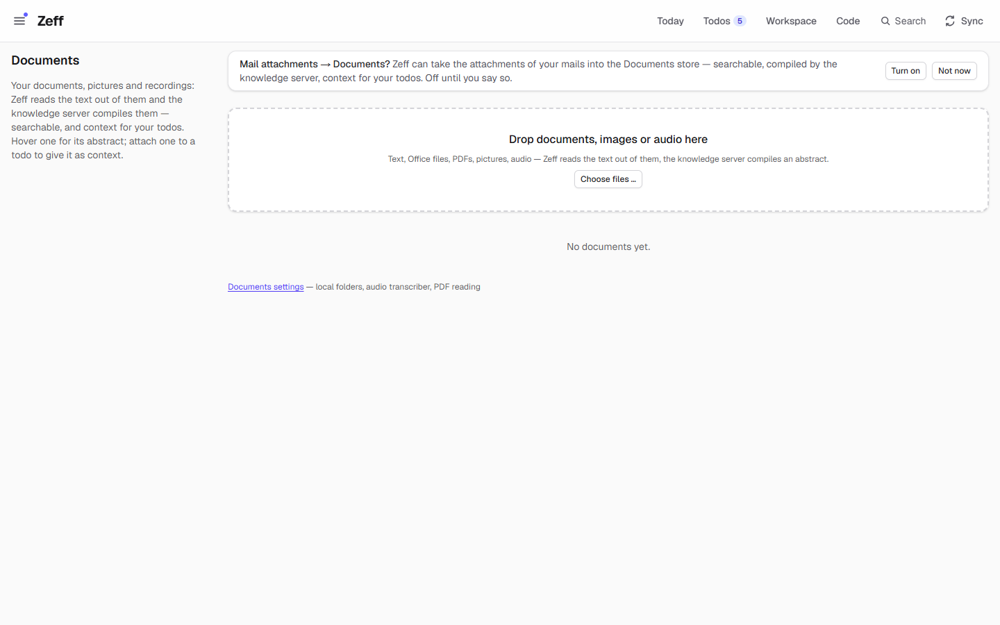
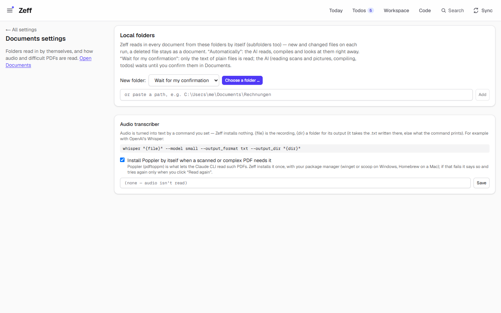
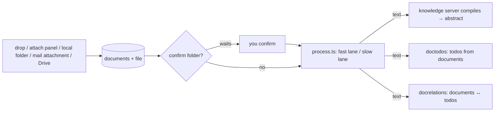

# Documents

> A store for your documents — text, Office files, PDFs, pictures, audio — whose text Zeff reads, so they become searchable, context for your todos and, with the AI, a source of todos themselves. **Category:** app · **On by default:** no · **Beta:** no · **Needs:** nothing; abstracts need [Knowledge](knowledge.md), document todos and matching need [LLM](llm.md)

## For users

### What it does

Letters, bills, forms, scans, screenshots and voice memos usually sit in a folder where nothing sees them. Drop
them into Zeff's **Documents** and it reads their text:

| Kind | How it is read |
| --- | --- |
| Text (txt, md, HTML, RTF …) | as it is (HTML and RTF stripped to text) |
| Office (docx, xlsx, pptx, odt, ods, odp) | their XML read out of the zip — no library, no Office needed |
| PDF with text | read here |
| Scanned or complex PDF | by the Claude CLI (needs Poppler's `pdftoppm`, installed by itself if allowed) |
| Picture | by the Claude CLI: the text visible in it, then what it shows |
| Audio | by a transcriber command you set (e.g. Whisper); none set: not read |

With the [Knowledge](knowledge.md) plugin, the knowledge server then compiles each document into a page with an
**abstract** (shown on hover) and concepts. Two extensions for [Todos](todos.md) run with every briefing:

- **Document review** — the AI reads new and changed documents and makes todos of what they ask of you: a deadline,
  a bill, a form, an open question — with the document as the todo's source.
- **Document matching** — the AI attaches to each open todo the documents it is about, by content. They show on the
  todo, in its context and in agents' context.

You can also attach a document to a todo by hand. Documents come in from three more places: **local folders** you
name (read in on a schedule), **mail attachments** (Mail settings; the Documents page offers to switch it on), and
[Google Drive](google-drive.md) when its document pull is on.

The demo data has no documents, so the screenshot above shows the store as you first find it: the offer to take
mail attachments in (off until you say so), the drop zone, and the link to the settings.

### Getting started

1. **Menu → Plugins**, switch on **Documents**. *Document review* and *Document matching* are on by themselves once
   [LLM](llm.md) is installed too.
2. Open **Documents** (under *Apps*, `/documents`) and drop files on the page or use **Add files → Choose files …**
   (up to 50 MB each; the same content twice is kept once).
3. Optional, under **Settings → Documents** (`/settings/documents`): add **local folders**, set an **audio
   transcriber**, and decide whether Poppler may be installed by itself.
4. For pictures and scanned PDFs, the Claude CLI must be installed and signed in (see
   [AI backends](ai-backends.md)).

The settings page explains the two folder modes and shows an example transcriber command for OpenAI's Whisper:
`whisper "{file}" --model small --output_format txt --output_dir "{dir}"`.

### Using it

**The list.** Each document shows its name, kind, size and status: *waiting*, *being read …*, *ready*, *ready —
compiling …*, *compiled*, *failed*, *not readable*, *waits for your confirmation*, *deleted in the folder*. Search
by name, abstract and concepts (or **Full text** — every word found somewhere in the document's text), filter by
kind and status, sort by newest, name or size. Hovering shows the abstract; opening one shows its summary, its
text, and buttons **Open**, **Download**, **Read again**, **Delete**.

**Reading** runs in the background in two lanes so one slow file never holds up the rest: the fast lane reads what
needs no AI (text, Office, PDFs with text); the slow lane has what needs the Claude CLI (pictures, scans — at most 5
minutes each) or the transcriber. **Restart reading** stops what is being read now and starts the rest afresh;
**Skip** leaves one out. What a restart of Zeff interrupted is picked up again.

**Attach to a todo.** Under a todo, the attach panel lists the store's documents (search, one click, abstract
beside each) or takes new files dropped right there — kept in the store and attached at once. In a todo's notes,
`` shows a picture from the store. An attached document is part of the todo's context and what the
AI reads.

**Local folders.** In Settings → Documents → Local folders, pick a folder with the small folder browser (drives →
folders) or paste a path (`C:\Users\me\Documents\Rechnungen`). Subfolders are included. Each folder is either
**Automatically** (goes on to the AI by itself) or **Wait for my confirmation** — then its documents are read
where that needs no AI, but nothing with the AI happens (no Claude reading, no compiling, no todos, no matching)
until you **Confirm** them on the Documents page (**Confirm all** for several). A changed file waits again. **Read
in now** scans immediately; otherwise the `localdocs` sync step does it on its interval. A changed file updates its
document in place; a deleted file leaves its document, marked as gone from the folder.

**In the Workspace.** The documents are also a [Workspace](workspace.md) source: a documents database with an inbox
(unread until you open the file, tick it off or mark it), all documents, the last seven days, from mail, being read,
and by type — the same entries as a sidebar in its view.

### Settings

| Setting | Where | What it changes |
| --- | --- | --- |
| Local folders | Settings → Documents | folders read in by themselves (path, mode *Automatically* / *Wait for my confirmation*, remove) |
| Audio transcriber | Settings → Documents | a command; `{file}` is the recording, `{dir}` a folder for its output (the `.txt` written there is taken, else what the command prints). Empty: audio isn't read |
| Install Poppler by itself | Settings → Documents [on] | when a scanned PDF needs `pdftoppm`, installs it once with winget/scoop (Windows) or Homebrew (Mac); a failed try is repeated only after a day or on *Read again* |
| Local folders interval | Sync settings | how often `localdocs` scans |
| Document review / Document matching | Menu → Plugins (under Documents) | the two AI steps; each has its model in the LLM settings |
| Mail attachments | Mail settings | which mail attachments become documents |

### Tips & limits

- **What leaves the machine:** plain reading happens locally. Pictures and scanned PDFs are sent to Claude through
  the Claude CLI. Document review and matching send documents' text (or the start of it) to the AI backend chosen
  for those tasks. The knowledge server runs locally.
- Use **Wait for my confirmation** for folders with sensitive papers: nothing reaches the AI before you confirm.
- One document per content (SHA-256): the same file dropped twice is "Already there."
- Files are kept in the account's data folder under `documents/`; deleting a document removes it from the store.
- Other plugins can replace what counts as a document's text — [Revolut](revolut.md) does this for bank statements,
  so their bookings don't reach knowledge, people and cases as if they were letters.
- Audio needs your own transcriber; Zeff installs none.

## Technical reference

### Overview

An upload (`POST /api/documents`, multipart field `files`, only from Zeff's own pages, agents or scripts) is hashed,
stored in `<data>/documents/` and inserted into `documents` with status `queued`. `process.ts` reads queued documents
in two lanes (`extract.ts` by kind; Claude CLI with `poppler.ts` for scans; the transcriber for audio), then — with
Knowledge installed — hands the text to the knowledge server's "Zeff" source (`export.ts`: one page per document in
the space "Zeff · Documents", versioned by a hash of the text) and polls the abstract back (`pullAbstracts`,
`pollAbstracts`). Documents from a confirm-folder are held by `gate.ts` before any AI step.

With every briefing, the `doctodos` step (`review.ts`) reads new and changed documents in batches and proposes
todos; the `docrelations` step (`relations.ts`) narrows each open todo's candidates by shared words and lets the AI
pick by content.

### Manifest

| Field | Value |
| --- | --- |
| id | `documents` |
| category | `app` |
| order | 190 |
| defaultInstalled | `false` |
| requires | Claude CLI for pictures and scanned PDFs (plus Poppler's pdftoppm); a transcriber command for audio |
| settings | `/settings/documents` — "Local folders read in by themselves, the audio transcriber" |
| apps | `/documents` — "Drop documents, images, audio" |
| routes | `/documents`, `/api/documents` |
| syncSteps | `localdocs` |
| extensions | `doc-review` (for `todos`, requires `llm`, on by default, sync step `doctodos`); `doc-relations` (for `todos`, requires `llm`, on by default, sync step `docrelations`) |

### Files

| File | What it is |
| --- | --- |
| [plugin.ts](../../src/plugins/documents/plugin.ts) | the manifest |
| [store.ts](../../src/plugins/documents/store.ts) | rows and files, add, delete, text, a todo's attachments |
| [shared.ts](../../src/plugins/documents/shared.ts) | kinds, statuses, `DocView`, `doc:<id>` refs, note-image syntax, 50 MB limit |
| [extract.ts](../../src/plugins/documents/extract.ts) | reading text by kind |
| [poppler.ts](../../src/plugins/documents/poppler.ts) | finding / installing `pdftoppm` |
| [process.ts](../../src/plugins/documents/process.ts) | the two reading lanes, restart, abstracts |
| [export.ts](../../src/plugins/documents/export.ts) | documents as knowledge-server pages |
| [folders.ts](../../src/plugins/documents/folders.ts) | local folders, scanning (`localdocs`) |
| [gate.ts](../../src/plugins/documents/gate.ts) | documents waiting for confirmation |
| [seen.ts](../../src/plugins/documents/seen.ts) | read/unread |
| [review.ts](../../src/plugins/documents/review.ts) | Document review (todos from documents) |
| [relations.ts](../../src/plugins/documents/relations.ts) | Document matching |
| [attachments.ts](../../src/plugins/documents/attachments.ts) | a todo's attached documents |
| [fulltext.ts](../../src/plugins/documents/fulltext.ts), [list-filter.ts](../../src/plugins/documents/list-filter.ts) | full-text search; list search, filter, sort |
| [text-point.ts](../../src/plugins/documents/text-point.ts) | the `documents.texts` extension point |
| [settings.ts](../../src/plugins/documents/settings.ts) | transcriber and Poppler setting |
| [workspace-source.ts](../../src/plugins/documents/workspace-source.ts), [nav.ts](../../src/plugins/documents/nav.ts), [view-data.ts](../../src/plugins/documents/view-data.ts), [view-template.meta.ts](../../src/plugins/documents/view-template.meta.ts), [ui/view-parts.tsx](../../src/plugins/documents/ui/view-parts.tsx) | the Workspace source, its sidebar and view template |
| [server-actions.ts](../../src/plugins/documents/server-actions.ts) | page and settings actions |
| [DocumentsApp.tsx](../../src/plugins/documents/DocumentsApp.tsx), [AttachPanel.tsx](../../src/plugins/documents/AttachPanel.tsx), [DocBadge.tsx](../../src/plugins/documents/DocBadge.tsx), [TodoPicker.tsx](../../src/plugins/documents/TodoPicker.tsx), [LocalFoldersForm.tsx](../../src/plugins/documents/LocalFoldersForm.tsx), [DocumentSettingsForm.tsx](../../src/plugins/documents/DocumentSettingsForm.tsx) | UI |
| [src/app/api/documents/route.ts](../../src/app/api/documents/route.ts), [[id]/file/route.ts](../../src/app/api/documents/%5Bid%5D/file/route.ts) | upload; the stored file |

### Data

| Table / pref | Fields |
| --- | --- |
| `documents` ([schema.ts](../../src/db/schema.ts)) | `name`, `mime`, `size`, `sha256` (unique), `kind` (text/office/pdf/image/audio/other), `status` (queued/extracting/ready/failed/unsupported), `error`, `file` (name in the documents folder), `text`, `summary` (the abstract), `concepts`, `compiled`, `created_at`, `updated_at` |
| `doc_local_files` | `path`, `folder_id`, `rel`, `doc_id`, `size`, `mtime`, `missing_at` — each file of a local folder |
| `doc_gate` | `doc_id`, `state`, `at` — documents waiting for confirmation |
| `document_seen` | `doc_id`, `at` — read state for the inbox |
| pref `documents:folders` | the local folders (`id`, `path`, `mode` auto/confirm, `addedAt`, `lastScanAt`, `files`) |
| pref `plugin:documents` | `transcriber`, `autoInstall` |
| `<data>/documents/` | the stored files |

A todo keeps a document as the ref `doc:<id>`.

### Sync, jobs & AI tasks

| Step | What it does | When |
| --- | --- | --- |
| `localdocs` | scans the local folders, reads new/changed files | its own interval (Sync settings); in use once a folder exists |
| `doctodos` | Document review | with the briefing, workdays (part of the todos step) |
| `docrelations` | Document matching | with the briefing, workdays (part of the relations step) |

Background: `process.ts` reading lanes (also resumed at server start by `instrumentation.ts`), abstract polling.

AI tasks ([llm-tasks.ts](../../src/plugins/documents/llm-tasks.ts)): `doc-todos` — "Finds what you have to do in new
and changed documents"; `doc-relations` — "Matches each todo with the documents it is about". The Claude CLI reads
pictures and scans directly (not an LLM task).

### MCP tools & actions

- MCP tool `todo_attachment` ([src/mcp/tools/todos.ts](../../src/mcp/tools/todos.ts)): returns a todo's attached
  pictures as images or a document's text (`doc: "doc:12"`); unavailable while Documents is off. `todo_context`
  lists attachments as `[doc:12]`.
- API: `POST /api/documents` (upload, answers `{ ok, documents: [{ id, ref, name, status, fresh }] }`),
  `GET /api/documents/<id>/file`.
- Server actions in [server-actions.ts](../../src/plugins/documents/server-actions.ts): delete, read again, restart,
  start, skip, attach to a todo, search, full text, folders (add, mode, remove, scan, browse), confirm, settings.
- No todo actions of its own.

### Extension points

- **Provides** `documents.texts` ([text-point.ts](../../src/plugins/documents/text-point.ts)): a function
  `(name, text) => string | null` that replaces a document's text for everything downstream; the first non-null
  wins. [Revolut](revolut.md) contributes one for bank statements.
- **Contributes** to the Workspace: `workspaceSources` (source `documents`, two-way for the *Unread* box) and
  `appNavProviders` (the documents view's sidebar entries in the Workspace tree).
- Used by [Mail](mail-client.md) attachments and [Google Drive](google-drive.md) (`addDocument`).

### Tests

[documents.test.ts](../../tests/documents.test.ts), [documents-lanes.test.ts](../../tests/documents-lanes.test.ts),
[documents-steps.test.ts](../../tests/documents-steps.test.ts),
[documents-fulltext.test.ts](../../tests/documents-fulltext.test.ts),
[documents-view.test.ts](../../tests/documents-view.test.ts), [doc-folders.test.ts](../../tests/doc-folders.test.ts),
[workspace-documents.test.ts](../../tests/workspace-documents.test.ts),
[mail-attachments.test.ts](../../tests/mail-attachments.test.ts),
[work-attachments.test.ts](../../tests/work-attachments.test.ts).

Run one with `node --import tsx --test tests/documents.test.ts`.
