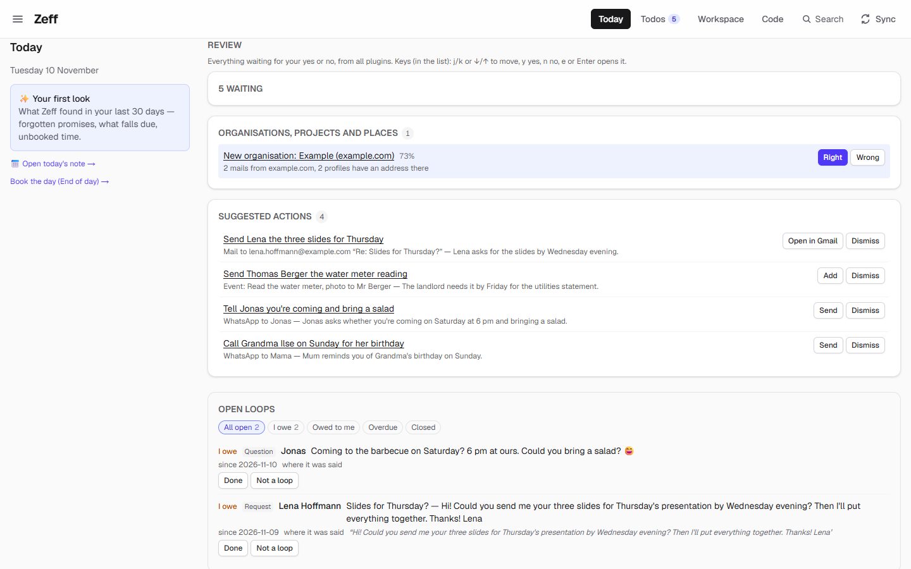
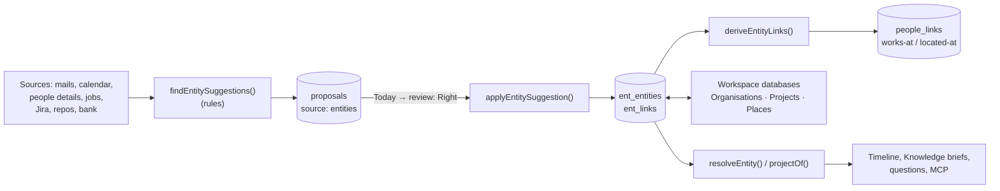

# Organisations, projects & places

> The organisations, projects and places your work hangs on, each known under every name your sources use, proposed by rule and confirmed by you, and kept as three databases of the Workspace. **Category:** app · **On by default:** no · **Beta:** no · **Needs:** [People](people.md), [Workspace](workspace.md)

## For users

### What it does

Besides people, most of what reaches you is about a *thing*: a company that writes from `@example.com`, a customer, a bank counterparty, a project with a job number, a Jira key and a repo, the office where an appointment takes place, the address in a letter. Every source writes these differently ("Example GmbH", "example.com", "Example"; "Hauptstraße 3, 10115 Berlin" and "Büro").

This plugin gives each of them **one entry** with all its names and links:

- **Organisations** (`org:<id>`) — found from mail domains (never freemail such as gmail or web.de), customers of your jobs, People profiles that are companies, and bank counterparties with a legal form. Each keeps its other names and mail domains; people whose address is at its domain (or whose role names it) are linked as *works at*.
- **Projects** (`project:<id>`) — the time tracking's projects, with what belongs to them: job number, Jira project key and board, repositories, Workspace databases and the organisation they are for, plus the hours booked.
- **Places** (`place:<id>`) — where your appointments are (online meetings never), people's addresses and the addresses in letters. Each keeps its address and other names ("Büro"); people living or sitting there are linked as *located at*.

Each entry's page gathers what belongs to it: its people, its projects, tickets, the latest mails, money paid and received, booked hours, the latest time entries and appointments. Other parts of Zeff — the [Timeline](timeline.md), the Knowledge briefs, the question views — and AI agents over MCP use it to turn a name, an address, a domain or a ticket key into the entity behind it.

Nothing is created behind your back: everything is a **proposal** you confirm in the review queue. In the demo, for example, two mails from `example.com` and two people with an address there produce the proposal "New organisation: Example (example.com)" with 73 % confidence.

### Getting started

1. Open **Menu → Plugins** and switch on **Organisations, projects & places**. It installs [People](people.md) and [Workspace](workspace.md) with it.
2. Open the **Workspace** once: three databases are created — **Organisations**, **Projects** and **Places** — and filled with what you already have (your time-tracking projects show up right away).
3. Wait for the next briefing (or run the **People matching** sync step from the Sync menu): it looks for organisations, places and project links in your sources and queues proposals.
4. Confirm them on the **Today** page, in the review section *Organisations, projects and places*.

There is nothing to sign in to and no AI involved — the proposals are read off the sources by rule.

### Using it

**Confirming proposals.** The review section on the Today page (shown above) lists what was found, each with the reason and a confidence. The kinds of proposals are:

| Proposal | What *Right* does |
| --- | --- |
| New organisation / place / project link | Creates the organisation or place (with its domains, aliases, address), or links a project to its job, Jira key, board, repo, database or customer. |
| Another name (alias) | Adds the name to an existing entity, so it is found by it from now on. |
| A link | Adds a missing domain, Jira key, board, repo, database or organisation. |
| Merge | Two entries are one: the second's names, links and people move to the first, the second goes. |

*Wrong* is remembered and the same proposal is never made again. Proposals whose reason has gone (the thing exists now, the source vanished) leave the queue by themselves.

**The databases.** Each kind is an ordinary Workspace database, one row per entity:

- *Organisations*: Aliases, Domains, People, Projects, Note.
- *Projects*: Aliases, Job, Jira, Repos, Databases, Organisation, Hours, Note.
- *Places*: Aliases, Address, People, Note.

In the demo nothing is confirmed yet, so the three databases are still empty: they fill as you accept proposals (your time-tracking projects appear in *Projects* once there are any).

Editing a row changes the entity: its name, note, address, other names and domains (a comma-separated list replaces the old one). Deleting an organisation or place row deletes it; projects are deleted in the time tracking (Projects), not here. Opening a row shows its page with the gathered sections — *People*, *Projects*, *Tickets* (open first), *Latest mails*, *Money*, *Booked*, *Latest entries*, *Appointments*, *Belongs to it* — and you can add your own blocks below.

**On a person.** A confirmed *works at* or *located at* appears on the person's page in [People](people.md) under the links.

### Settings

None. The plugin has no settings of its own; switch it off under Menu → Plugins. The three databases can be renamed or archived like any Workspace database — an archived one is not created again.

### Tips & limits

- **No AI, no data leaving the machine.** The proposals and links are deterministic rules over the local database (mail addresses, calendar locations, people's details, time-tracking jobs, Jira tickets, repos, bank transactions).
- **Freemail is never an organisation.** A domain is reduced to its registrable part (`mail.example.co.uk` → `example.co.uk`); organisation names are compared without their legal form ("GmbH", "AG", "Ltd").
- **Online locations are never places** (Teams, Zoom, Meet, Webex, links, "phone", "online" …).
- **People links are kept fresh by rule:** a *works at* / *located at* that is not seen again for 90 days lapses.
- **Projects are the time tracking's.** Renaming a project here renames it in the time tracking; its job number is shown in the Job field.
- A Jira key alone is used to find a project's tickets only when no board says more (one key may belong to two jobs).
- The MCP tools follow the agent's data clearance like every other Zeff tool.

## Technical reference

### Overview

Organisations and places are stored in `ent_entities`; projects are not copied — `project:<id>` *is* the time tracking's project (`src/lib/projects.ts`), read through the same store functions. Everything an entity is known by or linked to (alias, domain, job, jira, board, repo, db, org) is a row in `ent_links`. Who works at an organisation or lives at a place is part of the People graph (`people_links` with `works-at` / `located-at`).

Finding happens in [suggest.ts](../../src/plugins/entities/suggest.ts): `findEntitySuggestions()` collects candidates (`orgCandidates`, `placeCandidates`, project links) and queues them in the shared proposals store (`@/lib/proposals`, source `entities`); `deriveEntityLinks()` writes the rule-based people links. Both run in the People plugin's `peoplenorm` step after every briefing and again each time an entity database is read. Accepting goes through `decide()` (which writes the feedback ledger, step `entities`) and runs `applyEntitySuggestion`.

[resolve.ts](../../src/plugins/entities/resolve.ts) answers "what is this?" — `resolveEntity(input)` matches a mail address, domain, name, alias, address, ticket key, job number or key and returns entity or person refs; `projectOf(ref)` finds the project of a ticket, time entry, job, todo, repo, MR or page.

### Manifest

| Field | Value |
| --- | --- |
| id | `entities` |
| name | Organisations, projects & places |
| category | `app` |
| order | 173 |
| defaultInstalled | `false` |
| dependsOn | `people`, `workspace` |
| routes | — (its pages are Workspace databases) |
| settings | — |
| syncSteps | — (runs inside People's `peoplenorm`) |
| features | — |

### Files

| File | What it does |
| --- | --- |
| [plugin.ts](../../src/plugins/entities/plugin.ts) | The manifest. |
| [server.ts](../../src/plugins/entities/server.ts) | Registers the three Workspace sources and the proposal source. |
| [store.ts](../../src/plugins/entities/store.ts) | `ent_entities` / `ent_links`: create, get, list, update, merge, delete; projects read from the time tracking. |
| [suggest.ts](../../src/plugins/entities/suggest.ts) | Finding organisations, places, project links, aliases and merges; applying and rejecting; `deriveEntityLinks`. |
| [normalize.ts](../../src/plugins/entities/normalize.ts) | Registrable domains, freemail, names without legal form, address normalising, online-location check. |
| [resolve.ts](../../src/plugins/entities/resolve.ts) | `resolveEntity`, `resolveRefs`, `projectOf`. |
| [detail.ts](../../src/plugins/entities/detail.ts) | Everything gathered about an entity (people, projects, tickets, mails, money, hours, entries, appointments). |
| [database.ts](../../src/plugins/entities/database.ts) | Creates the three Workspace databases once (`ensureEntityDatabases`, called from the Workspace layout). |
| [workspace-source.ts](../../src/plugins/entities/workspace-source.ts) | The `orgs`, `projects`, `places` sources: records with typed fields, two-way pull, delete. |
| [proposals.ts](../../src/plugins/entities/proposals.ts) | The proposal source for the review queue. |
| [tools.ts](../../src/plugins/entities/tools.ts) | Search, get, proposal texts — shared by MCP and the review queue. |
| [mcp.ts](../../src/plugins/entities/mcp.ts) | MCP tools `entity_search`, `entity_get`. |

### Data

| Table / pref | Fields |
| --- | --- |
| `ent_entities` | `id`, `kind` (`org` / `place`), `name`, `note`, `address`, `created_at`, `updated_at`. |
| `ent_links` | `ref` (`org:3`, `place:5`, `project:2`), `rel` (`alias`, `domain`, `job`, `jira`, `board`, `repo`, `db`, `org`), `target`, `label`, `evidence`, `source` (`manual` — yours, `suggestion` — a proposal you accepted, `rule` — read off the sources), `created_at`; unique per (ref, rel, target). |
| proposals store | Pending/decided proposals with source `entities` (kinds org, place, project, alias, merge, link), payload `{ref, otherRef, name, data}`. An older `ent_suggestions` table is migrated once and left as it was. |
| `people_links` (People) | `works-at` / `located-at` links with `target_type` `org` / `place`. |
| Prefs | `workspace.orgsDb`, `workspace.projectsDb`, `workspace.placesDb` — the databases' ids. |

### Sync, jobs & AI tasks

No sync step and no AI tasks of its own. `findEntitySuggestions()` and `deriveEntityLinks()` run in [People](people.md)'s `peoplenorm` step (after each briefing, workdays) and whenever one of the entity databases is read by its pipeline.

### MCP tools & actions

| Tool | What it does |
| --- | --- |
| `entity_search` | Find organisations, projects and places by name, alias, mail address or domain, ticket key, job number or address; optional `kind`, `limit`. Also lists people the query resolves to. Read-only. |
| `entity_get` | One entity by `org:`, `project:` or `place:` ref with links, people and the gathered sections — or any other ref (ticket, entry, job, todo, repo, MR, page) to read the project it belongs to. Read-only. |

Both are registered on Zeff's MCP server (`src/mcp/server.ts`) and for Workspace agents (`plugins/workspace/agent.ts`); they answer with an error while the plugin is not installed. No todo actions, no server actions of its own (the review queue's buttons decide proposals).

### Extension points

| Point | Contribution |
| --- | --- |
| `workspaceSources` | `orgs`, `projects`, `places`. |
| `proposalSources` | `entities` — shown in the review queue as "Organisations, projects and places". |

Used by: [Timeline](timeline.md) (`refs.ts` resolves projects of tickets), the Knowledge plugin's briefs, the question views (`plugins/questions`), GitLab and work branch knowledge (`projectOf`). It writes into [People](people.md)'s link graph.

### Tests

`tests/entities.test.ts` covers freemail and domain rules, organisation proposals and their people links, aliases and merges only on your word, project links and `projectOf`, places from appointments and addresses, the review queue and MCP tools, and the Workspace row two-way edit. Related: `tests/cases-parties.test.ts`, `tests/intel-glue.test.ts`.

Run one: `node --import tsx --test tests/entities.test.ts`.
