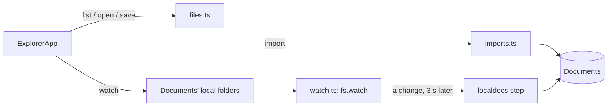

# Explorer

> The files of this computer in the Workspace, like Windows Explorer: drives, folders and files; import them into Documents, watch folders so their changes come in by themselves, and open text, Markdown, CSV, pictures, PDFs, Office files, audio and video — text files you can edit and save. **Category:** app · **On by default:** no · **Needs:** [Workspace](workspace.md) and [Documents](documents.md) (installed with it); Zeff running on the computer whose files you want to see

## For users

### What it does

Your files live in folders Zeff doesn't see until you point it at them. The Explorer is a window onto them inside the
Workspace, laid out like Windows Explorer:

- **Toolbar** — back, forward, up, refresh; the address bar (click a folder in it, or click beside the folders and type a
  path); a search that filters the folder you're in.
- **Places** on the left — *Quick access* (home, Desktop, Documents, Downloads, Pictures), your **watched folders** (a
  green dot: watched live), and *This PC* (the drives).
- **The folder's files** — name, date modified, type, size, and whether a file is in Documents (✅, or 🟡 when it changed
  since). Click the column names to sort. Click to pick, Ctrl/Shift-click to pick several, double-click (or click the
  name) to open a folder or a file.
- **The viewer** on the right — the file you opened.
- **Places in sidebar** (the button beside the search) moves the places into Zeff's sidebar, under the Explorer page in
  the Workspace tree, grouped as *Quick access*, *Watched folders* and *This PC* — the files get the room. A click
  there opens that folder; the place you're in is marked. **Places here** puts them back. Each Explorer page has
  its own setting.

| A file | Shown as |
| --- | --- |
| Text and code (txt, json, xml, yaml, ini, js, ts, py, sql, ps1 …) | an editor (the one of VS Code) with its colours; **Save** or Ctrl+S |
| Markdown | *Preview* or *Edit* |
| CSV / TSV | *Table* (the first 500 rows) or *Edit* |
| Pictures, PDFs, audio, video | as your browser shows them |
| Office (docx, xlsx, pptx, odt, ods, odp) | the text Documents reads out of it (not editable) |
| Anything else | *Open* (with this computer's program for it) or *Download* |

**Into Documents.** Pick files and press **Import to Documents**, or **Import folder** to take in every file Documents
reads in a folder and its subfolders once (at most 500 at a time). A file changed since it was imported shows 🟡 and
offers **Update in Documents** — its document is updated in place, nothing doubled. Saving a file you imported by hand
updates its document too.

**Watching a folder.** **Watch folder** makes the folder one of Documents' *local folders* (Settings → Documents): every
new and changed file in it (subfolders too) is read into Documents. Choose first whether its documents go to the AI
**Automatically** or **Wait for my confirmation**. With the Explorer installed, a watched folder is watched *live*:
a change is read in a few seconds after it happens, not only on the `localdocs` schedule. **Stop watching** leaves its
documents in Documents.

**On this computer.** **Open** hands a file to the program Windows opens it with, **Show in folder** shows it in
Windows Explorer, **Open in Windows Explorer** opens the folder there. Programs and scripts (exe, bat, ps1, msi, lnk …)
are never started from Zeff — only shown in their folder. **New folder** and **New text file** make one in the folder
you're in.

### Getting started

1. **Menu → Plugins**, switch on **Explorer** (Documents comes with it).
2. Open **Explorer** under *Apps* (`/explorer`): it opens your Explorer page in the Workspace, made the first time. More
   Explorer pages, each remembering its folder: **New → templates → Explorer**.
3. Find a folder, pick files and **Import to Documents**, or **Watch folder**.

### Keys

| Key | Does |
| --- | --- |
| Double-click / Enter | open the picked folder or file |
| Backspace, Alt+↑ | up one folder |
| Alt+← / Alt+→ | back / forward |
| F5 | refresh |
| Ctrl+A | pick everything shown |
| Ctrl+S (in the editor) | save |

### Tips & limits

- **Who sees what:** the Explorer shows every file the user Zeff runs as can read — as the folder browser under
  Settings → Documents does. Anyone who can open your Zeff can open your files through it, so keep Zeff to yourself (it
  listens on 127.0.0.1 unless you set it up otherwise), or leave the plugin off.
- In Docker it sees the container's files: the folders you mounted (`ZEFF_PATH_MAP` maps their Windows paths). *Open* and
  *Show in folder* aren't offered there.
- Text is edited as UTF-8 (a BOM stays). Files in another encoding are shown, not edited, so saving can't mangle them.
  Files over 2 MB are shown, not edited; over 10 MB not shown.
- Saving is refused when another program changed the file since you opened it — open it again.
- Hidden files (starting with `.` or `$`), Office's lock files (`~$…`), `desktop.ini` and `Thumbs.db` aren't listed.
  At most 5000 entries per folder are shown.
- Nothing is deleted, moved or renamed from here.

## Technical reference

### Overview

The Explorer is a page app of the Workspace (`workspace.pageApps`): an Explorer page is a plain page whose id is kept in
the pref `explorer:pages` with the folder it was last in. The page renders `ExplorerApp` with its first listing read on
the server (`start.ts`), so nothing waits for a round trip. Everything after goes through server actions. Files for the
viewer (pictures, PDFs, media) come from `GET /api/explorer/file?path=…` (Range requests, only from Zeff's own pages).

Importing uses Documents' store (`addDocument`, `replaceDocument`) and remembers which file became which document in
`explorer_imports`; a watched folder's files are known from Documents' `doc_local_files`. Watching uses Documents' local
folders (`documents/folders.ts`); `watch.ts` adds a recursive `fs.watch` per folder and account that runs the `localdocs`
step three seconds after the last change.

### Manifest

| Field | Value |
| --- | --- |
| id | `explorer` |
| category | `app` |
| order | 192 |
| defaultInstalled | `false` |
| dependsOn | `workspace`, `documents` |
| apps | `/explorer` — "The files of this computer, in the Workspace" |
| routes | `/explorer`, `/api/explorer` |

### Files

| File | What it is |
| --- | --- |
| [plugin.ts](../../src/plugins/explorer/plugin.ts) | the manifest |
| [server.ts](../../src/plugins/explorer/server.ts) | the page app, the template, the watchers started |
| [shared.ts](../../src/plugins/explorer/shared.ts) | shapes; what a file is shown as, its editor language; crumbs; CSV rows (client-safe) |
| [files.ts](../../src/plugins/explorer/files.ts) | listing, places, opening, saving, new folder / file, opening with this computer's program |
| [imports.ts](../../src/plugins/explorer/imports.ts) | import into Documents, what is imported (`explorer_imports`) |
| [watch.ts](../../src/plugins/explorer/watch.ts) | live watchers of the watched folders |
| [pages.ts](../../src/plugins/explorer/pages.ts), [start.ts](../../src/plugins/explorer/start.ts) | Explorer pages; what a page starts with |
| [server-actions.ts](../../src/plugins/explorer/server-actions.ts) | the page's actions |
| [ui/ExplorerApp.tsx](../../src/plugins/explorer/ui/ExplorerApp.tsx), [ui/FileViewer.tsx](../../src/plugins/explorer/ui/FileViewer.tsx) | UI |
| [src/app/explorer/page.tsx](../../src/app/explorer/page.tsx) | `/explorer`: opens the Explorer page |
| [src/app/api/explorer/file/route.ts](../../src/app/api/explorer/file/route.ts) | a file for the viewer or as a download |

### Data

| Table / pref | Fields |
| --- | --- |
| `explorer_imports` | `path` (the host's), `doc_id`, `size`, `mtime`, `at` — a file imported by hand and its document |
| pref `explorer:pages` | `{ [pageId]: { path, inTree } }` — the Explorer pages, their folder (`null`: This PC) and whether their places are in the Workspace tree |
| (Documents) `doc_local_files`, pref `documents:folders` | the watched folders and their files |

### Server actions

`listFolderAction`, `placesAction`, `openFileAction`, `saveFileAction`, `importFilesAction`, `importFolderAction`,
`watchFolderAction`, `unwatchFolderAction`, `watchModeAction`, `createAction`, `openHereAction`, `placesInTreeAction` — each answers
`{ ok: true, … }` or `{ ok: false, error }` and refuses while the plugin is off.

### Extension points

- **Contributes** `workspace.pageApps` (the Explorer on its pages), `workspace.templates` (*Explorer*) and
  `workspace.pageNav` (its places under an Explorer page in the tree, when set so: entries `path:<folder>`, opened as
  `?nav=path:<folder>`; the Explorer keeps the address in step with the folder shown).
- **Uses** Documents' store and local folders, and the `localdocs` sync step.
- No API methods, MCP tools, actions or AI tasks of its own.

### Tests

[explorer.test.ts](../../tests/explorer.test.ts) — run with `node --import tsx --test tests/explorer.test.ts`.
