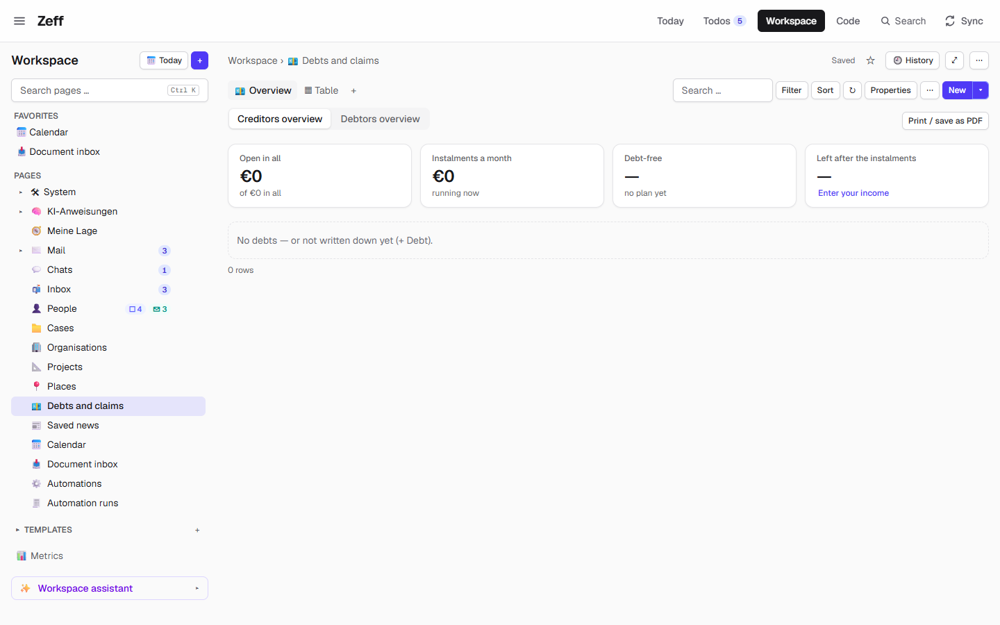
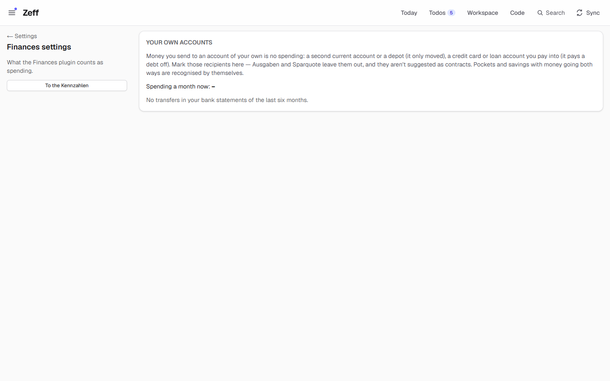
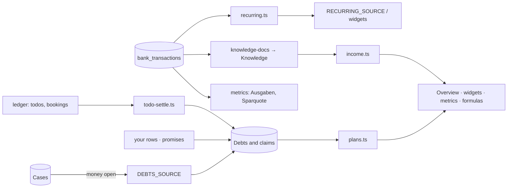

# Finances

> Your debts and what you are owed in one Workspace database — whom you owe what, the instalments a month, when you are debt-free, who owes you — with payment plans, charts of the months ahead and your income and spending read off your bank statements. **Category:** app · **On by default:** yes · **Beta:** no · **Needs:** [Workspace](workspace.md), [Cases](cases.md) (bank data from [Revolut](revolut.md) or the Cases bank connection; income needs the [Knowledge](knowledge.md) server)

## For users

### What it does

Debts rarely sit in one place. A payment plan with the broadcasting fee office arrives by letter, a loan from a friend
was a WhatsApp message, the credit card is a line on the bank statement. Finances gathers them into one Workspace
database, **Debts and claims** (💶), and answers the questions you actually have:

- **Creditors overview** — whom you owe what, what is still open, your instalments a month, the month you are
  debt-free, and what is left of your income after the instalments (and your fixed costs).
- **Debtors overview** — the same the other way round: who owes you, what comes back a month, when it is all back,
  the next payment you expect.

Debts come from two places:

1. **The cases** — every [case](cases.md) with money open becomes a row by itself, its figures what its letters
   say (locked in the table; the bank's payments counted).
2. **Your own rows** — a loan from Chris, a credit card, money a friend owes you. You write these down with **+
   Debt**; promises with an amount that the [People](people.md) plugin found ("… 200 € zurücküberweisen") are offered
   as debts to write down with one click.

Each debt gets a **payment plan**: the instalment every month from its next due day (on the plan's day of the month,
when set), the rest last, until nothing is open. A debt with a due day but no instalment is one payment; one with
neither has no plan (it is counted under "without a plan"). Ticking off a payment todo, or a matching booking on your
statement, lowers the debt and moves its due day a month on.

In the demo the database exists but is empty ("No debts — or not written down yet (+ Debt).") — the demo has no
letters with case numbers and no bank statements.

### Getting started

1. Finances is on by default. If not: **Menu → Plugins → Finances** (it installs Workspace and Cases).
2. The database **Debts and claims** is made once in the Workspace (sidebar, 💶). The old address
   `/vorgaenge/uebersicht` leads there too, as does *Debt overview* in the Cases bank bar.
3. For income, spending and recurring payments, give Zeff bank bookings: import a statement CSV ([Revolut](revolut.md))
   or connect your bank (see [Cases](cases.md#using-it)).
4. Optional: **Settings → Finances** to mark recipients that are accounts of your own.

### Using it

**The overview.** Switch between *Creditors overview* and *Debtors overview* with the tabs. Tiles on top:

| Tile (creditors) | Tile (debtors) | What it shows |
| --- | --- | --- |
| Open in all | Owed to you in all | what is still open, "of … in all" |
| Instalments a month (or *Running costs a month* with fixed costs counted in) | Coming back a month | the plans running now |
| Debt-free | All back | the month the last debt with a plan is paid |
| Left after the instalments (and fixed costs) | Next payment | your income minus the instalments; click the income to change it |

Below, the table: creditor (with its colour; ✎ changes the contact), *Total*, *Open* (with a progress bar), *Instalment*,
*Next due* (red when overdue), *Plan* (in words, "until …"; amber when there is no plan), *Last payment*, and the
buttons **Pay** (shows the debt's GiroCode — see [Cases](cases.md)) and, for your own rows, remove. Your own debts'
figures are edited in place (click, type, Enter); a case's figures are what its letters say. A `*` notes debts with no
known due day — their plan is assumed to start next month.

Charts follow when there are plans: *Open until debt-free* (a falling line), *Open by creditor* (bars), *Fixed costs*
(when published), and *Monthly payments until debt-free* — a bar per month stacked by creditor, your income as a line;
toggle *Count in fixed costs* to put your fixed costs under the bars. **Print / save as PDF** prints the overview with
its date.

**Writing a debt down.** **+ Debt** (the toolbar's *New*) opens the form: direction, the other side (pick a contact or
type a new name — person or organisation), what for, amount, instalment, due day. Below it, promises found in your
messages are offered ("Lotte: 200 € zurücküberweisen" → a debt to Lotte).

**Fixed costs.** Finances counts as fixed costs any column you publish as value type **Fixkosten** in one of your
databases (e.g. a *Verträge* or *Monatskosten* database). Their sum (or the aggregate you chose) appears in the tiles
and the monthly chart.

**Recurring payments.** From your bookings, Finances finds what goes out regularly to the same recipient (monthly,
quarterly, yearly; amounts about the same) — contracts and subscriptions. They are a Workspace source (*Recurring
payments*, 🔁) a contracts database can follow, and the widget *Subscriptions not in your contracts* lists those no contracts row covers yet,
with *Add to …* to make the row.

**Widgets & formulas.** On any Workspace page or on Today: the widgets *Debts in figures*, *Payments coming up*,
*Subscriptions not in your contracts* and *Cashflow ahead* (the next 90 days of your account from today's balance, with a buffer warning). In formulas:
`=Schulden(@Chris)`, `=SUMME(Schulden(@Freunde))`, `=Forderungen(@Familie)`, `=Rate(@Sparkasse)` (English aliases
`Debts`, `Claims`/`Owed`, `Instalment`).

### Settings

**Settings → Finances** (`/settings/finances`) lists the recipients of your transfers in the last six months (count,
amount, last transfer), the money first, with *Spending a month now* and *to credit accounts* above.

| Setting | Values | What it changes |
| --- | --- | --- |
| A recipient's kind | *Not mine (spending)* · *Own account* · *Credit account* | money sent to your own or credit accounts is no spending: *Ausgaben* and *Sparquote* leave it out, and it isn't suggested as a contract; credit accounts are summed as *Auf Kreditkonten* |
| Income a month | the *Left after* tile (click) | your own figure over the one read off your statements; emptied, the statements' again |
| *Count in fixed costs* | toggle on the overview | fixed costs in the tiles and the monthly chart |
| Widget settings | per widget | *Whose* (what I owe / what I am owed), *Days ahead*, *How many*, cashflow *Balance today* and *Buffer* |

Pockets and savings accounts with money going both ways are recognised as "moved only" without marking.

### Tips & limits

- **Rows from cases are read-only** in the debts table (their fields are locked); correct them on the case.
- **Income** is the average *net income* of the last three whole months, as the [Knowledge](knowledge.md) server read
  it off your statements: Finances gives it one page per account and month (space *Zeff · Konto*: money in by sender,
  largest payments out). Without Knowledge, set it by hand.
- **Spending** is the statements' outgoing money over the last three whole months, on average, minus moved money.
- **Privacy.** The plans, charts and recurring detection are computed locally. Your monthly bank summaries go to the
  local Knowledge server, and through it to the AI it compiles with.
- Removing your own debt moves its row to the Workspace bin (restorable).
- Plans assume monthly instalments; irregular plans need the due day adjusted by hand.

## Technical reference

### Overview

The **Debts and claims** database is a normal Workspace database with fixed field ids (`DEBT` in fields.ts) and
`dataType: "debts"`. Its pipeline has one source step, `ext: "debts"` (`DEBTS_SOURCE`), running every 60 minutes and
after changes: `debtRecords()` turns every case with money open into a record (fields locked). Your own rows sit beside
them in the same database. The *Overview* view is the app view `debts` (view-template.meta.ts) — a template of the
Workspace template language with plugin parts for in-place editing, the GiroCode, the form and the charts; the second
view *Table* is the raw table.

`debts.ts` reads the database and computes a `DebtPlan` per row with `plans.ts` (`schedule()` per debt, `summarize()`
for monthly rates, debt-free month, unplanned total and the months ahead). `todo-settle.ts` hooks the debts into the
shared ledger (`lib/money/ledger`) and the todo settle machinery: a proof (a payment todo done, a booking) is allocated
to a debt; `recomputeDebt()` rebuilds a row's open amount and due day from its start figures and its allocations. A
booking no todo took can pay a debt of your own by its recipient.

### Manifest

| Field | Value |
| --- | --- |
| id | `finances` |
| category | `app` |
| order | 178 |
| defaultInstalled | `true` |
| dependsOn | `workspace`, `cases` |
| settings | `/settings/finances` — "Your own accounts: transfers there are no spending" |
| routes | `/settings/finances` |
| syncSteps | none |
| features | none |
| actions / AI tasks | none (view action `debts.new`) |

### Files

| File | What it is |
| --- | --- |
| [plugin.ts](../../src/plugins/finances/plugin.ts) | the manifest |
| [server.ts](../../src/plugins/finances/server.ts) | registers sources, widgets, metrics, formula functions; loads `todo-settle` |
| [fields.ts](../../src/plugins/finances/fields.ts) | the debts database's fixed field ids `DEBT` |
| [database.ts](../../src/plugins/finances/database.ts) | creates the database, `debtRecords()` from the cases, moves old manual "MAN-…" cases in |
| [source.ts](../../src/plugins/finances/source.ts) | `DEBTS_SOURCE`, `RECURRING_SOURCE` |
| [debts.ts](../../src/plugins/finances/debts.ts) | debts per direction with plans; balances per contact |
| [plans.ts](../../src/plugins/finances/plans.ts) | pure payment-plan maths (`schedule`, `summarize`) |
| [own.ts](../../src/plugins/finances/own.ts) | your own debts: create, edit, delete, from a promise |
| [todo-settle.ts](../../src/plugins/finances/todo-settle.ts) | ledger hooks: a payment lowers its debt; `recomputeDebt()` |
| [income.ts](../../src/plugins/finances/income.ts) | monthly income (yours, else Knowledge's) |
| [knowledge-docs.ts](../../src/plugins/finances/knowledge-docs.ts) | statements as monthly pages for the Knowledge server |
| [accounts.ts](../../src/plugins/finances/accounts.ts) | own/credit accounts, recipients list, credit payments |
| [recurring.ts](../../src/plugins/finances/recurring.ts) / [recurring-source.ts](../../src/plugins/finances/recurring-source.ts) | recurring payment detection and its Workspace source |
| [insights.ts](../../src/plugins/finances/insights.ts) / [insights-data.ts](../../src/plugins/finances/insights-data.ts) | missing subscriptions, contract matching, cashflow forecast |
| [fixed.ts](../../src/plugins/finances/fixed.ts) | fixed costs from columns published as "Fixkosten" |
| [metrics.ts](../../src/plugins/finances/metrics.ts) | Kennzahlen; `monthlySpending()` |
| [formulas.ts](../../src/plugins/finances/formulas.ts) | formula functions `Schulden`, `Forderungen`, `Rate` |
| [widgets.ts](../../src/plugins/finances/widgets.ts) | Workspace widgets |
| [view-template.meta.ts](../../src/plugins/finances/view-template.meta.ts) / [view-data.ts](../../src/plugins/finances/view-data.ts) | the overview template and its `app.*` |
| [server-actions.ts](../../src/plugins/finances/server-actions.ts) | the page's server actions |
| [ui/](../../src/plugins/finances/ui/) | `AddDebt`, `DebtChart`, `BalanceChart`, `EditMoney`, `EditSide`, `InlineAmount`, `DeleteDebt`, view parts |
| [settings page](../../src/app/settings/finances/page.tsx) | Settings → Finances |

### Data

The debts database (Workspace tables `ws_pages`), fields:

| Field id | Name | Type |
| --- | --- | --- |
| title | What for | title |
| `debtdir` | Direction | select: *I owe* / *Owed to me* |
| `debtcreditor` | Other side | person |
| `debtcollector` | Collected by | person |
| `debttotal` | Total | € |
| `debtopen` | Open | € |
| `debtrate` | Instalment | € |
| `debtdue` | Next due | date |
| `debtday` | Plan's day | number (day of month) |
| `debtcase` | Case number | text |
| `debtnext` | Next | text |
| `debtclaim` | From promise | number (People claim id; hidden in *Table*) |

Prefs: `workspace.debtsDb` (database id), `finances.ownAccounts` (recipient key → `own`/`credit`), `cases.income`
(your income), `cases.incomeFacts` (what Knowledge read). Payments are ledger entries (`lib/money/ledger`). Bookings
are the Cases plugin's `bank_transactions`.

### Sync, jobs & AI tasks

No sync step and no AI task. The debts database's pipeline reruns every 60 minutes and after changes. After each
briefing, `refreshIncome()` reads the income facts from the Knowledge server (also when the overview opens). The
monthly bank pages are handed to Knowledge's export (`plugins/knowledge/export.ts` → `bankDocs()`), versioned by an
FNV-1a hash so unchanged months aren't compiled again.

### MCP tools & actions

No MCP tools or todo actions. Server actions: `financesOverviewAction(dir)`, `createDebtAction`,
`debtFromClaimAction`, `debtMoneyAction`, `debtSideAction`, `deleteDebtAction`, `setIncomeAction`,
`markAccountFormAction`. View action `debts.new` opens the form. Agents read and write the database through the
Workspace MCP tools.

### Extension points

Contributes to:

- `workspaceSources` — `debts` (💶) and `recurring` (🔁, fields `CONTRACT`, locked).
- `workspaceWidgets` — `finances.figures`, `finances.payments`, `finances.subscriptions`, `finances.cashflow`.
- `workspaceMetrics` — *Schuldenstand*, *Offene Schulden*, *Tilgungsrate*, *Schuldenfrei in*, *Schulden ohne Plan*,
  *Forderungen*, *Offene Forderungen*, *Rückzahlungen*, *Alles zurück in*, *Forderungen ohne Plan*, *Nettoeinkommen*,
  *Ausgaben*, *Auf Kreditkonten*, *Frei im Monat*, *Sparquote*, *Schuldendienstquote*.
- `workspaceFormulaFunctions` — `Schulden`, `Forderungen`, `Rate`.
- the todo settle machinery and the ledger (`todo-settle.ts`).
- Workspace view templates — app view `debts`.

Reads: the Cases plugin's cases, parties and bookings; People's claims (promises); the Workspace value type
`fixkosten`.

### Tests

`tests/finances.test.ts`, `tests/finances-plans.test.ts`, `tests/finances-view.test.ts`,
`tests/finances-insights.test.ts`, `tests/finances-recurring.test.ts`, `tests/income.test.ts`,
`tests/templates-finance.test.ts`, `tests/ledger.test.ts`, `tests/formula-units.test.ts`.
Run one with `node --import tsx --test tests/finances.test.ts`.
