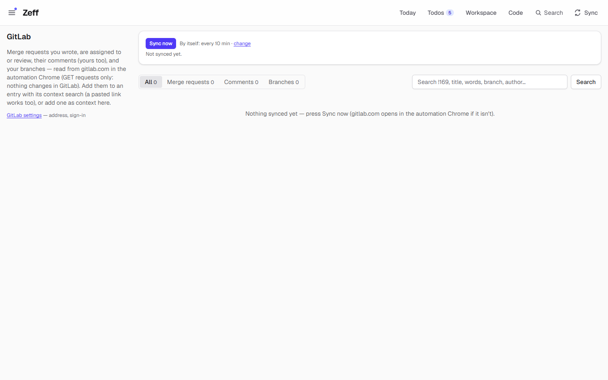
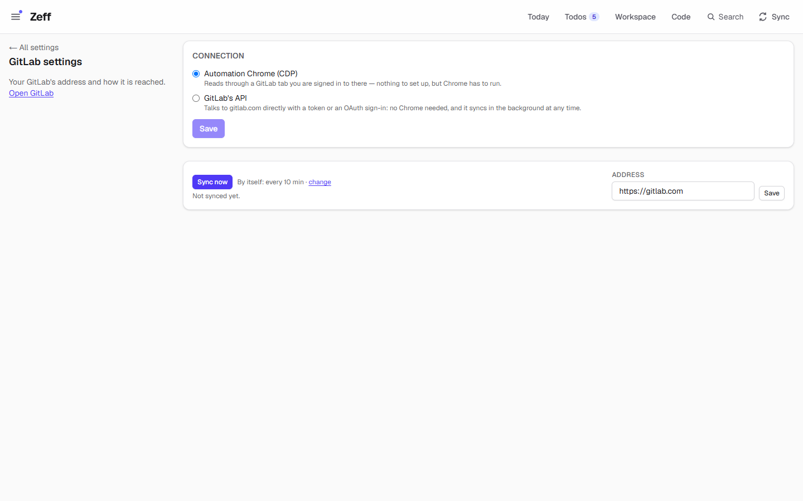
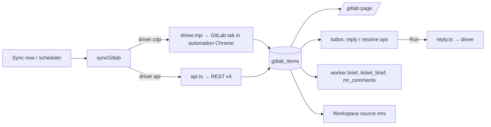

# GitLab

> Reads your merge requests, their review comments and your branches from GitLab — as context for todos and workers, and for delivery (push, open MR, merge) and replies to comments on a click. **Category:** connector · **On by default:** yes · **Beta:** no · **Needs:** the automation Chrome signed in to GitLab ([Browser](browser.md)), or GitLab's API with a token or your own OAuth sign-in; git for delivery



## For users

### Where it is

GitLab's page lives in the **Workspace**: the database **GitLab** (a favourite, made the first time `/gitlab` is opened) holds the synced
items — Item, Kind (mr, comment, branch), Project, Ref, Author, State, Branch, Ticket, When, Updated, In context, Link, Body — read from
the source "GitLab" (`gitlab-items`). Its **GitLab** view is the old page in the view language: the sync, the kinds with their counts,
the search and each item with its text, "done?" and "Add as context". You (or the assistant) can change it like any view, and every
change is kept as a version.

What a view or flow can do in GitLab (changing GitLab needs the flow permission "send"):

| Flow action | Does |
| --- | --- |
| `gitlab.reply` | an answer in a comment's thread (note, body) |
| `gitlab.resolve` | marks a comment's thread resolved (note) |
| `gitlab.merge` | merges a merge request (project, iid, source) |
| `gitlab.sync` | reads the items from GitLab now |

`/gitlab?kind=mr&q=…` opens that page with the kind and the search set.


### What it does

When you write code, much of the conversation about it happens in GitLab: reviewers comment on lines of a merge request,
you answer, threads get resolved, branches get merged. The GitLab plugin brings that into Zeff:

- it **syncs** the merge requests you wrote, are assigned to or review, all their comments (yours too, with their
  thread and — for a comment on code — the file and line), and your branches with commits in the last 90 days;
- the **GitLab page** lists them (All / Merge requests / Comments / Branches) with a search ("!169", title words,
  branch, author), each with *Open in GitLab* and *Add as context*;
- review comments become **todos** (through the briefing, see [Jira briefing](jira-lage.md) and [Todos](todos.md)) that
  offer one-click operations: *Reply* with the drafted answer, *Resolve* the thread;
- the [Code](work.md) plugin's workers get a ticket's merge requests and comments in their brief, and after an
  implementation Zeff offers *Open merge request* and, once approved, *Merge*;
- merge requests are a Workspace source (*Open MRs* per ticket, see [Workspace](workspace.md)).

In the demo the plugin is installed but nothing is synced: the page shows the empty state ("Nothing synced yet — press
Sync now").

### Getting started

1. **Menu → Plugins → GitLab** (on by default).
2. **Settings → GitLab** (`/settings/gitlab`): enter your GitLab's address (default `https://gitlab.com`).
3. Choose the **driver**:
   - **Automation Chrome (CDP)** — nothing to set up: Zeff uses a GitLab tab in the automation Chrome you are signed in
     to (default `http://127.0.0.1:9222`), and calls GitLab's API from that tab with your session. Chrome has to run.
   - **GitLab's API** — with a *Personal access token*, or *OAuth* with an application you register in GitLab
     (Application ID, and a secret only for a confidential application; the redirect URI to register is shown, it ends in
     `/api/connectors/gitlab/callback`). Then *Sign in to GitLab*. *Test*, *Connect again* and *Disconnect* are there
     once connected.
4. Press **Sync now** on the GitLab page, or set an interval on the Sync settings page.



### Using it

- **Browse and search** on `/gitlab`: the tabs filter by kind (with counts), the search matches title, text, ref,
  project and author. The list shows the latest 150; search to find older ones. Jira keys in titles and branch names are
  recognized when their prefix is one you book on.
- **Add as context**: keeps an item as a context item (with its link) to link to time entries.
- **Answering review comments**: a todo for a review comment carries `gitlab-reply` (the drafted answer) and
  `gitlab-resolve`. *Run* posts the reply in the comment's thread / resolves it in GitLab. Marking a comment done in
  Zeff also resolves (or reopens) its thread in GitLab when GitLab treats it as a thread.
- **Delivery** after a worker's implementation: *Push branch* (Code), then *Open MR* (`gitlab-open-mr`; an open MR for
  the branch is reused), then *Merge !iid* (`gitlab-merge`) — offered as soon as the MR is approved.

### Settings

| Setting | Where | What it changes | Default |
| --- | --- | --- | --- |
| Address | Settings → GitLab | Your GitLab's base URL. | `https://gitlab.com` |
| Driver | Settings → GitLab | Automation Chrome (CDP) or GitLab's API. | CDP |
| API sign-in | Settings → GitLab | Personal access token, or OAuth (application ID, secret; scopes `api read_user`). | — |
| Sync interval | Sync settings page (and the sync controls) | Every N minutes, 0 = only by hand. With CDP the background sync runs only while the automation Chrome runs; with the API always. | 10 min |

### Tips & limits

- **Reading is GET only.** Writes happen only on your click: a reply, a new comment, resolving a thread, opening or
  merging an MR. Every write supports a dry run in the driver (find the thread / check the branches, post nothing).
- With CDP no token or password is touched — Zeff uses Chrome's session. The background sync never starts Chrome; a
  sync by hand may open a GitLab tab there.
- With the API, the token / OAuth tokens are stored in Zeff's database (`connectors` table) on this computer.
- What the AI sees: synced MRs and comments are part of the context the briefing and workers read; that text goes to
  the configured AI backend.
- After a sync that worked, only what changed since (with a day's overlap) is read again.
- Comments from bot accounts ("release-bot", "Semantic Bot") are treated as notices.

## Technical reference

### Overview

Two drivers give the same reads and writes with the same results:

- `driver.mjs` — a stdio MCP server that attaches to the automation Chrome (`GITLAB_CDP_ENDPOINT`, else
  `CHRONO_CDP_ENDPOINT`, else `http://127.0.0.1:9222`) and calls GitLab's REST API from a GitLab tab there (reply falls
  back to the page itself: Reply…, type, send). Tools: `gitlab_items`, `gitlab_reply`, `gitlab_comment`,
  `gitlab_resolve`, `gitlab_open_mr`, `gitlab_merge_mr`.
- `src/lib/gitlab/api.ts` — REST v4 with a token or OAuth (a 401 refreshes the OAuth token once).

Which one is used is the `connectors` row for `gitlab` (`driver`: `cdp` / `api`). `syncGitlab()` (`src/lib/gitlab/sync.ts`,
one at a time per server) reads items and saves them into `gitlab_items`; `src/lib/gitlab/reply.ts` does the writes.



### Manifest

| Field | Value |
| --- | --- |
| id | `gitlab` |
| name | GitLab |
| category | connector |
| order / actionsOrder | 360 / 20 |
| defaultInstalled | true |
| requires | The automation Chrome with GitLab, signed in (and git) — or GitLab's API with a token or your own sign-in. |
| dependsOn | none |
| settings | `/settings/gitlab` ("Your GitLab's address") |
| nav | `/gitlab` (Merge requests, comments & branches) |
| routes | `/gitlab` |
| syncSteps | `gitlab` |
| services | `gitlab` |

### Files

| File | What it is |
| --- | --- |
| [plugin.ts](../../src/plugins/gitlab/plugin.ts) | The manifest. |
| [server.ts](../../src/plugins/gitlab/server.ts) | Contributes the Workspace source. |
| [actions.ts](../../src/plugins/gitlab/actions.ts) | Actions `gitlab-reply`, `gitlab-resolve`, `gitlab-open-mr`, `gitlab-merge`. |
| [run.ts](../../src/plugins/gitlab/run.ts) | Runs them. |
| [server-actions.ts](../../src/plugins/gitlab/server-actions.ts) | Sync now, save address, mark a comment resolved, search/find items for the context form. |
| [sync-settings.ts](../../src/plugins/gitlab/sync-settings.ts) | Its row on the Sync settings page. |
| [workspace-source.ts](../../src/plugins/gitlab/workspace-source.ts) | Workspace source: merge requests, joinable by ticket. |
| [GitlabConnection.tsx](../../src/plugins/gitlab/GitlabConnection.tsx) | Driver / token / OAuth form. |
| [driver.mjs](../../src/plugins/gitlab/driver.mjs) | The automation-Chrome driver (stdio MCP server). |
| [lib/gitlab/api.ts](../../src/lib/gitlab/api.ts) | The API driver (REST v4, OAuth endpoints, note positions). |
| [lib/gitlab/sync.ts](../../src/lib/gitlab/sync.ts) | The sync. |
| [lib/gitlab/store.ts](../../src/lib/gitlab/store.ts) | Settings, saving and listing items, recording an opened MR. |
| [lib/gitlab/reply.ts](../../src/lib/gitlab/reply.ts) | Reply, comment, resolve, open MR, merge. |
| [lib/gitlab/shared.ts](../../src/lib/gitlab/shared.ts) | Client-safe types and helpers. |
| [app/gitlab/page.tsx](../../src/app/gitlab/page.tsx), [app/settings/gitlab/page.tsx](../../src/app/settings/gitlab/page.tsx) | The pages. |
| [mcp/tools/merge-requests.ts](../../src/mcp/tools/merge-requests.ts) | MCP tools for agents. |

### Data

| Table | What it holds |
| --- | --- |
| `gitlab_items` | One row per item; `key` `mr:<project>!<iid>`, `note:<id>` or `branch:<project>:<name>`; `kind` (mr/comment/branch), `project`, `project_url`, `ref` ("!167" or branch name), `title`, `body` (Markdown), `author`, `state` (opened/merged/closed, resolved/unresolved, or a branch's MR), `created_at`, `updated_at`, `url`, `branch`, `parent` (a comment's or branch's MR key), `thread` (GitLab discussion id), `synced_at`, `resolved_at` (marked done in Zeff; kept across syncs). |
| `gitlab_settings` | `base_url`, `sync_minutes` (default 10), `last_sync_at`, `last_result`, `last_ok`. |
| `connectors` (service `gitlab`) | `driver` (cdp/api), `auth_kind` (token/oauth), `token`, `client_id`, `client_secret`, OAuth tokens and expiry, `scope`, `account`, `connected_at`. |

### Sync, jobs & AI tasks

- Sync step `gitlab` (`src/lib/sync/registry.ts`, scheduled by `src/lib/sync-scheduler.ts`): a full sync reads 90 days;
  later ones only what changed since the last good sync minus a day.
- No AI tasks of its own; the briefing's AI reads the comments and drafts replies (see [Jira briefing](jira-lage.md)).

### MCP tools & actions

**Actions** (on todos): `gitlab-reply` and `gitlab-resolve` (offered to the AI, "comms"); `gitlab-open-mr` and
`gitlab-merge` (delivery, made by Zeff after a worker's implementation).

**MCP tools** (Zeff's MCP server, available while GitLab is installed): `mr_comments` (a merge request's review comments
with their `note:<id>` keys and code positions), `mr_reply`, `mr_resolve`, `mr_comment`.

**Routes**: `/api/connectors/gitlab/connect` and `/api/connectors/gitlab/callback` (the generic OAuth connector routes).

### Extension points

- Contributes the Workspace source `mrs` (`workspaceSources`) — merge requests by ticket (found in branch or title).
- Contributes its sync settings (`sync-settings.ts`) and a sync step; its items are read by the todos (comment ops,
  delivery ops, links, sources), the worker brief and the attention bar.

### Tests

`tests/gitlab-api-driver.test.ts`, `tests/gitlab-mcp.test.ts`, `tests/gitlab-note-place.test.ts`; delivery in
`tests/work-delivery-plan.test.ts`, the merge gate in `tests/todo-merge-gate.test.ts`.

```
node --import tsx --test tests/gitlab-api-driver.test.ts
```
