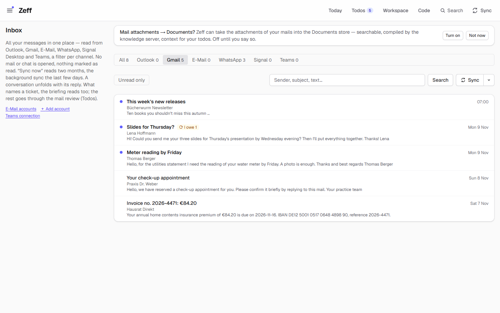
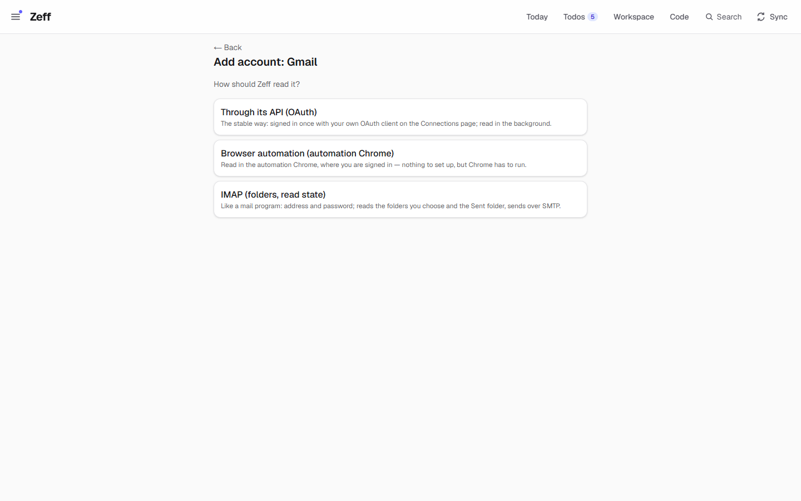
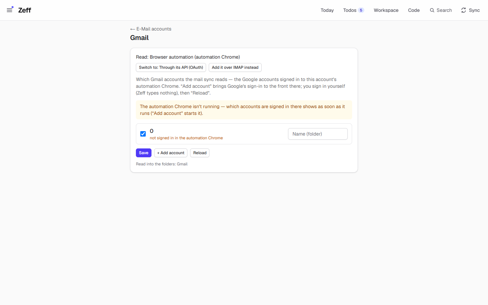
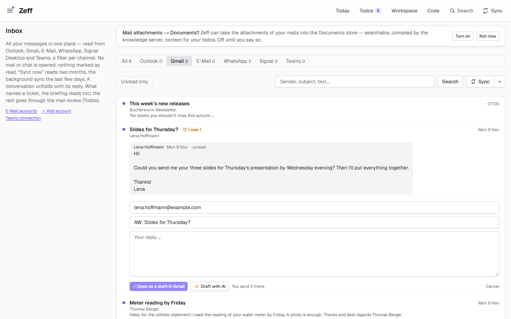

# Gmail

> Reads your Gmail inbox into Zeff's inbox — from the mail list in the automation Chrome, or through Google's API with your own sign-in — so your mails become context for todos, the mail review, mail matching and knowledge; with write access, it also sends replies on your click. **Category:** connector · **On by default:** no · **Beta:** no · **Needs:** the account's automation Chrome signed in to Gmail, or Google's API with your own sign-in ([Settings → Connections](#getting-started)); shows its mails in [Mail & Chat](mail-client.md)



## For users

### What it does

Gmail is one of the mailboxes Zeff reads. Its mails land in the one inbox (**Inbox**, `/mail`, tab *Gmail*) next to Outlook,
other mail accounts, WhatsApp, Signal and Teams. From there they feed the rest of Zeff:

- the **mail review** ([Todos](todos.md)) reads new mails and makes todos of what they ask of you — in the demo, Lena
  Hoffmann's *"Slides for Thursday?"* ("could you send me your three slides … by Wednesday evening?") and Thomas Berger's
  *"Meter reading by Friday"* each become a todo with the mail as its source;
- **mail matching** attaches mails to the open todos they are about;
- [Open loops](loops.md) marks what you owe someone (the *"I owe 1"* badge on Lena's mail);
- the [Timeline](timeline.md), [People](people.md) and [Knowledge](knowledge.md) read them too.

Reading changes nothing in Gmail: Zeff reads the mail **list** (sender, subject, the snippet, time, unread, has attachments),
opens no unread mail and marks nothing read. Writing — sending a reply, saving a draft, archiving, marking unread — happens only
when you allow it on the Connections page and only on your click (see [Writing to Gmail](#writing-to-gmail)).

The extension also brings the **Write mail** action to [Auto actions](auto-actions.md): when a todo calls for a mail (a reply, a
request, a submission), the AI drafts it ready-worded; one click opens Gmail's compose window filled in, and you send it yourself.

### Getting started

1. **Settings → E-Mail accounts** (`/settings/mail`) → **Add account** → *Gmail*. Zeff asks how it should read the mailbox, and
   installs the Gmail extension for you when you choose (you can also install it under **Menu → Plugins** first).

   

2. Choose one of the ways:
   - **Browser automation (automation Chrome)** — nothing to set up. Zeff runs a Chrome of its own for each Zeff account (the
     *automation Chrome*, with its own profile and sign-ins, reached over a local debug port). Under **Settings → Connections →
     Browser sign-ins**, press **Sign in** next to *Gmail*: Chrome comes to the front at mail.google.com and you sign in
     yourself — Zeff never types or stores your Google password. **Check** asks whether you're signed in. Chrome has to be
     running for a sync.
   - **Through its API (OAuth)** — the stable way. You create a free OAuth client of your own in Google Cloud Console (project,
     *Gmail API* and *Google Calendar API* switched on, consent screen with yourself as test user, a "Web application" client
     with the redirect URI Zeff shows), enter its ID and secret on **Settings → Connections → Google**, and press **Sign in to
     Google**. One Google sign-in serves Gmail and [Google Calendar](google-calendar.md). The sync then runs in the background
     whether Chrome runs or not. Zeff asks Google only for read access (`gmail.readonly`) unless you allow writing.
   - **IMAP** — reads Gmail like a mail program with an app password; that is the [E-Mail (IMAP / POP3)](imap-mail.md)
     extension, not this one.
3. Press **Sync now** on the account (or wait for the background sync). The first sync reads two months; later ones the last
   few days.

You can switch the way later on the account's page (**Switch to: …**), or on **Settings → Connections**, card *Google*, row
*Gmail* (*Automation Chrome* / *Google's API*).

### Using it

- **Read your Gmail in Zeff.** Open **Inbox** and pick the *Gmail* tab. Unread mails have a dot; *Unread only* filters them.
  Open a mail to see its conversation (with your own replies, when Zeff has read them).
- **Several Gmail accounts** (automation Chrome only). The account page (`/settings/mail/account/gmail`) lists the Google
  accounts signed in to the automation Chrome. Tick the ones to read and give each a name — its folder in Zeff
  (*Gmail · Private*). **+ Add account** brings Google's add-account sign-in to the front in the automation Chrome; sign in
  there, then **Reload**. Up to ten accounts. With the API there is one account: the one signed in on the Connections page.

  

  Until Chrome runs, the page can't ask it which accounts are signed in; the default entry *0* means "the first Google account
  signed in there".

- **Labels as folders** (API only). On the same page you can name Gmail labels to keep as folders of their own
  (*Gmail/Receipts*). Mails Gmail marks *Important* are read too, even when a filter took them out of the inbox.
- **Reply.** Open a mail: it unfolds with its text and **↩ Reply** / **Draft a reply with AI**. In the reply form, **Draft with
  AI** writes the text from the conversation. Without write access the button is **Open as a draft in Gmail** — Gmail's compose
  window opens filled in and you send it there; with write access you get **Send** and **Save as draft in Gmail**, and the reply
  goes into the mail's Gmail conversation.

  
- **A todo's mail.** A todo that came from a Gmail mail can carry a *Write mail (Gmail)* action. **Open in Gmail** opens the
  filled-in compose window. With write access the todo also shows **Send** and **Save as draft in Gmail**; a reply to the mail
  the todo came from goes into that conversation, the action is noted on the todo, and a reply that *was* the todo ticks it off.
- **Attachments into Documents.** With [Documents](documents.md) installed, *Mail attachments → Documents* (Inbox banner or
  Settings → E-Mail accounts) takes mail attachments into the Documents store — off until you turn it on. Attachments are fetched
  from the raw message, so the mail stays unread.

#### Writing to Gmail

On **Settings → Connections → Google → What Zeff may do with Google**, switch on **Allow writing to Gmail** and then **Connect
again**: Google is asked for `gmail.modify` and `gmail.settings.basic`. The pills above the switch show what the sign-in holds
now. With it:

| Where you click | What happens in Gmail |
| --- | --- |
| A todo's mail: **Send** / **Save as draft in Gmail** | Sent from your Gmail (or saved to its drafts), as a reply in the original conversation when it answers the todo's mail |
| An inbox row's reply: **Send** / **Save as draft in Gmail** | The reply, in the row's conversation |
| An inbox row: **Archive** / **Mark unread** | The conversation leaves the inbox (still in All Mail) / is marked unread — labels only |

Agents never send a mail. An [agent routine](workspace.md) whose permissions say *May change Gmail* may change labels, read
state and spam, and make filters (see [MCP tools](#mcp-tools--actions)). Nothing is ever deleted, trashed or forwarded.
The full rules are in [Writing to Gmail and Google Calendar](../google-writes.md).

### Settings

| Where | Setting | What it changes |
| --- | --- | --- |
| Settings → E-Mail accounts → Gmail | Read: *API* / *automation Chrome* (**Switch to**) | How the mailbox is read. *Add it over IMAP instead* starts an IMAP account. |
| same page (automation Chrome) | Accounts: read or not, and a name | Which signed-in Google accounts the sync reads, and the folder each goes to (`Gmail`, `Gmail · <name>`) |
| same page (API) | Labels kept as folders | Gmail labels read into folders of their own (`Gmail/<label>`) |
| Settings → Connections → Google | OAuth client (ID, secret), **Sign in to Google**, **Test**, **Connect again**, **Disconnect** | The API sign-in (shared with Google Calendar) |
| same card | *Allow writing to Gmail* | Asks Google for write rights at the next sign-in (send, drafts, archive, unread, labels, filters) |
| Settings → Connections → Sync settings → *Mail* | Every N minutes | How often the mail sync runs (default 15; shared with Outlook Mail and the IMAP accounts). Nothing runs by itself between 19:00 and 08:00. |
| same list → *Mail review*, *Mail attachments*, *Mail matching* | (follow the briefing / the mail sync) | What goes through the mails after a sync |
| Menu → Plugins → Auto actions → *Write mail* | on / off | Whether auto actions propose Gmail mails |

### Tips & limits

- **Automation Chrome must run.** In the background, the mail sync never starts Chrome; it waits ("The automation Chrome isn't
  running — later"). A sync you start by hand may start it. The API way has no such limit.
- **Signed out?** A sync that lands on Google's sign-in page raises a sign-in prompt (bell / Connections page). Zeff never signs
  in for you.
- **What is opened.** The automation-Chrome driver reads the list and pages through it (`in:inbox newer_than:Nd`); it never
  opens an unread mail. For conversations *you wrote in* it reads the whole thread once — opening only messages that are already
  read — so your replies show in the conversation.
- **Gmail's web page can change.** The automation-Chrome driver reads Gmail's page as you would see it; a Gmail redesign can
  break it until Zeff is updated. The API does not have this problem.
- **Privacy.** Mails are kept in Zeff's database on this computer. When the AI runs (mail review, matching, reply drafts), the
  mail's sender, subject and text go to the AI backend you chose in [LLM](llm.md) — a cloud model unless you use a local one.
  Mails are treated as data, never as instructions.
- **Removing** an account (Settings → E-Mail accounts → Remove) stops reading it; the mails already kept stay.
- **The demo** does not sync: its Gmail mails are sample data.

## Technical reference

### Overview

Gmail is a mail **source** of the shared mail sync (`src/lib/mail/sync.ts`, step `mail`), next to Outlook Mail and the IMAP /
POP3 accounts. Two drivers read it, chosen per service in the `connectors` table (`driverOf("gmail")`):

- **cdp** (default): `src/plugins/gmail/driver.mjs`, a stdio MCP server run by Zeff (`runStdioSession`) with the account's
  automation-Chrome environment (`automationEnv()` → `GMAIL_CDP_ENDPOINT`). It attaches with Playwright to the Chrome debug
  endpoint, opens a Gmail tab (`mail.google.com/mail/u/<n>`), and reads rows of a search (`in:inbox newer_than:Nd`, page by page)
  — deterministic DOM reading, no LLM. One sync per Gmail account set in `plugin:gmail`.
- **api**: `src/lib/google/gmail-api.ts` (`readGmail`) against Gmail's REST API with the Google OAuth sign-in
  (`src/lib/connectors`). It reads inbox and sent (at least 14 days), *Important* and chosen labels, the threads you wrote in
  (full text once), and returns **mirrors** — the full id list of each folder — so a mail that left the inbox in Gmail moves to
  the archive in Zeff (`archiveGone`).

Both produce the same `MailInput` rows (message ref `msg-f:<decimal>`, conversation `gmail:<thread>`) and are saved by
`saveMails` into `emails`. After a successful sync the registry runs the Workspace pipelines (inbox databases), closes reply
todos by evidence, and indexes the timeline. The mail review (`mailtodos`) and mail matching (`relations`) run later with the
briefing.

Writes go only through `src/lib/google/*` behind `write-guard.ts` and are started from click paths (`run.ts`,
`server-actions.ts`) or the permission-gated MCP tools.

```mermaid
flowchart LR
  S[Sync step "mail"] -->|driver = cdp| D[gmail/driver.mjs<br/>Playwright → automation Chrome]
  S -->|driver = api| A[google/gmail-api.ts<br/>Gmail REST, OAuth]
  D --> M[(emails)]
  A --> M
  A -->|mirrors| R[archiveGone / moveSent]
  M --> P[Workspace inbox pipelines]
  M --> T[mailtodos · relations · timeline]
  U[Your click: Send / Draft / Archive / Unread] --> W[gmail/run.ts → google/gmail-send.ts<br/>write-guard]
```

### Manifest

| Field | Value |
| --- | --- |
| id | `gmail` |
| category | `connector` |
| order / actionsOrder | 270 / 100 |
| defaultInstalled | `false` (installed by *Add account → Gmail*) |
| requires | The automation Chrome signed in to mail.google.com, or Google's API with your own sign-in |
| dependsOn | — |
| settings | `/settings/mail` — mail accounts |
| apps | `/mail` (Inbox) |
| routes | `/mail`, `/apps/gmail`, `/gmail`, `/api/boards/mail-relations` |
| syncSteps | `mail`, `mailtodos`, `relations` |
| services | `gmail` (sign-in prompts) |
| extensions | `compose-action` for `auto-actions` — *Write mail*, on by default, action `gmail-compose` |
| features / experimental / beta | — |

### Files

| File | What it is |
| --- | --- |
| [plugin.ts](../../src/plugins/gmail/plugin.ts) | The manifest |
| [driver.mjs](../../src/plugins/gmail/driver.mjs) | The automation-Chrome driver (MCP over stdio): `gmail_status`, `gmail_accounts`, `gmail_mail`, `gmail_thread`, `gmail_attachments`, `gmail_download` |
| [accounts.ts](../../src/plugins/gmail/accounts.ts) | The Gmail accounts read (pref `plugin:gmail`), their folder names, the accounts signed in to Chrome |
| [GmailAccountsForm.tsx](../../src/plugins/gmail/GmailAccountsForm.tsx) | The accounts list on the account page |
| [actions.ts](../../src/plugins/gmail/actions.ts) | The `gmail-compose` action (Gmail's compose URL) |
| [run.ts](../../src/plugins/gmail/run.ts) | Send / draft through the API on your click, reply threading (`gmailThreadOf`), archive / unread of a row |
| [server-actions.ts](../../src/plugins/gmail/server-actions.ts) | Server actions: add account in Chrome, save accounts, send/draft a todo's mail, row archive/unread |
| [mcp.ts](../../src/plugins/gmail/mcp.ts) | MCP tools for agents (`gmail_find`, `gmail_labels`, `gmail_filters`, `gmail_filter`, `gmail_change`) |
| [sync-settings.ts](../../src/plugins/gmail/sync-settings.ts) | Its part of the sync settings (the shared mail interval and followers) |
| [gmail-api.ts](../../src/lib/google/gmail-api.ts) | The API driver: `readGmail`, attachments (`gmailApiCall`), message ids |
| [gmail-send.ts](../../src/lib/google/gmail-send.ts) | MIME, send, drafts, archive, unread |
| [gmail-write.ts](../../src/lib/google/gmail-write.ts) | Labels, changes, filters, search — and the scope checks (`gmailCanWrite`, `gmailCanFilter`) |
| [gmail-filter-guard.ts](../../src/lib/google/gmail-filter-guard.ts) | Refuses filters that only name a passing state or a date range |
| [write-guard.ts](../../src/lib/google/write-guard.ts) | Allowlist of Google write calls; refuses delete, trash, forward |
| [grants.ts](../../src/lib/google/grants.ts) | What the pages are told (`gmail-send`) |
| [mail/sync.ts](../../src/lib/mail/sync.ts) | The shared mail sync (all mail sources) |
| [mail/accounts.ts](../../src/lib/mail/accounts.ts) | The one list of mail accounts on Settings → E-Mail accounts |
| [settings/mail/account/[key]/page.tsx](../../src/app/settings/mail/account/[key]/page.tsx) | The Gmail account page (`GmailPart`) |

### Data

| Where | What |
| --- | --- |
| `emails` table | One row per message: `key` (`<convId>\|<hash>`), `conv_id` (`gmail:<thread>`), `folder` (`Gmail`, `Gmail · <name>`, `Gmail/<label>`, `… · Sent`, archive), `from_name`, `from_email`, `subject`, `preview` (snippet, or full text for conversations read whole), `received_at`, `unread`, `has_attachments`, `attach_ref` (`msg-f:<id>`), `reviewed_at` / `resolved_at` (mail review) |
| pref `plugin:gmail` | `{ accounts: [{ account, label }] }` — the accounts read in the automation Chrome (address or Gmail's account number; unset: account `0`) |
| pref `gmail:full:<account>` | Message ids whose full text is known (not read again), last 5000 |
| pref `mail:gmailLabels` | Labels kept as folders (API) |
| `connectors` rows `gmail` and `google` | `gmail.driver` (`cdp` / `api`); `google`: OAuth client, tokens, granted `scope`, `account`, `extra` (`gmailWrite`, `calendarWrite`) |
| `app_settings` | `mail_sync_minutes` (default 15), `mail_last_sync_at`, `mail_last_result`, `mail_last_ok` — shared by all mail sources |

### Sync, jobs & AI tasks

- **`mail`** — `syncMail()`: every installed mail source; per Gmail account into its folder. Background runs read 3 days (the API
  at least 14), by hand / the first time 60 days. With the cdp driver it waits in the background while the automation Chrome is
  down. A run lock per Zeff account (`__zeffMailSyncing`). Attachments go to Documents afterwards if turned on
  (`attachments-sync.ts`).
- **`mailtodos`** (mail review) and **`relations`** (mail matching) run with the briefing on workdays; their AI tasks belong to
  [Todos](todos.md) / [Mail & Chat](mail-client.md).
- No AI task of its own (no `llm-tasks.ts`). Reply drafts in the inbox use the mail client's drafting.

### MCP tools & actions

MCP tools (Zeff's MCP server, `src/mcp/server.ts` → `registerGmailTools`; all need the API sign-in):

| Tool | What it does | Who may |
| --- | --- | --- |
| `gmail_find` | Gmail search (`from:… newer_than:30d`), lists ref, date, sender, subject, labels, unread | any agent (read-only) |
| `gmail_labels` | The account's labels | any agent |
| `gmail_filters` | Gmail's filters and what they do | any agent (needs filter scope) |
| `gmail_filter` | Make a filter (labels, skip inbox, mark read; optionally apply to up to 1000 existing mails) | only a routine worker with *May change Gmail* |
| `gmail_change` | Add/remove labels, mark read, report spam on up to 200 mails; never delete | only a routine worker with *May change Gmail* |

Action (`actions.ts`): **`gmail-compose`** `{ to, subject, body }` — *Write mail (Gmail)*, verb *Open in Gmail*, a comms
action; its link is Gmail's compose window. Run through the API only by its own buttons (`runGmailComposeAction`), never by a
todo's *Run*, a worker or an agent.

Server actions: `openGmailAddAccountAction`, `saveGmailAccountsAction`, `runGmailComposeAction`, `gmailRowChangeAction`.
Routes owned: `/mail`, `/apps/gmail`, `/gmail` (old, now on the account page), `/api/boards/mail-relations`.

### Extension points

- Contributes the **`compose-action`** extension to [Auto actions](auto-actions.md) (action `gmail-compose`).
- Is a source of the shared mail sync and of the Workspace's mail data sources (`workspace-mail-sources`), the *Gmail* channel of
  [Mail & Chat](mail-client.md), and of mail attachments for [Documents](documents.md).
- Its driver is listed in `src/plugins/drivers.ts` (`driverPath("gmail")`); the sync step is in `src/lib/sync/registry.ts`.
- Writes are journaled to the [Timeline](timeline.md) (`mail.sent`, `mail.draft`) via `journalGoogleWrite`.

### Tests

| Test | Covers |
| --- | --- |
| [google-api-driver.test.ts](../../tests/google-api-driver.test.ts) | Gmail synced through the API without the automation Chrome; attachments through the API |
| [gmail-mirror.test.ts](../../tests/gmail-mirror.test.ts) | Mirroring: a mail that leaves the inbox goes to the archive; labels as folders; *Important* and the 14-day minimum |
| [gmail-write.test.ts](../../tests/gmail-write.test.ts) | Changes refused without write scope; labels, read, spam; limits; search |
| [gmail-filter-guard.test.ts](../../tests/gmail-filter-guard.test.ts) | Filters must name something lasting |
| [google-writes.test.ts](../../tests/google-writes.test.ts) | MIME, replies in thread, drafts, archive, unread — against a fake Google ([fake-google.ts](../../tests/fake-google.ts)) |
| [google-writes-clicks.test.ts](../../tests/google-writes-clicks.test.ts) | Writes only from click paths |
| [mail-attachments.test.ts](../../tests/mail-attachments.test.ts), [workspace-mail-sources.test.ts](../../tests/workspace-mail-sources.test.ts) | Attachments → Documents; mails as Workspace data |

Run one: `node --import tsx --test tests/gmail-mirror.test.ts` (the full suite is `npm test`).
