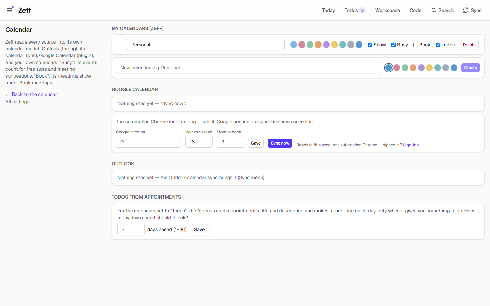
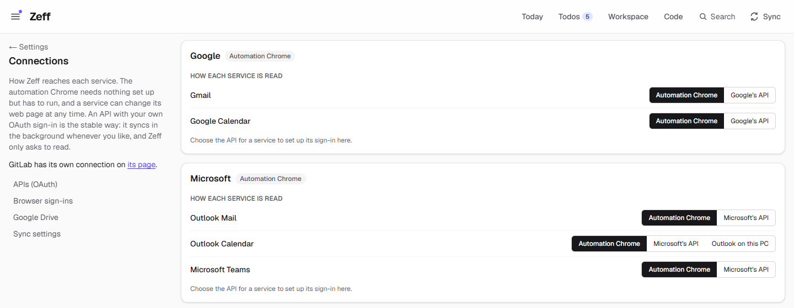
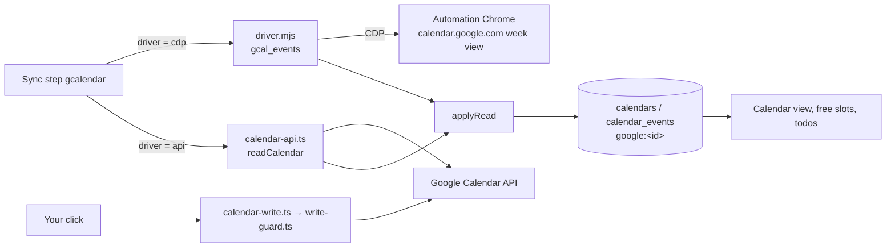

# Google Calendar

> Reads all your Google calendars (yours, family, birthdays …) into Zeff's calendar, so their events show there and count for free slots — and, only if you allow it, writes events on your click. **Category:** connector · **On by default:** no · **Beta:** no · **Needs:** [Calendar](calendar.md); the automation Chrome signed in to Google, or Google's API with your own sign-in

## For users

### What it does

Zeff has one calendar for everything ([Calendar](calendar.md)): your own calendars in Zeff, Outlook's meetings and — with this
extension — every Google calendar you can see. Each Google calendar becomes a calendar of its own in Zeff, with Google's name
and colour, shown or hidden as it is in Google. Its events then:

- show in the calendar view (Workspace → Calendar) next to the others;
- count as busy time when Zeff looks for a free slot (a todo's proposed appointment, meeting suggestions) — except for
  calendars that never block time: birthdays, Google Tasks, holidays and contacts' calendars;
- are context for todos (with [Todos](todos.md) and the calendar's "Todos" switch, the AI reads upcoming appointments and makes
  a todo where one gives you something to do).

Reading changes nothing in Google. Writing — a new event, an event moved, an invitation answered — happens only when you switch
it on (see [Writing to Google Calendar](#writing-to-google-calendar)) and only on your click.

The extension also brings the **Event in Google Calendar** action to [Auto actions](auto-actions.md): when a todo needs a
time block ("Buy a present for Paula, Wed 18:00, 60 min"), the AI proposes it in a free slot; one click opens Google Calendar's
"new event" form filled in, and you save it there (or, with write access, Zeff enters it).

### Getting started

1. **Menu → Plugins** → *Google Calendar* → Install. It installs [Calendar](calendar.md) too, if it isn't there.
2. Choose how Zeff reaches Google — **Settings → Connections**, card *Google*, row *Google Calendar*:
   - **Automation Chrome** (the default): Zeff opens Google Calendar's week view in the automation Chrome — a Chrome that Zeff
     runs for each Zeff account, with its own profile and sign-ins. Under *Browser sign-ins*, press **Sign in** next to
     *Google Calendar*; Chrome comes to the front at calendar.google.com and you sign in yourself (Zeff never types a
     password). **Check** asks whether you are signed in.
   - **Google's API**: Zeff reads through Google's Calendar API with an OAuth sign-in. You enter an OAuth client of your own
     (from Google Cloud Console) on the same card and press *Connect*. One Google sign-in serves both Gmail and Google
     Calendar ([Gmail](gmail.md)). This is the stable way: it syncs in the background whether Chrome runs or not.

   

3. **Settings → Calendar** (`/settings/calendar`), section *Google Calendar*: pick the Google account, how many weeks to read
   ahead and how many months back, **Save**, then **Sync now**.

### Using it

- **The calendar.** Open *Workspace → Calendar* (`/kalender`). Google's calendars appear in *Calendars & date* with their
  colours; tick them on or off there. Their events are shown like any other; open one for its details and its link to Google.
- **Settings → Calendar.** Each Google calendar has the same switches as the other sources: *Show*, *Busy* (counts for free
  slots), *Book* (its meetings show under *Book meetings* for time tracking) and *Todos* (the AI makes todos of its
  appointments). Busy is off from the start for birthdays, tasks and holidays.
- **A month further back.** The sync reads a window (see Settings). To see an older month, go there in the calendar and press
  Sync: through the API, Zeff reads that month too.
- **Sync.** The *Google Calendar* step runs by itself (every 60 minutes by default) and from the **Sync** menu. With the
  automation Chrome it runs in the background only while that Chrome is running — it never starts Chrome by itself; a sync you
  start by hand may start it. The result reads like "112 events in 6 calendars" (and "· 2 unreadable" when an event's line could
  not be understood — those are counted, never guessed).

#### Writing to Google Calendar

Off until you allow it. On **Settings → Connections → Google → What Zeff may do with Google**, switch on *Allow writing to
Google Calendar* and sign in to Google again (the switch alone changes nothing — Google only holds the right after the new
sign-in). This needs the API sign-in. Then:

| Where you click | What is written |
| --- | --- |
| A todo's proposed appointment: **Add to Google Calendar** (on the todo, or **Accept** in the calendar) | The event in your main Google calendar; the action leaves the todo and is noted on it. |
| The calendar, a Google calendar you own or may write to | A new event (title, all day or from–to, place, notes, guests — Google invites them); your event moved, resized or edited. Guests are told of a change. |
| The calendar, an invitation: **Accept** / **Maybe** / **Decline** | Your answer only; the organiser is told. |

Zeff never deletes or cancels a Google event, never moves one to another calendar, never moves someone else's meeting and never
writes to a calendar you may only read. Without write access, the same buttons open Google's own form, filled in, for you to
save. Each write appears on the timeline. Details: [docs/google-writes.md](../google-writes.md).

### Settings

| Setting | Where | What it changes |
| --- | --- | --- |
| How Google Calendar is read | Settings → Connections → Google | *Automation Chrome* (reads the web page) or *Google's API* (OAuth sign-in). |
| Allow writing to Google Calendar | Settings → Connections → Google | Asks Google for `calendar.events` at the next sign-in; enables the write buttons. Off by default. |
| Google account | Settings → Calendar → Google Calendar | Which Google account is read in the automation Chrome: its number (`0` = the first signed in, `1` = the second …) or its address. Once Chrome runs, the page lists the accounts signed in there. Default `0`. |
| Weeks to read | Settings → Calendar → Google Calendar | How many weeks ahead, counted from the Monday of last week (1–12 when saved; 13 until you save). |
| Months back | Settings → Calendar → Google Calendar | Through the API: read from the 1st of the month so many months back (0–24, default 3). |
| Show / Busy / Book / Todos | Settings → Calendar, per Google calendar | Shown in the calendar; counts for free slots; its meetings under Book meetings; the AI makes todos of its appointments. |
| Sync interval | Settings → Connections → Sync settings, *Google Calendar* | How often the step runs by itself (default every 60 min; 0 = only by hand). |
| Event in Google Calendar | Menu → Plugins → Auto actions | The auto-actions extension that proposes Google Calendar events (on by default once both are installed). |

### Tips & limits

- **What leaves the machine:** nothing goes to Google but the reading itself (and, with write access, the events you create or
  answer). Event titles, times, places and descriptions (up to 2000 characters) are kept in Zeff's database; the AI sees them
  when it looks for free slots, makes todos from appointments or briefs you.
- **The Chrome way reads the page, not an API.** It reads each event's screen-reader line in the week view. A Google redesign
  can make lines unreadable (counted as "unreadable") or stop the sync; the API way does not depend on the page.
- **The Chrome way does not know which calendars you may write to.** Zeff asks the API once, if a Google sign-in is there.
- **A calendar hidden in Google** is kept in Zeff as it last was, not emptied.
- **Each read replaces the days it covers**: events moved or deleted in Google disappear from Zeff with the next sync.
- **Recurring events** come as their single occurrences (the API) or as they show in the week view (Chrome).
- Cancelled events and Google's "working location" entries are left out.

## Technical reference

### Overview

The plugin is a **source** for the [Calendar](calendar.md) plugin's calendar model (`src/lib/calendar/ir.ts`). One sync step,
`gcalendar`, reads Google and writes each Google calendar into Zeff as `google:<calendar id>` (`ensureCalendar`), replacing the
events of the days read (`replaceEvents`). Two drivers deliver the same shape (`calendars`, `events`, `unparsed`, `from`):

- **cdp** — `driver.mjs`, a stdio MCP server run by Zeff, attaches with Playwright to the account's automation Chrome (endpoint
  from `GCAL_CDP_ENDPOINT`, else `CHRONO_CDP_ENDPOINT`, else the account's Chrome — see `automationEnv()` in
  [drivers.ts](../../src/plugins/drivers.ts)). It opens `calendar.google.com/calendar/u/<n>/r/week/…` in a fresh tab, week by week,
  reads the sidebar's calendars and each event chip's `aria-label` ("09:00 to 17:00, Work, …, 5 October 2026", German or
  English), parses it (`parseLine`) and closes the tab.
- **api** — [calendar-api.ts](../../src/lib/google/calendar-api.ts) reads `calendarList` and `events` (`singleEvents=true`)
  through Google's REST API with the Google provider's OAuth sign-in (`src/lib/connectors`). It also reports your access role
  per calendar, which decides where Zeff may write.

Writes go only through [calendar-write.ts](../../src/lib/google/calendar-write.ts) and the guard
[write-guard.ts](../../src/lib/google/write-guard.ts) (an allowlist: events insert and patch; any `DELETE`, `/trash` or
`status: "cancelled"` is refused). After a write the touched days are read again (`refreshGcalDays`).

### Manifest

| Field | Value |
| --- | --- |
| id | `google-calendar` |
| category | `connector` |
| order | 330 |
| defaultInstalled | `false` |
| dependsOn | `calendar` |
| requires | The account's automation Chrome, signed in to Google — or Google's API with your own sign-in |
| settings | `/settings/connections` (how it is reached) |
| routes | — |
| syncSteps | `gcalendar` |
| services | `gcalendar` (sign-in prompts) |
| extensions | `event-action` for `auto-actions` — *Event in Google Calendar*, on by default, action `gcal-event` |

### Files

| File | What it does |
| --- | --- |
| [plugin.ts](../../src/plugins/google-calendar/plugin.ts) | The manifest. |
| [sync.ts](../../src/plugins/google-calendar/sync.ts) | `syncGoogleCalendar` (the step), the read window (`syncWindow`, `rangesToRead`), `applyRead` into the calendar model, writable calendars, `signedInGoogleAccounts`. |
| [driver.mjs](../../src/plugins/google-calendar/driver.mjs) | The Chrome driver: MCP tools `gcal_status`, `gcal_accounts`, `gcal_events`; parses the week view. |
| [run.ts](../../src/plugins/google-calendar/run.ts) | The `gcal-event` action run through the API on your click (`runGcalEventOnTodo`). |
| [sync-settings.ts](../../src/plugins/google-calendar/sync-settings.ts) | Its row on the sync settings (interval, window). |
| [calendar-api.ts](../../src/lib/google/calendar-api.ts) | The API driver (`readCalendar`). |
| [calendar-write.ts](../../src/lib/google/calendar-write.ts) | Insert, patch, respond, the writable check, the read-back. |
| [write-guard.ts](../../src/lib/google/write-guard.ts) | The allowlist every Google write goes through. |
| [grants.ts](../../src/lib/google/grants.ts) | Tells pages whether `gcal-write` is granted. |
| [journal.ts](../../src/lib/google/journal.ts) | Notes each write on the timeline. |
| [calendar/actions.ts](../../src/plugins/calendar/actions.ts) | The `gcal-event` action definition (offer, fields, Google's "new event" URL). |
| [calendar/server-actions.ts](../../src/plugins/calendar/server-actions.ts) | `saveGoogleCalendarSettingsAction`, `syncCalendarsAction` (also a month further back), accept/move/answer in the calendar. |
| [settings/calendar/page.tsx](../../src/app/settings/calendar/page.tsx) | Settings → Calendar with the Google section. |

### Data

- **`calendars` / `calendar_events`** (Calendar plugin, `src/db/schema.ts`): each Google calendar a row with key
  `google:<Google calendar id>`, `source: "google"`, name, colour, visible, busy. Events keyed by Google's event address id
  (base64url of `"<event id> <calendar id>"`), with title, start/end (local `YYYY-MM-DDTHH:mm` or dates for all-day), place,
  description, show-as, your response, private, online, organiser, attendees and the link to Google.
- **Prefs:** `plugin:google-calendar` — `{ account, weeks, pastMonths }`; `google-calendar:writable` — the ids of calendars you
  own or may write to.
- **`connectors`** rows `gcalendar` (driver `cdp`/`api`) and `google` (the OAuth client, tokens, granted scopes, `extra.calendarWrite`).

### Sync, jobs & AI tasks

- **Step `gcalendar`** (in `src/lib/sync/registry.ts`): runs `syncGoogleCalendar()`; default every 60 minutes; with the Chrome
  driver only while the automation Chrome runs. One at a time per account (`__zeffGcalSyncing`). A sign-in problem raises a login
  prompt (`login:gcalendar`) for the Chrome driver.
- **Window:** from the 1st of the month `pastMonths` back (at least the Monday of last week) to `weeks` weeks after that Monday;
  a month shown in the calendar (`gcal.range` host op) is read as well.
- **AI:** none of its own. Its events feed the Calendar plugin's steps (`calendartodos`, `calendarrelations`) and the auto
  actions' `gcal-event` proposals.

### MCP tools & actions

- **Driver tools** (stdio MCP, used by Zeff itself, read-only): `gcal_status`, `gcal_accounts`, `gcal_events {account, weeks, from, launch}`.
- **Action `gcal-event`** (`title`, `start`, `minutes` 15–600, `body`): proposed by auto actions; its link opens Google
  Calendar's form, filled in. With write access, *Add to Google Calendar* enters it via `runGcalEventOnTodo` — only from that
  button, never from a todo's *Run*, a worker or an agent.
- **API routes:** none of its own (the OAuth flow is the connectors').

### Extension points

- Contributes calendars to the [Calendar](calendar.md) model (`ensureCalendar` / `replaceEvents`).
- Contributes the `gcal-event` action to [Auto actions](auto-actions.md) through its `event-action` extension.
- Writes `calendar.created`, `calendar.changed`, `calendar.response` events to the [Timeline](timeline.md).

### Tests

- `tests/google-api-driver.test.ts` — the API drivers (Gmail, Calendar) against a fake Google.
- `tests/google-writes.test.ts` — inserts, patches, answers, the guard, the scopes.
- `tests/google-writes-clicks.test.ts` — the write buttons on your click, and the fallback to Google's form.
- `tests/calendar.test.ts`, `tests/safety.test.ts` — the calendar model and that writes only run from click paths.

Run one: `node --import tsx --test tests/google-api-driver.test.ts`.
