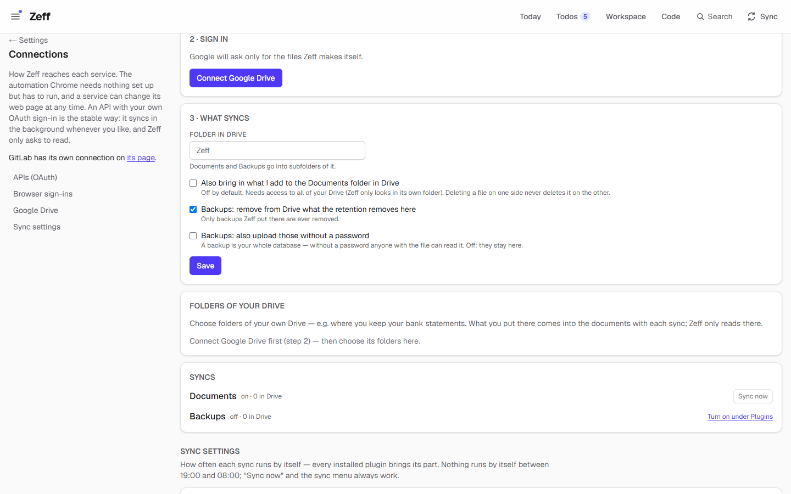
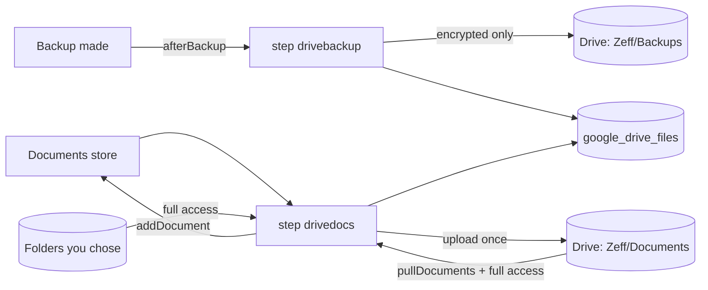

# Google Drive

> Keeps a copy of your documents — and, if you turn it on, of your encrypted backups — in your own Google Drive, and can bring files you put in Drive into Zeff's documents. **Category:** connector · **On by default:** no · **Beta:** yes · **Needs:** a Google Cloud OAuth client of your own; works with [Documents](documents.md) and [Backup](backup.md)

> **Beta.** Not yet tried against a real Google account for long — if Google changes its sign-in or API, a sync can fail (it
> says so under Settings → Connections → Google Drive and in the Sync menu). Backups hold your whole database: they only go to
> Drive when encrypted (set a password under Backups), unless you allow otherwise.

## For users

### What it does

Your documents in Zeff (contracts, invoices, statements — the [Documents](documents.md) store) and your backups live on this
computer. Google Drive gives you a second copy somewhere else:

- **Documents → Drive** (on once the plugin is installed): every document goes up to a folder `Zeff/Documents` in your Drive,
  once. A document deleted in Zeff stays in Drive and is not brought back.
- **Backups → Drive** (off until you turn it on): each backup ZIP goes up to `Zeff/Backups` as soon as it is made — but only
  encrypted ones, unless you allow otherwise. What the local retention removes is removed from Drive too (only backups Zeff put
  there).
- **Drive → Zeff** (off until you switch it on): files you drop into Zeff's `Documents` folder in Drive, or into folders of your
  Drive you choose ("My Drive → Bank statements"), come into Zeff's documents with the next sync — each file once, again only
  when it changes. Google Docs, Sheets and Slides come in as .docx, .xlsx and .pptx.

Nothing is ever deleted on one side because it was deleted on the other (the backup retention is the one exception, and only
for Zeff's own backup files).

Zeff signs in with an OAuth client **of your own** (made once, free, in Google Cloud Console), so nothing runs through anyone
else's Google project. By default it asks only for `drive.file` — Zeff then sees only the files it put in Drive itself.

### Getting started

1. **Menu → Plugins** → *Google Drive* → Install (the warning above is shown before installing).
2. **Settings → Connections → Google Drive** (`/settings/connections#google-drive`), step **1 · Your OAuth client** — in Google
   Cloud Console, once:
   1. Make a project and switch on the **Google Drive API** in it.
   2. OAuth consent screen: type "External", add your Google address as a test user — and publish the app ("In production"):
      while it is in "Testing", Google ends the sign-in after 7 days.
   3. Credentials → Create credentials → OAuth client ID → "Web application", with the authorized redirect URI the page shows
      (Zeff's own address followed by `/api/google-drive/callback`).
   4. Paste the client ID (`….apps.googleusercontent.com`) and secret into the page and press **Save the client**.
3. Step **2 · Sign in**: **Connect Google Drive**. Google asks only for the files Zeff makes — or for all of your Drive when you
   have set Zeff to read what you add there. Afterwards the page says "Connected as …" and what Zeff can see.
4. Step **3 · What syncs**: set the folder name and the switches (see Settings), **Save**.
5. Backups to Drive: **Menu → Plugins** → Google Drive's extension *Backups to Google Drive* → on, and set a backup password
   under [Backup](backup.md).

### Using it

- **Syncs.** The *Syncs* box at the bottom of the card shows both syncs (on/off, how many files are in Drive) with **Sync now**.
  They also run by themselves (documents every 15 minutes, backups every 60 minutes by default — not during the quiet hours) and
  from the **Sync** menu as *Documents ↔ Google Drive* and *Backups → Google Drive*. A backup goes up at once when it is made.
- **Bring in a folder of yours.** Under *Folders of your Drive*, browse My Drive, pick a folder and add it. What you put there
  comes into the documents with each sync; Zeff only reads there. This needs full Drive access — the page tells you to connect
  again when it is missing.
- **Results** read like "3 uploaded · 1 came in from Drive" or "2 not uploaded: no password set". A file that can't come in (too
  large, an unsupported Google type) is remembered and not tried again until it changes in Drive.
- **Disconnect** forgets the sign-in; what is in Drive stays there. Connecting the same Google account again uploads nothing
  twice; another account starts over.

### Settings

| Setting | Where | What it changes |
| --- | --- | --- |
| Client ID / Client secret | Connections → Google Drive → 1 | Your OAuth client. A new client signs you out (connect again). The secret is never shown again. |
| Folder in Drive | Connections → Google Drive → 3 | The top folder (default `Zeff`; for another Zeff account `Zeff - <account>`). Documents and Backups go into subfolders. No slashes. |
| Also bring in what I add to the Documents folder in Drive | Connections → Google Drive → 3 | Drive → Zeff for Zeff's own Documents folder. Off by default; needs access to all of your Drive. |
| Backups: remove from Drive what the retention removes here | Connections → Google Drive → 3 | Mirrors the local backup retention in Drive (on by default). Only Zeff's backups are removed, and never when the local folder looks empty. |
| Backups: also upload those without a password | Connections → Google Drive → 3 | Off by default: unencrypted backups stay on this computer. |
| Folders of your Drive | Connections → Google Drive | Extra folders whose files come into the documents (read only). |
| Documents to Google Drive | Menu → Plugins (extension of Documents) | The documents sync; on by default. |
| Backups to Google Drive | Menu → Plugins (extension of Backup) | The backups sync; off by default. |
| Sync intervals | Connections → Sync settings | *Documents → Google Drive* (default 15 min), *Backups → Google Drive* (default 60 min). |

### Tips & limits

- **What leaves the machine:** your documents (as files) and, if you turn it on, your backups. A backup is your whole database —
  keep the password on. Nothing goes to an AI from this plugin.
- **Access:** `drive.file` by default (only Zeff's own files). Reading files you add needs the full `drive` scope; Zeff then still
  only looks in its own folder and the folders you chose.
- **Testing apps expire:** an OAuth app left in "Testing" loses its sign-in after 7 days ("Google no longer accepts the saved
  sign-in … Connect again"). Publish it.
- **At most 25 files come in per run**; the rest follow with the next one. Large files go up in chunks (8 MB).
- **Limits on size:** a file larger than the Documents store allows is skipped (and said so).
- Google's own file types other than Docs, Sheets and Slides (Forms, Drawings …) are skipped.

## Technical reference

### Overview

The plugin has its own OAuth flow (authorization code with PKCE; Zeff is its own redirect target) and its own tokens, separate
from the Google sign-in of Gmail and Google Calendar on the Connections page — so Drive can run with the narrow `drive.file`
scope. A small REST client ([api.ts](../../src/plugins/google-drive/api.ts)) does folders, listing, resumable chunked uploads,
downloads, exports and deletes; it refreshes the token on 401 and waits out rate limits.

It brings two sync steps as **extensions of other plugins**: `drivedocs` for Documents and `drivebackup` for Backup. Each is
there only while its extension is on and runs only when connected. Every file Zeff puts in or takes from Drive is recorded in
`google_drive_files`, so nothing goes up twice and only Zeff's own files are ever removed.

### Manifest

| Field | Value |
| --- | --- |
| id | `google-drive` |
| category | `connector` |
| order | 120 |
| defaultInstalled | `false` |
| beta | yes (text above) |
| requires | A Google Cloud OAuth client of your own and the Google Drive API switched on in its project |
| settings | `/settings/connections#google-drive` |
| routes | `/google-drive` (old address, redirected to the Connections section), `/api/google-drive` |
| syncSteps | via extensions: `drivebackup`, `drivedocs` |
| extensions | `backup-sync` for `backup` — *Backups to Google Drive*, off by default, step `drivebackup`; `documents-sync` for `documents` — *Documents to Google Drive*, on by default, step `drivedocs` |

### Files

| File | What it does |
| --- | --- |
| [plugin.ts](../../src/plugins/google-drive/plugin.ts) | The manifest. |
| [config.ts](../../src/plugins/google-drive/config.ts) | The settings row, scopes (`drive.file` / `drive`), the file records, disconnect / forget. |
| [oauth.ts](../../src/plugins/google-drive/oauth.ts) | PKCE, the authorize URL, code exchange, token refresh, the signed-in address. |
| [api.ts](../../src/plugins/google-drive/api.ts) | The Drive v3 REST calls. |
| [sync.ts](../../src/plugins/google-drive/sync.ts) | `syncBackups`, `syncDocuments`, `driveCounts`. |
| [folders.ts](../../src/plugins/google-drive/folders.ts) | Folders of your Drive to pull from (pref `googleDrive.pullFolders`), whether full access is needed. |
| [after.ts](../../src/plugins/google-drive/after.ts) | Starts `drivebackup` right after a backup is made (called by `plugins/backup/backup.ts`). |
| [server-actions.ts](../../src/plugins/google-drive/server-actions.ts) | Save client, save settings, disconnect, sync now, list/add/remove folders. |
| [GoogleDriveSettings.tsx](../../src/plugins/google-drive/GoogleDriveSettings.tsx) | The card on the Connections page (steps 1–3, syncs). |
| [DriveFolders.tsx](../../src/plugins/google-drive/DriveFolders.tsx) | The folder browser. |
| [sync-settings.ts](../../src/plugins/google-drive/sync-settings.ts) | Its rows on the sync settings. |
| [connect/route.ts](../../src/app/api/google-drive/connect/route.ts), [callback/route.ts](../../src/app/api/google-drive/callback/route.ts) | The OAuth redirect and callback. |

### Data

- **`google_drive`** (one row): `client_id`, `client_secret`, `refresh_token`, `access_token`, `expires_at`, `scope` (granted),
  `email` (who is connected), `connected_at`, `folder_name`, `root_folder_id` / `backups_folder_id` / `documents_folder_id`
  (made on first use, re-made if deleted in Drive), `mirror_backup_retention` (default on), `upload_unencrypted` (default off),
  `pull_documents` (default off).
- **`google_drive_files`**: one row per Drive file Zeff knows — `kind` (`backup` / `document`), `key` (backup file name,
  `doc:<id>`, or `skipped` for a file that could not come in), `drive_id` (unique), `version` (md5, else modified time), `size`,
  `origin` (`push` / `pull`), `synced_at`. Kept on disconnect; cleared when another Google account connects.
- **Pref** `googleDrive.pullFolders` — `[{ id, path }]`.

### Sync, jobs & AI tasks

- **`drivedocs`** — `syncDocuments()`: uploads each document not yet recorded; then, when `pull_documents` or pull folders are set
  and full access is granted, lists those folders and imports new or changed files (max 25 per run; Google Docs/Sheets/Slides
  exported to Office formats). Default every 15 minutes, not in the quiet hours.
- **`drivebackup`** — `syncBackups()`: uploads the account's backup ZIPs not yet recorded (unencrypted ones only with
  `upload_unencrypted`); with `mirror_backup_retention` deletes Drive copies of backups no longer present locally (only when
  some local backups exist). Default every 60 minutes, and at once after each backup.
- Both are guarded per account (`__zeffDriveDocs`, `__zeffDriveBackup`). No AI tasks.

### MCP tools & actions

None for agents. API routes: `GET /api/google-drive/connect` (to Google, with state and PKCE cookie) and
`GET /api/google-drive/callback` (code exchange, back to the Connections page).

### Extension points

- Extends [Documents](documents.md) (`documents-sync`) and [Backup](backup.md) (`backup-sync`); writes into the documents with
  `addDocument`, reads backups with `accountBackupFiles`.
- Its steps are in the closed sync registry (`src/lib/sync/registry.ts`, `drivebackup`, `drivedocs`).

### Tests

`tests/google-drive.test.ts` against a stand-in for Google ([fake-google.ts](../../tests/fake-google.ts)): off by default, the
narrow sign-in, documents up once (chunks, hiccups, refresh), Drive → Zeff off until allowed, deletions never mirrored,
encrypted-only backups and the retention, the Sync menu steps, a revoked sign-in, and chosen folders.

Run: `node --import tsx --test tests/google-drive.test.ts`.
