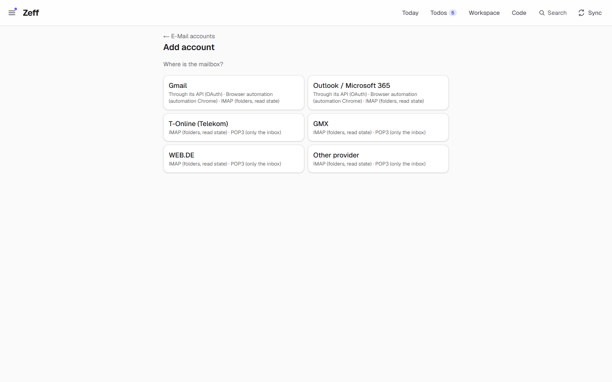
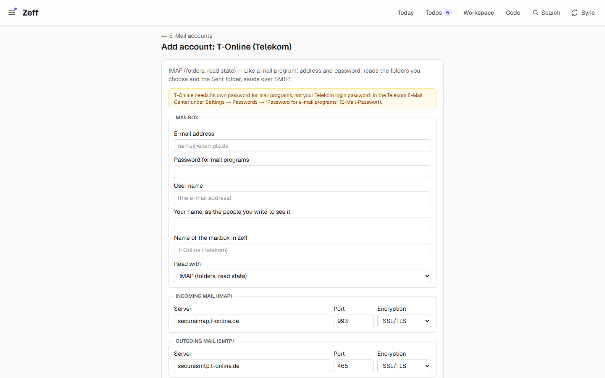

# E-Mail (IMAP / POP3)

> Reads any mailbox the way a mail program does — over IMAP or POP3, several side by side (T-Online, GMX, WEB.DE, Gmail, Outlook or any other) — into Zeff's inbox, and sends your replies and new mails over the account's own SMTP server. **Category:** connector · **On by default:** no (installed when you add such an account) · **Beta:** no · **Needs:** your mailbox's address, its password for mail programs, and the provider's IMAP/POP3 and SMTP servers (filled in for T-Online, GMX and WEB.DE); shows its mails in [Mail & Chat](mail-client.md)



## For users

### What it does

Many people's mail is not in Gmail or Outlook but at their internet provider — T-Online, GMX, WEB.DE. This extension reads
those mailboxes with the same standard protocols a mail program uses:

- **IMAP** — reads the folders you choose plus the Sent folder, each mail with its read state, and leaves everything on the
  server as it was (folders are opened read-only, so reading never marks a mail read);
- **POP3** — for providers without IMAP: only the inbox, each new mail once; nothing is ever deleted on the server.

Its mails go into the one inbox (**Inbox** → tab *E-Mail*), under the account's name (*T-Online*, *T-Online · Sent*). From there
they feed the same things as every other mailbox: the **mail review** turns what a mail asks of you into a todo
([Todos](todos.md)), **mail matching** attaches mails to todos, and the [Timeline](timeline.md), [People](people.md) and
[Knowledge](knowledge.md) read them.

Unlike the Gmail and Outlook readers, this extension also **writes**: replies and new mails are really sent from Zeff, over
the account's SMTP server — always on your click. You can archive conversations (on the server too) and, if you like, have a
mail marked read when you open it in Zeff.

### Getting started

1. **Settings → E-Mail accounts** (`/settings/mail`) → **+ Add account**.
2. Pick the provider. For T-Online, GMX and WEB.DE the servers are filled in; *Other provider* leaves them for you. (For Gmail
   and Outlook, IMAP is one of three ways — see [Gmail](gmail.md) and [Outlook](outlook.md) for the others.)
3. Pick **IMAP** (recommended) or **POP3**.

   

4. Fill in:
   - **E-mail address** and **Password for mail programs**. The page tells you what your provider needs:
     - *T-Online*: not your Telekom login password, but the separate e-mail password (Telekom E-Mail Center → Settings →
       Passwords → "Password for e-mail programs");
     - *GMX* / *WEB.DE*: switch on "POP3/IMAP access" once in their mail settings;
     - *Gmail*: an app password (Google account → Security → 2-Step Verification → App passwords);
     - *Outlook*: Microsoft has turned off password sign-in for many accounts — if the test is refused, use the API instead.
   - **User name** (empty: the address), **Your name** (what people you write to see), **Name of the mailbox in Zeff**.
5. Press **Save and test the connection**. Zeff signs in to the incoming server (and lists its folders) and to the SMTP
   server, and tells you how each went. After a successful IMAP test, the server's folders appear to choose from.
6. The mails are read with the next mail sync, or press **Sync now** on the account. The first read takes two months (POP3:
   the newest 200 messages; older ones are counted as read), later ones the last few days.

The extension installs itself when you save the first such account; you don't need to look for it under **Menu → Plugins**.

### Using it

- **Read.** **Inbox** → *E-Mail*. Each account's mails are under its name; your sent mails under *<name> · Sent*.
- **Reply.** Open a mail, **Reply** (or **Draft with AI** to have the reply written from the conversation), check it, **Send**.
  It goes out over the account's SMTP server as a proper reply (with `In-Reply-To` / `References`, so it threads in the other
  person's mail program), shows in the conversation at once, and — for IMAP with *Put a copy … in the Sent folder* on — a copy
  is stored in the server's Sent folder.
- **New mail.** **✉ New mail** above the inbox list (tab *All* or *E-Mail*); with several accounts, choose **From**.
- **Archive.** Select a conversation and **Archive**: on the server it moves to the account's archive folder (the one you set,
  else the server's *Archive*, Gmail's *All Mail*, or a folder called so); in Zeff it moves to *<name> · Archive*, which the
  inbox leaves out. **Archive read** archives every read conversation of your IMAP / POP3 inboxes at once (after a confirm) —
  on IMAP every read mail of the server's inbox, also older ones Zeff hasn't read in.
- **Read on open.** With *Mark a mail read when I open it* on (the default), a mail you open and look at in the inbox is marked
  read in Zeff and, over IMAP, on the server. POP3 has no read state on the server: Zeff only. Turn it off per account
  (**Settings → E-Mail accounts** → the account → untick the box → **Save**) and opening a mail changes nothing — neither in
  Zeff nor on the server. Reading mails in never marks them: Zeff opens the folders read-only (IMAP `EXAMINE`).
- **A todo's mail.** The AI can propose a *Write mail (E-Mail)* action on a todo that came from such a mail. On the todo it opens
  your mail program (a `mailto:` link) for you to send; the real **Send** over SMTP is the inbox's reply form.
- **Check an account.** Settings → E-Mail accounts shows each account with how it is read, ✓ *works* / ⚠ *failed* (hover for
  the server's words) and when it was last read. **Edit**, **Sync now**, **Remove** (the mails already kept stay).

### Settings

Per account, on its page (Settings → E-Mail accounts → the account):

| Setting | What it changes |
| --- | --- |
| E-mail address | The mailbox, and the From address of what you send |
| Password for mail programs | Kept on this computer; leave empty to keep the one saved |
| User name | The login name (empty: the address) |
| Your name, as the people you write to see it | The From name |
| Name of the mailbox in Zeff | The folder names (`<name>`, `<name> · Sent`, `<name> · Archive`). Names other channels own (Gmail, Outlook, WhatsApp …) get ` (IMAP)` / ` (POP3)` added; a name taken gets a number. Renaming moves the kept mails along. |
| Read with: IMAP / POP3 | Switching moves the incoming server and port to the provider's other one |
| Incoming server, port, TLS / STARTTLS | IMAP (993 TLS / 143 STARTTLS) or POP3 (995 / 110) |
| SMTP server, port, TLS / STARTTLS | Where mail is sent (465 TLS / 587 STARTTLS) |
| Folders (IMAP, after a test) | Which server folders are read; the Sent folder is always read |
| Archive folder (IMAP) | Where *Archive* moves mails (empty: found on the server) |
| Sent folder (IMAP) | Read as yours; where a sent copy goes |
| Put a copy of each mail sent in the Sent folder (IMAP) | Off for providers that store it themselves (Gmail, Microsoft — preset) |
| Mark a mail read when I open it | In Zeff and (IMAP) on the server — default on |

Shared with the other mail sources: **Settings → Connections → Sync settings → Mail** (how often, default every 15 minutes;
nothing runs by itself between 19:00 and 08:00), *Mail review*, *Mail attachments* and *Mail matching*.

### Tips & limits

- **No automation Chrome.** IMAP / POP3 talk to the provider's servers directly; the background sync runs whether Chrome runs
  or not, and an IMAP account alone never starts it.
- **The password is stored unencrypted** in this Zeff account's settings on this computer, like the other services' keys. It
  is never shown again on a page. Use your provider's separate mail-program password where there is one.
- **What is read.** IMAP: the first 64 KB of each message (header and text, not the attachments) in the chosen folders for the
  window of days. POP3: the header and first 300 lines (`TOP`) of each message not seen before (by UIDL).
- **Nothing is deleted.** The POP3 client never sends `DELE`; IMAP reading uses `EXAMINE` (read-only). Writes on the server are
  only: sending, the Sent copy, archive moves and the read flag on open.
- **Folders not found** on the server are named in the sync result ("not found on the mail server: …").
- **Agents.** Agents read the inboxes through MCP; they may archive only with *May change mail* in their routine's permissions.
  They never send — a mail they propose is sent on your click.
- **Privacy.** When the AI runs (mail review, matching, reply drafts), the mail's sender, subject and text go to the AI backend
  you chose in [LLM](llm.md). Mails are data, never instructions.
- **The demo** has no IMAP account; the *E-Mail* tab is empty there.

## Technical reference

### Overview

The extension is a mail source of the shared mail sync (`src/lib/mail/sync.ts`, step `mail`) — the `imap` source. Each account
in the pref `imap-mail.accounts` is read by itself (`readMailbox("imap")`): IMAP through `client.ts` (imapflow, read-only
mailbox locks, `fetch({ since })`), POP3 through the small RFC 1939 client in `pop3.ts` (USER/PASS, UIDL, TOP, never DELE,
STLS for STARTTLS). `map.ts` turns a parsed message (mailparser) into a `MailInput`: conversation `imap:<account>:<thread root
Message-ID>`, folder `<name>` / `<name> · <folder>`, your own mails as sender "Ich" in `· Sent`, unread from `\Seen`, the
Message-ID kept as `attach_ref`.

Writing: `run.ts` sends over SMTP (nodemailer) with reply headers built from the conversation's kept Message-IDs, appends a Sent
copy over IMAP when set, saves the sent mail at once, and records `mail.sent` on the timeline. `archive.ts` moves conversations
to the archive (server and Zeff); `read-on-open.ts` sets `\Seen` when you open a mail. Settings → E-Mail accounts
(`src/lib/mail/accounts.ts`) lists these accounts with Outlook's and Gmail's in one list; choosing a way installs the plugin.

```mermaid
flowchart LR
  S[Sync step "mail"] --> R{account.method}
  R -->|imap| I[client.ts readImap<br/>EXAMINE, fetch since]
  R -->|pop3| P[pop3.ts readPop3<br/>UIDL, TOP, no DELE]
  I --> M[map.ts → MailInput]
  P --> M
  M --> E[(emails)]
  U1[Reply / New mail: Send] --> X[run.ts → SMTP + Sent copy] --> E
  U2[Archive / Archive read] --> A[archive.ts → IMAP MOVE] --> E
  U3[Open a mail] --> O[read-on-open.ts → \Seen]
```

### Manifest

| Field | Value |
| --- | --- |
| id | `imap-mail` |
| category | `connector` |
| order / actionsOrder | 275 / 105 |
| defaultInstalled | `false` — installed by Settings → E-Mail when such an account is saved |
| requires | Address, mail-program password, the provider's IMAP and SMTP servers |
| dependsOn | — |
| settings | `/settings/mail` |
| apps | `/mail` (Inbox) |
| routes | `/settings/mail`, `/mail`, `/api/boards/mail-relations` (`/settings/imap-mail` redirects to `/settings/mail`) |
| syncSteps | `mail`, `mailtodos`, `relations` |
| services / extensions / features | — |

### Files

| File | What it is |
| --- | --- |
| [plugin.ts](../../src/plugins/imap-mail/plugin.ts) | The manifest |
| [config.ts](../../src/plugins/imap-mail/config.ts) | The accounts (`MailAccount`), saving, naming, folder labels, conversation ids, the form's values |
| [presets.ts](../../src/plugins/imap-mail/presets.ts) | Providers and their servers (Gmail, Outlook, T-Online, GMX, WEB.DE, other) and the ways each can be read |
| [client.ts](../../src/plugins/imap-mail/client.ts) | IMAP read, connection test, `\Seen`, archive moves, SMTP send with Sent copy |
| [pop3.ts](../../src/plugins/imap-mail/pop3.ts) | The POP3 client and reader |
| [map.ts](../../src/plugins/imap-mail/map.ts) | A parsed message → `MailInput` |
| [run.ts](../../src/plugins/imap-mail/run.ts) | Sending a mail (`runImapSend`), reply headers |
| [archive.ts](../../src/plugins/imap-mail/archive.ts) | Archiving conversations, *Archive read* |
| [read-on-open.ts](../../src/plugins/imap-mail/read-on-open.ts) | Marking opened mails read |
| [actions.ts](../../src/plugins/imap-mail/actions.ts) | The `imap-send` action |
| [open-actions.ts](../../src/plugins/imap-mail/open-actions.ts) | Server actions of the inbox view: archive rows, archive read, mark opened read |
| [server-actions.ts](../../src/plugins/imap-mail/server-actions.ts) | Settings → E-Mail: choose a way, save, test, sync now, remove |
| [mcp.ts](../../src/plugins/imap-mail/mcp.ts) | MCP tools `mailbox_inbox`, `mailbox_archive` |
| [ui/ServerFields.tsx](../../src/plugins/imap-mail/ui/ServerFields.tsx), [ui/NewMail.tsx](../../src/plugins/imap-mail/ui/NewMail.tsx), [ui/labels.ts](../../src/plugins/imap-mail/ui/labels.ts) | Server fields, the *New mail* form, the shared words (methods, provider notes) |
| [sync-settings.ts](../../src/plugins/imap-mail/sync-settings.ts) | Its part of the sync settings (the shared mail interval) |
| [settings/mail/page.tsx](../../src/app/settings/mail/page.tsx), [add/page.tsx](../../src/app/settings/mail/add/page.tsx), [account/[key]/page.tsx](../../src/app/settings/mail/account/[key]/page.tsx) | The accounts list, the add flow, an account's page |

### Data

| Where | What |
| --- | --- |
| pref `imap-mail.accounts` | The accounts: `id` (`m1`, `m2` …), `method`, `provider`, `name`, `senderName`, `address`, `user`, `password` (plain text), incoming `imapHost`/`imapPort`/`imapTls`, `smtpHost`/`smtpPort`/`smtpSecurity`, `folders`, `serverFolders` (from the last test), `sentFolder`, `saveSent`, `archiveFolder`, `markReadOnOpen`, `lastSyncAt`/`lastResult`/`lastOk` |
| pref `imap-mail.pop3seen.<id>` | UIDLs of a POP3 account's messages already kept |
| pref `imap-mail.config` | The single mailbox of older versions — moved into the list as `m1` once (with its mails' conversation ids) |
| `emails` table | The mails: `conv_id` `imap:<id>:<thread>`, `folder` `<name>` / `<name> · Sent` / `<name> · Archive` / `<name> · <folder>`, `attach_ref` = Message-ID, `unread` |
| `app_settings` | The shared mail sync's interval and last result |

### Sync, jobs & AI tasks

- **`mail`** — part of `syncMail()`: every account in turn (`syncSource("imap")`), 3 days in the background once it has
  worked, 60 days the first time. *Sync now* on one account runs `syncMailAccount(id)` in the background. Each account's result
  is noted on it.
- **`mailtodos`**, **`relations`** — the mail review and mail matching (with the briefing), see [Todos](todos.md).
- No AI task of its own; reply drafts come from [Mail & Chat](mail-client.md).

### MCP tools & actions

| Tool | What it does |
| --- | --- |
| `mailbox_inbox` | The IMAP / POP3 inboxes' mails, newest first: read state, account, sender, subject, key, conversation (`unreadOnly`, `limit`) |
| `mailbox_archive` | Archive by `keys` (a key archives its conversation) or `allRead: true`; never deletes. An agent run needs *May change mail* in its routine's permissions |

Action **`imap-send`** `{ to, subject, body, account? }` — *Write mail (E-Mail)*, a comms action. Its link outside the reply
form is a `mailto:`; the real send (`runImapSend`) runs only from the reply's / new mail's **Send**, never from a todo's *Run*,
a worker or an agent.

Server actions: `chooseMailMethodAction`, `saveMailAccountAction`, `testMailAccountAction`, `syncMailAccountAction`,
`removeMailAccountAction` (Settings); `archiveRowsAction`, `archiveReadAction`, `markOpenedReadAction` (inbox).

### Extension points

- A source of the shared mail sync and the *E-Mail* channel of [Mail & Chat](mail-client.md); its inbox parts
  (`inbox.archive`, `inbox.archive-read`) are registered in the mail client's view parts.
- Feeds the Workspace mail data sources ([Workspace](workspace.md)) and mail attachments for [Documents](documents.md).
- Records `mail.sent` events on the [Timeline](timeline.md).

### Tests

[tests/imap-mail.test.ts](../../tests/imap-mail.test.ts) covers the move of the old single mailbox into the list, several accounts side
by side, IMAP read-only reading, POP3 (nothing deleted, each message once), the connection test, SMTP sending with threading and
the Sent copy, renaming, archive, read on open, and the one list of mail accounts — with stand-in IMAP / POP3 / SMTP clients
(no network). Also relevant:
[workspace-mail-sources.test.ts](../../tests/workspace-mail-sources.test.ts).

Run: `node --import tsx --test tests/imap-mail.test.ts`.
