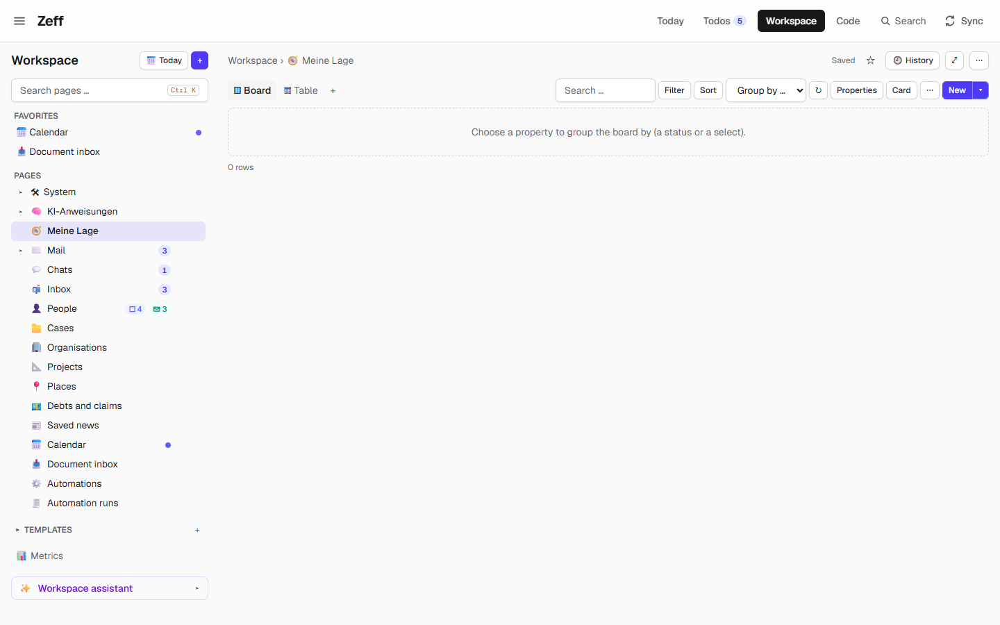
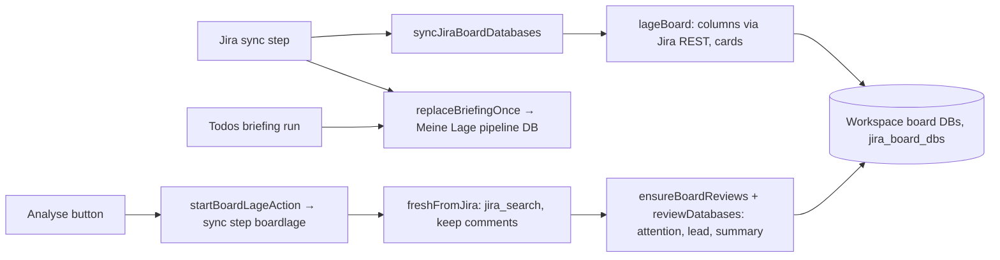

# Jira briefing

> Puts your Jira boards into the Workspace as board databases. Each ticket card can show where the ticket stands, as judged by the AI (attention, a headline, a summary). It also adds *Meine Lage*, a database of your own tickets with the AI's overall summary. **Category:** app · **On by default:** no · **Beta:** no · **Needs:** [Workspace](workspace.md), [Todos](todos.md), [Jira](jira.md) (and [LLM](llm.md) for the AI parts)



## For users

### What it does

The Jira plugin keeps a copy of your tickets. Jira briefing turns them into boards you can read at a glance:

- **Each Jira board you switched on** (Settings → Jira) becomes a **board database in the Workspace**. Its columns are
  the board's columns in Jira. If Jira's REST access is not set, the columns are the status categories. Each ticket is
  a row with its key, status, type, priority, assignee, last change and a link to Jira. The rows are sorted with the
  most pressing first. The database is locked and marked as Jira's, so a change to a ticket has to be made in Jira.
  Tickets resolved in the last two weeks still show as done.
- **The board briefing.** On a Jira board's database, the *Analyse* button sends the relevant open tickets to the AI.
  The AI writes each card's briefing fields: **attention** (for example feedback, active, check, blocked), a
  **headline** and a **summary**. It only reassesses cards that changed.
- **Meine Lage** ("my briefing"). This database is made once. Its pipeline takes your Jira tickets (assigned to you or
  followed, open, or done in the last 3 days). AI steps set *Attention* and a *Lage* sentence for each ticket and write
  an overall summary: what is urgent now, what comes next, what you are waiting for. The rows are then sorted by
  attention. It replaced the old "My briefing" board.

In the demo there is no Jira data. *Meine Lage* exists, but it has no rows yet. The board view asks for a property to
group by because the pipeline's *Attention* field appears only after its first AI run.

### Getting started

1. Install [Jira](jira.md), [Todos](todos.md) and the [Workspace](workspace.md). Then **Menu → Plugins → Jira
   briefing** → *Install* (off by default).
2. On **Settings → Jira**, sync the boards and switch on the ones you want.
3. Run a Jira sync. Afterwards, every enabled board has its own database in the Workspace sidebar, and *Meine Lage*
   is created.
4. Optional: for the real board columns, set Jira's REST access as the environment variables `JIRA_URL` and
   `JIRA_PERSONAL_TOKEN`. Without them, the columns are To do / In progress / Done.

### Using it

- **Open a Jira board** in the Workspace sidebar. You get a normal board/table database that you cannot edit, because
  it changes only with Jira. Old links of the form `/kanban/jira-<id>` lead to it.
- **Analyse a board.** Above a Jira board's database, there is one button:
  - **Analyse — with me**: the relevant tickets you are involved in (assigned, followed, commented on, or with your
    todos or entries).
  - **Analyse — all tickets** (tick *Tickets without me too*): the board's other relevant tickets too, with only what
    Jira knows about them. The browser remembers this choice.

  "Relevant" means: on an enabled board, open, and either in progress or changed in the last 30 days. At most 150
  tickets are read, newest change first. Tickets already covered by the Todos briefing are skipped. While the run
  goes on, the button shows *Analysing …* and the cards fill in part by part. Afterwards it shows *Last <when>:
  <message>*, for example "12 tickets (with you) · 4 reassessed · 8 unchanged".
- **Meine Lage** follows the Todos briefing. Its rows are filled from what Zeff already has from Jira, and its AI steps
  run with the briefing. The rules the AI follows are in the Workspace instruction *Lage* (under *KI-Anweisungen*).
  You can change them there.

### Settings

| Setting | Where | What it changes | Default |
| --- | --- | --- | --- |
| Which boards | Settings → Jira (board on/off) | Which Jira boards get a database. | — |
| All tickets / with me | The *Analyse* button's tick box (kept in the browser) | The scope of the next board briefing. | with me |
| Board briefing | Sync settings page, row *Board briefing* | Shown as "by hand only — Analyse on a Jira board". There is no interval. | by hand |
| AI backend for "Board briefing" | Settings → AI (the [LLM](llm.md) task list) | The backend and model the board briefing uses. | the default backend |
| *Lage* instruction | Workspace → KI-Anweisungen → Lage | The rules for Meine Lage's AI steps. | as shipped |
| `JIRA_URL`, `JIRA_PERSONAL_TOKEN` | environment | Jira's REST API, used for the board columns and status names (both cached for an hour). | — (status categories) |

### Tips & limits

- **Nothing is written to Jira.** The board databases are read-only copies. To change a ticket, use the
  [Jira](jira.md) actions on its todos, or Jira itself.
- What the AI sees: for the board briefing, the tickets' fields, their recent comments and history (read fresh from
  Jira) and what Zeff knows about them. All of this goes to the AI backend set for *Board briefing*.
- The board briefing does not create todos. Todos come from the Todos briefing.
- Only one board briefing runs at a time. Starting another one while it runs joins the run that is already going.
- A board taken out of Jira's filter loses its rows: they are archived on the next sync, not deleted.

## Technical reference

### Overview

The plugin has three parts:

1. **Board databases** (`to-workspace.ts`, `syncJiraBoardDatabases`). These run after every Jira sync step (and on
   the first visit to an old `/kanban/jira-*` link). For each enabled board, `board.ts` (`lageBoard`) builds a
   `RichBoard`: columns from Jira's board configuration over REST (or status categories), and each card with its
   attention, headline, summary, activity, open todos, flags, suggested actions, questions, chat and context. The
   database is created once (locked, full width, source `jira`, kept out of the briefing collection) and mapped in
   `jira_board_dbs`. The select options (status, type, priority) keep their ids. Rows are added, changed (only what
   differs), archived, and put in board order.
2. **The board briefing** (`board-lage.ts`, sync step `boardlage`). `relevantKeys` chooses the tickets.
   `freshFromJira` reads them in chunks of 50 with `jira_search` (with changelog) and keeps their comments.
   `ensureBoardReviews` gives each board database the briefing fields (`workspace/lage-fields`), and the Workspace's
   `reviewDatabases` fills them. The step then refreshes the AI blocks and runs the pipelines with AI.
3. **Meine Lage** (`replaceBriefingOnce`). This is called at startup and after a Jira sync, and it does its work only
   once (`workspace.briefingReplaced`). It creates a pipeline database: source `jira` (`mine`, `involved`,
   `openOnly`, `doneDays: 3`), then AI field *Attention*, AI field *Lage*, an AI summary and a sort by *Attention*,
   with the AI review on. The briefing run then runs its AI steps (`src/lib/runs/run.ts`, `briefingDatabaseRun`).



### Manifest

| Field | Value |
| --- | --- |
| id | `jira-lage` |
| name | Jira briefing |
| category | app |
| order | 70 |
| defaultInstalled | false |
| dependsOn | `workspace`, `todos`, `jira` |
| routes / nav / settings | none (its databases live in the Workspace) |
| syncSteps | `boardlage` |

### Files

| File | What it is |
| --- | --- |
| [plugin.ts](../../src/plugins/jira-lage/plugin.ts) | The manifest. |
| [shared.ts](../../src/plugins/jira-lage/shared.ts) | Client-safe types: `BoardSummary`, `RichCard`, `RichColumn`, `RichBoard`. |
| [board.ts](../../src/plugins/jira-lage/board.ts) | The boards (`lageBoards`, `lageBoard`): Jira columns over REST, cards with briefing, run state. |
| [to-workspace.ts](../../src/plugins/jira-lage/to-workspace.ts) | Board databases, Meine Lage, old-link redirects, `lageDatabaseKind`. |
| [board-lage.ts](../../src/plugins/jira-lage/board-lage.ts) | The board briefing run (scope, fresh read, reviews). |
| [actions.ts](../../src/plugins/jira-lage/actions.ts) | Server action `startBoardLageAction` (sets the scope, starts the step). |
| [BoardLageButton.tsx](../../src/plugins/jira-lage/BoardLageButton.tsx) | The *Analyse* button with the all-tickets tick box. |
| [LageStrip.tsx](../../src/plugins/jira-lage/LageStrip.tsx) | Shows the button above a Jira board's database (and nowhere else). |
| [llm-tasks.ts](../../src/plugins/jira-lage/llm-tasks.ts) | AI task `board-lage`. |
| [sync-settings.ts](../../src/plugins/jira-lage/sync-settings.ts) | Its Sync settings row (by hand only). |

### Data

| Store | What it holds |
| --- | --- |
| `jira_board_dbs` (created on demand) | `board_id` (`jira-<id>`) → `db_id` (the Workspace database). |
| Workspace databases | One per board: properties `jirastatus`, `jiratype`, `jirapriority`, `jiraassignee`, `jiraupdated`, `jiraurl`, plus the key property. The briefing fields come from `workspace/lage-fields`. |
| prefs `workspace.briefingDb`, `workspace.briefingReplaced` | Meine Lage's database id, and whether it was created. |
| account flags `__zeffBoardLage`, `__zeffBoardLageAll` | The running board briefing, and the scope of the next run. |
| `sync_state` row `boardlage` | The last run's time, result and message (shown under the button). |

It reads `jira_tickets`, `jira_boards` and `jira_comments` from [Jira](jira.md) and writes `jira_comments`.

### Sync, jobs & AI tasks

- Sync step `boardlage` ("Board briefing", `src/lib/sync/registry.ts`). It is started by hand from the button and is
  not part of *Sync all*.
- After every `jira` step: `syncJiraBoardDatabases()` and `replaceBriefingOnce()`.
- AI task `board-lage` ("Board briefing: Assesses where all current tickets of your Jira boards stand (for the Kanban
  cards) — without todos."). Its prompts are the Workspace briefing fields' prompts and the *Lage* instruction.

### MCP tools & actions

No MCP tools and no todo actions of its own. Server action: `startBoardLageAction({ all })`. The Jira MCP server tool
it calls is `jira_search`.

### Extension points

- Hooks into the Workspace: `LageStrip` on `/workspace/[id]`, the Jira source in `workspace/sources.ts`, and Meine
  Lage in the briefing run.
- Contributes an AI task (`llm-tasks.generated.ts`) and a Sync settings row.

### Tests

`tests/jira-to-workspace.test.ts` (board databases kept by each sync), `tests/lage-board-run.test.ts` (My briefing
compared with the board button), `tests/briefing-pipeline.test.ts` (Meine Lage), `tests/workspace-lage-fields.test.ts`,
`tests/workspace-jira-boards.test.ts`.

```
node --import tsx --test tests/jira-to-workspace.test.ts
```
