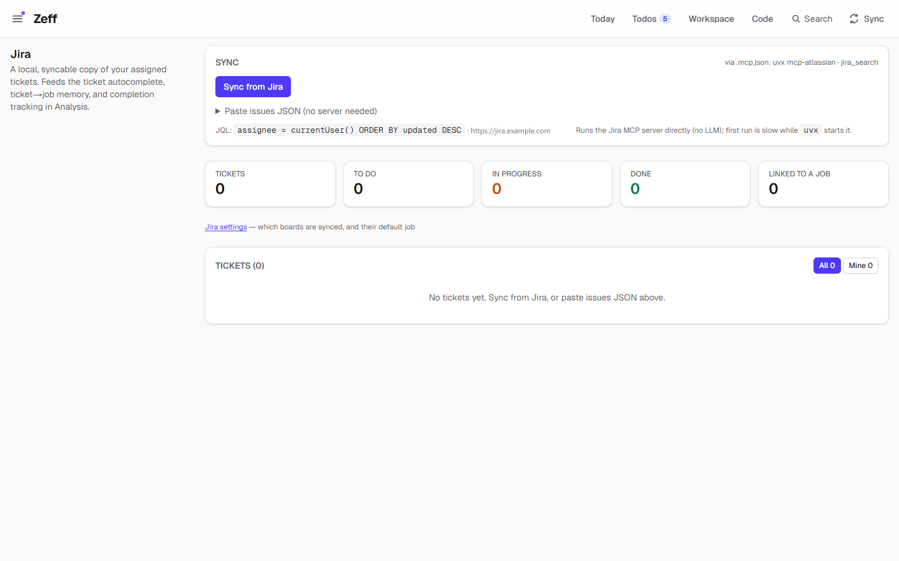
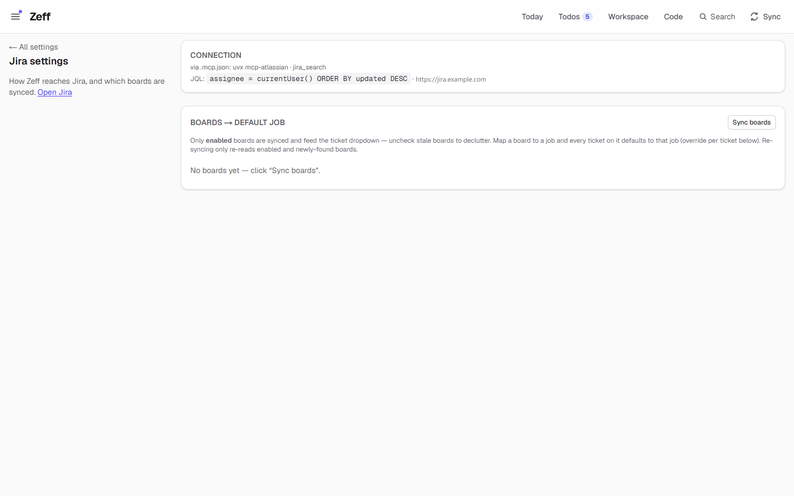
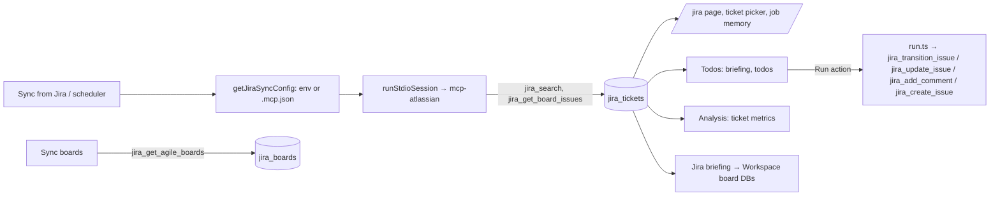

# Jira

> Keeps a local copy of your Jira tickets and those of the boards you choose, as the base for todos, the ticket picker, the job per ticket and the ticket metrics. Changes in Jira (status, assignee, comment, new ticket) happen only when you click. **Category:** connector · **On by default:** no · **Beta:** no · **Needs:** the Jira MCP server (`mcp-atlassian`, started with `uvx`) with your access



## For users

### Where it is

Jira's page lives in the **Workspace**: the database **Jira** (a favourite, made the first time `/jira` is opened) holds the synced
tickets — Key, Type, Status, Category, Priority, Assignee, Mine, Board, Job, Active, Link, Updated — read from the source "Jira"
(`jira-tickets`). Its **Jira** view is the old page written in the view language: the sync, the figures, All / Mine and the tickets
with their job and tags. Because it is a view of a database you (or the assistant) can change it like any other — another layout,
a board by status, buttons that act on a ticket — and every change is kept as a version you can go back to.

What a view or flow can do in Jira (through Zeff's Jira connection; changing Jira needs the flow permission "send"):

| Flow action | Does |
| --- | --- |
| `jira.comment` | a comment on a ticket (ticket, body) |
| `jira.transition` | moves a ticket to a status (ticket, to) |
| `jira.assign` | gives a ticket to someone (ticket, assignee) |
| `jira.sync` | reads the tickets from Jira now |

`/jira` and `/jira?mine=1` open that page.


### What it does

If your work is planned in Jira, most of what you book, discuss and implement belongs to a ticket. The Jira plugin
keeps a copy of those tickets in Zeff, so the rest of Zeff can work with them without asking Jira each time:

- **Your tickets** (by default `assignee = currentUser()`) and **all tickets of the boards you switch on** are synced:
  key, summary, description, status and status category, type, priority, assignee, link, when opened, updated, first
  moved and resolved.
- The **ticket picker** in the weekly report suggests these tickets, and Zeff **remembers the job** for each ticket.
  A board can have a **default job**, so each ticket on that board is booked on that job until you set another one.
- [Todos](todos.md) builds the briefing and the todos from these tickets. Its comments are kept too.
- [Analysis](time-tracking.md) uses them for ticket metrics: open, done, closed in a period, reaction and resolution
  time.
- **Actions on todos** change Jira on your click: move a ticket to another status, assign it, post a comment, or
  create a new linked ticket.
- With [Jira briefing](jira-lage.md) installed, each board you switched on also becomes a board database in the
  [Workspace](workspace.md).

The demo has no Jira data. The page shows its empty state: "No tickets yet. Sync from Jira, or paste issues JSON
above."

### Getting started

1. **Menu → Plugins → Jira** (off by default) → *Install*.
2. **Make the Jira MCP server available.** Zeff starts it by itself (no AI involved) and looks in this order:
   - the environment variable `JIRA_MCP_COMMAND` (with `JIRA_MCP_ARGS` and `JIRA_MCP_ENV`), for example in
     `.env.local`;
   - otherwise a server named `jira`, `mcp-atlassian` or `atlassian` in the project's `.mcp.json`. Its `env` and
     `envFile` are used too. This is where your Jira address and access token go.

   The usual server is `mcp-atlassian`, started with `uvx`. If `uv` is missing, Zeff says so and shows the install
   command. **Menu → Plugins → This PC** shows whether `uv (uvx)` was found.
3. Open **Jira** (`/jira`) and press **Sync from Jira**. The first run is slow while `uvx` starts the server.
4. Open **Settings → Jira** (`/settings/jira`), press **Sync boards**, switch on the boards you work on, and give
   each one a default job if you want.



You can also try Zeff without a server. Under **Paste issues JSON (no server needed)**, paste the JSON a Jira search
returns. The tickets are imported the same way (*Imported N tickets (x new, y updated)*).

### Using it

- **The ticket list** (`/jira`) shows every synced ticket: key, type, summary, status, assignee (yours marked), board,
  **Job** (a select; your choice is remembered for the ticket) and **Tags** (default tags added to every entry booked
  on that ticket). *All* / *Mine* filters to the tickets assigned to you. *Clear* deletes the local copy, not
  anything in Jira.
- **Boards** (`/settings/jira`): *Sync boards* finds the Agile boards of the projects your tickets belong to and counts
  their tickets. Only **enabled** boards are synced and offered in the ticket dropdown. Turn off old boards to keep the
  list short. Syncing again reads only enabled boards and boards it has not seen before.
- **Sync**: *Sync from Jira* on the page, the *Sync* menu in the header, or a scheduled interval on the Sync settings
  page (row *Jira*: "Your tickets and those of the chosen boards (status, comments, history)").
- **Changing Jira from a todo.** The AI suggests these actions on todos, and you start each one:

  | Action | What it does in Jira |
  | --- | --- |
  | *Change Jira status* (`jira-transition`) | Finds the ticket's transition with that name (or target status) and takes it. If there is none, it tells you the possible ones. |
  | *Assign Jira ticket* (`jira-assign`) | Sets the assignee (Jira user name). |
  | *Post Jira comment* (`jira-comment`) | Posts the drafted comment (Jira wiki markup, at most 8,000 characters). |
  | *Create Jira ticket* (`jira-create`) | Creates a ticket in the source ticket's project with its labels and components, sets the assignee if given, and links it with "Relates". The description is written in Markdown and converted. If the type is not accepted (Task/Aufgabe, Bug/Fehler, Story), the next likely type is tried. |

  When several actions run one after another, they share one session of the server. After they finish, the affected
  tickets are read again.
- **Notes and context to Jira.** Your own note on a todo can be posted as a comment on its ticket. People tagged with
  @Name become Jira mentions, and pictures are attached. If you change the note later, the comment is edited. Context
  items can also be put on their ticket, one comment each, with their files attached.
- **Marking a Jira comment done** stops new todos from being made from it.

### Settings

| Setting | Where | What it changes | Default |
| --- | --- | --- | --- |
| Boards on/off | Settings → Jira | Which Agile boards are synced and feed the ticket dropdown. | off |
| Board default job | Settings → Jira | The job each ticket on the board is booked on, unless the ticket has its own. | none |
| Ticket job | Jira page, *Job* column | The job for that one ticket. It is remembered and also learned from what you book. | — |
| Ticket tags | Jira page, *Tags* column | Tags added to every entry booked on the ticket. | — |
| Sync interval | Sync settings page, row *Jira* | Every N minutes, or by hand only. | — |
| `JIRA_MCP_COMMAND`, `JIRA_MCP_ARGS`, `JIRA_MCP_ENV` | environment | The server to start (instead of `.mcp.json`). | from `.mcp.json` |
| `JIRA_JQL` | environment | Which tickets are "yours". | `assignee = currentUser() ORDER BY updated DESC` |
| `JIRA_FIELDS` | environment | Fields read per ticket. | `summary,description,status,created,updated,resolutiondate,issuetype,priority,assignee` |
| `JIRA_MCP_TOOL`, `JIRA_MCP_LIMIT` | environment | The search tool, and how many of your tickets are read. | `jira_search`, 100 |
| `JIRA_BASE_URL` | environment | The Jira address for links (else the server's `JIRA_URL`). | — |

### Tips & limits

- **Reads do not change Jira.** Writes happen only when you run an action on a todo, post a note or context to its
  ticket, or create a ticket.
- Your Jira access lives in the MCP server's configuration (`.mcp.json` / its env file / `.env.local`), not in Zeff's
  database. Zeff never shows the token.
- What the AI sees: the briefing and workers read ticket summaries, descriptions and comments. That text goes to the
  configured AI backend (see [LLM](llm.md)). The sync itself uses no AI.
- A board is read in pages of 50. If a board could not be read to the end, nothing is deactivated, and the next sync
  tries again. A ticket that the sync no longer returns is marked inactive. It is not deleted.
- Tickets you booked time on but that are not in scope are added with their title only, so the weekly report can still
  show their name.
- If Jira is down, the sync shows an error message and the rest of Zeff keeps working.

## Technical reference

### Overview

Zeff talks to Jira only through the **Jira MCP server**, as plain JSON-RPC over stdio, without an LLM
(`src/lib/jira/mcp-client.ts`, `runStdioSession`). Each sync opens one session so that the server's slow cold start
happens only once. `getJiraSyncConfig()` (`src/lib/jira/sync.ts`) resolves the server from the environment or from
`.mcp.json`.

A sync (`syncFromJira`) does the following:

1. reads your tickets with `jira_search` (JQL, fields, `expand: changelog`);
2. reads the issues of each enabled board with `jira_get_board_issues`, paged 50 at a time;
3. reads the titles of booked ticket keys that are missing;
4. saves everything with `upsertTickets` (missing tickets are marked inactive);
5. sets `mine` and the board of each ticket.

After the sync step, if [Jira briefing](jira-lage.md) and the Workspace are installed, the board databases are updated
and the Workspace pipelines run.



### Manifest

| Field | Value |
| --- | --- |
| id | `jira` |
| name | Jira |
| category | connector |
| order / actionsOrder | 210 / 10 |
| defaultInstalled | false |
| requires | The Jira MCP server (mcp-atlassian) with your access. |
| dependsOn | none |
| settings | `/settings/jira` ("Address, access, chosen boards") |
| nav | `/jira` (Boards, tickets & sync) |
| routes | `/jira` |
| syncSteps | `jira` |
| services | `jira` |

### Files

| File | What it is |
| --- | --- |
| [plugin.ts](../../src/plugins/jira/plugin.ts) | The manifest. |
| [server.ts](../../src/plugins/jira/server.ts) | Contributes the Workspace source `jira-comments`. |
| [actions.ts](../../src/plugins/jira/actions.ts) | Actions `jira-transition`, `jira-assign`, `jira-comment`, `jira-create` and their operation types. |
| [run.ts](../../src/plugins/jira/run.ts) | Runs them in one MCP session, then reads the tickets again. |
| [server-actions.ts](../../src/plugins/jira/server-actions.ts) | Sync, paste import, ticket/board job, board on/off, clear, mark a comment resolved. |
| [sync-settings.ts](../../src/plugins/jira/sync-settings.ts) | Its row on the Sync settings page. |
| [workspace-source.ts](../../src/plugins/jira/workspace-source.ts) | Jira comments as a Workspace source (by ticket: author, date). |
| [lib/jira/mcp-client.ts](../../src/lib/jira/mcp-client.ts) | Stdio MCP client (spawn, handshake, tool calls), "Jira is down" detection. |
| [lib/jira/sync.ts](../../src/lib/jira/sync.ts) | Config resolution, the sync, the paste import. |
| [lib/jira/boards.ts](../../src/lib/jira/boards.ts) | Board discovery per project. |
| [lib/jira/normalize.ts](../../src/lib/jira/normalize.ts) | Raw issue → `NormalizedTicket` (status category, dates, first response). |
| [lib/jira/store.ts](../../src/lib/jira/store.ts) | Tickets and boards: upsert, jobs, stats, lifecycles, ticket cards. |
| [lib/jira/comments.ts](../../src/lib/jira/comments.ts) | Keeping comments read by briefing runs. |
| [lib/jira/note-sync.ts](../../src/lib/jira/note-sync.ts) | A todo note as a Jira comment (mentions, pictures). |
| [lib/jira/context-sync.ts](../../src/lib/jira/context-sync.ts) | Context items as Jira comments with attachments (has a dry run). |
| [app/jira/page.tsx](../../src/app/jira/page.tsx), [app/settings/jira/page.tsx](../../src/app/settings/jira/page.tsx) | The pages. |

### Data

| Table | What it holds |
| --- | --- |
| `jira_tickets` | One row per ticket: `key`, `summary`, `description`, `status`, `status_category` (todo/inprogress/done/unknown), `issue_type`, `priority`, `assignee`, `url`, `job_number` (the job it is booked on), `opened_at`, `updated_at`, `resolved_at`, `responded_at` (first transition), `board_id`, `active` (returned by the last sync), `mine` (assigned to you), `followed` (1 by hand, -1 unfollowed, 0 automatic), `synced_at`. |
| `jira_boards` | `id` (Jira's), `name`, `type` (kanban/scrum/simple), `project_key`, `job_number` (default job), `enabled`, `member_count`, `synced_at`. |
| `jira_comments` | Comments as briefing runs read them: `id`, `ticket`, `author`, `at`, `body`. |
| `resolved_jira_comments` | Comments marked done (no new todos from them). |
| Notes / context items | `jira_comment_id`, `jira_synced_at`, `jira_synced_hash`: the comment that a note or context item was posted as. |

### Sync, jobs & AI tasks

- Sync step `jira` (`src/lib/sync/registry.ts`). Its message: "N tickets — M yours (x new, y updated)". After it, the
  Jira briefing board databases, *Meine Lage* (once) and the Workspace pipelines run.
- No AI tasks of its own. The briefing that turns tickets into todos belongs to [Todos](todos.md), and the board
  briefing belongs to [Jira briefing](jira-lage.md).

### MCP tools & actions

**Actions** (on todos): `jira-transition`, `jira-assign`, `jira-comment` (a "comms" action) and `jira-create`.

**MCP server tools Zeff calls**: `jira_search`, `jira_get_board_issues`, `jira_get_agile_boards`, `jira_get_issue`,
`jira_get_transitions`, `jira_transition_issue`, `jira_update_issue` (also to attach files), `jira_add_comment`, `jira_edit_comment`, `jira_create_issue`,
`jira_create_issue_link`.

**Zeff's own MCP tools** use the synced tickets: `ticket_brief` and `list_todos` (Todos), `report_time` (the ticket's
default job), and `search_context` (`where: jira`).

### Extension points

- Contributes the Workspace source `jira-comments` (`workspaceSources`), which can be joined only through a relation.
- Contributes its sync settings row and the `jira` sync step.
- [Jira briefing](jira-lage.md), [Todos](todos.md), the weekly report and Analysis read its tables.

### Tests

`tests/jira-to-workspace.test.ts`, `tests/note-jira-sync.test.ts`, `tests/note-images.test.ts`,
`tests/briefing-pipeline.test.ts`, `tests/workspace-sources.test.ts`, `tests/prerequisites.test.ts` (uv/uvx).

```
node --import tsx --test tests/note-jira-sync.test.ts
```
