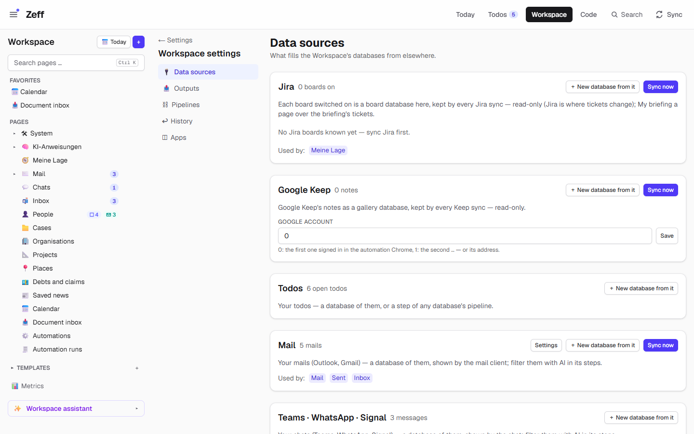
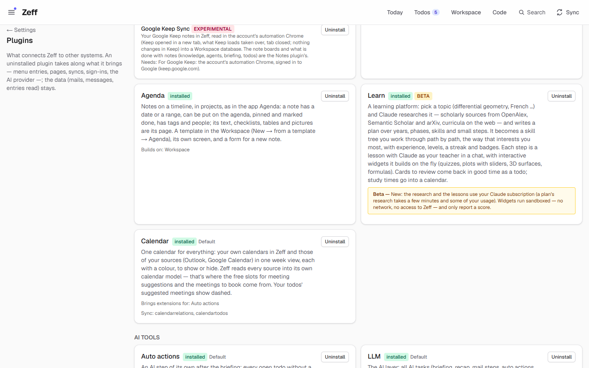
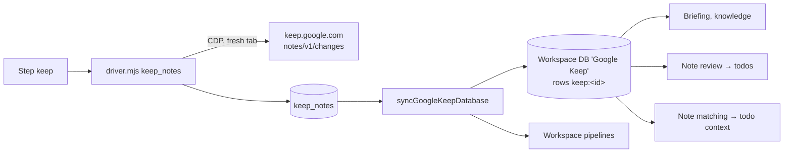

# Google Keep Sync

> Brings your Google Keep notes and lists into a read-only "Google Keep" database of the Workspace, where the briefing, the knowledge, the note review and agents can use them. **Category:** connector (a part of [Workspace](workspace.md)) · **On by default:** no · **Beta:** no — **Experimental** · **Needs:** [Workspace](workspace.md); the automation Chrome signed in to Google (keep.google.com)

> **Experimental — read before you switch it on.** Zeff reads Google Keep through its web page in the automation Chrome —
> Google offers no API for personal Keep notes. If Google changes the page, the sync can fail or miss notes, and Google can
> object to automated access to your account. You use it at your own risk; the Plugins page shows this warning with the
> liability disclaimer before you install it.

The demo has no Keep notes, so the source shows "0 notes"; after a sync the count and the *Google Keep* database appear.

## For users

### What it does

If you keep shopping lists, ideas, reminders or the details of an appointment in Google Keep on your phone, Zeff can read them
so they are not a separate island:

- Every note and list (not the archived ones) becomes a row of a gallery database **Google Keep** in the
  [Workspace](workspace.md) — title, text, checklists ("☐ milk", "☑ bread"), colour, pinned, labels — with the note's page as its
  content. The database is locked: Google Keep is where notes change.
- The database is in the **briefing** and the **knowledge**, so the AI's daily briefing and [Knowledge](knowledge.md) search see
  your notes.
- The **note review** (a step after each briefing) reads notes that are new or edited in the last three weeks and makes
  [todos](todos.md) of what they ask of you ("Book the tyre change", one todo for a whole shopping list) — the note is the todo's
  source. Information, recipes, idea collections, ticked items and credentials are left alone.
- **Note matching** attaches to each open todo the notes it is about, so they show on the todo and in its agents' context.

Reading changes nothing in Keep: no note is opened, edited or moved, and nothing is marked.

The note review, note matching, "Notes in the briefing" and the **Create note** auto action are Workspace extensions (they also
work with your own note databases); Google Keep Sync is only the source.

### Getting started

1. **Menu → Plugins** → *Workspace* → its part *Google Keep Sync* → Install. The experimental warning is shown first.

   

2. **Settings → Connections → Browser sign-ins**: press **Sign in** next to *Google Keep*. The automation Chrome (a Chrome Zeff
   runs for each Zeff account, with its own profile) comes to the front at keep.google.com; you sign in yourself — Zeff never
   types a password. **Check** asks whether you are signed in.
3. **Workspace → Settings → Data sources** (`/workspace/settings/sources`): under *Google Keep*, set the **Google account**
   (`0` = the first account signed in in the automation Chrome, `1` = the second … — or its address) and **Save**.
4. Press **Sync now** there (or Sync → *Google Keep*). The first sync creates the *Google Keep* database.

### Using it

- **Your notes.** Open the *Google Keep* database in the Workspace (the old address `/keep/google` leads there). The *Notes* view
  is a gallery, pinned first; *Table* shows colour, labels and "Edited in Keep". Open a row to read the note.
- **Sync.** The *Google Keep* step runs every 60 minutes by default — in the background only while the automation Chrome runs
  (it never starts Chrome by itself); started by hand, it may start Chrome. The result reads like "2 new · 1 changed · 48 in
  all". Each sync writes only the rows that changed; notes deleted or trashed in Keep go to the Workspace's trash.
- **Todos from notes.** After the next briefing, look in Todos for todos whose source is a Keep note; open the source to see the
  note.
- **Create note** (auto action): when a todo needs something kept rather than done (a packing list, the details of an
  arrangement), auto actions may propose a note; one click creates it as a row of one of your note databases in the Workspace —
  not in Google Keep.

### Settings

| Setting | Where | What it changes |
| --- | --- | --- |
| Google account | Workspace → Settings → Data sources → Google Keep | Which Google account's Keep is read: its number in the automation Chrome or its address (default `0`). |
| Sync every | Settings → Connections → Sync settings (also "Google Keep is read …" on the data source, once loaded) | How often *Google Keep* runs by itself (default 60 min; 0 = only by hand). |
| In the briefing / in the knowledge | The database's settings in the Workspace | Both on for the Google Keep database; turn off to keep notes out of the briefing or the knowledge. |
| Note review / Note matching / Notes in the briefing / Create note | Menu → Plugins → Workspace extensions | The AI steps and the action that use notes (on by default; the AI ones need [LLM](llm.md)). |

### Tips & limits

- **What leaves the machine:** the sync itself only reads from Google. The notes are stored in Zeff's database; the note review,
  note matching and the briefing send note titles and text (up to 1200 characters per note) to the AI you chose under
  [LLM](llm.md). Don't keep passwords in Keep notes you sync.
- **It reads what Keep's web app loads** — not an official API. A Keep redesign can stop the sync or miss notes; when a sign-in
  is needed you get a sign-in prompt.
- **Archived notes** are kept in Zeff's raw store but not in the database. Trashed notes are left out entirely.
- **Removal needs a full read:** notes gone from Keep are removed only when Keep delivered all notes in that sync.
- **Read-only.** Changing a note in Zeff's database does not change Keep (the database is locked). Writing back to Keep was an
  earlier plugin (*Keep write*) that has been retired; the driver still has a `keep_write` tool, but nothing in Zeff calls it.
- One Google account per Zeff account.

## Technical reference

### Overview

Google Keep Sync is a **feature** (part) of the Workspace plugin with the id `keep` (it was a plugin of its own; the id is kept so
settings stay). Its code is in `src/plugins/keep/`, which also still holds the note-related Workspace extensions (note review,
note matching, notes in the briefing, the Create note action) and the legacy "Keep boards" (moved into Workspace databases in
2026-10).

The sync step `keep` runs `driver.mjs` — a stdio MCP server — against the account's automation Chrome (endpoint from
`KEEP_CDP_ENDPOINT`, else `CHRONO_CDP_ENDPOINT`, else the account's Chrome). The driver opens `keep.google.com/u/<n>/` in a fresh
tab and **listens** to what Keep's own web app loads (`notes-pa.clients6.google.com/notes/v1/changes`), page by page; it sends
Google nothing of its own. `model.mjs` replays Keep's note commands into text and checklist items. The notes are stored in
`keep_notes` (`saveKeepNotes`), then mirrored into the Workspace database (`syncGoogleKeepDatabase`) and the Workspace's
pipelines run.

### Manifest

Declared in [workspace/plugin.ts](../../src/plugins/workspace/plugin.ts) under `features`:

| Field | Value |
| --- | --- |
| id | `keep` |
| part of | `workspace` |
| order | 300 |
| defaultInstalled | `false` |
| experimental | yes (text above) |
| requires | For Google Keep: the account's automation Chrome, signed in to Google (keep.google.com) |
| settings | `/workspace/settings/sources` (the Google account) |
| syncSteps | `keep` |
| services | `keep` (sign-in prompts) |
| routes | — (old `/keep/...` addresses redirect, see `src/app/keep/[[...rest]]/page.tsx`) |

The Workspace's note extensions (keeping their old `notes:` ids): `notes:note-review` (step `notetodos`, needs `llm`),
`notes:note-relations` (step `noterelations`, needs `llm`), `notes:lage-context`, `notes:note-action` (action `keep-note`).

### Files

| File | What it does |
| --- | --- |
| [sync.ts](../../src/plugins/keep/sync.ts) | `syncKeep` — the step: runs the driver, stores, mirrors into the Workspace, runs pipelines, raises sign-in prompts. |
| [driver.mjs](../../src/plugins/keep/driver.mjs) | The Chrome driver: `keep_status`, `keep_notes`, `keep_write` (unused). |
| [model.mjs](../../src/plugins/keep/model.mjs) | Decodes Keep's note model (commands, checklist items) into text. |
| [write.mjs](../../src/plugins/keep/write.mjs) | Writing through Keep's own editor (create / update / trash) — used only by `keep_write`. |
| [store.ts](../../src/plugins/keep/store.ts) | The `keep_notes` table, `saveKeepNotes`, `allKeepNotes`, the account setting. |
| [google-workspace.ts](../../src/plugins/keep/google-workspace.ts) | The "Google Keep" gallery database and `syncGoogleKeepDatabase`. |
| [collections.ts](../../src/plugins/keep/collections.ts), [server.ts](../../src/plugins/keep/server.ts) | Notes as item collections (until mirrored), registered on `collectionProviders`. |
| [boards.ts](../../src/plugins/keep/boards.ts) | The legacy own Keep boards (`keep_boards`, `keep_own_notes`). |
| [note-review.ts](../../src/plugins/keep/note-review.ts) | The note review (`notetodos`): prompt, schema, todos from notes. |
| [note-relations.ts](../../src/plugins/keep/note-relations.ts) | Note matching (`noterelations`). |
| [lage.ts](../../src/plugins/keep/lage.ts) | Notes in a ticket's briefing block. |
| [note-action.ts](../../src/plugins/keep/note-action.ts), [run.ts](../../src/plugins/keep/run.ts) | The `keep-note` action and its run (a row in a notes database). |
| [llm-tasks.ts](../../src/plugins/keep/llm-tasks.ts) | AI tasks `note-todos`, `note-relations`. |
| [server-actions.ts](../../src/plugins/keep/server-actions.ts), [KeepAccountForm.tsx](../../src/plugins/keep/KeepAccountForm.tsx) | Sync now, the account form. |
| [sync-settings.ts](../../src/plugins/keep/sync-settings.ts) | Its rows on the sync settings. |
| [KeepNoteBadge.tsx](../../src/plugins/keep/KeepNoteBadge.tsx), [colors.ts](../../src/plugins/keep/colors.ts), [shared.ts](../../src/plugins/keep/shared.ts) | A note shown on a todo, Keep's colours, the note brief type. |

### Data

- **`keep_notes`** (made on first use): `id` (Google's), `kind` (`note`/`list`), `title`, `text` (checklists as `- [ ]` / `- [x]`
  lines), `labels` (JSON), `color`, `pinned`, `archived`, `created_at`, `updated_at`, `url`, `synced_at`.
- **Workspace database "Google Keep"** (pref `keep.googleDb`): locked, source `google-keep`, in briefing and knowledge.
  Properties: Title, Color (select), Pinned (checkbox), Labels (multi-select, options added as labels appear), Note (ref
  `keep:<id>`, hidden), Edited in Keep (hidden). Views: *Notes* (gallery, pinned first) and *Table*. Row times are set to the note's.
- **Prefs:** `plugin:keep` — `{ account }`; `keep.notesDb` — the notes database the Create note action made when there was none.
- **Legacy:** `keep_boards`, `keep_own_notes`, `keep_moved`, `keep_moved_boards` — your former Keep boards and where they moved.

### Sync, jobs & AI tasks

- **`keep`** — `syncKeep()`; default every 60 minutes, only while the automation Chrome runs (background), one at a time per
  account (`__zeffKeepSyncing`); timeout 4 minutes.
- **`notetodos`** (note review) and **`noterelations`** (note matching) follow every briefing. AI tasks `note-todos` and
  `note-relations` (configurable under [LLM](llm.md)); prompt ids `note-review` and `note-relations` (editable prompts, German).
  The review reads notes edited in the last 21 days, in batches; a note is read again only once edited.

### MCP tools & actions

- **Driver tools** (Zeff's own use): `keep_status`, `keep_notes {account, launch}`, `keep_write` (not called by Zeff).
- **Action `keep-note`** (`board`, `title`, `text`): offered by auto actions while `notes:note-action` is on; creates a row in a
  Workspace notes database.
- Agents reach the notes through the Workspace's MCP tools (the database is an ordinary Workspace database) and the knowledge search.

### Extension points

- Contributes a collection provider (`collectionProviders`, `src/lib/items/point.ts`) for Google Keep notes and old note refs.
- Sets the Workspace database's source (`setDatabaseSource(id, "google-keep")`) and runs the Workspace pipelines after a sync
  (`runPipelinesAfterSync`).
- The note extensions extend [Todos](todos.md) and [Auto actions](auto-actions.md).

### Tests

- `tests/google-keep-mirror.test.ts` — the Google Keep database: rows, colours, labels, only changes written, gone notes trashed.
- `tests/keep-to-workspace.test.ts` — moved boards, the collection provider, `runKeepNote`.
- `tests/notes-plugin.test.ts` — Keep as a part of the Workspace, retired plugin ids.
- `tests/items-note-review.test.ts` — note review and note matching prompts and results.

Run one: `node --import tsx --test tests/google-keep-mirror.test.ts`.
