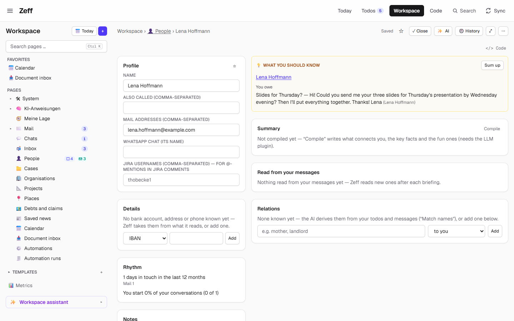
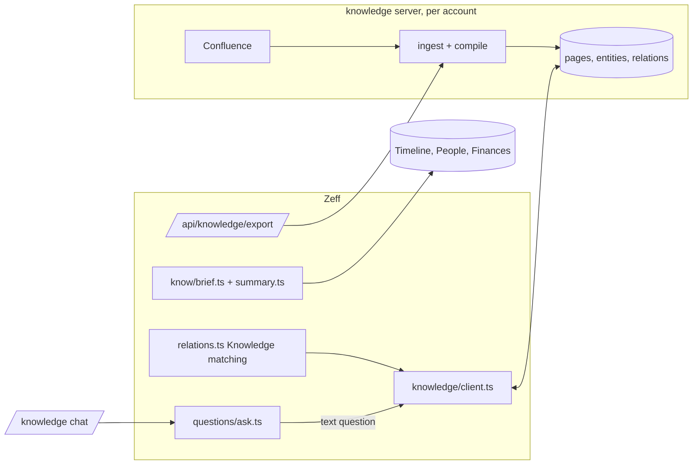

# Knowledge

> What Zeff knows, three ways — what you should know right now (before a meeting, beside a mail, a ticket or a person), questions about numbers and dates answered from your own data, and Confluence's pages as a searchable knowledge graph — each part switched on or off by itself. **Category:** App · **On by default:** yes (What you should know and Structured questions on; Confluence knowledge off) · **Beta:** no · **Needs:** What you should know: [Timeline](timeline.md) (its AI summary: [LLM](llm.md)); Structured questions: [LLM](llm.md); Confluence knowledge: the knowledge server (started by the launcher), Knowledge matching: [LLM](llm.md)

## For users

### What it does

*Knowledge* (`knowledge-hub`) is a hub for three parts. Each keeps the id it had as an extension of its own and is
switched on or off by itself in Menu → Plugins:

| Part | id | On by default | In one line |
| --- | --- | --- | --- |
| [What you should know](#what-you-should-know) | `know` | yes | Context just in time: who they are, your last contacts, what's still open between you, money, a birthday — beside an appointment, a mail, a chat, a ticket, a person or a case. |
| [Structured questions](#structured-questions) | `questions` | yes | "How much did I spend on craftsmen in 2026?", "When did I last talk to Anna?" answered from your own data with the numbers, the rows linked and the query shown. |
| [Confluence knowledge](#confluence-knowledge) | `knowledge` | no | Confluence pages (and what Zeff syncs) compiled into a searchable knowledge graph; a chat that answers with sources; the matching pages on each todo; search for agents. |

### Getting started

1. Menu → Plugins → *Knowledge* (category *App*): the hub and its three parts. *What you should know* and *Structured
   questions* are on; switch on *Confluence knowledge* if you have a knowledge server.
2. *What you should know* needs the [Timeline](timeline.md); its AI summary needs [LLM](llm.md).
3. *Structured questions* needs [LLM](llm.md); you ask it in the knowledge chat (`/knowledge`, which comes with
   Confluence knowledge) or an agent asks it over MCP (`ask_structured`).
4. *Confluence knowledge* needs the knowledge server (`knowledge/`, a server of its own): the launcher (Zeff.exe) starts
   it; every further account with this extension gets its own server with its own database. Confluence's address and
   token are set in Zeff's `.env` (`CONFLUENCE_URL` and either `CONFLUENCE_PERSONAL_TOKEN` or `CONFLUENCE_USERNAME` +
   `CONFLUENCE_API_TOKEN`).

### Using it

#### What you should know

Before an appointment with people, and beside a mail, a chat, a ticket, a person or a case, Zeff puts together what
matters now — by rule, at once, without AI:

- **the people:** their role (a confirmed one first), facts that still hold (never superseded or disputed ones), "away
  until …", a birthday coming up, money owed either way (Finances), your last contact and how many contacts in the last
  30 days;
- **what is still open between you:** promises by you (*You owe*) and to you (*Owed to you*), with due dates and
  "overdue since …";
- **recent events** with them from the [Timeline](timeline.md);
- **what it is about:** tickets, cases, projects, organisations;
- a line **"Not up to date: …"** when a source it relies on hasn't synced, so you know it may be missing things.

Each line links to its source. With the [LLM](llm.md) extension a short **AI summary** (2–5 points, open and overdue
first) sits on top: *Sum up* makes it, *Sum up again* refreshes it; it is kept until something in the brief changes and
then marked "AI summary from before the latest changes". *Helpful* / *Not helpful* rate it. Before your meetings the
summaries are made by themselves with the briefing (for meetings with people in the next three hours, up to six a run).

In the demo, Lena Hoffmann's page shows under *You owe* her mail "Slides for Thursday? — Hi! Could you send me your
three slides for Thursday's presentation by Wednesday evening? …", with *Sum up* for the AI summary.

Where it shows: on an appointment (*Before the meeting* in the event details), on **Today** about half an hour before a
meeting, as a module of Workspace rows and pages (people, cases, mail conversations), and for agents (MCP
`meeting_brief`, `context_brief`). Secret data never shows; agents see personal data only with permission.

#### Structured questions

Ask in the knowledge chat a question about numbers and dates: "Which tickets cost me the most time this month?", "How
many todos did I finish in October?", "When did I last write to Thomas?". The AI decides whether it is a data question;
if so it plans up to three queries over named, read-only *views* of your data, Zeff runs them, and the AI answers with
the exact numbers, citing the rows ([1], [2] …) as links, with "how it was computed" shown under the answer. A text
question ("how does code get onto the test environment?") still goes to the Confluence knowledge.

The views:

| View | Holds | Needs |
| --- | --- | --- |
| `time_entries` | Booked time: day, hours, description, ticket, job, project, kind | — |
| `bank_transactions` | Bank transactions | Finances |
| `calendar_events` | Appointments | Calendar |
| `todos` | Todos: ticket, text, status, created, done, due | Todos |
| `messages` | Mails and messages per person and date | — |
| `workspace` | Your Workspace databases (any property, with conditions) | Workspace |
| `timeline` | Timeline events by entity, kind, source and date | Timeline (contributed) |

A query is `{ view, filters, groupBy?, aggregate, measure?, order, limit }`; aggregates are `count`, `sum`, `avg`,
`min`, `max`, `first`, `last`, `count_days`, `list`; groupings are the view's own plus `day`, `week`, `month`, `year`,
`weekday`. An agent can send a query itself (no AI) or call the tool without arguments to list the views.

#### Confluence knowledge

The knowledge server reads Confluence (and Zeff's own synced context — tickets with comments, Teams chats by day, mail
conversations, merge requests, todos with notes and reports, time entries by week, day recaps, notes, Google Keep notes,
chosen Workspace databases — plus your own entries) and has the AI *compile* each new or changed page: a summary, its
concepts in other words (German and English), the entities in it (systems, components, people, teams, customers,
processes, terms, tickets) and how they relate. Entities of the same name from different pages are one: that is the
graph.

- **Chat** (`/knowledge`, Menu → *Chat*): ask the knowledge; every answer cites its sources. The side panel shows the
  counts (pages, spaces, entities, relations), pages not compiled yet, the last run, and the buttons *Sync* (read the
  sources now and compile what's new), *Graph ↗* and *Knowledge server ↗*. *Add knowledge* keeps a fact, a note or a
  link (its page is read) — compiled right after.
- **Graph** (`/graph`): opens the knowledge server's graph of the account you're in.
- **On todos:** the *Knowledge (n)* toggle shows the pages and entities that really fit the todo, each with a line why
  it helps, and the addresses of the systems it is about (Prod, Test, Dev). This comes from **Knowledge matching**
  (`todo-knowledge`), a step after every briefing: for each new or changed todo the AI checks the knowledge server's
  full-text hits and keeps only what fits.
- **Projects:** for a repository the AI writes a short description from the knowledge and a table of its systems; the
  addresses go through Zeff's trust store, so a changed production address waits for your review instead of replacing
  the one that holds.
- **Agents** search it over MCP (`search_knowledge`) and add to it (`add_knowledge`).

When the knowledge server isn't running, the chat page says "This account's knowledge server isn't answering (…) — is it
running? The launcher (Zeff.exe) starts it."

### Settings

| Setting | Where | What it changes |
| --- | --- | --- |
| What you should know / Structured questions / Confluence knowledge | Menu → Plugins → Knowledge | Each part on or off. |
| Knowledge matching (`todo-knowledge`) | Menu → Plugins → Confluence knowledge → extension | The step after the briefing that picks knowledge per todo (on by default; needs LLM). |
| AI tasks *What you should know*, *Structured questions*, *Knowledge matching* | Settings → AI → Tasks | Backend and model of each ([LLM](llm.md)). |
| Knowledge matching instructions | Settings → AI → *Knowledge matching* | Extra instructions for that step. |
| Prompts *What you should know*, the planner and phrasing of structured questions | Workspace → System → Prompts | The AI's instructions. |
| Rules for the systems' picking stage | Settings → Todos | Your own rules for which addresses belong to a project ("" = the built-in ones). |
| `CONFLUENCE_URL`, `CONFLUENCE_PERSONAL_TOKEN` or `CONFLUENCE_USERNAME` + `CONFLUENCE_API_TOKEN` | Zeff's `.env` | Where the knowledge server reads Confluence. |
| `KNOWLEDGE_URL`, `KNOWLEDGE_TOKEN` | Environment | The first account's knowledge server (default port 9555) and its token. |

### Tips & limits

- **What the AI sees:** the summary sees the brief's numbered lines; structured questions see the views' descriptions,
  then the query results (not your raw data); Knowledge matching sees each todo and its candidate pages; the knowledge
  server's compile sees each page. All go to the backend set for the task. Secret data is never shown or sent.
- **Clearance:** every view and every row of a structured question is checked against the data boundaries — secret for
  nobody, personal for you and for agents allowed personal data. A personal Confluence space's pages are not shown to an
  agent without personal-data permission.
- The knowledge server is a separate process with its own database per account; Zeff reaches the first account's at
  `KNOWLEDGE_URL` (default port 9555) and the others at their own ports.
- Structured questions answer only from views that exist and plugins that are installed; an empty result says what was
  searched for so you can ask differently.
- *What you should know* is rule-based: it never invents facts; its summary cites the lines it rests on.

## Technical reference

### Overview

The hub ([knowledge-hub/plugin.ts](../../src/plugins/knowledge-hub/plugin.ts)) is a manifest with three `features`;
their code stays in [know/](../../src/plugins/know), [questions/](../../src/plugins/questions) and
[knowledge/](../../src/plugins/knowledge). `isInstalled("know" | "questions" | "knowledge")` checks each part.

**What you should know.** `briefFor(refs)` ([know/brief.ts](../../src/plugins/know/brief.ts)) collects people
(facts, role, away, birthday, money, last contact), open loops (`openLoopsFor`, [know/loops.ts](../../src/plugins/know/loops.ts) —
commitment claims of the People plugin), recent timeline events, related links and stale sources (Source health),
filtered by clearance; `meetingBrief(eventId)` does it for an appointment; `hash` identifies its content.
`summarizeBrief` ([know/summary.ts](../../src/plugins/know/summary.ts)) numbers the lines, asks the task `know-summary`
for 2–5 points with source numbers, and keeps the result in `ai_memo` (scope `know-summary`) by the brief's hash.
`prepareMeetingBriefs` runs with the briefing (in the People matching step), 180 minutes ahead, 6 per run, unless
switched off (pref `know.autoSummary`). UI: [know/ui/KnowPanel.tsx](../../src/plugins/know/ui/KnowPanel.tsx),
[know/ui/MeetingSoon.tsx](../../src/plugins/know/ui/MeetingSoon.tsx).

**Structured questions.** [questions/ask.ts](../../src/plugins/questions/ask.ts): one AI call routes and plans
(`kind: structured | text`, ≤ 3 queries); `validateQuery` checks each against the views (a failing plan goes back once
with the error); `runQuery` ([questions/views.ts](../../src/plugins/questions/views.ts)) runs it in code; a second call
phrases the answer citing rows. `chatAnswer` is the knowledge chat's router (null → the knowledge server answers).
Every view and item passes `sensitivityGate` (the data boundaries).

**Confluence knowledge.** [knowledge/client.ts](../../src/plugins/knowledge/client.ts) talks to the knowledge server
(`knowledge/`, its own Next app, `/api/status`, `/search`, `/related`, `/links`, `/repo-sources`, `/ask`, `/page`,
`/sync`, `/own`, `/people`, `/profile`). Zeff provides the server's "Zeff" source through
`/api/knowledge/export` ([knowledge/export.ts](../../src/plugins/knowledge/export.ts); per-account token).
[knowledge/instances.ts](../../src/plugins/knowledge/instances.ts) writes `data/knowledge-instances.json`, which the
launcher watches to start one server per account with the extension. Knowledge matching
([knowledge/relations.ts](../../src/plugins/knowledge/relations.ts)) writes `todos.knowledge`. Project summaries:
[repo-systems.ts](../../src/plugins/knowledge/repo-systems.ts), [repo-picks.ts](../../src/plugins/knowledge/repo-picks.ts),
[repo-trust.ts](../../src/plugins/knowledge/repo-trust.ts).

### Manifest

| Field | Hub | `know` | `questions` | `knowledge` |
| --- | --- | --- | --- | --- |
| name | Knowledge | What you should know | Structured questions | Confluence knowledge |
| category | `app` | (feature) | (feature) | (feature) |
| order | 159 | 176 | 165 | 160 |
| defaultInstalled | `true` | `true` | `true` | `false` |
| dependsOn | — | `timeline` | `llm` | — |
| requires | — | — | — | the knowledge server (the launcher starts it; one per account) |
| apps | — | — | — | `/knowledge` "Chat" |
| routes | — | — | — | `/knowledge`, `/graph` |
| extensions | — | — | — | `todo-knowledge` for `todos`: "Knowledge matching", requires `llm`, on by default, syncSteps `knowledgerel` |

### Files

| File | What it is |
| --- | --- |
| [knowledge-hub/plugin.ts](../../src/plugins/knowledge-hub/plugin.ts) | The hub's manifest with the three features. |
| [know/brief.ts](../../src/plugins/know/brief.ts) | `briefFor`, `meetingBrief`, `upcomingMeetings`, `briefText`, stale sources. |
| [know/summary.ts](../../src/plugins/know/summary.ts) | AI summary, cache, `prepareMeetingBriefs`, rating. |
| [know/loops.ts](../../src/plugins/know/loops.ts) | Open loops for the brief. |
| [know/shared.ts](../../src/plugins/know/shared.ts) | Brief types. |
| [know/server-actions.ts](../../src/plugins/know/server-actions.ts) | `knowBriefAction`, `knowSummarizeAction`, `knowRateAction`. |
| [know/mcp.ts](../../src/plugins/know/mcp.ts) | `meeting_brief`, `context_brief`. |
| [know/ui/KnowPanel.tsx](../../src/plugins/know/ui/KnowPanel.tsx), [MeetingSoon.tsx](../../src/plugins/know/ui/MeetingSoon.tsx) | The panel; Today's "meeting soon". |
| [questions/ask.ts](../../src/plugins/questions/ask.ts) | Plan, run, phrase; `chatAnswer`; prompts. |
| [questions/views.ts](../../src/plugins/questions/views.ts), [view-types.ts](../../src/plugins/questions/view-types.ts) | Registry, validation, aggregation, sensitivity gate; types. |
| [questions/builtin-views.ts](../../src/plugins/questions/builtin-views.ts) | The built-in views. |
| [questions/view-point.ts](../../src/plugins/questions/view-point.ts) | The `questions.views` point. |
| [questions/mcp.ts](../../src/plugins/questions/mcp.ts) | `ask_structured`. |
| [knowledge/client.ts](../../src/plugins/knowledge/client.ts) | The knowledge server's API client. |
| [knowledge/instances.ts](../../src/plugins/knowledge/instances.ts) | One knowledge server per account (`knowledge-instances.json`). |
| [knowledge/export.ts](../../src/plugins/knowledge/export.ts) | Zeff's context as documents for the server. |
| [knowledge/relations.ts](../../src/plugins/knowledge/relations.ts) | Knowledge matching. |
| [knowledge/repo-systems.ts](../../src/plugins/knowledge/repo-systems.ts), [repo-picks.ts](../../src/plugins/knowledge/repo-picks.ts), [repo-trust.ts](../../src/plugins/knowledge/repo-trust.ts), [repo-systems-store.ts](../../src/plugins/knowledge/repo-systems-store.ts), [repo-prompt.ts](../../src/plugins/knowledge/repo-prompt.ts) | Project descriptions and their systems' addresses. |
| [knowledge/KnowledgeChat.tsx](../../src/plugins/knowledge/KnowledgeChat.tsx), [KnowledgeAdd.tsx](../../src/plugins/knowledge/KnowledgeAdd.tsx), [KnowledgeSyncButton.tsx](../../src/plugins/knowledge/KnowledgeSyncButton.tsx), [TodoKnowledge.tsx](../../src/plugins/knowledge/TodoKnowledge.tsx) | Chat, add, sync, the todo toggle. |
| [knowledge/server-actions.ts](../../src/plugins/knowledge/server-actions.ts), [add-actions.ts](../../src/plugins/knowledge/add-actions.ts) | Ask, sync, add. |
| [app/knowledge/page.tsx](../../src/app/knowledge/page.tsx), [app/graph/route.ts](../../src/app/graph/route.ts), [app/api/knowledge/export/route.ts](../../src/app/api/knowledge/export/route.ts) | Pages and routes. |
| [mcp/tools/knowledge.ts](../../src/mcp/tools/knowledge.ts) | `search_knowledge`, `add_knowledge`, `search_context`, `source_health`, `zeff_actions`. |
| [knowledge/](../../knowledge) | The knowledge server (separate app: ingest, compile, search, graph, ask). |

### Data

| Where | What |
| --- | --- |
| `todos.knowledge` | JSON `{ at, pages, entities, links?, repo? }` — what Knowledge matching picked for the todo. |
| `ai_memo` scope `know-summary` | AI summaries by key (`event:<id>[:<day>]`, a row …) and brief hash. |
| pref `know.autoSummary` | Make summaries before meetings by themselves (default on). |
| learning ledger, step `know-summary` | *Helpful* / *Not helpful* verdicts. |
| `data/knowledge-instances.json` | Accounts with a knowledge server: port, data folder, token. |
| The knowledge server's own database (per account) | Pages, chunks, entities, relations, runs. |
| Trust store, subject `repo:<id>` | Project system addresses (`<env>-url`). |

### Sync, jobs & AI tasks

| Kind | Id | What |
| --- | --- | --- |
| Sync step | `knowledgerel` | Knowledge matching, with every briefing (workdays, at the briefing's interval) — new and changed todos only. |
| With the briefing | `prepareMeetingBriefs` | Meeting summaries for the next 3 hours (in the People matching step). |
| AI task | `know-summary` | "What you should know" summary. |
| AI task | `questions-structured` | Plan and phrase structured questions. |
| AI task | `knowledge-relations` (idempotent) | Picks from the knowledge base's hits what really fits each todo. |
| Context step | `knowledge` | Extra instructions for Knowledge matching (Settings → AI). |

The knowledge server's own compile and answer run through its own AI setting (Copilot or Claude CLI).

### MCP tools & actions

| Tool | Part | What |
| --- | --- | --- |
| `meeting_brief` | know | The brief before a meeting (`event`, `occurrence`; without: the next meeting with someone known in it, from 30 minutes ago to 24 hours ahead). |
| `context_brief` | know | What you should know about a ref (`person:12`, `ticket:PROJ-7`, `page:31`) or a name. |
| `ask_structured` | questions | A `question` (AI plans) or a `query` (run as is); with neither, the views. Read-only. |
| `search_knowledge` | knowledge | Pages and entities for a query (limit 1–15, default 6), filtered by clearance. |
| `add_knowledge` | knowledge | Keep a text or a URL in the knowledge base. Never secrets or guesses. |
| `search_context` | core | Everything Zeff keeps (knowledge, mails, Teams, GitLab, Jira, notes, facts, todos, documents, pages, people). |

Server actions: `knowBriefAction`, `knowSummarizeAction`, `knowRateAction`, `askKnowledgeAction`,
`knowledgeSyncAction`, `addKnowledgeAction`. The LLM plugin's `llm.steps.update` offer reads knowledge hits as context.

### Extension points

- Provides **`questions.views`** ([questions/view-point.ts](../../src/plugins/questions/view-point.ts)): a plugin adds a
  `QueryView` (`name`, `description`, `plugin`, `filters`, `dims`, `measures`, `items(filters, ctx)`) with
  `questionViews.contribute("<plugin>", [view])`; the Timeline does.
- *What you should know* is placed by other plugins: the calendar's event details, Today, and the Workspace detail
  module `know` (people, cases, mail conversations).
- *What you should know*'s open loops: `openLoopsFor` is the merge point for the Open loops plugin.

### Tests

| Test | Covers |
| --- | --- |
| [tests/know-brief.test.ts](../../tests/know-brief.test.ts), [tests/know-summary.test.ts](../../tests/know-summary.test.ts), [tests/know-mcp.test.ts](../../tests/know-mcp.test.ts) | The brief, its summary, the MCP tools. |
| [tests/questions.test.ts](../../tests/questions.test.ts) | Views, validation, queries, routing, clearance. |
| [tests/knowledge-catalog.test.ts](../../tests/knowledge-catalog.test.ts), [tests/knowledge-links.test.ts](../../tests/knowledge-links.test.ts), [tests/knowledge-panel.test.ts](../../tests/knowledge-panel.test.ts), [tests/knowledge-person-facts.test.ts](../../tests/knowledge-person-facts.test.ts), [tests/knowledge-profile.test.ts](../../tests/knowledge-profile.test.ts) | Export catalog, system links, the todo panel, person facts, profile figures. |
| [tests/items-knowledge.test.ts](../../tests/items-knowledge.test.ts), [tests/workspace-knowledge.test.ts](../../tests/workspace-knowledge.test.ts), [tests/workspace-knowledge-source.test.ts](../../tests/workspace-knowledge-source.test.ts) | Workspace data in the knowledge. |

Run one: `node --import tsx --test tests/know-brief.test.ts`.
