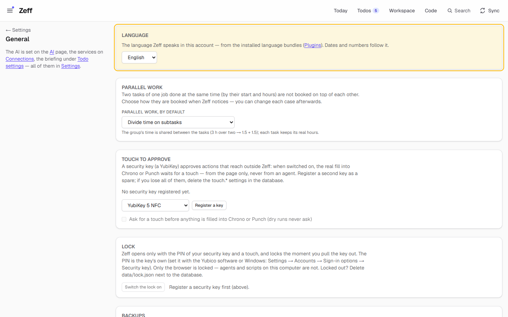
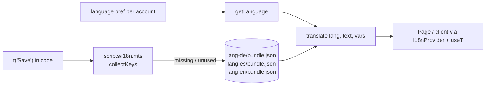

# Languages: Deutsch, English, Español

> Three language bundles (German, English and Spanish) that set the language of Zeff's interface, dates and numbers, plus how UI translation works in the code. **Category:** language · **On by default:** yes (all three) · **Beta:** no · **Needs:** nothing



## For users

### What it does

Zeff's texts are written in English in the code. Each language is a small plugin that brings a **bundle**, a list
that maps every English text to its translation:

| Plugin | Language | Dates and numbers |
| --- | --- | --- |
| `lang-en` (English) | English, the language the texts are written in | `en-GB` (e.g. 10/11/2026, 1,234.5) |
| `lang-de` (Deutsch) | German: all interface texts | `de-DE` (e.g. 10.11.2026, 1.234,5) |
| `lang-es` (Español) | Spanish: all interface texts | `es-ES` |

The language applies **per account**: a work account can be in German and a private one in English (see
[Accounts](accounts.md)). Dates, numbers and relative times ("3 days ago") follow it, both on the server and in the
browser.

The demo runs in English, as the screenshot shows.

### Getting started

1. All three bundles are installed by default. To offer fewer languages, uninstall one under **Menu → Plugins**
   (category *Languages*).
2. Open **Settings → General** (`/preferences#language`) and choose a language under **Language**. The picker lists
   English plus every installed bundle, each in its own name (English, Deutsch, Español). The page reloads in the new
   language.

### Using it

Nothing else to do. Every page, menu, button, toast and the Plugins catalog (names, descriptions, needs, menu entries
and action names) appears in the chosen language. Proper names such as Jira or Chrono stay as they are, and so do the
language plugins' own names and descriptions.

If a text has no translation yet, it shows in English. Nothing breaks.

### Settings

| Setting | Where | What it changes |
| --- | --- | --- |
| Language | Settings → General → Language (`/preferences#language`) | The account's language: interface texts, `<html lang>`, date and number formats. Stored as the `language` preference. Only installed bundles (and English) can be chosen. |

The three plugins have no settings of their own. Each plugin's settings link points to this picker.

### Tips & limits

- **Uninstalling the bundle in use** switches the account back to English. A language whose plugin is not installed
  falls back to English.
- **The AI's language is separate.** Prompts and what the AI writes are not translated by these bundles.
  Translation covers the interface only.
- **Your own data stays as it is**: job names, todo titles, mail text and so on are never translated.
- Nothing leaves the machine. The bundles are JSON files shipped with Zeff.

## Technical reference

### Overview

**English text is the key.** In the code a visible text is written once, in English, inside `t("…")`:

```ts
// server code (pages, server actions, API routes, lib)
import { t } from "@/lib/i18n/server";
t("Save");
t("{n} entries", { n: 3 });

// client components
const t = useT(); // from "@/components/I18nProvider"
t("Save");
```

`translate(lang, text, vars)` in [shared.ts](../../src/lib/i18n/shared.ts) looks the text up in the language's
bundle. If it is missing or empty, the English text is used. `{placeholders}` are then filled in, and a placeholder
without a value stays visible (`{n}`, not `undefined`).

**Server side**, [server.ts](../../src/lib/i18n/server.ts) reads the account's `language` preference
(`getLanguage()`), cached per account for 2 seconds. It only accepts a language whose bundle plugin is installed (English
always). It also sets the format resolver, so [src/lib/format.ts](../../src/lib/format.ts) formats dates and numbers
with the language's locale.

**Client side**, the root layout ([src/app/layout.tsx](../../src/app/layout.tsx)) sets `<html lang>` and wraps the
app in `I18nProvider` with the account's language.
[I18nProvider.tsx](../../src/components/I18nProvider.tsx) sets the browser's format language and provides `useT()`
and `useLang()`.

**Markup inside a sentence**: [rich.tsx](../../src/lib/i18n/rich.tsx) keeps a sentence with a link as one key with
tags, so each language can put the link where its grammar needs it:

```tsx
rich(t("Working hours are on the <link>Schedule</link> page."), { link: (s) => <Link href="/schedule">{s}</Link> })
```

A tag without a renderer, or one a translation dropped, shows its words as plain text.

**Keys must be literals.** `t(variable)` cannot be found by the scanner and so cannot be translated. Texts that live
in data (the plugin catalog, the integrations' manifests) are listed as literals in a `texts` function:
[catalog-text.ts](../../src/plugins/catalog-text.ts) for the catalog, and `meta.ts` `texts` for mounted integrations.



### Manifest

| Field | lang-en | lang-de | lang-es |
| --- | --- | --- | --- |
| id | `lang-en` | `lang-de` | `lang-es` |
| name | English | Deutsch | Español |
| category | `language` | `language` | `language` |
| order | 130 | 140 | 150 |
| defaultInstalled | `true` | `true` | `true` |
| dependsOn | none | none | none |
| settings | `/preferences#language` | `/preferences#language` | `/preferences#language` |
| routes, syncSteps, features | none | none | none |

### Files

| File | What it does |
| --- | --- |
| [lang-de/plugin.ts](../../src/plugins/lang-de/plugin.ts), [lang-en/plugin.ts](../../src/plugins/lang-en/plugin.ts), [lang-es/plugin.ts](../../src/plugins/lang-es/plugin.ts) | The manifests. |
| [lang-de/bundle.json](../../src/plugins/lang-de/bundle.json) | German: about 9,100 English texts → German. |
| [lang-es/bundle.json](../../src/plugins/lang-es/bundle.json) | Spanish: the same keys → Spanish. |
| [lang-en/bundle.json](../../src/plugins/lang-en/bundle.json) | English: empty. It holds an entry only to override a wording. |
| [src/lib/i18n/shared.ts](../../src/lib/i18n/shared.ts) | `LANGUAGES` (name, native name, locale, plugin), `translate`, `translator`, `bundleOf` (client-safe). |
| [src/lib/i18n/server.ts](../../src/lib/i18n/server.ts) | Server `t()`, `getLanguage`, `setLanguage`, `availableLanguages`, format resolver. |
| [src/components/I18nProvider.tsx](../../src/components/I18nProvider.tsx) | `I18nProvider`, `useT()` and `useLang()` for client components. |
| [src/lib/i18n/rich.tsx](../../src/lib/i18n/rich.tsx) | `rich()`: markup tags inside a translated sentence. |
| [src/lib/i18n/collect.ts](../../src/lib/i18n/collect.ts) | Finds every literal `t("…")` in `src/` and `integrations/` with the TypeScript parser. |
| [scripts/i18n.mts](../../scripts/i18n.mts) | `npm run i18n`: missing and unused keys per bundle. |
| [src/components/LanguagePicker.tsx](../../src/components/LanguagePicker.tsx) | The picker on Settings → General. |
| [src/app/actions/plugins.ts](../../src/app/actions/plugins.ts) | `setLanguageAction`. |
| [src/plugins/catalog-text.ts](../../src/plugins/catalog-text.ts) | The catalog's texts as literals, so they are found and translated. |

### Data

- **Preference `language`** (per account, in the `prefs` table): `en`, `de` or `es`. The default is `en`.
- **Bundles**: flat JSON objects, `{ "<English text>": "<translation>" }`, sorted by key. An empty value counts as
  missing and shows the English text.
- Whether each `lang-*` plugin is installed is stored in the account's `plugins` table, like any plugin.

### Sync, jobs & AI tasks

None.

### MCP tools & actions

None for agents. The server action `setLanguageAction(lang)` refuses a language whose bundle is not installed ("This
language isn't installed (Menu → Plugins).").

### Extension points

The language plugins do not use extension points. A bundle is imported statically in
[shared.ts](../../src/lib/i18n/shared.ts), and `LANGUAGES` lists the three languages. Adding a language today means:
a `src/plugins/lang-<code>/` folder with `plugin.ts` and `bundle.json`, an entry in `LANGUAGES` and `BUNDLES`, the
language code in [scripts/i18n.mts](../../scripts/i18n.mts), then `npm run plugins:index`.

Other plugins take part by writing their visible texts as literal `t("…")` calls (or `useT()` in client
components). Mounted integrations list theirs in `meta.ts` `texts` (see [Time sheets](timesheets.md)).

### Translating: the workflow

1. Write the text in English in `t("…")`. Use one key per sentence, `{name}` placeholders and `<tag>` markup through
   `rich()`.
2. Run **`npm run i18n`**. It prints how many texts are in the code and, per bundle, how many are missing and unused.
3. Add the German and Spanish translations of the new keys to `lang-de/bundle.json` and `lang-es/bundle.json`. Keep
   every `{placeholder}` and `<tag>` of the English text.
4. Run `tests/i18n.test.ts`. It fails while a text is missing from the German or Spanish bundle, or a translation
   lost a placeholder or tag.

`npm run i18n -- --write` adds missing keys (empty), **drops every key it did not find in the code**, and re-sorts
the files. Keys used only by an integration that is not mounted, or written some other way than a literal `t()`, are
dropped too. Check the diff, or add keys with a small script instead.

### Tests

| Test | What it covers |
| --- | --- |
| [tests/i18n.test.ts](../../tests/i18n.test.ts) | Translation with English fallback and placeholders; `rich()` markup; every UI text in the German and Spanish bundles with its placeholders and tags kept. |

Run it: `node --import tsx --test tests/i18n.test.ts`.
