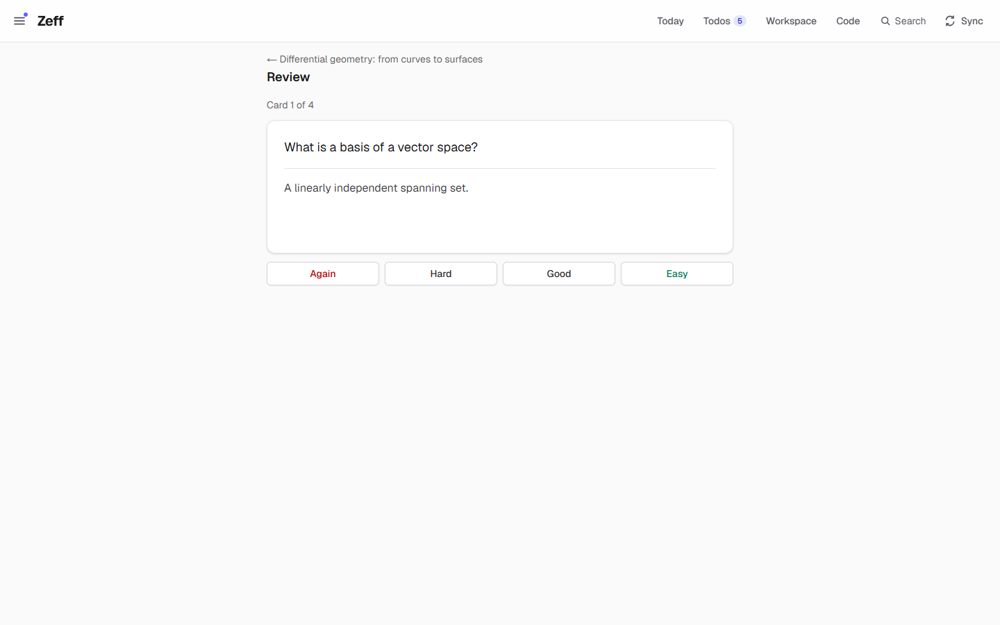
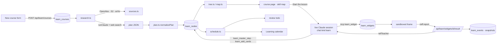

# Learn

> A learning platform: Claude researches a topic and plans it as a skill tree, then teaches each small step in a chat
> with exercises it builds on the spot, while Zeff keeps your progress, cards to review and study times. **Category:** app ·
> **On by default:** no · **Beta:** yes (the research and the lessons use your Claude subscription; widgets run
> sandboxed) · **Needs:** the Claude CLI signed in ([AI backends](ai-backends.md)), Zeff's MCP server for the teacher's
> tools; it works with [Todos](todos.md) (lesson and review todos), [Code / Work](work.md) (the live sessions a lesson
> runs in) and [Calendar](calendar.md) (study times)

## For users

### What it does

You give Learn a topic, a goal and what you know already. Claude looks for scholarly sources and curricula and writes
a plan that can run for years. The plan has four levels: **years → phases → skills → steps**. A step is one lesson of
about 15–45 minutes with a goal you can test. Zeff turns the plan into a **skill tree**. A step opens once everything it
requires is mastered. A skill, phase or year is mastered once all its parts are.

Each step is a **lesson**: a chat with Claude as your teacher. The teacher explains, asks questions and builds
interactive exercises right in the lesson (quizzes, plots with sliders, formulas, 3D models). When you have shown the
step's goals, it marks the step mastered. It also leaves **cards** behind, which come back for review when you are about
to forget them. Experience points (XP), levels, a daily goal, a streak and badges keep track of how you are doing.
Study times you set go into your calendar as appointments.

The demo shows a course a week in:

- **Topic:** differential geometry. **Goal:** "Understand Riemannian geometry". **Prior knowledge:** "School maths,
  some linear algebra".
- **Plan:** "Differential geometry: from curves to surfaces", two years long. It has five paths: *Foundations*,
  *Intuition*, *Computation*, *Theory* and *Physics*. It cites four sources: do Carmo's *Differential Geometry of
  Curves and Surfaces*, Bär's *Elementare Differentialgeometrie*, Lee's *Introduction to Riemannian Manifolds* and
  Keenan Crane's CMU notes on discrete differential geometry.
  - **Year 1, "curves and surfaces":** the phases *Foundations* (linear algebra, multivariable calculus), *Curves*
    (plane curves, space curves, curves numerically) and *Surfaces* (first fundamental form, Gaussian curvature,
    minimal surfaces, Theorema egregium).
  - **Year 2, "manifolds":** charts and atlases, Riemannian metrics.
- **Progress so far:** both foundations and the first two steps of *Plane curves* are mastered. You are in the lesson
  **"Curvature of plane curves"**, which has two exercises.
- **Cards:** four are due, two from "Vector spaces, basis, dimension" and two from "Arc length".

### Getting started

1. Open **Menu → Plugins** and turn on **Learn**. It is in beta: it says that the research and the lessons use your
   Claude subscription.
2. Set up and sign in to the Claude CLI (**Settings → AI**, see [AI backends](ai-backends.md)). Both the research and
   the teacher run on it.
3. Open **Learn** from the menu (under *Apps*). The address is `/learn`.

The Learn page lists your courses. Each card shows its level, progress bar, streak and cards due. Below the cards is
the form for a new course.

### Using it

#### Start a course

Fill in **Topic** (or pick an example), **Goal** and **What you know already**. Then click **Research and plan**. The
course page shows "Claude is researching and planning …" and fills in by itself once the plan is ready. That takes a
few minutes and some of your Claude usage. Here is what happens behind the button:

1. Zeff asks three open literature services about the topic: OpenAlex, Semantic Scholar and arXiv. The answers are
   merged and sorted by citations.
2. Claude, with its own web search, looks at how the topic is usually taught: university curricula, standard
   textbooks, and for languages the CEFR levels A1–C2. It then writes the plan as JSON.
3. Zeff checks and repairs the plan before storing it. Every repair is listed under **Repaired in the plan** on the
   course page.
4. If the plan comes out as a single chain instead of a tree, Claude gets it back once and is asked to branch it out.

If the research fails, the page says why and offers **Try again**.

#### The course page

From top to bottom:

- **Review N cards**, shown when cards are due.
- Four tiles: your **Level** with XP to the next one, **Today** against your daily goal, your **Streak** (days in a
  row), and **Progress** (share of steps mastered).
- Your **badges**. The demo has *First step*, *First skill*, *First phase* and *7 days in a row*.
- The **skill map**, with **Update planning** next to it.
- **Next steps**: the steps you can take now, the one you are in first.
- **By phase, as a list**: the same tree, folded by year and phase.
- **Your interests** and **Study times**.
- **Sources (n)** and, if anything was repaired, **Repaired in the plan (n)**.
- **Plan anew** and **Remove course**.

#### The skill map

![The skill map: three bands Foundations, Curves and Surfaces. Linear algebra and Multivariable calculus are mastered (ticks) and joined by an arrow. Plane curves shows 2/3, Curves numerically 0/2, Space curves, First fundamental form, Gaussian curvature, Theorema egregium and Minimal surfaces are locked. A red thread runs from Linear algebra through the gaps between the nodes, solid where walked and dashed ahead, numbered 2 to 10. Above the map, the picked skill Plane curves lists its steps: Parametrised curves and Arc length ticked, Curvature of plane curves open. Below the map, Next steps: Curvature of plane curves (in progress, 45 min · 10 XP) and Discretising curves (30 min · 10 XP)](img/learn-skill-map.png)

The map draws every **skill** as a round node:

- **Colour:** the skill's path (legend above the map).
- **Ring:** progress, shown as steps mastered out of all its steps. In the demo, *Plane curves* shows **2/3** and
  *Curves numerically* **0/2**.
- **Columns:** a skill stands one column after everything it requires.
- **Bands:** the phases are drawn as bands behind the nodes.
- **State:** a tick means mastered, a lock means locked.
- **Foundations:** the skills that need nothing stand one after another down the first column, joined by arrows. In
  the demo these are *Linear algebra*, then *Multivariable calculus*.
- **Lines:** faint lines show what comes before what.

Click a skill to list its steps above the map, each with its minutes. Click a step to open its lesson.

The **red thread** is your way through the map:

- **Solid** where you have walked. A skill counts as walked once one of its steps has been begun or mastered, and the
  walked skills are ordered by when that happened.
- **Dashed** for the plan ahead. The foundations come first. After them, a skill joins the thread as soon as what it
  follows is on the way: paths you care about most first, otherwise the plan's order.
- **Drawn in the gaps** between the columns and rows, never across a node or its title.
- **Numbered:** each stretch is numbered, so you can follow where it goes next.

In the demo, the thread runs from *Linear algebra* to *Multivariable calculus* and *Plane curves*. Then it goes on
dashed through *Space curves* and *Curves numerically* into the *Surfaces* band.

On a phone the map scrolls sideways.

**By phase, as a list** shows the same tree as cards. Each skill card shows its path, its XP and its steps with
minutes. Lines join the skills that require one another.

#### A lesson

Open a step from the map, from **Next steps** or from the list. A step not begun yet shows **Start the lesson**. That
starts a live Claude session on the step's own todo, with the message "Let's begin: “<step>”." Afterwards the page
shows the lesson as a **timeline**:

- **Left of the line:** your messages, the exercises the teacher built, and how you did in each one.
- **Right of the line:** the teacher's explanations.
- **Bottom:** the message box ("Answer the teacher …").
- **Goals** (top right) shows what the step is meant to teach.

The demo's lesson **"Curvature of plane curves"** shows what a real lesson looks like.

**1. Curvature.** The teacher calls curvature *how much a curve bends*. For a curve γ(s) parametrised by arc length,
the curvature is the length of its second derivative: **κ(s) = ‖γ″(s)‖**. A circle shows it best: the smaller the
radius, the stronger the bend, and **κ = 1/r**.

**2. Exercise "Curvature of circles"** (a widget typeset with KaTeX). You type κ for three cases:

| Case | Answer | Why |
| --- | --- | --- |
| radius 2 | 0.5 | κ = 1/2 |
| radius 0.5 | 2 | κ = 1/0.5 |
| a line | 0 | the radius goes to infinity, so κ = lim 1/r = 0: a line doesn't bend |

**3. Your tries.** The first try scored 2 of 3: you answered "1" for the line. The teacher explained why it is 0, and
the second try scored 3 of 3. Both tries are on the timeline with every answer: ✓ / ✗, what you typed, and the
formula note "κ = 1/r". **As it looked** opens a snapshot of the widget exactly as you left it.

![The lesson's timeline: on the left the result card "Curvature of circles — 2 of 3 right" (radius 2 → 0.5 ✓, radius 0.5 → 2 ✓, a line → 1 ✗, κ = 1/r, "As it looked", 10 Nov, 18:12), then the same exercise "3 of 3 right" (the line → 0 ✓, 18:15) and your question "And for a curve that isn't a circle?"; on the right the teacher: "Two out of three — good! The line is the limit case: its radius goes to infinity, so κ = lim 1/r = 0 …", "All right. 🎯" and the start of the osculating-circle explanation with κ(x) typeset](img/learn-timeline.png)

**4. The osculating circle.** Asked "And for a curve that isn't a circle?", the teacher introduces the osculating
circle. That is the circle that hugs the curve best at a point, and its radius is 1/κ. For the parabola y = ½x² this
gives

  κ(x) = 1 / (1 + x²)^{3/2}

The parabola bends most at its vertex (κ = 1, so r = 1) and flattens further out.

**5. Exercise "The osculating circle"** (a JSXGraph widget). You drag the slider t, and the pink point P moves along the
parabola while the dashed circle grows. At t = 0.80 the widget reads κ = 0.476 and r = 2.10, since
1 / 1.64^{3/2} ≈ 0.476. **Got it** reports the exercise as done.

**6. Wrap-up.** The teacher closes with: "Next we'll see why curvature doesn't depend on the parametrisation."

When an exercise is finished, **Zeff's server tells the teacher the result itself**, in a message like
"[Exercise … finished: 2 of 3 right, 67 %. Answers: …]". It goes into the lesson's running session, or continues the
conversation in a new run. The teacher then talks through what went wrong and goes on by itself. A widget that breaks
shows a friendly note, and the teacher is told to send a fixed one.

The teacher can also put pictures straight into its messages: a function plot with sliders, an SVG drawing, a
Chart.js chart, or a whole exercise set.

When you have shown the goals, the teacher marks the step **mastered**. That gives its XP, plus the XP of any skill,
phase or year it completes. The teacher also adds 3–8 review cards and tells you which step can come next. Each step
has its own lesson. The teacher knows what you showed in the course's other lessons (steps mastered, exercise scores
and answers), so it doesn't quiz you again on what you already know.

#### Review cards

**Review N cards** on the course page (or the todo "Review N cards · <course>" in your list) opens `/learn/<id>/review`:

1. Read the front of the card and think of the answer.
2. Click **Show the answer**.
3. Grade yourself: **Again**, **Hard**, **Good** or **Easy**.

The grade decides when the card comes back (spaced repetition, SM-2, see *Technical reference*). Each review is worth
1 XP. The review todo always shows how many cards are due, and it is done when none are left.

#### On a phone

Lessons are built for the phone: the teacher's rules ask for short answers that read well on a small screen. The
lesson fills the window, its timeline scrolls, and the message box stays at the bottom. The same pages work through
Zeff's phone companion.

#### Interests, daily goal, study times, re-planning

- **Your interests:** a slider per path, from *not now* through *a little* and *interested* to *most of all*. This
  changes the order of **Next steps** and the red thread, and it saves as you change it. The demo puts *Intuition* at
  *most of all* and *Physics* at *interested*.
- **Daily goal:** 20, 50, 100 or 200 XP a day. The **Today** tile fills toward it.
- **Study times:** weekly slots (weekday, time, 15–120 minutes). Zeff keeps them for the next four weeks as appointments
  "Lernen: <course>" in a calendar of its own, **Learning**. That calendar counts as busy, books no time and makes no
  todos.
- **Update planning:** Claude revises the plan for your interests and an optional note ("more applications in
  physics"). Everything you have mastered or begun stays exactly as it is.
- **Plan anew:** researches the course again from scratch. **Progress, exercises and cards start over.**
- **Remove course:** deletes the course with all its progress, exercises and cards.

### Settings

Learn has no settings page. Everything is set per course, on the course page:

| Setting | Where | What it changes |
| --- | --- | --- |
| Topic, goal, what you know already | New course form | What the research plans for. Fixed after creation (use *Plan anew* with a new course to change them). |
| Your interests (per path: not now / a little / interested / most of all → weights 0–3) | Course page | Order of *Next steps* and of the red thread; what *Update planning* deepens or trims |
| Daily goal (20 / 50 / 100 / 200 XP) | Course page | The *Today* tile and "Goal reached ✓" |
| Study times (weekday, HH:MM, 15–120 min; up to 21) | Course page | Appointments in the *Learning* calendar for the next 4 weeks |
| Update planning (+ note) | Next to the skill map | Revises the plan and keeps progress |
| Plan anew / Remove course | Bottom of the course page | New plan from scratch (progress lost) / delete the course |

### Tips & limits

- **What leaves the machine:**
  - **Research:** the topic goes to OpenAlex, Semantic Scholar and arXiv (no key, no account). The topic, goal and
    prior knowledge go to Claude, which also searches the web.
  - **Lessons:** what you write goes to Claude through your own Claude CLI session.
  - Nothing else from Zeff is sent: the teacher's rules contain only the course, the step, its sources and what you
    showed in earlier lessons.
- **What the teacher can do:** it works only inside Zeff, like every Zeff chat. Beside Zeff's usual chat tools it gets
  only the five `learn_*` tools (see *MCP tools*).
- **Widgets are sandboxed.** They run in a frame with an opaque origin: no network (`connect-src 'none'`), no cookies
  or storage of Zeff's. They can load only four libraries (KaTeX, JSXGraph, three.js, Chart.js), served by Zeff
  itself. All they can send back is a score, their answers, a snapshot of themselves and their height.
- **XP for exercises is capped.** A widget gives at most 5 XP, and only for doing better than your best so far.
  Repeating an exercise you already aced earns nothing.
- **The plan is checked, never trusted.** Nodes of unknown kind or with a missing parent, requirements on missing nodes,
  and cycles are repaired, and each repair is listed.
- **The foundations are always learned in depth first.** Zeff makes the first phase's skills a chain, and what builds
  on them follows only the last one.
- **Research and updates take minutes** and use your Claude usage (20 minutes at most per call). A course runs only one
  research or update at a time.
- **Language:** the plan and the teacher speak German. Zeff's prompts are German, and the research prompt asks for
  German titles and texts (technical terms may stay). The demo seeds its course in English or German to match the UI.
- **Lesson todos** are made "by a worker", so they stay out of your todo list. The **review todo** is in your list.
- **The hourly upkeep** of reviews and the calendar only runs while the plugin is installed. It is also run whenever you
  learn.

## Technical reference

### Overview

Learn is a plugin folder (`src/plugins/learn`) with pages under `src/app/learn`, a few API routes under
`src/app/api/learn`, and the shared widget sandbox in `src/lib/widgets`. All its data sits in the account's SQLite
database, in `learn_*` tables the store creates on first use.

**Research** (`research.ts`) runs in the background, once per course at a time:

1. `fetchSources` (`sources.ts`) asks OpenAlex, Semantic Scholar and arXiv in parallel (15 s each). It parses the
   answers into one source shape, drops duplicates by title and sorts by citation count.
2. `researchPrompt` asks Claude (`runClaude` with `PLAN_SCHEMA`, web search on, 20-minute timeout) for the plan.
3. `normalizePlan` (`plan.ts`) repairs the answer.
4. `planShape` judges whether the plan branches. A linear plan is sent back once with `reworkPrompt`.
5. `store.savePlan` stores the nodes in the plan's order.

The course page follows progress through the change topic `learn`.

**The tree** (`tree.ts`) is computed from the stored nodes plus which steps are mastered or active. It gives:

- **Status** per node: locked, available, active or mastered.
- **Progress** per course and per path.
- **`nextSteps`**: active first, then the paths weighted by interest, then plan order.
- **`layers`**: the columns for drawing.

`map.ts` turns the nodes into the skill map's graph (`skillGraph`) and the red thread (`courseRoute`).
`src/components/skill-tree/thread-route.ts` routes each stretch of the thread through the gaps between nodes.

**A lesson** is a Zeff chat of kind `learn` (`teacher.ts` registers the chat profile):

- **Session:** `startLessonAction` makes the step's lesson todo (`addLessonTodo`, `byWorker`) and starts a live Claude
  session on it through Work's `startSessionAction`.
- **Rules:** the profile builds the teacher's rules from the course, the step (its place in the tree, goals,
  requirements, sources), `courseHistory` (what was shown in other lessons) and `KIT_GUIDE` (how to write exercise
  sets).
- **Tools:** the profile allows Zeff's chat tools plus the five `learn_*` MCP tools.
- **Widgets:** the teacher calls `learn_widget`. The widget is stored (`learn_widgets`) and the page renders it in a
  sandboxed frame (`lib/widgets/sandbox.ts`, `buildSrcdoc`).
- **Results:** the frame's `zeff.report(...)` goes to the page, which POSTs it to `/api/learn/widgets/<id>/result`.
  That route keeps the best score, awards XP, stores the snapshot, and, when the result says `done`, sends the result
  message to the lesson's session (`tellTeacher` in `server.ts`).

**The game** (`game.ts`, pure):

- **Levels:** level 1 costs 100 XP, each next level 25 % more (rounded to tens). That gives 100, 130, 160, 200, …
- **Demo check:** the demo course has 340 XP: 8 steps × 10 + 2 skills × 50 + 1 phase × 150 + 2 exercises × 5. That is
  level 3 with 110 of 160 XP, as the screenshot shows.
- **Default XP by kind:** step 10, skill 50, phase 150, year 500. The plan may set its own.
- **Streak:** learning on the same day keeps it, the next day adds one, a gap starts over.
- **Badges:** `first-step`, `first-skill`, `first-phase`, `first-year`, `streak-7`, `streak-30`, `reviews-100`,
  `reviews-1000`, `widgets-10`, `course-done`. They are awarded in `awardXp`.

**Spaced repetition** (`srs.ts`, pure) is SM-2:

- A new card is due at once, with ease 2.5.
- **Again** resets its reps, counts a lapse and lowers the ease by 0.2 (never below 1.3). The card is due again at once.
- **Ease changes:** Hard −0.14, Good ±0, Easy +0.1.
- **First good answer:** back in 1 day (Easy: 3 days).
- **Second:** 4 days (Hard), 6 (Good) or 8 (Easy).
- **After that:** interval × ease. Hard uses × 1.2 instead, Easy × ease × 1.3.

**Schedule** (`schedule.ts`):

- `syncReviewTodos` keeps one todo per course with cards due ("Review {n} cards · {course}", source `Learn`). It updates
  the count and sets the todo done when no cards are due.
- `syncStudyCalendar` writes the slots' events for 4 weeks into the calendar `zeff:learn` ("Learning", violet, busy, no
  booking, no todos).
- `server.ts` runs both hourly for each account where Learn is installed. The review route runs them too.

### Manifest

| Field | Value |
| --- | --- |
| id | `learn` |
| category | `app` |
| order | 272 |
| defaultInstalled | `false` |
| apps | `/learn` — "Learn", hint "Courses, skill trees, lessons with Claude" |
| routes | `/learn` |
| beta | Research and lessons use your Claude subscription; widgets run sandboxed and only report a score |
| dependsOn | none (needs the Claude CLI at run time) |
| settings, syncSteps, features, services | none |

### Files

| File | What it does |
| --- | --- |
| [plugin.ts](../../src/plugins/learn/plugin.ts) | The manifest |
| [server.ts](../../src/plugins/learn/server.ts) | Loads the teacher's chat profile; hourly review/calendar upkeep; `tellTeacher` (a finished exercise to its lesson's session) |
| [shared.ts](../../src/plugins/learn/shared.ts) | Shapes: `Plan`, `PlanNode`, `PlanSource`, node kinds and statuses, `DEFAULT_XP` |
| [research.ts](../../src/plugins/learn/research.ts) | `PLAN_SCHEMA`, research/rework/update prompts, `runResearch`, `startResearch`, `runPlanUpdate`, `startPlanUpdate` |
| [sources.ts](../../src/plugins/learn/sources.ts) | OpenAlex / Semantic Scholar / arXiv parsers, `mergeSources`, `fetchSources` |
| [plan.ts](../../src/plugins/learn/plan.ts) | `normalizePlan` (checks and repairs, foundations as a chain, cycles broken), `planShape` (linear or branched) |
| [tree.ts](../../src/plugins/learn/tree.ts) | `computeTree` (status, progress, paths), `nextSteps`, `layers` |
| [map.ts](../../src/plugins/learn/map.ts) | `skillGraph` (the map's edges), `courseRoute` (the red thread's order) |
| [store.ts](../../src/plugins/learn/store.ts) | Tables, courses, nodes, `masterNode`, `awardXp`, widgets and results, snapshots, cards, `courseHistory` |
| [teacher.ts](../../src/plugins/learn/teacher.ts) | Chat profile `learn`, `teacherRules`, `KIT_GUIDE`, `LEARN_TOOLS`, `addLessonTodo` |
| [tools.ts](../../src/plugins/learn/tools.ts) | What the MCP tools do (plain-text answers for the agent) |
| [mcp.ts](../../src/plugins/learn/mcp.ts) | Registers the five `learn_*` tools on Zeff's MCP server |
| [timeline.ts](../../src/plugins/learn/timeline.ts) | `buildTimeline`: the lesson's log, widgets and results merged in order |
| [result-message.ts](../../src/plugins/learn/result-message.ts) | The message a result / a widget error becomes for the teacher |
| [game.ts](../../src/plugins/learn/game.ts) | Levels, streak, daily goal, badges |
| [srs.ts](../../src/plugins/learn/srs.ts) | SM-2 spaced repetition |
| [schedule-shared.ts](../../src/plugins/learn/schedule-shared.ts) / [schedule.ts](../../src/plugins/learn/schedule.ts) | Study slots → calendar events; review todos |
| [demo.ts](../../src/plugins/learn/demo.ts) | The demo's differential-geometry course (plan, lesson log, two widgets, tries, cards) |
| [ui/](../../src/plugins/learn/ui/) | `NewCourseForm`, `CourseControls` (interests, daily goal, study times, update/replan/remove), `LessonButton`, `LessonTimeline`, `LessonWidgets` (`useWidgetResults`), `ReviewDeck`, `badges.ts` |
| [src/app/learn/](../../src/app/learn/) | Pages `/learn`, `/learn/[id]`, `/learn/[id]/step/[key]`, `/learn/[id]/review`; `actions.ts` (server actions) |
| [src/components/skill-tree/](../../src/components/skill-tree/) | `SkillMap`, `SkillTree`, `thread-route.ts` (the red thread's routing) |
| [src/lib/widgets/](../../src/lib/widgets/) | `sandbox.ts` (frame, CSP, bridge, message checks, `xpForResult`), `spec.ts` (exercise sets), `kit/kit.js` (the exercise kit), `inline.ts` (pictures in messages), `libs.ts` (served libraries) |

### Data

All tables are in the account's database. `store.ts` creates them on first use, and two columns were added later by
`alter table`.

| Table | Fields |
| --- | --- |
| `learn_courses` | `topic`, `goal`, `level` (what you know); `status` researching / ready / failed; `title`, `summary`, `years`, `sources` (JSON), `problems` (repairs, JSON), `error`; `interests` (path → weight, JSON); `daily_goal`; `xp`, `streak`, `last_day`, `today`, `today_xp`; `badges` (JSON); `slots` (study times, JSON); `review_todo_id`; timestamps |
| `learn_nodes` | Per course and `key` (unique): `kind` year/phase/skill/step, `parent_key`, `title`, `summary`, `objectives`, `requires`, `path`, `xp`, `minutes`, `sources`, `ord` (plan order), `mastered_at`, `active_since`, `lesson_todo_id` |
| `learn_events` | What earned XP: `kind` (`mastered`, `widget`, `review`), `node_key`, `xp`, `detail` (JSON: score, correct/total, note, answers, snapshot id, grade …), `at` |
| `learn_widgets` | The teacher's widgets: `node_key`, `run_id`, `title`, `html`, `libs`, `best_score`, `xp` earned so far (≤ 5) |
| `learn_snapshots` | A try's widget body as it looked (inputs filled in, canvases as images, no scripts), per widget |
| `learn_cards` | `front`, `back`, SM-2 state `reps`, `lapses`, `ease`, `interval`, `due`, `last` |

Also outside these tables:

- **Lesson todos:** source `chat:learn`, `byWorker`. Their runs and logs are kept by Work.
- **Review todos:** source `Learn`.
- **Calendar:** `zeff:learn` in the calendar store.

### Sync, jobs & AI tasks

- **Sync steps:** none.
- **Background jobs:**
  - Research and plan update run in the background (`startResearch`, `startPlanUpdate`), sharing one lock per course.
  - An hourly timer in `server.ts` runs `syncReviewTodos` and `syncStudyCalendar`. It is off in tests.
- **AI:** Learn has no entries in `llm-tasks.ts`. It calls the Claude CLI directly (`runClaude`), and its prompts are
  German:
  - `researchPrompt`: plan a topic from the found literature plus web search, as years → phases → skills → steps.
    Steps are 15–45 min with testable goals, 3–8 per skill. At least 3 paths, a branched tree, keys like
    `y1.p1.s1.a`.
  - `reworkPrompt`: branch out a plan that came out linear.
  - `updatePrompt`: revise the plan for interests and a note, keeping mastered and begun steps unchanged. Steps the
    answer leaves out are put back.
  - `teacherRules` with `KIT_GUIDE`: the teacher's system prompt. It covers how to teach (small steps, short
    phone-friendly answers, LaTeX), when to use which exercise item type (choice, number, text, formula, cloze, order,
    match, categorize, hotspot, slider, table, plot, code, scenario, cards), the inline picture blocks (plot, svg,
    chart, widget), and when to master a step and add cards.

### MCP tools & actions

**MCP tools** (Zeff's MCP server, `src/mcp/server.ts` → `registerLearnTools`). They are available while Learn is
installed, and a lesson's session gets them as `mcp__zeff__learn_*`:

| Tool | Read-only | What it does |
| --- | --- | --- |
| `learn_context` | yes | The course's progress and, with `node_key`, the step: goals, requirements and whether they're mastered, its widgets with best results, steps mastered lately |
| `learn_widget` | no | Shows a widget in the lesson: `spec` (an exercise set the kit renders; mistakes are refused with each listed) or `html` with `libs` (katex, jsxgraph, three, chart) |
| `learn_master_step` | no | Marks the step mastered (with `evidence`). Gives XP for it and for everything it completes, and unlocks what requires it. A locked step is refused. |
| `learn_add_cards` | no | Up to 30 review cards (front/back, LaTeX in `$…$`) |
| `learn_progress` | yes | Level, XP, streak, today against the goal, progress per path, the next steps |

**Server actions** (`src/app/learn/actions.ts`): `updatePlanAction`, `retryResearchAction`, `deleteCourseAction`,
`setInterestsAction`, `setDailyGoalAction`, `setStudySlotsAction`, `startLessonAction`.

**API routes** (all refuse foreign requests and answer 404 while Learn isn't installed):

| Route | What it does |
| --- | --- |
| `POST /api/learn/courses` `{ topic, goal, level }` | New course, research started → `{ ok, id }` |
| `POST /api/learn/widgets/<id>/result` | A widget's result: best kept, XP, snapshot, teacher told when `done` → `{ xp, best, told }` |
| `GET /api/learn/snapshots/<id>` | A try's snapshot (body, title, libs) |
| `POST /api/learn/cards/<id>/review` `{ grade }` | Card reviewed (again / hard / good / easy) → `{ xp, due }`; the review todo follows |
| `GET /api/widgets/lib/<library>/<file>` | The widget libraries (shared, not Learn's own) |

**Todo actions:** none.

### Extension points

- **Uses:**
  - The chat-profile registry (`registerChatProfile` in `src/lib/chat.ts`), which defines the chat kind `learn`.
  - Work's live sessions and runs, for lessons.
  - The calendar IR (`ensureCalendar` / `replaceEvents`).
  - The todo store.
  - Zeff's MCP server.
- **Provides:**
  - The skill-map and skill-tree components.
  - The widget sandbox and exercise kit (`src/lib/widgets`). These are generic building blocks, and other code can
    render widgets with them too.
- **Contributions to other plugins' points:** none.

### Tests

| Test | Covers |
| --- | --- |
| [learn-plan.test.ts](../../tests/learn-plan.test.ts) | `normalizePlan` repairs, `planShape` |
| [learn-plan-update.test.ts](../../tests/learn-plan-update.test.ts) | Foundations as a chain; Update planning keeps what's done |
| [learn-research.test.ts](../../tests/learn-research.test.ts) | Source parsers and merging; research with a fake Claude, rework of a linear plan |
| [learn-tree.test.ts](../../tests/learn-tree.test.ts) | Status, unlocking, progress, next steps, layers |
| [learn-map.test.ts](../../tests/learn-map.test.ts) / [learn-route.test.ts](../../tests/learn-route.test.ts) | The map's edges; the red thread's order |
| [learn-store.test.ts](../../tests/learn-store.test.ts) | Courses, mastering, XP, widgets, cards |
| [learn-game.test.ts](../../tests/learn-game.test.ts) | Levels, streak, daily goal, badges, SM-2 |
| [learn-day.test.ts](../../tests/learn-day.test.ts) | Study slots and events, review todos |
| [learn-teacher.test.ts](../../tests/learn-teacher.test.ts) / [learn-history.test.ts](../../tests/learn-history.test.ts) | Teacher rules, chat profile, what earlier lessons showed |
| [learn-timeline.test.ts](../../tests/learn-timeline.test.ts) | The lesson timeline |
| [learn-widget.test.ts](../../tests/learn-widget.test.ts) | Sandbox page, libraries, message checks, results |
| [learn-demo.test.ts](../../tests/learn-demo.test.ts) | The demo course |
| [widget-kit.test.ts](../../tests/widget-kit.test.ts), [widget-kit-browser.test.ts](../../tests/widget-kit-browser.test.ts), [widget-libs.test.ts](../../tests/widget-libs.test.ts) | Exercise kit checks, every item type in a real browser, served libraries |

Run one with `node --import tsx --test tests/learn-tree.test.ts`.

There is no e2e spec for Learn.
