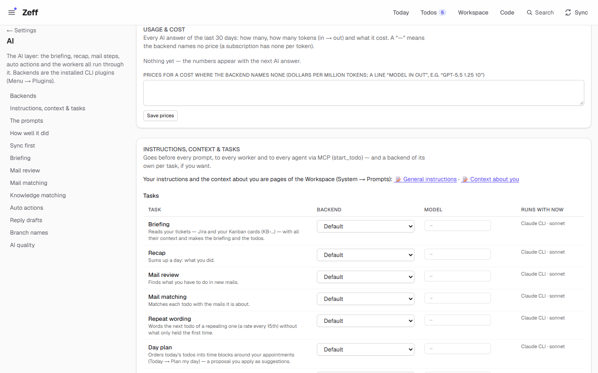
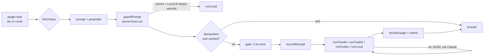

# LLM

> The AI layer: every AI task in Zeff — the briefing, the recap, the mail review, auto actions, workers, Workspace AI — goes through it, each with its own backend and model or the default, all with your instructions and context. **Category:** AI · **On by default:** yes · **Beta:** no · **Needs:** at least one backend — [Claude CLI, ChatGPT (Codex CLI), GitHub Copilot CLI or Local AI](ai-backends.md)

## For users

### What it does

Zeff asks an AI for many small jobs: read the day's mail and find the todos in it, write the morning briefing, propose
[auto actions](auto-actions.md) for a todo, summarize a person, answer a question in the Workspace chat. The LLM
extension is the one place all of these go through. It decides:

- **which AI answers** — the default backend (Claude, Copilot, ChatGPT or a local model), or a backend and model of its
  own per task (say, the mail review on a local model and the briefing on Claude Sonnet);
- **what goes with every prompt** — your general instructions ("answer briefly", "always address customers formally",
  "never push to main") and the context about you ("I'm a developer on the ACME project, Thomas tests, Sarah is the PM");
- **what may not go out** — lines from sources you marked secret (Settings → Data boundaries) are cut out of every
  prompt, or the whole prompt goes to the local AI instead (see [Local AI](ai-backends.md#local-ai-ollama-lm-studio));
- **what it cost** — every answer is counted (tokens, cost where known) and every text sent is kept for 30 days so you
  can see exactly what left the PC (Privacy → What went to the AI).

Without the LLM extension Zeff still syncs and shows everything, but no AI task runs: they fail with "The LLM plugin is
not installed (Menu → Plugins) — no AI tasks."

### Getting started

1. The LLM extension is on by default (Menu → Plugins, category *AI*).
2. Install and sign in at least one backend extension — [GitHub Copilot CLI](ai-backends.md#github-copilot-cli) is on by
   default; [Claude CLI](ai-backends.md#claude-cli), [ChatGPT (Codex CLI)](ai-backends.md#chatgpt-codex-cli) and
   [Local AI](ai-backends.md#local-ai-ollama-lm-studio) can be switched on in Menu → Plugins.
3. Open **Settings → AI** (`/settings/ai`; the old address `/llm` leads there). Under **Backends** pick the default
   backend and each backend's model, and press **Test** next to a backend: it sends a tiny prompt and tells you the
   answer time, the model and — for Claude — the cost.
4. Optional: write your **Instructions** and **Context about you** under *Instructions, context & tasks*.

### Using it

**Choose the default backend and models.** The *Backends* card lists every installed backend with whether its CLI was
found on this computer, how it signs in, a model picker (Claude: Default/Opus/Sonnet/Haiku; Copilot and ChatGPT: the
models their CLI offers your account; Local AI: on its own page) and a *Test* button. Whatever you pick here is the
default for every task.

**Give every task your instructions and context.** Two texts go with every prompt:

- *Instructions* — how the AI should work, for every task, every worker and every agent over MCP (e.g. language, tone,
  what it must never do).
- *Context about you* — who you are, what you work on, who is who. This is the same text as *About me*; changing it
  in one place changes it in the other.

Both are pages of the Workspace (System → Prompts). Once those pages exist (Zeff makes them on first visit), the card
*Instructions, context & tasks* shows two links — "📝 General instructions" and "📝 Context about you" — and you edit
the texts there; before that it shows two text fields with a character counter. Together they may hold 8000
characters; the first 2500 go into each prompt. They go at the **end** of every prompt under the heading "the user's general instructions — they take precedence
over all other rules above", so your word weighs more than a task's own rules.

**Give a task a backend of its own.** The *Tasks* table lists every AI task the installed extensions bring, with what it
does. For each you can pick a *Backend* (Default or one of the installed ones) and a *Model* (empty: that backend's
model from above). The column *Runs with now* shows what the task actually uses — a task set to a backend whose
extension was switched off falls back to the default. Two special cases:

- *Worker* never runs on the local AI (it doesn't work in a repo) — it goes to the first installed CLI instead.
- *Worker* on ChatGPT only works as a live session (Code settings → Live sessions on); otherwise Claude or Copilot.

**See what the AI costs.** The *Usage & cost* card sums every AI answer of the last 30 days: how many, tokens in → out
and the cost, by task and by model. Claude reports its cost itself; for other backends you can enter prices ("model in
out", dollars per million tokens, e.g. `gpt-5.5 1.25 10`) and Zeff estimates the cost, marked *partly estimated*. A "—"
means no price is known (a subscription has none per token).

**See what went to the AI.** Privacy → *What went to the AI* (`/privacy/receipts`) lists every prompt sent in the last
30 days — which task, which backend and model, how many characters, how many secret lines were left out — with the full
text and a monthly export.

### Settings

| Setting | Where | What it changes |
| --- | --- | --- |
| Default backend | Settings → AI → Backends | The backend every task uses unless it has its own. If the chosen backend's extension is uninstalled, the first installed one takes over (Copilot by default). |
| Claude model | Backends | Default (the CLI's own), Opus, Sonnet (default) or Haiku. |
| Copilot model | Backends | One of the models `copilot help config` lists, *Auto*, or empty for Copilot's default. |
| ChatGPT model | Backends (while ChatGPT is installed) | One of the models `codex debug models` lists for your account, or empty. Default `gpt-6-luna`. |
| Local AI model, address | [Settings → Local AI](ai-backends.md#local-ai-ollama-lm-studio) | The local backend's server and model. |
| Instructions | Instructions, context & tasks | Text appended to every prompt and given to every worker and MCP agent. |
| Context about you | Instructions, context & tasks | Background appended to every prompt; same as *About me*. |
| Task backend / model | Tasks table | A backend and model per task; "Default" = the default above. |
| Prices | Usage & cost | Prices per million tokens used to estimate costs where the backend reports none. |

### Tips & limits

- **What leaves the machine:** the prompt text (with your instructions and context) goes to the backend's provider —
  Anthropic, GitHub, OpenAI — unless the backend is the local AI. Lines from sources or databases labelled *secret*
  never go out; they are replaced by a redaction mark (or the prompt goes whole to the local AI, if you set that).
- **Closed runs:** analysis prompts run headless and closed — no tools, no MCP servers, no project settings, no session
  kept. Only workers (Code tab) are agents with tools.
- **At most three at once:** all AI tasks from all jobs share a gate of three concurrent CLI runs, so a long sync does
  not start dozens of processes.
- **A repeat is free:** tasks marked *idempotent* (e.g. Knowledge matching, People matching, AI filter, News tags)
  remember their answer for the same input for up to 7 days.
- **One retry:** Copilot, ChatGPT and the local AI sometimes answer without valid JSON; each such answer is asked once more.
- **Budget:** a task can set a maximum cost (`maxBudgetUsd`); only Claude honours it.
- Instructions and context together: at most 8000 characters; only the first 2500 go with a prompt.

## Technical reference

### Overview

Every AI call in Zeff goes through `llm(task, prompt, schema, opts)` in [run.ts](../../src/plugins/llm/run.ts) (or
through `runAi()` in [lib/ai/index.ts](../../src/lib/ai/index.ts), which delegates to it with the task `general` by
default). A task id is one of the ids the installed plugins declare in their `llm-tasks.ts`; the list is gathered by
`npm run plugins:index` into [llm-tasks.generated.ts](../../src/plugins/llm-tasks.generated.ts) and ordered by the
plugins' `order` in [tasks.ts](../../src/plugins/llm/tasks.ts).

`llm()` refuses when the LLM plugin or the chosen backend is not installed, then:

1. **chooses** backend and model (`llmChoice`): the task's own setting if its backend is available, else `aiChoice()`
   (the default); workers are kept off the local AI and off ChatGPT without live sessions;
2. **builds** the prompt: the task's prompt, then `---`, then `llmPreamble()` (instructions + context, max 2500 chars);
3. **guards** it with `guardPrompt` ([lib/boundaries](../../src/lib/boundaries)): secret lines replaced by a redaction
   mark; if any were removed and the Local AI is set to take secrets, the unredacted prompt goes to the local AI instead;
4. **answers from memory** if the task is idempotent and the same input was answered within 7 days (`ai_memo`);
5. **queues** behind a global gate of `LLM_CONCURRENCY = 3`; records a receipt of the text sent; calls the backend's
   runner (`runClaude`, `runCopilot`, `runCodex`, `runLocal`); retries once on a `NoJsonError` (not for Claude);
6. **records** usage (tokens, cost) and remembers idempotent answers.

The LLM plugin also contributes the API methods `llm.steps.list` and `llm.steps.update` (the instructions and numbers
of the AI steps in System → Prompts); `llm.steps.update` carries an `offer`, so the AI may propose it as a
["Do in Zeff" action](actions.md#do-in-zeff) when a colleague says how a step should behave ("name branches after the
code change").

### Manifest

| Field | Value |
| --- | --- |
| id | `llm` |
| name | LLM |
| category | `ai` |
| order | 220 |
| defaultInstalled | `true` |
| dependsOn | — |
| settings | `/settings/ai` — "AI backend and model per task, instructions" |
| routes | `/llm` (moved to `/settings/ai#backends`, [lib/moved-pages.ts](../../src/lib/moved-pages.ts)) |
| syncSteps | — |
| features | — |

### Files

| File | What it is |
| --- | --- |
| [plugin.ts](../../src/plugins/llm/plugin.ts) | The manifest. |
| [run.ts](../../src/plugins/llm/run.ts) | `llm()`, `llmChoice()`, `llmPreamble()`, the gate, memo and secret routing. |
| [tasks.ts](../../src/plugins/llm/tasks.ts) | Task list (`LLM_TASKS`, `IDEMPOTENT_TASKS`), settings types, `LLM_PREAMBLE_MAX`. |
| [settings.ts](../../src/plugins/llm/settings.ts) | Read and save the LLM settings (`app_settings.llm_settings`). |
| [llm-tasks.ts](../../src/plugins/llm/llm-tasks.ts) | The plugin's own task: `general` ("Other"). |
| [api.ts](../../src/plugins/llm/api.ts) / [server.ts](../../src/plugins/llm/server.ts) | API methods `llm.steps.*` and their registration. |
| [server-actions.ts](../../src/plugins/llm/server-actions.ts) | Save backend/model, test a backend, save instructions/context/tasks. |
| [LlmSettingsForm.tsx](../../src/plugins/llm/LlmSettingsForm.tsx) | Instructions, context and the task table. |
| [UsagePanel.tsx](../../src/plugins/llm/UsagePanel.tsx) | The Usage & cost card and the price list. |
| [app/settings/ai/LlmSections.tsx](../../src/app/settings/ai/LlmSections.tsx) | The plugin's part of `/settings/ai`. |
| [components/AiSettingsForm.tsx](../../src/components/AiSettingsForm.tsx) | The Backends card (default backend, models, Test). |
| [lib/ai/index.ts](../../src/lib/ai/index.ts) | `runAi`, `aiChoice`, `aiProviders`, `getAppSettings`. |
| [lib/ai/shared.ts](../../src/lib/ai/shared.ts) | Provider ids and names, Claude model aliases, `AiAnswer`. |
| [lib/ai/guard.ts](../../src/lib/ai/guard.ts) | No-JSON retry, answer cache, concurrency gate. |
| [lib/ai/memo.ts](../../src/lib/ai/memo.ts) | The `ai_memo` table (remembered answers). |
| [lib/ai/usage.ts](../../src/lib/ai/usage.ts) | The `ai_usage` table, prices, summaries. |
| [lib/ai/receipts.ts](../../src/lib/ai/receipts.ts) | The `ai_receipts` table (what went out, 30 days). |
| [lib/ai/json.ts](../../src/lib/ai/json.ts) | Finding and mending JSON in free text (`NoJsonError`). |
| [lib/ai/batch-job.ts](../../src/lib/ai/batch-job.ts) | Batching helpers for prompts (`promptRoom`, `batchByChars`). |

### Data

| Where | What |
| --- | --- |
| `app_settings.ai_provider` | The default backend (`claude`, `copilot`, `codex`, `local`). |
| `app_settings.claude_model`, `copilot_model`, `codex_model` | Each backend's default model ("" = the CLI's own). |
| `app_settings.llm_settings` | JSON `{ instructions, context, tasks: { <taskId>: { provider, model } } }`. |
| Workspace pages `llm-instructions`, `llm-context` | System → Prompts pages; when changed there they win over the stored text. |
| `ai_usage` (made on first use) | One row per answer: `at`, `task`, `provider`, `model`, `input`, `output`, `cache_read`, `cache_write`, `cost`, `estimated`, `ms`. |
| `ai_receipts` (made on first use) | One row per prompt sent: `at`, `task`, `provider`, `model`, `chars`, `redacted` (lines left out), `text` (first 60 000 chars); kept 30 days. |
| `ai_memo` | Remembered answers: scope `llm:<task>`, ref and hash = hash of task, backend, model, schema and prompt; pruned after 7 days. |
| pref `ai.prices` | The price lines for cost estimates. |

### Sync, jobs & AI tasks

No sync steps of its own. Its one task is `general` ("Other" — everything that names no task, e.g. the connection test).
All other tasks are declared by the plugins that use them; at the time of writing:

| Plugin | Tasks |
| --- | --- |
| [Auto actions](auto-actions.md) | `auto-actions` |
| Calendar | `calendar-todos`, `calendar-relations` |
| Cases | `cases-compile` |
| Documents | `doc-todos`, `doc-relations` |
| Jira briefing | `board-lage` |
| Keep | `note-todos`, `note-relations` |
| [Knowledge](knowledge.md) | `know-summary`, `knowledge-relations` (idempotent), `questions-structured` |
| Open loops | `loops-close` |
| News | `news-funnel`, `news-ask`, `news-discover`, `news-similar`, `news-taste`, `news-feeds`, `news-digest`, `news-retag` |
| People | `people-dates`, `people-compile`, `people-extract`, `people-import`, `people-greeting`, `people-normalize`, `people-classify` |
| Todos | `ticket-lage`, `recap`, `mail-todos`, `mail-relations`, `repeat-text`, `day-plan`, `reply-draft` |
| Work | `worker` |
| Workspace | `ai-field`, `ai-filter`, `pipeline-summary`, `editor-ai`, `page-todos`, `workspace-ask`, `workspace-dossier`, `page-assist`, `workspace-chat`, `ai-block`, `workspace-flow` |

The authoritative list is the *Tasks* table on `/settings/ai` (it shows only the tasks of installed plugins).

### MCP tools & actions

- No MCP tools of its own. The instructions and context go to every agent started over MCP (`start_todo`) and every
  worker through `llmPreamble()`.
- API methods (plugin API, [api.ts](../../src/plugins/llm/api.ts)): `llm.steps.list` (permission `llm.read`) and
  `llm.steps.update` (permission `llm.write`; offered to the AI as a [Do in Zeff](actions.md#do-in-zeff) action, with
  the current instructions of the step as context).
- Server actions: `saveAiSettingsAction`, `testAiAction`, `saveLlmSettingsAction`.

### Extension points

- **AI tasks** — any plugin brings its tasks as `export const <NAME>_LLM_TASKS = (t) => [{ plugin, id, label, what, idempotent? }]`
  in an `llm-tasks.ts`; `npm run plugins:index` adds it to the generated list, and the task appears in the table and may
  be passed to `llm()`. See [docs/plugin-system.md](../plugin-system.md).
- **Backends** — the four backends are the plugins with `aiProvider` in their manifest ([AI backends](ai-backends.md));
  their runners are called directly from `run.ts` (a closed list, not a point).
- Contributes to the **plugin API** (`apiPoint`) with `llm.steps.*`.

### Tests

| Test | Covers |
| --- | --- |
| [tests/ai-guard.test.ts](../../tests/ai-guard.test.ts) | Retry, answer cache, gate. |
| [tests/ai-json.test.ts](../../tests/ai-json.test.ts) | JSON extraction and mending. |
| [tests/ai-usage.test.ts](../../tests/ai-usage.test.ts) | Usage table, prices, estimates. |
| [tests/ai-receipts.test.ts](../../tests/ai-receipts.test.ts) | Receipts and redaction counts. |
| [tests/ai-settings-form.test.ts](../../tests/ai-settings-form.test.ts) | The Backends form. |
| [tests/about-me.test.ts](../../tests/about-me.test.ts), [tests/system-prompts.test.ts](../../tests/system-prompts.test.ts) | Context about you, prompt pages. |
| [tests/plugin-index.test.ts](../../tests/plugin-index.test.ts) | The generated task lists are current. |

Run one: `node --import tsx --test tests/ai-guard.test.ts`.
