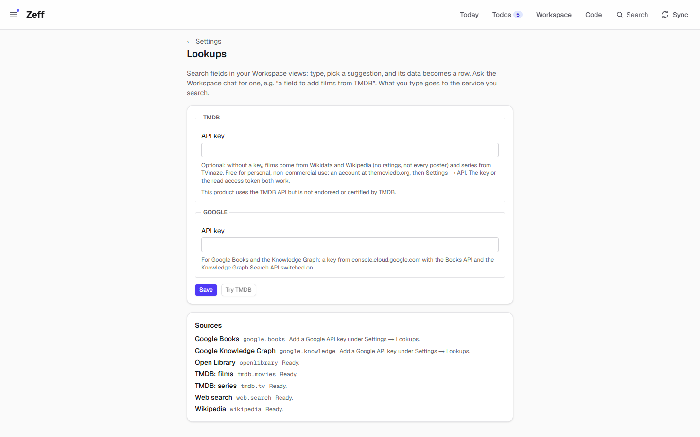
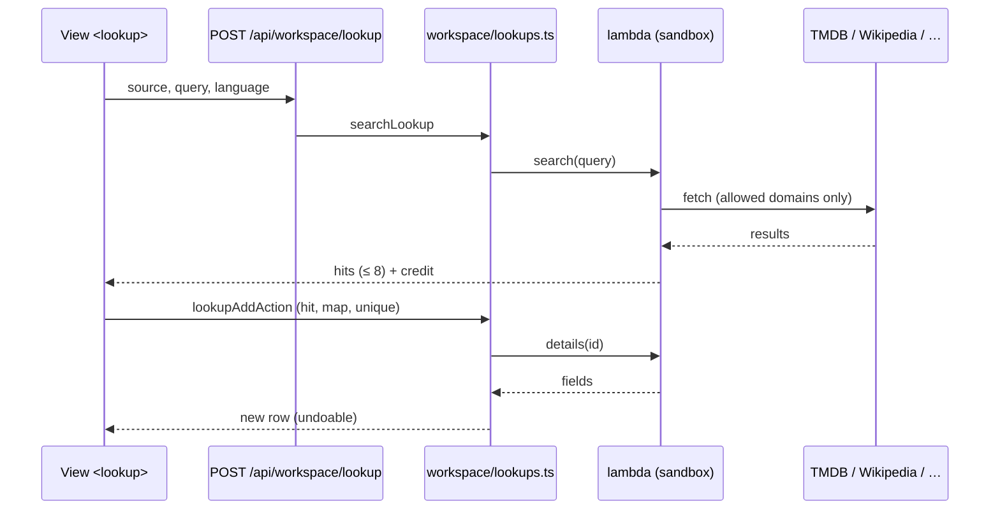

# Lookups

> Search fields for your own Workspace views: type a title, pick a suggestion, and its data becomes a row — films and series, books, Wikipedia articles, Google's Knowledge Graph and web results. **Category:** Connector · **On by default:** yes · **Beta:** no · **Needs:** [Workspace](workspace.md); optional keys (TMDB, Google); the web source needs [Web search](web-search.md)



## For users

### What it does

A watch list, a reading list, a list of places — typing every field by hand is tedious. With Lookups a Workspace view
gets a search field: type "Dune", pick the film from the suggestions, and a new row appears with its title, year,
rating, genres, poster and overview, each filled into the database's properties you chose. The sources:

| Source | id | What it finds | Needs |
| --- | --- | --- | --- |
| TMDB: films | `tmdb.movies` | Films, in your language; with a TMDB key with ratings; without one from Wikidata and Wikipedia (no rating, not every poster) | Optional TMDB key |
| TMDB: series | `tmdb.tv` | TV series; with a key from TMDB, without one from TVmaze (then in English) | Optional TMDB key |
| Wikipedia | `wikipedia` | Articles in your language: description, first paragraph, picture | — |
| Open Library | `openlibrary` | Books: authors, year, pages, subjects, cover | — |
| Google Books | `google.books` | Books: authors, publisher, date, pages, ISBN-13, cover | Google API key |
| Google Knowledge Graph | `google.knowledge` | People, places, works, organisations as things (not pages) | Google API key |
| Web search | `web.search` | Pages and PDFs of the web; the document's whole text becomes the row's page | [Web search](web-search.md) installed and working |

The demo comes without keys: Settings → Lookups lists Open Library, TMDB (films and series), Web search and Wikipedia as
*Ready* and the two Google sources as "Add a Google API key under Settings → Lookups."

### Getting started

1. Lookups is on by default (Menu → Plugins, category *Connector*). It needs the [Workspace](workspace.md).
2. Optional: open **Settings → Lookups** (`/settings/lookups`) and add
   - a **TMDB API key** (free for personal, non-commercial use: an account at themoviedb.org, then Settings → API; the
     key or the read access token both work) — for ratings and German series titles; *Try TMDB* searches "Dune" to check it;
   - a **Google API key** from console.cloud.google.com with the *Books API* and the *Knowledge Graph Search API*
     switched on — for Google Books and the Knowledge Graph.
3. Put a search field into a view: ask the Workspace chat, e.g. "a field to add films from TMDB", or write the
   `<lookup>` tag yourself in the view's template (see below).

### Using it

**Add a row from a search.** In a view with a lookup field, type at least two letters. Up to eight suggestions appear
(title, a subtitle, a picture). Pick one: Zeff reads it in full and adds a row, filling the properties named in the
field's map. If the field has a `unique` property (e.g. *TMDB ID*), a hit that is already in the database is not added a
second time. The *Web search* source is slow; it waits until you press Enter.

**The tag.** A view's template takes:

```html
<lookup source="tmdb.movies" placeholder="Add a film…" map="Poster=poster, Year=year, title=title" unique="TMDB ID" open=false language="de-DE"/>
```

| Attribute | Meaning |
| --- | --- |
| `source` | The source id (table above). Required. |
| `map` | `Property=field, …` — which field of the hit goes into which property (the properties must exist); `title` is the row's title (by default the hit's title). Required. |
| `unique` | A property that tells a row is there already. |
| `placeholder` | The field's hint text. |
| `language` | The language to search in, e.g. `de-DE`. |
| `open` | `true`: open the new row after adding it. |

The fields each source gives are listed for the AI and in the Studio; e.g. `tmdb.movies` gives `title`,
`original_title`, `overview`, `tagline`, `year`, `rating`, `genres`, `poster` and more; `wikipedia` gives `title`,
`description`, `summary`, `image`, `url`.

**In flows.** A Studio flow can search a source too (`lookup.search`, `lookup.details`); see [Studio](studio.md).

**Change a source.** Each source is a *lambda* — a small program you can open in the Studio. A changed built-in source
is kept beside Zeff's and wins until you reset it. You can also write a lookup lambda of your own; it then appears as a
source like the built-in ones.

### Settings

| Setting | Where | What it changes |
| --- | --- | --- |
| TMDB API key | Settings → Lookups | TMDB for films and series (ratings, German series titles) instead of Wikidata/Wikipedia and TVmaze. Left empty when saving: the stored key stays. |
| Google API key | Settings → Lookups | Enables Google Books and the Google Knowledge Graph. Left empty: the stored key stays. |
| Try TMDB | Settings → Lookups | One search for "Dune" — shows the first three hits or the error. |

Keys are never shown again after saving. A Studio secret named `TMDB_KEY` or `GOOGLE_KEY` takes precedence over the
key saved here.

### Tips & limits

- **What leaves the machine:** what you type goes to the source you search (TMDB, Wikipedia/Wikidata, TVmaze, Open
  Library, Google; the web search through [Web search](web-search.md)). Nothing else of your data does.
- Pictures (posters, covers) stay linked, not copied: a row shows them from the source's server.
- Credits are shown where a source's terms ask for them ("This product uses the TMDB API but is not endorsed or
  certified by TMDB.", "Text from Wikipedia, CC BY-SA.", TVmaze CC BY-SA).
- A lookup cannot add rows to a database whose rows come from a source (a synced database).
- Each lambda may only reach the domains in its manifest (`web`), never a private address; it runs in a sandboxed Node
  process with a time and memory limit; keys never show in an error or log.

## Technical reference

### Overview

The Lookups plugin is almost only data: seven **lookup lambdas** in
[lambdas/](../../src/plugins/lookups/lambdas) (each a folder with `lambda.json` and `index.mjs`; the shared helpers
[_lib.mjs](../../src/plugins/lookups/lambdas/_lib.mjs) are given to each as `lib.mjs`), the keys
([config.ts](../../src/plugins/lookups/config.ts)) and the settings page. [server.ts](../../src/plugins/lookups/server.ts)
contributes the folder to the Workspace's `workspace.lambdas` point.

The Workspace does the rest: [workspace/lambdas/store.ts](../../src/plugins/workspace/lambdas/store.ts) lists built-in
and your own lambdas; [workspace/lambdas/sources.ts](../../src/plugins/workspace/lambdas/sources.ts) turns every lambda
of kind `lookup` into a `LookupSource` (`search` → hits, `details` → fields, `missing` → what it still needs);
[workspace/lookups.ts](../../src/plugins/workspace/lookups.ts) merges those with the sources other plugins contribute
(`workspace.lookups`) and flow-defined sources, searches (at most 8 hits, queries under 2 characters return nothing) and
adds the row. [workspace/lambdas/run.ts](../../src/plugins/workspace/lambdas/run.ts) runs a lambda in a sandboxed Node
process and hands it `TMDB_KEY` / `GOOGLE_KEY` from the Lookups settings when it names them in `secrets`.



The search goes through a route, not a server action, because a web search can take half a minute and a page's
actions run one after another.

### Manifest

| Field | Value |
| --- | --- |
| id | `lookups` |
| name | Lookups |
| category | `connector` |
| order | 127 |
| defaultInstalled | `true` |
| dependsOn | `workspace` |
| requires | "Films, series, Wikipedia and Open Library work as they are; your own free TMDB key makes films and series better …; Google Books and the Knowledge Graph need a Google API key." |
| settings | `/settings/lookups` — "The API keys of the sources" |
| routes | `/settings/lookups` |
| syncSteps, features | — |

### Files

| File | What it is |
| --- | --- |
| [plugin.ts](../../src/plugins/lookups/plugin.ts) | The manifest. |
| [server.ts](../../src/plugins/lookups/server.ts) | Contributes `src/plugins/lookups/lambdas` to `workspace.lambdas`. |
| [config.ts](../../src/plugins/lookups/config.ts) | The keys (pref `lookups.config`), the TMDB credit line. |
| [server-actions.ts](../../src/plugins/lookups/server-actions.ts) | Save the keys; *Try TMDB*. |
| [lambdas/](../../src/plugins/lookups/lambdas) | `tmdb.movies`, `tmdb.tv`, `wikipedia`, `openlibrary`, `google.books`, `google.knowledge`, `web.search`; `_lib.mjs` shared helpers. |
| [app/settings/lookups/page.tsx](../../src/app/settings/lookups/page.tsx) | The settings page and the source list. |
| [workspace/lookups.ts](../../src/plugins/workspace/lookups.ts), [workspace/lookup-point.ts](../../src/plugins/workspace/lookup-point.ts) | Sources, search, adding a row; the `workspace.lookups` point. |
| [workspace/actions/lookups.ts](../../src/plugins/workspace/actions/lookups.ts) | `lookupSearchAction`, `lookupAddAction`. |
| [app/api/workspace/lookup/route.ts](../../src/app/api/workspace/lookup/route.ts) | `POST /api/workspace/lookup` (JSON only). |
| [workspace/ui/view-lookup.tsx](../../src/plugins/workspace/ui/view-lookup.tsx) | The field in a view. |

### Data

| Where | What |
| --- | --- |
| pref `lookups.config` | `{ tmdbKey, googleKey }`. |
| `ws_lambdas` | Your own lambdas and built-ins you changed (`builtin = 1`); the shipped ones are read from the folder. |
| Workspace rows | What a lookup adds: an ordinary row of the view's database (the `web.search` source also writes the document's text as the row's page). |

### Sync, jobs & AI tasks

None.

### MCP tools & actions

No MCP tools of its own. Server actions `saveLookupsAction`, `testTmdbAction`; the Workspace's `lookupSearchAction`,
`lookupAddAction`; route `POST /api/workspace/lookup`. The `web.search` lambda calls the Zeff functions `web.search` and
`web.read` (from [Web search](web-search.md)).

### Extension points

- Contributes to **`workspace.lambdas`** (built-in lambda folders).
- Sources come from three places: lambdas of kind `lookup` (this plugin's and yours), the **`workspace.lookups`** point
  (`LookupSource[]` from any plugin's `server.ts`), and flows defined as lookup sources.
- A lookup lambda's `lambda.json`: `name`, `label`, `what`, `kind: "lookup"`, `credit`, `secrets`, `requires`, `web`
  (allowed domains), `zeff` (Zeff functions it may call), `fields` (name → description), `slow`, `timeoutMs`.

### Tests

| Test | Covers |
| --- | --- |
| [tests/lookups.test.ts](../../tests/lookups.test.ts) | The sources, search and adding rows. |
| [tests/workspace-lambdas.test.ts](../../tests/workspace-lambdas.test.ts) | Lambdas: store, sandbox, secrets, allowed domains. |

Run one: `node --import tsx --test tests/lookups.test.ts`.
