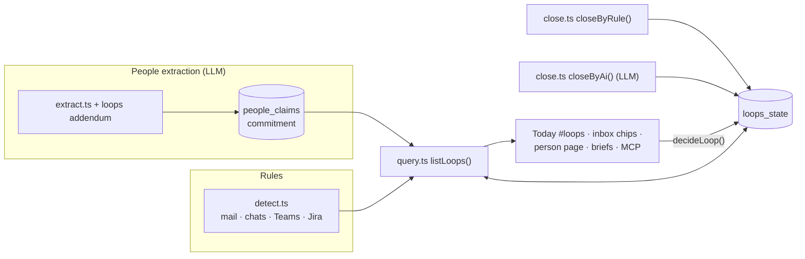

# Open loops

> What is still open between you and others, across all sources: promises both ways, unanswered questions and requests, Jira comments addressed to you, and how each one gets closed. **Category:** app · **On by default:** no · **Beta:** no · **Needs:** [People](people.md) (promises read by AI also need [LLM](llm.md))

## For users

### What it does

Things fall through the cracks between messages: you told someone "I'll send it tomorrow", a colleague promised you an offer by Friday, a friend asked a question you never answered, someone asked you to review or sign something, a Jira comment `@`-mentions you. Open loops lists all of these in one place, from mail, Gmail, WhatsApp, Signal, Teams and Jira, and says **who owes whom**:

- **I owe** (`mine`) — what you promised, questions and requests to you nobody answered, comments addressed to you.
- **Owed to me** (`theirs`) — what others promised you, your own questions that are still the last word of their chat.

Each loop has a kind (*Promise*, *Question*, *Request*, *Mention*), the person, the text, the quote it was read from, when it was said, a due day if there is one, and a link to where it was said. A loop is **overdue** when its day has passed, or — without a day — when it has been open for 7 days.

In the demo, Jonas asks on WhatsApp "Coming to the barbecue on Saturday? 6 pm at ours. Could you bring a salad? 😄" — that is a loop *I owe · Question · Jonas* until you answer.

Loops close in three ways:

1. **By the source, by itself** — only where there is no doubt: the next answer of the right side in that chat or thread; a promise made in a Jira comment once its ticket is done; a promise to send something once the right side sent an attachment after it in the same chat or thread.
2. **As a proposal you confirm** — a reply that talks about the same thing ("Kept? A reply about it: …"), or, with the LLM plugin, the AI's reading of a later message with a quote that must appear in it ("Kept? The AI read: …"). A "later", "ok", 👍 or a question back is never taken as kept.
3. **By you** — *Done*, *Not a loop*, *Reopen*.

### Getting started

1. Open **Menu → Plugins** and switch on **Open loops** (it installs [People](people.md)).
2. In the People overview (**Dates & to check → Tools and settings**) set **Your name** — the rules need it to tell your messages from the others' and to see comments addressed to you. If you use Jira, link your own profile's Jira account (*Link Jira accounts*) so `@yourhandle` mentions are recognised.
3. For promises, switch on [LLM](llm.md): promises are read from your messages by People's extraction (*People facts from messages*), which runs with every briefing. Questions, requests and mentions need no AI.
4. Connect the sources you use ([Gmail](gmail.md), [Outlook](outlook.md), [IMAP](imap-mail.md), [WhatsApp](whatsapp.md), [Signal](signal.md), [Teams](teams.md), [Jira](jira.md)).

Open loops has no page of its own: it is a section of the **Today** page (`/heute#loops`). The old address `/loops` (and `/loops?view=overdue`) leads there.

### Using it

**The list on Today.** The *Open loops* section shows filter chips — **All open**, **I owe**, **Owed to me**, **Overdue**, **Closed** (the last two weeks) — with counts. When something is overdue the list opens on *Overdue*. Each loop offers:

| Button | What it does |
| --- | --- |
| **Done** | Kept or answered — closed. A promise is also ticked off in People. What you say is noted, so Zeff learns what keeps a promise. |
| **Not a loop** | Nothing is owed here — it goes (a promise is rejected in People). |
| **Confirm** | For a promise read by the AI and still marked *unconfirmed*: yes, this is open between you. |
| **Yes, kept** / **No, still open** | Decide a proposal to close it (a reply about it or the AI's reading). A rejected closing is not proposed again. |
| **Reopen** | On a closed loop: not kept after all — open again, and not closed this way again. |
| **Later** | Off the Today page's nudges for 3 days. |
| *where it was said* / *show message* | Opens the mail, chat, Teams message or ticket. |

**Elsewhere.**

- **Inbox and chats** ([Mail & Chat](mail-client.md)): a thread with open loops gets a chip "⟳ I owe 1 · owed 2" (red when one is overdue) linking to the list.
- **A person's page** ([People](people.md)): the loops with that person.
- **Meeting and person briefs** (Knowledge plugin) list what is open between you and the people in a meeting.
- **Workspace metrics**: *Offene Zusagen*, *Zusagen an dich*, *Überfällige Zusagen* can be put on any page.
- **Timeline** ([Timeline](timeline.md)): a promise kept by the source or the AI leaves a "loop closed" event on the person's and the source's timeline.
- **Agents** ask with the MCP tool `open_loops`.

### Settings

None of its own. What it depends on:

| Where | Setting | Effect |
| --- | --- | --- |
| People → Tools and settings | Your name | Which messages are yours, and which texts are addressed to you (your full name and first name). |
| People profile of you | Jira account | `@handle` / `[~handle]` mentions in Jira comments count as addressed to you. |
| LLM settings | *People facts from messages* task | Reads the promises; with Open loops on, its prompt gets an addendum so questions to you, review/sign requests and your own pending questions count as commitments too. |
| LLM settings | *Open loops: kept?* task | The AI that proposes closing a promise. |

Fixed values (in [shared.ts](../../src/plugins/loops/shared.ts) / [detect.ts](../../src/plugins/loops/detect.ts)): overdue after 7 days without a day, Later = 3 days, the rules read the last 21 days, at most 3 loops per chat or thread, at most 5 nudges.

### Tips & limits

- **Recall first.** An unsure promise is listed (as *unconfirmed*) rather than left out; you dismiss what isn't one. Every decision goes into the feedback ledger (step `open-loops`), so the quality page can show how often the rules and the AI were right.
- **Rule loops are recomputed on every read** from the last 21 days of messages; a loop that was answered simply disappears. When you decide one, a snapshot is kept so it still shows under *Closed*.
- **Mail:** Gmail keeps what you sent, so answers are seen; for Outlook only messages from your people are read. Notifications folders and WhatsApp system messages are ignored.
- **Questions** are recognised by a question mark outside links; **requests** by German and English phrases ("bitte prüfen", "Freigabe", "could you check", "please sign" …).
- **Privacy:** the rules run locally. The AI tasks (extraction and *kept?*) send message excerpts to the AI backend you configured. Over MCP, each loop's source carries its sensitivity: an agent without clearance for personal data sees no WhatsApp/Signal loops, secret sources are shown to nobody, and the answer says how many were left out.

## Technical reference

### Overview

A **loop** (`Loop` in [shared.ts](../../src/plugins/loops/shared.ts)) comes from one of two places, and the plugin does not copy either:

- **Promises** are People's commitment claims (`people_claims` with `kind = 'commitment'`, `direction` mine/theirs), read by the AI extraction. Ref: `claim:<id>`, origin `ai`.
- **Questions, requests and mentions** are read **by rule** on each read (`derivedLoops()` in [detect.ts](../../src/plugins/loops/detect.ts)): `fromMail` (mail threads and chats), `fromTeams`, `fromJira`. Ref: `q:<source>:<key>`, origin `rule`.

What became of a loop is kept by ref in `loops_state` ([state.ts](../../src/plugins/loops/state.ts)): closed (by rule, AI or you) with the closing quote, dismissed, a pending close proposal, rejected closings, snooze, and a snapshot. [query.ts](../../src/plugins/loops/query.ts) merges both into the views and runs `closeByRule()` at most once a minute before a read.

Closing ([close.ts](../../src/plugins/loops/close.ts)): `closeByRule()` checks every open promise's source (Jira ticket done since; attachment after a send-promise; a reply that shares the topic → proposal); `closeByAi()` gives the AI each open promise with what came from that person since and accepts its proposal only if the quote is really in the message. Both run in `afterExtraction()`, which the People `peoplenorm` step calls after its extraction. Your decisions go through `decideLoop()` ([store.ts](../../src/plugins/loops/store.ts)), which also ticks off or rejects the People claim and records feedback.

### Manifest

| Field | Value |
| --- | --- |
| id | `loops` |
| name | Open loops |
| category | `app` |
| order | 171 |
| defaultInstalled | `false` |
| dependsOn | `people` |
| routes | `/loops` (moved to `/heute#loops` by `src/lib/moved-pages.ts`) |
| settings | — |
| syncSteps | — (runs inside People's `peoplenorm`) |
| features | — |

### Files

| File | What it does |
| --- | --- |
| [plugin.ts](../../src/plugins/loops/plugin.ts) | The manifest. |
| [server.ts](../../src/plugins/loops/server.ts) | Contributes three Workspace metrics. |
| [shared.ts](../../src/plugins/loops/shared.ts) | The `Loop` model, views, constants; pure rules: question, request, deferral, shares-topic, send-promise, addressed-to, overdue. |
| [detect.ts](../../src/plugins/loops/detect.ts) | Loops read by rule from mail/chats, Teams and Jira; `whoAmI()`. |
| [source.ts](../../src/plugins/loops/source.ts) | Reads a loop's source message, later messages, thread senders, whether a ticket is done. |
| [close.ts](../../src/plugins/loops/close.ts) | Closing by rule and by AI; `closeClaim` (with a Timeline event); `afterExtraction`. |
| [state.ts](../../src/plugins/loops/state.ts) | The `loops_state` table. |
| [query.ts](../../src/plugins/loops/query.ts) | `listLoops`, `findLoop`, `nudges`, `loopCounts`, `mailLoops` (chips by thread/message). |
| [store.ts](../../src/plugins/loops/store.ts) | `decideLoop` — your word on a loop (ops below), with feedback. |
| [server-actions.ts](../../src/plugins/loops/server-actions.ts) | `loopsAction`, `decideLoopAction`, `loopFormAction`. |
| [mcp.ts](../../src/plugins/loops/mcp.ts) | The MCP tool `open_loops`. |
| [llm-tasks.ts](../../src/plugins/loops/llm-tasks.ts) | The AI task `loops-close`. |
| [ui/LoopsList.tsx](../../src/plugins/loops/ui/LoopsList.tsx) | The list with view chips and buttons (Today, person page). |
| [ui/LoopChip.tsx](../../src/plugins/loops/ui/LoopChip.tsx) | The chip in the inbox and chats. |

### Data

| Table | Fields |
| --- | --- |
| `loops_state` | `ref` (primary key: `claim:<id>` or `q:<source>:<key>`), `state` (open/closed/dismissed), `closed_by` (rule/ai/you), `close_ref`, `close_quote`, `closed_at`, `proposal_ref` / `proposal_quote` / `proposal_href` / `proposal_at` / `proposal_by` (a pending close proposal), `rejected` (JSON list of closing refs you rejected), `snooze_until`, `snapshot` (JSON: the loop as it was when decided), `updated_at`. |
| `people_claims` (People) | The promises themselves (`kind = 'commitment'`, `direction`, `due`, `done_at`, `evidence` = quote, `source_ref`). |

### Sync, jobs & AI tasks

- No sync step of its own. In People's `peoplenorm` step (after each briefing): `extractKnowledge()` (with the loops addendum in its prompt, `LOOPS_ADDENDUM` in `people/extract.ts`) → `afterExtraction()` → `closeByRule()` and, with LLM, `closeByAi()`.
- `closeByRule()` also runs before any read, at most once a minute.
- **AI task** `loops-close` — *Open loops: kept?*: reads what came from someone after a promise and proposes closing it with a quote; you confirm. Its prompt is in the prompt catalog (`lib/prompts/catalog.ts`, group People) and can be edited under System → Prompts.

### MCP tools & actions

| Tool | What it does |
| --- | --- |
| `open_loops` | What is owed, by whom: filters `direction` (mine / theirs / all), `overdue`, `closed` (the last two weeks, with what closed them), `person` (name, alias or `person:<id>`), `limit` (≤ 200). One line per loop: who owes, kind, person, text, since/due/overdue/unconfirmed, quote, closing or proposal, source, link, ref. Filters by the caller's data clearance and says how many were hidden. Read-only. |

Server actions: `loopsAction({view, personId, row})` (a view, a person's or a Workspace row's loops, with counts), `decideLoopAction(ref, op)` with ops `close`, `dismiss`, `confirm`, `reopen`, `accept-close`, `reject-close`, `later`; `loopFormAction` (form post for `later` / `close`, revalidates `/heute`). No todo actions.

### Extension points

| Point | Contribution |
| --- | --- |
| `workspaceMetrics` | *Offene Zusagen* (mine), *Zusagen an dich* (theirs), *Überfällige Zusagen* (overdue), each linking to `/heute#loops`. |

Read by: the Today page (`app/heute/page.tsx`), the inbox (`app/mail/page.tsx`, `mailLoops`), People's person page (`ui/row-parts.tsx`), the Knowledge briefs (`plugins/know/loops.ts`), and the todo evidence closing (`lib/todos/evidence-close.ts` reuses `sourceMessage`, `laterMessages`, `isDeferral`, `sharesTopic`, `whoAmI`).

### Tests

- `tests/open-loops.test.ts` — the rules (question, request, deferral, addressed-to, overdue); loops by rule from chats, mail, Teams and Jira; closing by source only where there is no doubt; the views; your decisions in the ledger; AI close proposals checked against the quote; the MCP tool with data boundaries; the extraction addendum.
- `tests/people-extract-loops.test.ts` — the extraction prompt with and without the plugin.
- `tests/know-brief.test.ts`, `tests/person-page.test.ts` — loops in briefs and on the person page.

Run one: `node --import tsx --test tests/open-loops.test.ts`.
