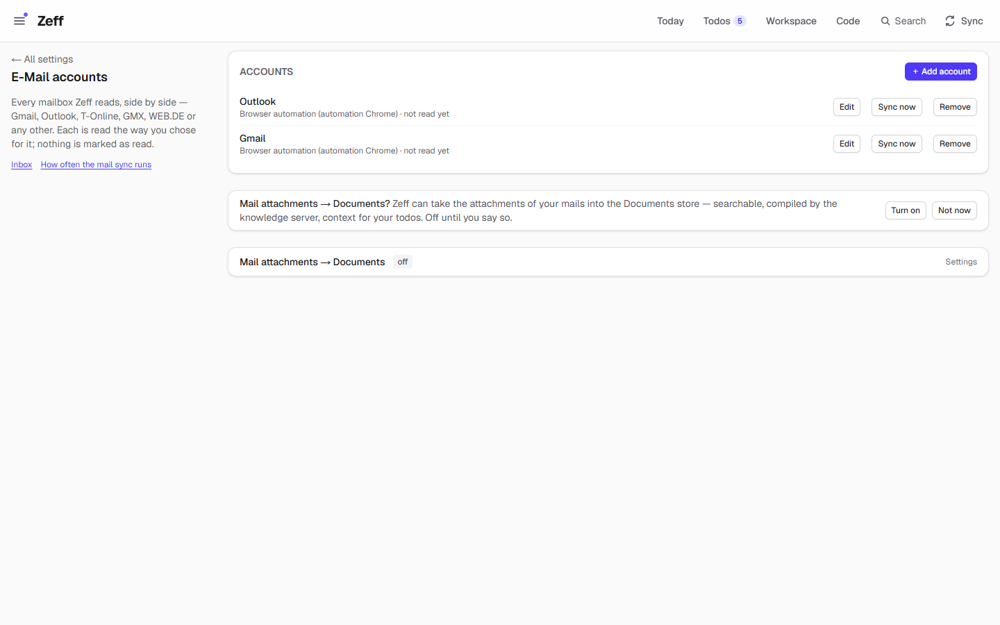
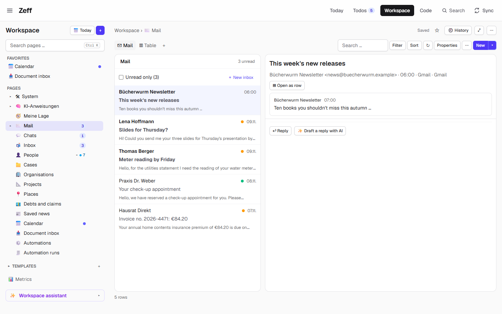
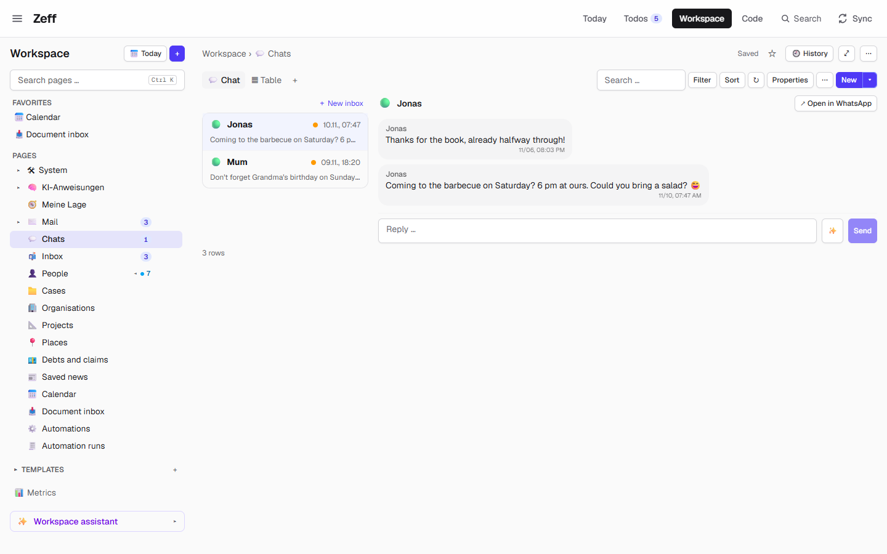
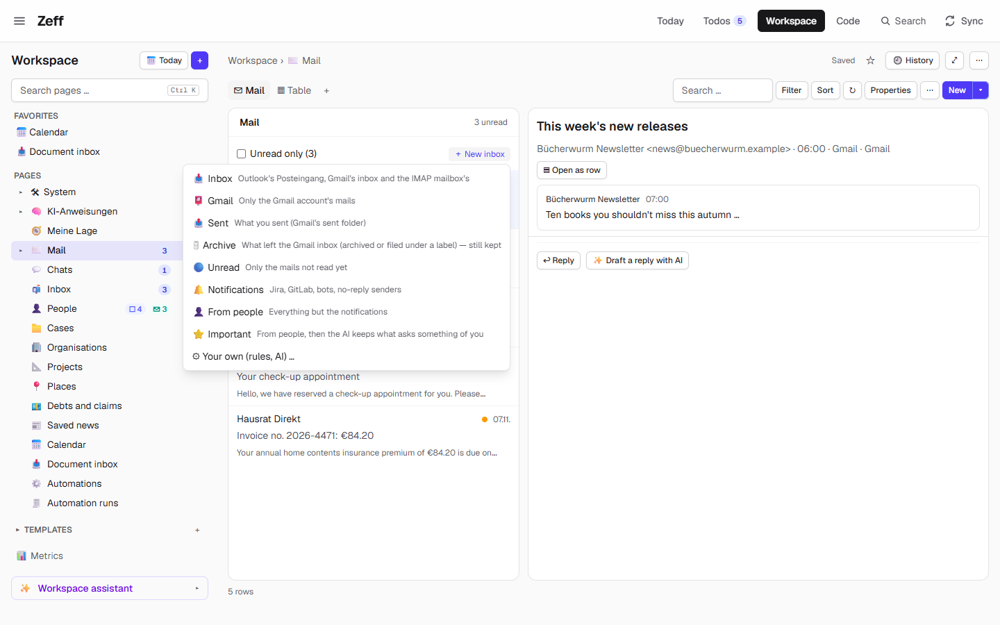
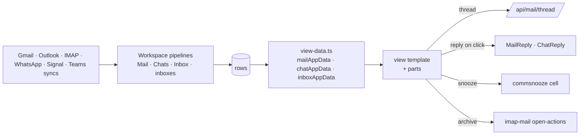

# Mail & Chat

> A mail client, a chat and a combined inbox for the mails and messages Zeff reads — views on the Workspace's mail and message databases, with the conversation, what you should know, the AI's suggestions and a reply. **Category:** app · **On by default:** yes · **Beta:** no · **Needs:** [Workspace](workspace.md); something to read: [Gmail](gmail.md), [Outlook](outlook.md), [IMAP / POP3](imap-mail.md), [WhatsApp](whatsapp.md), [Signal](signal.md) or [Teams](teams.md)

## For users

### What it does

Zeff reads your mail accounts and chats into the [Workspace](workspace.md) as databases: **Mail** (Outlook, Gmail, an
IMAP mailbox — the last 30 days), **Chats** (Teams, WhatsApp, Signal — the last 14 days) and, when you have both, one
combined **Inbox**. Without this plugin those databases are plain tables. With it, each opens in an app view made for it:

- **Inbox** — one list across all channels, a thread per conversation, a tab per channel with its unread count, snooze
  and archive.
- **Mail** — a mail client: the mails newest first, an "Unread only" toggle, and a reading pane.
- **Chat** — a messenger: the conversations on the left, the chat's messages as bubbles on the right, a reply line at the
  bottom.

In the demo the Inbox shows three unread threads: Jonas on WhatsApp asking about the barbecue, Mama about Grandma's
birthday, and Lena Hoffmann's Gmail "Slides for Thursday?". Picking Jonas' thread shows the whole conversation, the box
**What you should know** ("You owe: Coming to the barbecue on Saturday? …"), and a reply box with an ✨ button that drafts
the answer.

Every view is still a database: the **Table** tab beside it shows the same rows as a table, and you can filter, sort and
add your own views and inboxes.

### Getting started

1. Mail & Chat is on by default (**Menu → Plugins** → *Mail & Chat*). It needs the Workspace, which installing it turns on.
2. Add something to read. Mail accounts: **Settings → E-Mail accounts** (`/settings/mail`) → **+ Add account** — Gmail,
   Outlook, T-Online, GMX, WEB.DE or any other; Zeff installs whatever reads it. Chats: install [WhatsApp](whatsapp.md),
   [Signal](signal.md) or [Teams](teams.md) from the Plugins page.
3. Once a source is installed, the databases appear in the Workspace's tree: **Mail**, **Chats**, **Inbox** (and **Sent**
   under Mail, for Gmail). Each is made once; if you delete one it is not made again.

### Using it

#### The Inbox

1. Open **Workspace → Inbox**. The tabs on top filter by channel (All, Gmail, WhatsApp …) and show the unread count of each.
   The ⋯ menu has **Unread only** and, while threads are snoozed, **💤 Snoozed (n)**.
2. Each list entry is one conversation: the sender (bold while unread), the number of messages (Jonas: 2), the time, the
   subject, the channel's logo, a preview, and a dot when a todo is linked to it.
3. Pick one. The pane shows its header (subject, sender, time, channel) with **Snooze** (later today, tomorrow morning, next
   week — or awake now), **↗** (open it in Gmail, WhatsApp …), **Open as row**, and for an IMAP / POP3 mail **Archive**
   (out of the inbox, on the mail server too).
4. Below: **What you should know** about the people and the topic (with **Sum up**), the conversation oldest first, the AI's
   suggested actions, and the reply.
5. An unread mail of an [IMAP / POP3](imap-mail.md) account that you pick and look at for a moment (1.5 s) is marked read —
   in Zeff and, over IMAP, on its server — as long as that account's *Mark a mail read when I open it* is on (the default;
   Settings → E-Mail accounts → the account). Mails and chats of the other channels (Gmail, Outlook, WhatsApp …) stay as
   they are when you open them.

**Archive what is read** (shown while there are IMAP / POP3 accounts) archives every read conversation in those accounts'
inboxes.

#### Mail

The list of mails newest first, unread ones in bold; the reading pane with subject, sender, time, account and folder,
**Open in Gmail / Open in Outlook**, **Open as row**, what you should know, the thread, the suggestions and the reply.

#### Chat

A conversation per chat, newest first, each with its channel icon and last message ("Me: …" when it was yours). The
picked chat shows its messages as bubbles (yours on the right), opened at the newest; the reply line sends with Enter
(Shift+Enter for a new line).

#### Replying

- **A mail**: **Reply** opens a form with to, subject and text; **Draft a reply with AI** fills it from the conversation.
  With an Outlook account, or Gmail without write access, it is opened as a draft in Outlook / Gmail for you to send there.
  With Gmail write access (Google sign-in) it is sent from Zeff on your click, or saved to Gmail's drafts, in the mail's
  conversation. An IMAP / POP3 account sends over its SMTP server on your click.
- **A chat**: write, or press ✨ for the AI's draft, read it once more, then **Send** — it goes through the channel's own
  way (the same as the auto-actions).
- Where replying is not set up, the pane says so: "🔒 Read-only — replying through … isn't set up here."

#### More inboxes

**+ New inbox** makes a filtered database under Mail (or Chats) in one click:

| For | Template | What it keeps |
| --- | --- | --- |
| Mail | 📥 Inbox | Outlook's Posteingang, Gmail's inbox and the IMAP mailbox's |
| Mail | 📮 Gmail | Only the Gmail account's mails |
| Mail | 📤 Sent | What you sent (Gmail's sent folder) — reads that folder itself |
| Mail | 🗄 Archive | What left the Gmail inbox (archived or labelled) — reads that folder itself |
| Mail | 🔵 Unread | Only mails not read yet |
| Mail | 🔔 Notifications | Jira, GitLab, bots, no-reply senders |
| Mail | 👤 From people | Everything but the notifications |
| Mail | ⭐ Important | From people, then the AI keeps what asks something of you, and proposes a reply draft or an appointment |
| Chats | 🟣 Teams · 🟢 WhatsApp · 🔵 Signal | Only that channel |
| Chats | ⭐ Important | The AI keeps what asks something of you |

**Your own (rules, AI) …** opens the Workspace's pipeline editor for your own filter. An inbox with an AI step judges new
mails after every mail sync. A new inbox reads its rows at once, in the background.

#### The classic Inbox page

The mail connectors ([Gmail](gmail.md), [Outlook](outlook.md), [IMAP / POP3](imap-mail.md)) also bring the page
**Inbox** (`/mail`, under Apps in the menu): all mails and chats in one list with a tab per channel, search, sync buttons
and loop chips. It is theirs, not this plugin's, but it uses this plugin's reply forms.

#### On a Workspace page

The widget **Unread** (📬) shows the newest unread mails and chats — who, about what, when — or the inboxes with their
counts, with **↻ Read again**.

### Settings

Mail & Chat has no settings of its own. What it shows is set elsewhere:

| Where | What it changes |
| --- | --- |
| Settings → E-Mail accounts (`/settings/mail`) | The mail accounts: add one, its servers, password and folders, how it is read, mark read when opened (IMAP). |
| Settings → Sync | How often each mail and chat source is read. |
| The database's pipeline (Workspace) | What an inbox keeps: its source, filter rules, AI steps. Mail reads the last 30 days, Chats the last 14 by default. |
| The view (Workspace) | Each app view is a view template you can change, like any other Workspace view. |

### Tips & limits

- **Reading changes nothing at the source**, except two things you trigger: opening an unread IMAP mail (when "mark read
  when opened" is on) and Archive. WhatsApp, Signal, Teams, Gmail and Outlook are read without opening or marking anything.
- **Nothing is sent without your click.** AI drafts are drafts.
- **What the AI sees:** the Important templates' AI steps send each new mail or message (sender, subject, text) to your AI
  provider; **Draft a reply with AI** sends the conversation; **What you should know** uses what Zeff knows about the
  people. With a cloud provider that leaves your machine.
- A Teams conversation shows the message's own text; mails and WhatsApp / Signal chats show Zeff's copy of the whole thread.
- Snooze is kept in Zeff only; a new message in a snoozed thread brings it back.
- Deleting the Mail, Chats or Inbox database is final in the sense that Zeff does not make it again.

## Technical reference

### Overview

The plugin has no tables and no sync of its own. The [Workspace](workspace.md) keeps the databases
(`plugins/workspace/mail-databases.ts` makes Mail, Chats, Inbox and Sent once, when a mail or chat plugin is installed); each
is a pipeline over a source (`mail`, `messages`, or the combined `inbox` source). Mail & Chat registers three **app views**
(`plugins/workspace/app-views.ts`: `mail` for data type `mail`, `chat` for `message`, `inbox` for `inbox`) whose layout is a
**view template** (`view-template.meta.ts`) written in the Workspace's view language (`<panes>`, `<list>`, `<selected>`,
`<toggle>`, `<tabs>` …) plus the plugin's own **parts** (`mail.thread`, `mail.reply`, `inbox.snooze` …).

The data a template reads as `app.*` is worked out by pure functions in `view-data.ts` (`mailAppData`, `chatAppData`,
`inboxAppData`) from the rows, the view state (`selected`, `unread`, `channel`, `snoozed`) and the database's extras (previews,
which channels can reply). Threads are grouped by conversation (`threads.ts`); snooze is a cell (`commsnooze`) on each row.
The conversation of the picked item is fetched from `/api/mail/thread`.

### Manifest

| Field | Value |
| --- | --- |
| id | `mail-client` |
| category | `app` |
| order | 262 |
| defaultInstalled | true |
| dependsOn | `workspace` |
| settings | `/settings/mail` — "Mail accounts: add one, its servers, password and folders" |
| tabs, routes, syncSteps, features | none |

### Files

| File | What it is |
| --- | --- |
| [plugin.ts](../../src/plugins/mail-client/plugin.ts) | The manifest. |
| [server.ts](../../src/plugins/mail-client/server.ts) | Registers the widgets. |
| [view-template.meta.ts](../../src/plugins/mail-client/view-template.meta.ts) | The three app views (`MAIL_VIEW`, `CHAT_VIEW`, `INBOX_VIEW`): their default templates and parts. |
| [view-data.ts](../../src/plugins/mail-client/view-data.ts) | Pure: what `app.*` holds for each view; the picked item and how it is answered. |
| [threads.ts](../../src/plugins/mail-client/threads.ts) | Grouping by conversation; snooze times (later today ≥ 13:00, tomorrow 8:00, next Monday 8:00). |
| [templates.ts](../../src/plugins/mail-client/templates.ts) | The "+ New inbox" templates and `createInbox`. |
| [server-actions.ts](../../src/plugins/mail-client/server-actions.ts) | `inboxTemplatesAction`, `createInboxAction` (makes the inbox and starts its pipeline). |
| [widgets.ts](../../src/plugins/mail-client/widgets.ts) | The `mail.unread` widget and the unread badge of an inbox. |
| [ui/view-parts.tsx](../../src/plugins/mail-client/ui/view-parts.tsx) | The parts: thread, suggested, know, reply, text, chat messages, snooze, archive, archive-read; mark-read on open. |
| [ui/MailReply.tsx](../../src/plugins/mail-client/ui/MailReply.tsx) | Mail reply (draft in Outlook/Gmail, or sent via Gmail / SMTP). |
| [ui/ChatReply.tsx](../../src/plugins/mail-client/ui/ChatReply.tsx) | Chat reply (Teams, WhatsApp, Signal). |
| [ui/NewInbox.tsx](../../src/plugins/mail-client/ui/NewInbox.tsx) | The "+ New inbox" menu. |
| [workspace/mail-databases.ts](../../src/plugins/workspace/mail-databases.ts) | (Workspace) makes Mail, Chats, Inbox and Sent. |
| [app/api/mail/thread/route.ts](../../src/app/api/mail/thread/route.ts) | One conversation's messages (`?conv=`, `&older=1`). |

### Data

No tables of its own. It uses:

- the Workspace databases and rows (`ws_*` tables, see [Workspace](workspace.md)) — the columns it reads: mail
  (`mailfrom`, `mailreceived`, `mailaccount`, `mailfolder`, `mailconv`, `mailunread`), message (`msgchat`, `msgconv`,
  `msgchannel`, `msgsent`, `msgmine`), combined inbox (`commfrom`, `commwhen`, `commchannel`, `commconv`, `communread`,
  `commmine`, `commwhere`, `commsnooze`), plus `srcurl`, `filterwhy` (why an AI filter kept it) and `rowactions` (the AI's
  suggestions);
- prefs `workspace.mailDb`, `workspace.chatsDb`, `workspace.inboxDb`, `workspace.sentDb` — the ids of the databases made, so
  they are made only once;
- the mails and messages the connectors keep (see [Gmail](gmail.md), [WhatsApp](whatsapp.md) …).

### Sync, jobs & AI tasks

None of its own. The rows come from the connectors' syncs through the Workspace pipelines; an inbox with an AI step has
`autoAi` set, so its AI step judges new mails after every mail sync (Workspace pipeline AI). The reply drafts use the
reply-draft AI of the mail and chat actions.

### MCP tools & actions

None of its own. Agents read mail through the connectors' tools (e.g. `mailbox_inbox`, `gmail_find`) and the Workspace
tools. Server actions: `inboxTemplatesAction`, `createInboxAction`. API route: `GET /api/mail/thread`.

### Extension points

Contributes:

- **Workspace app views** (`plugins/workspace/view-apps.ts`, `app-views.ts`, `ui/app-view.tsx`) — `mail`, `chat`, `inbox`,
  with their parts and app data; the AI's view-template help reads `MAIL_APP_DATA`, `CHAT_APP_DATA`, `INBOX_APP_DATA`.
- **`workspaceWidgets`** — `mail.unread`.

Used by others: `MailReply` and `ChatReply` are used by the `/mail` page's conversation (`components/MailConversation.tsx`)
and by IMAP's new-mail form (`plugins/imap-mail/ui/NewMail.tsx`).

### Tests

Run one with `node --import tsx --test tests/mail-view.test.ts`.

- `tests/mail-view.test.ts` — the views' app data.
- `tests/inbox-threads.test.ts` — threads and snooze.
- `tests/workspace-inbox.test.ts` — the inbox databases and templates.
