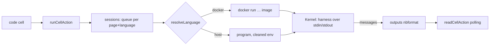

# Notebook

> Code blocks in any page that you can run — **Python, Node.js or Rust**, the language chosen per block — with a session per page and language that keeps its variables, outputs like Jupyter's (text, errors, images, HTML, tables), and **.znb** files: Jupyter notebooks with Zeff's blocks on top. Sessions run in **Docker containers** by default. **Category:** app · **On by default:** yes (running code is **off** until you switch it on) · **Beta:** no · **Needs:** the [Workspace](workspace.md); Docker, or Python / rustc on this computer

## For users

### What it does

Type `/code` (or `/python`, `/node`, `/rust`) in a page and you get a **code cell**: an editor with highlighting, a language picker, **Run** (Shift+Enter), **Stop**, a menu (run all cells of the page, run this and those below, restart the session, clear the output, show the variables) and the output under it. A page is one notebook: the cells of one language share a session, so a variable made in one cell is there in the next. A page can hold Python, Node.js and Rust cells side by side — each language has its own session.

Each language is a **plugin of its own** — *Notebook · Python*, *Notebook · Node.js*, *Notebook · Rust* — installed or removed on **Menu → Plugins**. A cell offers only the languages that can run on this machine: in Docker, or installed here. A new language is a new plugin.

### Getting started

1. Open **Settings → Notebook** and tick **Let code blocks run**. (It is off until you do: code runs with real rights.)
2. Look at **Languages** there: for each language where it runs now — a ✅ next to the languages that can run.
3. Put a code cell in a page and press Shift+Enter. The first run in Docker pulls the language's image (about a minute, once).

### Where code runs

By default **each session runs in a Docker container of its own**: the language's image, the session's folder mounted as `/work`, none of Zeff's environment (no tokens, keys or settings), no extra Linux capabilities, a limit of memory (2 GB), processors (2) and processes, and the network (you can switch it off). Without Docker — or when you choose **This computer** for a language — the session runs as a program on this machine, with a cleaned environment (no variable that looks like a token, key or password) and **your rights**: code can read and delete your files. Per language the setting is *Docker if there, else this computer* (the default), *Always Docker*, or *This computer*; the image can be changed too (for example one with numpy and matplotlib in it).

Files a cell writes (relative paths) land in the session's folder, `data/notebooks/page-<id>/`.

### The languages

- **Python** — variables stay; the last expression is the cell's value; `display(obj)` shows objects with a rich form (HTML, images, tables of pandas), matplotlib figures appear as images; `!command` runs a shell line, `%pip install x` installs; the editor completes names from the running session; **Stop** interrupts the cell and the session (and its variables) stays.
- **Node.js** — variables stay (`const` / `let` at the top of a cell are the session's variables, so a cell can be run again); top-level `await`, `require()`, `fetch`, `console`; `display.html(...)`, `display.markdown(...)`, `display.svg(...)`, `display.png(buffer)` for rich output. **Stop** ends the session.
- **Rust** — each cell is compiled and run (a few seconds). Functions, structs, enums, impls, traits, consts and `use` lines stay for the cells after it (a definition with the same name replaces the older one); `let` variables do not live on from cell to cell. A last expression without `;` is printed with `{:?}`. Compiler errors name the line of the cell.

### Inputs and output of a cell

A cell can take things **in** and hand a result **out**, in every language:

- **Inputs** — the row *Inputs* under the cell's header: **＋ Input** lists the named tables of the page, the results of transforms, **other named cells** and your databases. A chosen input is handed to the code as `inputs["Ausgaben"]` — a table with `.cols`, `.rows`, `.records()` — and, when the name is a valid identifier, as a variable of that name (`Ausgaben`; `Pro Kategorie` → `Pro_Kategorie`). In Rust: `input("Ausgaben")` gives a small JSON value (`.rows()`, `.at(1).as_f64()`, `.get("key")`, `.as_str()`). A cell asks for the permission to read its inputs the same way as any read (below).
- **Output** — the cell **returns** a value: its **last expression**, or an explicit top-level `return value` (Python and Node.js; in Rust the last expression without `;`, or `zeff_return!(value)`). Tables come back as a table (a pandas DataFrame, a `Table`, a list of dicts), numbers, texts, lists and dicts as they are. What was returned is kept with the cell (the green **↩** badge) and shown among the outputs as usual.
- **Name the output** (the field *Output* in the row) and it is **published**: other blocks read it by that name — a **transform** or a **result table** takes it as its input (it is a table on the page like any), another cell takes it as an input, and **widgets** read it as a value published for the whole of Zeff (`outputs.<name>`; a number becomes a Kennzahl). The data-flow chips and colours show the link (🔗) between the cell and whoever reads it. Publishing is a *write*, so it has its permission too (`write:outputs`), asked the first time.

### Shared storage between the kernels

`sharedStorage` is a small **localStorage that all kernels of a page share** — Python, Node.js and Rust cells of one page see the same strings. It holds **strings only**: serialize what you put in and parse what you take out.

```js
// Node.js
sharedStorage.set("myvar", JSON.stringify(myVar));
```
```python
# Python, in a later cell
import json
my_var = json.loads(sharedStorage.get("myvar"))
```

| Python | Node.js | Rust |
| --- | --- | --- |
| `sharedStorage.set(key, text)` · `.get(key, default=None)` · `.remove(key)` · `.keys()` · `.clear()` (also `sharedStorage[key]`, `key in sharedStorage`) | `sharedStorage.set(key, text)` · `.get(key)` (null when missing) · `.remove(key)` · `.keys()` · `.clear()` | `shared_set(key, &text)` · `shared_get(key) -> Option<String>` · `shared_remove(key)` · `shared_keys()` |

`setItem` / `getItem` / `removeItem` work as aliases. It is **synchronous** in every language. A cell sees the storage as it was **when the cell started**, plus its own changes; what a cell writes is there for the cells that start after it (also in another language). It is kept with the page — **it survives a restart of the sessions** — up to 2 MB a value and 10 MB in all. It holds only what notebooks put there and needs **no permission**: it is not a way into Zeff's data.

### Reading Zeff's data from code

Code in Python and Node.js can read what Zeff holds — **behind a permission you give**. Nothing is readable until you allow it. The first time a cell asks for something it may not read yet, **it stops and asks you** (under the cell: *This code wants to read the tables, calculations and results of this page* — **Allow for this page**, **Allow for every page** or **Don't allow**). An answer of yes is kept (Settings → Notebook lists it, and you can take it back) and **the code goes on right away**; with *Don't allow* the code gets a `PermissionError`. While a cell waits for you its time limit stands still; after ten minutes without an answer it is refused.

| Python | Node.js (`await`) | What it gives | Permission |
| --- | --- | --- | --- |
| `zeff.tables()` | `zeff.tables()` | The names of the page's tables, transform results and shared tables | the tables of the page |
| `zeff.table("Ausgaben")` | `zeff.table("Ausgaben")` | A table or a transform's **result** with its formulas worked out; numbers are numbers (`.cols`, `.rows`, `.records()`, `.column(name)`, `.df()` in Python) | the tables of the page |
| `zeff.metrics()` / `zeff.metric("Sparrate")` | the same | The Kennzahlen | the Kennzahlen |
| `zeff.outputs()` / `zeff.output("total")` | the same | Values widgets publish (`zeff.publish`) | the values widgets publish |
| `zeff.databases()` | the same | Names and ids of your databases | the list of databases |
| `zeff.database("Kunden")` | the same | A database's rows as a table | that database (asked per database) |

A table of the page is read as the page holds it — save-wise: what you just typed is read once the page has saved (a second). The data goes through the pipe the output comes on (stdin / stdout): a container never needs to reach Zeff over the network. Rust cells read their declared inputs (`input(...)`) but not the `zeff.*` calls.

### Writing into Zeff from code

Code can also **change** things in Zeff — with permission sets **of their own, apart from reading** (allowing a database to be read does not allow it to be changed). The question says so: *✏️ This code wants to change Zeff: add and change rows of the database “Kunden”*. Answers are kept like those for reading.

| Python | Node.js (`await`) | What it does | Permission |
| --- | --- | --- | --- |
| `zeff.publish("Gesamt", 42, "EUR")` | `zeff.publish(name, value, unit)` | A value for all of Zeff: widgets, views, formulas (a number is a Kennzahl) | `write:outputs` |
| `zeff.add_row("Kunden", {"Name": "Anna", "Betrag": 12})` | `zeff.addRow(db, fields)` | A new row (fields by name, the title column by its name); gives the id | `write:database:<id>` |
| `zeff.update_row("Kunden", id, {...})` | `zeff.updateRow(db, id, fields)` | Fields of a row set (the row ids are in `.ids` of `zeff.database(...)`) | `write:database:<id>` |
| `zeff.delete_row("Kunden", id)` | `zeff.deleteRow(db, id)` | A row moved to the **trash** (it can be brought back) | `delete:database:<id>` |

A field that does not exist says which do; computed fields, closed entries and databases that only show a source's records refuse like they do anywhere in Zeff. Rows of another database than the one named are refused. Rust cells cannot write into Zeff, only publish their output by name.

### Asking the AI from code

`zeff.ai(prompt)` (Python: `zeff.ai(prompt, json=True)` for a JSON value, `schema=` and `minutes=` (up to 9) for a long structured answer; Node.js: `await zeff.ai(prompt, true, { schema, minutes })`) sends a question to your AI and returns the answer. It costs tokens of your AI account, so it has its own permission (`ai`), asked the first time; the LLM plugin must be installed. You can set its backend and model under the task *Questions from code*. Rust cells cannot ask.

### Using Zeff's plugin methods from code

`zeff.api("todos.add", text="Learn: curves")` (Python) / `await zeff.api("calendar.event.add", { title, start, end })` (Node.js) calls a method
of a Zeff plugin — a todo, an appointment in Zeff's own calendar, a row — and returns its result. **Each method is a permission of its own**
(`api:todos.add`), asked the first time; a plugin's function names it in `needs`. The methods there are: `workspace.help` lists them in the
assistant; the Calendar brings `calendar.events` (read, from/to days) and `calendar.event.add` (title, start, end as `2026-11-13T18:00`).

### Changing Zeff's structure from code (the meta API)

`zeff.meta` makes and changes **Zeff's own structure** — pages, databases with their fields and views, blocks, flows, even plugins —
through the same functions the assistant and MCP use. Each kind has a **permission set of its own**, asked when the code first needs it
(*🛠 This code wants to change Zeff: …*), kept like the others; none of them includes reading or writing rows.

| Python | Node.js (`await`) | Permission |
| --- | --- | --- |
| `zeff.meta.page_create(title, markdown=…, parent=…)` · `page_update(page, …)` · `page_archive(page)` | `pageCreate(title, {markdown, parent})` · `pageUpdate` · `pageArchive` | `meta:pages` |
| `zeff.meta.database_create(title, properties=[…], views=[…])` | `databaseCreate(title, {properties, views})` | `meta:databases` |
| `zeff.meta.database_alter(db, ops)` — ops like `{"op": "add_property", "name": "Betrag", "type": "number"}`, `update_property`, `remove_property`, `add_view`, `update_view` … | `databaseAlter(db, ops)` | `meta:schema:<id>` (per database) |
| `zeff.meta.block_save(block)` | `blockSave(block)` | `meta:blocks` |
| `zeff.meta.flow_save(flow, page=…)` | `flowSave(flow, {page})` | `meta:flows` |
| `zeff.meta.plugin_save(id, manifest, files)` | `pluginSave(id, manifest, files)` | `meta:plugins` |

**Reading how Zeff is built** (permission `meta:read`; not the rows): `zeff.meta.tree()`, `schema(db)`, `blocks()`, `flows()`, `plugins()`.
**Deleting for good** has a permission of its own (`meta:delete`), apart from moving to the trash: `page_delete(page)`, `block_delete(name)`,
`flow_delete(page)`, `plugin_delete(id)` (Node.js: `pageDelete` …).

The same API is there for **widgets** (`zeff.meta.pageCreate({ title })`, `tree()` …; the widget asks, you allow per widget code,
[Widgets](../widgets.md)) and for **flows** (the actions `meta.read` and `meta.run`; the Studio's flow permissions have a section
*Zeff's structure*).

What code makes stays **inert**: a flow it saves has **no permissions** (a changed flow keeps the ones it had), a block is checked like
any, and a plugin is written to the plugins folder, **checked and left switched off** until you turn it on under *Menu → Plugins*, where
you see what it asks for. Pages and rows go to the trash, not away. Rust cells cannot call `zeff.*`.

### Outputs

A cell leaves outputs as Jupyter keeps them: **text** (stdout, stderr in red), **the value of the last line**, **displays** (images, HTML in a frame that runs no script, Markdown, JSON) and **errors** with a traceback. A long cell shows what it has printed so far. Outputs are kept with the page. The **variables** panel (cell menu) lists the session's names, types and a preview.

### Files: .znb and .ipynb

On a page's **⋯ menu**: **Export as a notebook (.znb)**, **Export for Jupyter (.ipynb)**, and **Import a notebook as a sub-page**.

A `.znb` is a Jupyter notebook (nbformat 4.5, JSON) — **Jupyter opens it as it is** — with Zeff on top: text becomes markdown cells, code cells keep their language in `metadata.zeff.language` and their outputs, and every other block of Zeff (a widget, a panel, a transform, a table with its name and protection) is a markdown cell with a plain note for Jupyter and the block itself in `metadata.zeff.node` — so Zeff gets it back whole. Importing reads `.znb` and plain Jupyter `.ipynb` (the kernel's language decides the cells' language).

### Settings

**Settings → Notebook**: let code run (off by default); time limit of one cell (120 s; 5–3600); memory of a container; network in containers; per language where it runs and which image.

### Tips & limits

- Running code is off until you turn it on, per Zeff installation.
- Interactive widgets (ipywidgets), `input()`, calling `zeff.*` from Rust, and a persistent Rust session (evcxr) are not there yet.
- Large outputs are cut off at 4 MB per cell; a page keeps at most about 1.5 MB of outputs per cell (images are dropped first).
- A page with a code cell is edited as blocks, not as plain Markdown (the phone's offline editor skips it).
- Sessions end after half an hour of nothing, or when you restart them; containers are removed with them.

## Technical reference

### Overview

[sessions.ts](../../src/plugins/notebook/sessions.ts) keeps one session per page and language: `startExecution` queues a cell (cells of one session run one after another, with a time limit), `readExecution` returns the outputs so far (a revision number lets a reader ask for what changed), `interruptSession`, `restartSession`, `askSession` (variables, completions). The kernel is made by the language: `resolveLanguage` ([runtimes.ts](../../src/plugins/notebook/runtimes.ts)) picks *where* (container or host — by the language's mode and what is there), [runner.ts](../../src/plugins/notebook/runner.ts) makes the process context (`docker run --rm -i --init -v dir:/work …` with limits, or a program with a cleaned environment) and the language's `start(ctx)` returns a `Kernel`.

Python and Node.js are **REPL programs** ([harness.ts of Python](../../src/plugins/notebook-python/harness.ts), [of Node.js](../../src/plugins/notebook-node/harness.ts)) written into the session's folder and started; `HarnessKernel` ([kernel.ts](../../src/plugins/notebook/kernel.ts)) talks to them: one JSON request per line on stdin, answers as lines on stdout that start with a marker only the session knows (so whatever the code prints is never taken for a message). Rust compiles a cell with `rustc` and runs it, in the container or on the host ([rust-kernel.ts](../../src/plugins/notebook-rust/rust-kernel.ts), splitting in [rust.ts](../../src/plugins/notebook-rust/rust.ts)).



### Plugins

| Plugin | id | Brings |
| --- | --- | --- |
| Notebook | `notebook` | The cell, sessions, Docker / host runner, settings, `.znb` / `.ipynb`; the point `notebook.kernelLanguages` |
| Notebook · Python | `notebook-python` | `python` — image `python:3.12-slim`, host: `python` / `python3` / `py -3` |
| Notebook · Node.js | `notebook-node` | `node` — image `node:22-slim`, host: Zeff's own Node.js |
| Notebook · Rust | `notebook-rust` | `rust` — image `rust:1-slim`, host: `rustc` |

A language plugin contributes a `KernelLanguage` ([languages.ts](../../src/plugins/notebook/languages.ts): id, label, editor language, image and interpreter in it, `probe()` for the host, `start(ctx)`) from its `server.ts`; it is offered only while the plugin is installed.

### Files

| File | What it does |
| --- | --- |
| [plugin.ts](../../src/plugins/notebook/plugin.ts) | The manifest. |
| [languages.ts](../../src/plugins/notebook/languages.ts) | The language point and its types. |
| [runtimes.ts](../../src/plugins/notebook/runtimes.ts) | Settings (the switch, limits, per language mode and image), `languageStatuses`, `resolveLanguage`, `kernelEnv`. |
| [runner.ts](../../src/plugins/notebook/runner.ts) | Docker status, image pulling, the process context for a container or the host. |
| [kernel.ts](../../src/plugins/notebook/kernel.ts) | `Kernel` and `HarnessKernel`. |
| [sessions.ts](../../src/plugins/notebook/sessions.ts) | Sessions and runs. |
| [outputs.ts](../../src/plugins/notebook/outputs.ts) | The outputs (nbformat) and their limits. |
| [format.ts](../../src/plugins/notebook/format.ts) | Page ⇄ notebook (`.znb` / `.ipynb`). |
| [zeff-access.ts](../../src/plugins/notebook/zeff-access.ts), [page-data.ts](../../src/plugins/notebook/page-data.ts), [grants.ts](../../src/plugins/notebook/grants.ts) | What code may ask of Zeff, the permission each request needs, a page's tables worked out, the kept permissions. |
| [server-actions.ts](../../src/plugins/notebook/server-actions.ts) | Run, read, stop, restart, variables, completion, export, import, settings. |
| [workspace/ui/code-cell.tsx](../../src/plugins/workspace/ui/code-cell.tsx), [code-output.tsx](../../src/plugins/workspace/ui/code-output.tsx) | The cell in the editor and its outputs. |

### Data

Kept permissions: the preference `notebook.grants` (`{ "<pageId>" | "*": ["tables" | "metrics" | "outputs" | "databases" | "database:<id>" | "write:outputs" | "write:database:<id>" | "delete:database:<id>"] }`). The shared storage of a page: the preference `notebook.shared.page-<id>` (a JSON object of strings). A code cell also keeps `name`, `inputs` (JSON list of names) and `result` (the last returned value, JSON). Settings are in the preferences: `notebook.enabled`, `notebook.timeoutSeconds`, `notebook.network`, `notebook.memory`, `notebook.mode.<language>`, `notebook.image.<language>`. A code cell in a page is the node `codeCell` with `language`, `source`, `outputs` (JSON, nbformat) and `count`; in Markdown `:::code {"language":"python"}` … `:::` (without outputs). A session's files: `data/notebooks/page-<id>/`.

### Tests

[tests/notebook-kernels.test.ts](../../tests/notebook-kernels.test.ts) runs real sessions (Python, Node.js, Rust), the Rust splitter, outputs, `.znb` ⇄ page and how a page keeps a code cell. `ZNB_TEST_MODE=docker` runs the sessions in containers (`ZNB_TEST_MODE=host`, the default, on this computer). A language that cannot run in the mode is skipped.

Run: `node --import tsx --test tests/notebook-kernels.test.ts`.
