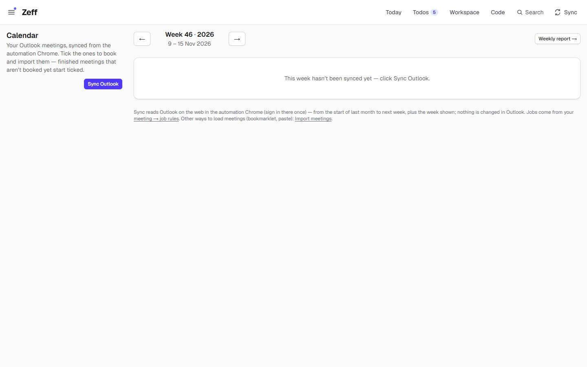
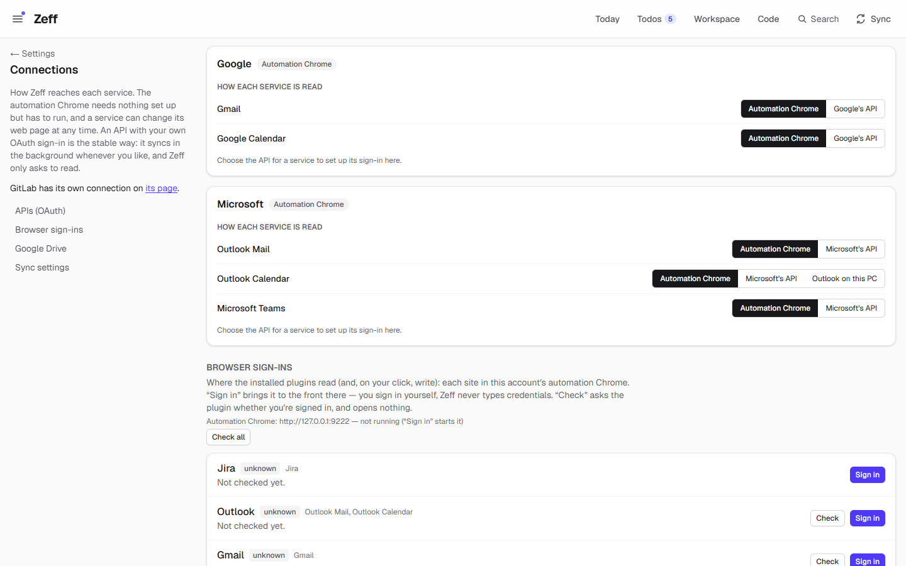
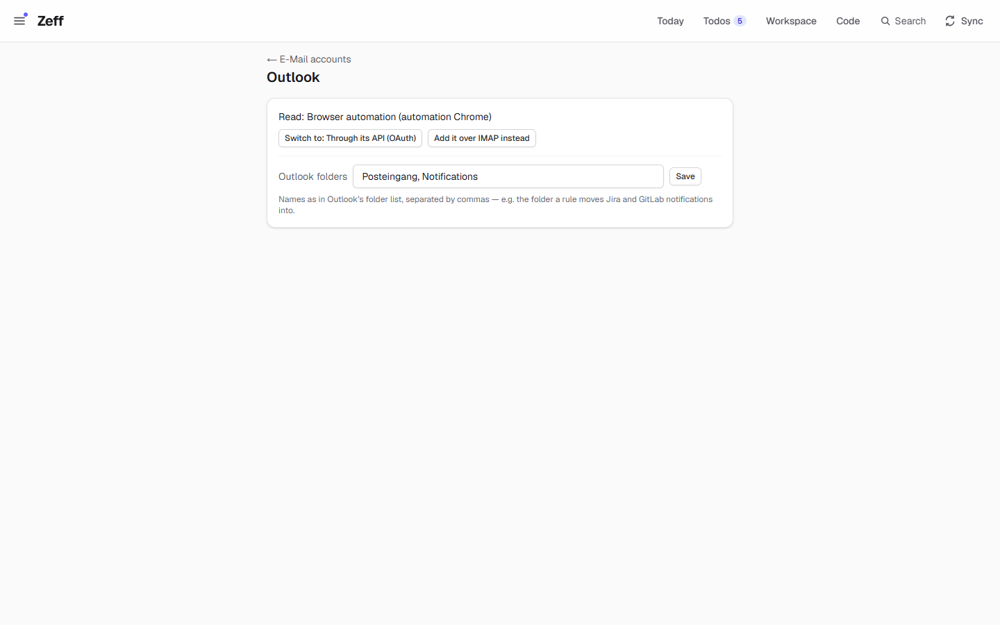
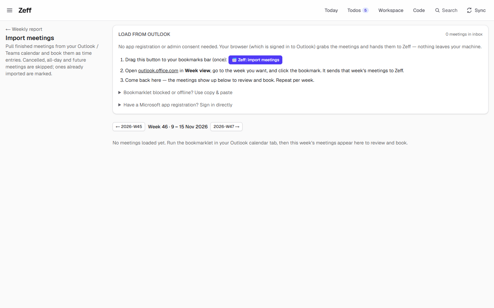

# Outlook

> Your work Outlook in Zeff: **Outlook Mail** reads the inbox into Zeff's inbox, **Outlook Calendar** reads your meetings so you can book them as time entries — through the automation Chrome with Outlook on the web, Microsoft's API with your own sign-in, or (calendar only) the Outlook installed on this PC. Each part is on or off by itself. **Category:** connector · **On by default:** yes (both parts) · **Beta:** no · **Needs:** the automation Chrome signed in to Outlook on the web, or Microsoft's API with your own sign-in ([Settings → Connections](#getting-started)); its mails show in [Mail & Chat](mail-client.md), its meetings feed [Time tracking](time-tracking.md) and the [Calendar](calendar.md)



## For users

### What it does

Outlook is one extension with two parts:

- **Outlook Mail** reads your Outlook inbox — the mail **list** (sender, subject, the preview, time, unread, attachments), in
  the folders you choose — into the one **Inbox** (`/mail`, tab *Outlook*), next to Gmail, other mailboxes and the chats. From
  there your mails feed the **mail review** (todos from what mails ask of you — [Todos](todos.md)), **mail matching**,
  [Open loops](loops.md), the [Timeline](timeline.md), [People](people.md) and [Knowledge](knowledge.md). No mail is opened
  and nothing is marked read. An Outlook mail in Zeff links to its conversation in Outlook on the web.
- **Outlook Calendar** reads your meetings — from the start of last month to the end of next week — into the meeting inbox.
  **Book meetings** (`/calendar`) shows them week by week: finished meetings you haven't booked yet start ticked; you pick a
  job (or let your *meeting → job rules* pick one) and import them as time entries. The meetings also appear in Zeff's
  [Calendar](calendar.md) and count for free slots, and the AI can make todos of appointments that give you something to do.

Nothing is ever changed in Outlook by reading. Each part also brings an action to [Auto actions](auto-actions.md):

- *Mail draft in Outlook* (Outlook Mail): the AI words a mail; one click opens Outlook on the web's compose window, filled in;
  you send it there.
- *Meeting in Outlook* (Outlook Calendar): the AI proposes an appointment (title, start, length, attendees); one click opens
  Outlook's new-meeting form, filled in; you check and send it.

### Getting started

Both parts are installed from the start. Turn either off under **Menu → Plugins → Outlook** (its parts are listed under it).

Then choose how Zeff reaches Outlook — **Settings → Connections**, card *Microsoft*, one row per service (*Outlook Mail*,
*Outlook Calendar*, *Microsoft Teams*):

- **Automation Chrome** (the default) — nothing to register. Zeff runs a Chrome of its own for each Zeff account (with its own
  profile and sign-ins, reached over a local debug port). Under **Browser sign-ins**, press **Sign in** next to *Outlook*:
  Chrome comes to the front at Outlook on the web and you sign in yourself — Zeff never types or stores your password. **Check**
  asks whether you are signed in. The syncs run in the background only while that Chrome runs.
- **Microsoft's API** — the stable way. Register an app once in the Microsoft Entra admin center (*Show how* on the card walks
  you through it: a new registration in your organisation's directory, the platform "Mobile and desktop applications" with the
  redirect URI Zeff shows and public client flows allowed, and the delegated Graph permissions `Mail.Read`, `Calendars.Read`,
  `Chat.Read`, `User.Read`, `offline_access` — some organisations need an administrator's consent). Enter the client ID (a
  secret if you made one) and your tenant ID or domain, **Save the client**, then **Sign in to Microsoft**. One Microsoft sign-in
  serves Outlook Mail, Outlook Calendar and [Microsoft Teams](teams.md). Zeff asks only to read.
- **Outlook on this PC** (Outlook Calendar only, Windows with classic Outlook installed) — reads every calendar of the installed
  Outlook (its mailboxes' and iCloud / subscribed ones) directly through Outlook's own interface: no Chrome, no sign-in, nothing
  changed. *Calendars left out* takes words of calendar names to skip (holidays by default).



For the mail, also see **Settings → E-Mail accounts** (`/settings/mail`): Outlook is listed there with Gmail and the other
mailboxes, with how it is read and how the last sync went. Its page lets you switch the way, add the mailbox over IMAP instead
([E-Mail (IMAP / POP3)](imap-mail.md)), and set the folders.



### Using it

**Mail**

- **Inbox** → tab *Outlook*. Open a mail to see the conversation; the link opens it in Outlook on the web.
- **Reply.** **↩ Reply** (with **Draft with AI** for the text) prepares a reply; it opens as a draft in Outlook on the web — you
  send it there.
- **Folders.** By default Zeff reads *Posteingang* (the inbox) and *Notifications*. On the account page, list the folders as
  they are named in Outlook's folder list, separated by commas — for example the folder a rule moves Jira and GitLab
  notifications into. A folder that isn't found is named in the sync result.
- **Attachments into Documents** — with [Documents](documents.md), *Mail attachments → Documents* (off until you turn it on).

**Calendar**

1. Open **Book meetings** (`/calendar`). The week shows your meetings; meetings already booked are marked, finished ones not
   yet booked start ticked.
2. **Sync Outlook** reads from the start of last month to next week, plus the week shown. It also runs by itself (see Settings).
3. Check the job of each ticked meeting (from your *meeting → job rules*, else your default meeting job), change hours or text
   if needed, and import. Group meetings collect the entries that ran parallel to them.
4. Meetings whose title matches an *exclude rule* (placeholders, reminders) start unticked. Both rule lists are on **Settings →
   Time → Meetings** (`/settings/time#meetings`).

Other ways to load meetings are on **Import meetings** (`/import`): a **bookmarklet** you drag to the bookmarks bar once and
click in your Outlook calendar tab (your browser hands the week's meetings to Zeff — no app registration), a copy-and-paste
fallback, and (*Have a Microsoft app registration? Sign in directly*) a sign-in to Microsoft for the calendar only.



### Settings

| Where | Setting | What it changes |
| --- | --- | --- |
| Settings → Connections → Microsoft | per service: *Automation Chrome* / *Microsoft's API* (/ *Outlook on this PC* for the calendar) | How each part is read |
| same card | Application (client) ID, client secret, directory (tenant) ID or domain; **Sign in**, **Test**, **Connect again**, **Disconnect** | The Microsoft API sign-in (shared with Teams). Tenant empty: `organizations` |
| same card (Outlook on this PC) | Calendars left out | Words of calendar names to skip, separated by `;` (default: holiday calendars) |
| Settings → E-Mail accounts → Outlook | Outlook folders | The folders the mail sync reads (default `Posteingang, Notifications`) |
| Settings → Connections → Sync settings → *Mail* | Every N minutes | The mail sync (default 15, shared with Gmail and the IMAP accounts) |
| same list → *Calendar* | Every N minutes | The Outlook calendar sync |
| Settings → Time → Meetings | Meeting → job rules, meeting exclude rules, default job | What the booking page picks and ticks |
| Menu → Plugins → Outlook | Outlook Mail, Outlook Calendar | Each part on or off |

Nothing runs by itself between 19:00 and 08:00; *Sync now* and the Sync menu always work.

### Tips & limits

- **Chrome must run** for the automation-Chrome way: in the background the syncs wait for it ("The automation Chrome isn't
  running — later"); a sync you start by hand may start it. The API and Outlook-on-this-PC ways run any time.
- **Signed out?** A sync that lands on Microsoft's sign-in page raises a sign-in prompt; you sign in in the automation Chrome
  yourself.
- **Outlook's web page can change.** The automation-Chrome driver reads Outlook on the web as you see it (German and English
  labels); a redesign can break it until Zeff is adapted. The API does not have this problem.
- **Attachments via the automation Chrome** open the mail by its id in a tab of its own; whether that marks an *unread* mail
  read is not verified, so Zeff skips unread mails there unless told otherwise. Through the API, attachments are fetched
  without opening anything.
- **Writing.** Zeff never sends Outlook mail or creates meetings itself: its actions open Outlook's own forms, filled in, for you
  to send.
- **Privacy.** Mails and meetings are kept in Zeff's database on this computer (the bookmarklet's meetings in a file in Zeff's
  data folder). When the AI runs (mail review, matching, appointment todos), the mail's or meeting's text goes to the AI backend
  you chose in [LLM](llm.md).
- **The demo** has no Outlook data and does not sync; the *Outlook* tab of the inbox is empty there.

## Technical reference

### Overview

`outlook` is a parent plugin with two **features** that keep the ids they had as plugins of their own: `outlook-mail` and
`outlook-calendar` (checks like `isInstalled("outlook-mail")` and the `connectors` rows use these ids). The parent brings only
the manifest; the code is shared:

- **Mail** is a source of the shared mail sync (`src/lib/mail/sync.ts`, step `mail`, source `outlook`). With the **cdp** driver
  Zeff runs `src/plugins/outlook/driver.mjs` (a stdio MCP server, Playwright attached to the account's automation Chrome via
  `OUTLOOK_CDP_ENDPOINT`) and calls `outlook_mail {days, folders}`, which reads the mail list folder by folder in a tab of its
  own. With **api** it calls `readMail` in `src/lib/microsoft/mail-api.ts` (Graph, `Mail.Read`, German/English folder names
  mapped to well-known folders, up to 1000 mails per folder). Both give the same `MailInput` rows (`emails`).
- **Calendar** is the sync step `calendar` (`src/lib/sync/registry.ts` → `syncOutlookWeekStarts` in `src/lib/sync/pulls.ts`):
  cdp → `outlook_events {weekStartIsos}` (the week view read by `owa-extractor.mjs`, the same extractor the bookmarklet uses);
  api → `src/lib/microsoft/calendar-api.ts` (`/me/calendarView`, `Calendars.Read`); com → `src/lib/outlook-com/calendar.ts`
  running `scripts/outlook-calendar-com.ps1`. Every driver returns Graph-shaped events per week, which replace that week in the
  meeting inbox (`replaceInboxWeeks`). After a sync the appointments go into the calendar model (`calendar/ir.ts`) and
  `calendarTodos()` asks the AI for todos.

```mermaid
flowchart LR
  subgraph Mail
    MS[step "mail"] -->|cdp| MD[outlook/driver.mjs outlook_mail]
    MS -->|api| MA[microsoft/mail-api.ts]
    MD --> E[(emails)]
    MA --> E
  end
  subgraph Calendar
    CS[step "calendar" / Sync Outlook] -->|cdp| CD[outlook/driver.mjs outlook_events]
    CS -->|api| CA[microsoft/calendar-api.ts]
    CS -->|com| CC[outlook-com + PowerShell]
    BM[Bookmarklet / paste] --> IN
    CD --> IN[(meeting inbox<br/>calendar-inbox.json)]
    CA --> IN
    CC --> IN
    IN --> BK[Book meetings → time_entries]
    IN --> IR[calendar model, appointment todos]
  end
```

### Manifest

| Field | `outlook` | feature `outlook-mail` | feature `outlook-calendar` |
| --- | --- | --- | --- |
| category | `connector` | — | — |
| order / actionsOrder | 255 / — | 260 / 40 | 340 / 50 |
| defaultInstalled | `true` | `true` | `true` |
| requires | Automation Chrome with Outlook Web, or Microsoft's API | | |
| settings | `/settings/connections` | `/settings/mail` | — |
| apps | — | `/mail` (Inbox) | `/calendar` (Book meetings) |
| routes | — | `/mail`, `/api/boards/mail-relations` | `/calendar`, `/import`, `/api/calendar` |
| syncSteps | — | `mail`, `mailtodos`, `relations` | `calendar` |
| services | — | `outlook` | `outlook` |
| dependsOn / extensions / experimental / beta | — | — | — |

### Files

| File | What it is |
| --- | --- |
| [plugin.ts](../../src/plugins/outlook/plugin.ts) | The manifest with both features |
| [driver.mjs](../../src/plugins/outlook/driver.mjs) | The automation-Chrome driver: `outlook_status`, `outlook_events`, `outlook_mail`, `outlook_attachments`, `outlook_download` |
| [actions.ts](../../src/plugins/outlook/actions.ts) | Actions `mail-compose` and `calendar-event` (Outlook on the web deep links) |
| [calendar-actions.ts](../../src/plugins/outlook/calendar-actions.ts) | Server actions: import meetings as entries, device-code sign-in, bookmarklet paste, clear the inbox, *Sync Outlook* |
| [mail-sync-settings.ts](../../src/plugins/outlook/mail-sync-settings.ts), [calendar-sync-settings.ts](../../src/plugins/outlook/calendar-sync-settings.ts) | Their parts of the sync settings |
| [microsoft/mail-api.ts](../../src/lib/microsoft/mail-api.ts) | Outlook Mail through Graph, and attachments |
| [microsoft/calendar-api.ts](../../src/lib/microsoft/calendar-api.ts) | Outlook Calendar through Graph |
| [outlook-com/calendar.ts](../../src/lib/outlook-com/calendar.ts), [outlook-calendar-com.ps1](../../scripts/outlook-calendar-com.ps1) | Outlook on this PC (COM), the calendars left out |
| [sync/pulls.ts](../../src/lib/sync/pulls.ts) | `syncOutlookWeekStarts`: the driver chosen, the weeks into the inbox |
| [calendar/inbox.ts](../../src/lib/calendar/inbox.ts) | The meeting inbox (a JSON file) |
| [calendar/owa-extractor.mjs](../../src/lib/calendar/owa-extractor.mjs), [calendar/bookmarklet.ts](../../src/lib/calendar/bookmarklet.ts) | Reading Outlook's week view; the bookmarklets |
| [calendar/microsoft.ts](../../src/lib/calendar/microsoft.ts), [calendar/config.ts](../../src/lib/calendar/config.ts) | The older calendar-only Microsoft sign-in (device code with Microsoft's public Graph CLI client, or your own app) |
| [app/calendar/page.tsx](../../src/app/calendar/page.tsx), [app/import/page.tsx](../../src/app/import/page.tsx) | Book meetings; Import meetings |
| [connectors/providers.ts](../../src/lib/connectors/providers.ts) | The Microsoft provider: scopes, tenant, services |

### Data

| Where | What |
| --- | --- |
| `emails` table | Outlook's mails: `folder` as in Outlook (`Posteingang`, `Notifications` …), `attach_ref` = Outlook's item id, the shared fields (see [Gmail](gmail.md#data)) |
| `app_settings` | `mail_folders` (default `Posteingang, Notifications`), `mail_sync_minutes`, `mail_last_*` |
| meeting inbox | `data/calendar-inbox.json` (or `ZEFF_CALENDAR_INBOX`): Graph-shaped events per synced week, at most 2000 |
| `time_entries` | Booked meetings, with `external_id` (the event's id — a meeting is booked once) |
| report settings | Meeting → job rules, exclude rules, default meeting job |
| pref `outlookCom:exclude` | Calendars left out by the COM reader (default `Feiertage;Holidays`) |
| `connectors` rows `outlook-mail`, `outlook-calendar`, `microsoft` | Driver per service (`cdp` / `api` / `com`); the Microsoft OAuth client, tokens, scope, account, `extra.tenant` |

### Sync, jobs & AI tasks

- **`mail`** — shared mail sync; Outlook is read with the folders from `mail_folders`. Background: last 3 days while Chrome runs
  (cdp) or always (api); by hand / first time 60 days.
- **`calendar`** — the Outlook calendar, weeks from the start of last month to next week (`outlookWeeks`), then appointment
  todos (`calendarTodos`, AI). Window: always (api, com) or while the automation Chrome runs (cdp).
- **`mailtodos`**, **`relations`** — mail review and mail matching with the briefing ([Todos](todos.md)); the calendar's
  `calendartodos` / `calendarrelations` belong to [Calendar](calendar.md).
- No `llm-tasks.ts` of its own.

### MCP tools & actions

- No MCP tools of its own for agents (the driver's tools are internal, called by the syncs).
- Action **`mail-compose`** `{ to, subject, body }` (plugin `outlook-mail`, *Mail draft in Outlook*, a comms action) →
  `outlook.office.com/mail/deeplink/compose?…`.
- Action **`calendar-event`** `{ subject, start, minutes, attendees, body }` (plugin `outlook-calendar`, *Meeting in Outlook*)
  → `outlook.office.com/calendar/deeplink/compose?…`; minutes clamped to 15–480.
- API routes: `/api/calendar/ingest` (the bookmarklet posts meetings here), `/api/calendar/connect` and `/api/calendar/callback`
  (sign-in with your own app registration).

### Extension points

- Mail: a source of the shared mail sync, the *Outlook* channel of [Mail & Chat](mail-client.md), the Workspace mail data
  sources and mail attachments for [Documents](documents.md).
- Calendar: a source of the calendar model for [Calendar](calendar.md) and of meetings for [Time tracking](time-tracking.md).
- Actions are offered to [Auto actions](auto-actions.md) through the actions catalog (`OUTLOOK_MAIL_ACTIONS`,
  `OUTLOOK_CALENDAR_ACTIONS`).
- Its driver is `driverPath("outlook")` in `src/plugins/drivers.ts`.

### Tests

| Test | Covers |
| --- | --- |
| [microsoft-api-driver.test.ts](../../tests/microsoft-api-driver.test.ts) | Outlook Mail and Calendar (and Teams) through Graph, saved like the Chrome driver's, attachments without opening |
| [mail-outlook-link.test.ts](../../tests/mail-outlook-link.test.ts) | An Outlook mail links to its conversation in Outlook on the web |
| [calendar.test.ts](../../tests/calendar.test.ts), [calendar-view.test.ts](../../tests/calendar-view.test.ts), [calendar-merge-done.test.ts](../../tests/calendar-merge-done.test.ts) | Meetings, the booking week, merging |
| [mail-attachments.test.ts](../../tests/mail-attachments.test.ts), [workspace-mail-sources.test.ts](../../tests/workspace-mail-sources.test.ts) | Attachments; mails as Workspace data |

Run one: `node --import tsx --test tests/microsoft-api-driver.test.ts`.
