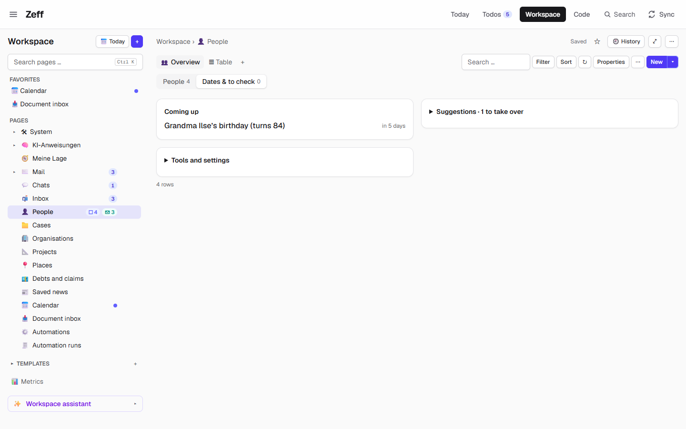
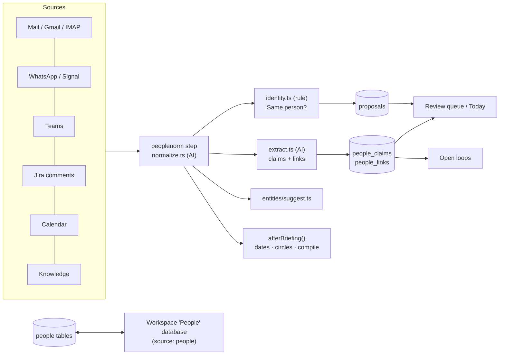

# People

> A profile for everyone who matters to you — their names, dates, circle and what Zeff has learned about them from your messages, gathered on one page and kept as a database of the Workspace. **Category:** app · **On by default:** no · **Beta:** no · **Needs:** nothing to install; the people database appears with [Workspace](workspace.md), the AI parts need [LLM](llm.md), the knowledge panel needs [Knowledge](knowledge.md)

## For users

### What it does

Your messages talk about the same people under many names: "Jonas" in WhatsApp, `jonas@example.com` in mail, "Herr Berger" in a todo, "Mama" in a chat. People gives each of them **one profile** and keeps all the names (aliases), mail addresses, the WhatsApp chat and the Jira account on it. Everything else in Zeff that names a person — todos, mails, chats, appointments, cases, the timeline — then finds the same profile.

On top of that a profile collects what you would otherwise have to remember yourself:

- **Dates** — birthdays, anniversaries and one-off days, each with a reminder some days before (on the Today page and as a desktop notification). Zeff finds dates in your facts and, with the LLM plugin, in the knowledge and in your messages; found dates are proposals until you confirm them.
- **What was read from your messages** — roles ("leads the design team"), preferences, facts and **commitments** ("I'll send you the slides by Thursday" — mine; "Lena sends the offer" — theirs). Each with the quote it came from. Things the AI is less than 80 % sure of wait in the review queue.
- **Links** — who reports to whom, who works on which ticket, repo or project, who works at which organisation (with [Organisations, projects & places](entities.md)).
- **Relations** — what the person is to you or to someone else ("mother", "landlord", "sister of Lotte").
- **A summary** — what connects you, key facts and fun facts, compiled by the AI from everything Zeff has.
- **Rhythm** — when you were last in touch (WhatsApp, Signal, mail, Teams, appointments), how often you usually are, who starts conversations, how fast each answers; people you are drifting apart from are pointed out.
- **Details** — IBAN, BIC, bank, address, phone, office hours, read off confirmed claims, with their history.

In the demo, for example, Jonas asks on WhatsApp whether you'll come to the barbecue on Saturday and bring a salad; Mum reminds you of Grandma Ilse's birthday on Sunday; Thomas Berger, the landlord, needs the water meter reading. These people get profiles, Grandma's birthday becomes a date with a reminder, and the requests become commitments and [open loops](loops.md).

### Getting started

1. Open **Menu → Plugins** and switch on **People**. With [Workspace](workspace.md) installed, a database called **People** is created in the Workspace the next time you open it — one row per profile. The old address `/personen` (and `/personen/<id>`) leads there.
2. Optional but recommended: switch on [LLM](llm.md). Without it People still works (profiles by hand, dates from facts, matching by rule), but the AI steps — matching names, reading facts and commitments from messages, finding dates, placing contacts in circles, summaries, greetings — are off.
3. Fill the profiles: in the People overview open **Dates & to check → Tools and settings** and press **Import from context (AI)** — the AI goes through the last 14 days of your mails, WhatsApp and Teams and makes profiles of the real people in them. Or add one by hand (**New** in the database) or take one of the suggestions (knowledge entities, WhatsApp chats without a profile).
4. In the same box set **Your name** (people with your last name count as family, and the loop detection knows which messages are yours) and, if you like, **About me** (the same text as Settings → About me, put in front of every AI task).

From then on the **People matching** sync step runs with every briefing (workdays) and keeps the profiles up to date.

### Using it

**The overview.** The People database opens on its *Overview* view (a view template of the People plugin). The **People** tab shows a card per person: initials, name, star, circle and role, last contact, what is open between you, the next date, the number of todos and tickets. Hovering a card offers to write to them, add a todo, pay, set the circle, or draft a birthday greeting. Above the cards: a circle selector (family, friends, work, authorities & creditors, services), a sort (by name, longest without contact, last in touch, next date, most todos) and filters (*Starred*, *Long not heard of*, *Open promises*, *With todos*, *Dates soon*). The *Table* view shows the same rows as a plain database table.

**Dates & to check.** The second tab collects what needs you (its count is the number of things to check). Its boxes appear only when they have something to show; in the demo that is *Coming up* with "Grandma Ilse's birthday (turns 84) — in 5 days", *Suggestions · 1 to take over* and the collapsed *Tools and settings*:

- *Coming up* — the dates of your people inside their reminder.
- *Appointments in the next 24 hours* — for each person in them: when you last met, what came from them since, what is open between you.
- *Get in touch* — people you haven't heard from for longer than the reminder weeks (Later puts one off for two weeks).
- The groups to check — names that may be one person, claims, links, commitments, stale claims ("still true?") and dates found — each with yes/no. **Take all from 90 %** accepts the claims and links the AI is very sure of (identity suggestions still wait for you).
- Suggestions — knowledge persons and WhatsApp chats without a profile, one click to add.
- **Tools and settings** — *Import from context (AI)*, *Find dates for everyone*, *Match names (AI)*, *Read new messages (AI)* (since last time, 14 or 30 days), *Place contacts (AI)*, *Link Jira accounts* (no AI), *Compile summaries* (and *again* for those compiled in the last 12 hours), and the settings below.

**A person's page.** Opening a row shows the person's page: *Profile* (names, addresses, chat, accounts, circle), *Details*, *Rhythm*, *Notes*, *Dates*, *Same person, or gone* (merge into another profile or delete), *Summary*, *Read from your messages*, *Relations*, *What the knowledge knows* (with the Knowledge plugin, including merging duplicate knowledge entities), and collapsible lists: *Latest messages*, *Todos they appear in*, *Appointments*, *Cases*, *Letters and documents*, *Mentioned in your workspace*, *Shared tickets*. With [Open loops](loops.md) the loops with that person are listed there too. The page is an ordinary Workspace page, so you can add your own blocks below.

**Elsewhere in Zeff.**

- **Today** (see [Todos](todos.md)): *Reminders* (dates inside their reminder, with *Thought of it*), *Promises* (yours due, theirs overdue, with *Kept*), "n things learned about people — confirm them", and the people in today's appointments.
- **Desktop notifications**: once when a date's reminder starts and once on the day; overdue promises.
- **Todos**: names in a todo are linked to the profile (hover shows a person card); the tag suggestions propose who knows about a todo (by ticket, links and claims).
- **Mentions**: `@Name` in notes and comments resolves to a profile; in notes synced to Jira it becomes the person's Jira mention (once their Jira account is linked).
- **Search** and the Zeff chat find people by their claims and details.
- **Workspace widgets** and **formulas** (see Extension points) put people on any page.
- A promise of yours to pay, due and without a todo, gets a todo after the briefing; ticking it off keeps the promise.

### Settings

People has no settings page of its own; the settings are in the overview's **Dates & to check → Tools and settings** box.

| Setting | What it changes | Default |
| --- | --- | --- |
| Remind after (weeks) | After how many weeks without contact someone you care about shows up under "get in touch" (1–52). | 6 |
| Your name | Your first and last name: people with your last name are placed in *Family*; the loop and pulse rules use it to tell your messages from theirs. | empty |
| About me | One text about you put in front of every AI task — the same as Settings → About me. | empty |
| Per date: remind days | How many days before a date the reminder starts (set on the date). | 7 |
| Per person: circle, star | Set on the card or page; a circle you set is never changed by the rule or the AI. | — |

The AI tasks (see below) can each get their own backend and model under the LLM plugin's settings; their prompts can be edited under System → Prompts.

### Tips & limits

- **Nothing is changed behind your back that is hard to undo.** Merges, new profiles and aliases from the AI's matching only happen where the evidence is unambiguous; identity suggestions found by rule ("Same person?") wait for your yes. Rejected claims and links are remembered and shown to the AI as examples of what not to read.
- **Confidence threshold:** claims and links below 80 % are hidden on the page until you confirm them; commitments that were kept disappear.
- **What the AI sees:** the AI tasks send names, aliases, addresses, chat names and message excerpts to whichever AI backend you configured for the task (local or cloud — see [LLM](llm.md)). Without the LLM plugin nothing is sent.
- **Two-way database:** the profiles live in People's own tables; the database rows are a view. Edits in the row (aliases, mails, chat, Jira, note, star, circle) go to the profile; a profile changed since the row was read wins.
- **Organisations in the people list:** a contact can be an organisation (a bank, an authority). *Place contacts (AI)* marks them; with [Organisations, projects & places](entities.md) they can become proper organisations.
- Dates in German and ISO formats are understood (`16.10.`, `16.10.1996`, `1996-10-16`, `16. Oktober 1996`); a birthday on 29 February is reminded on the 28th in other years.
- WhatsApp is linked by **chat name**, so a renamed chat needs the new name on the profile.

## Technical reference

### Overview

People keeps its own SQLite tables (`people*`) per account and exposes them to the rest of Zeff in three ways: as a **Workspace source** (`people`), from which the People database is generated and kept in sync two-way; through **direct imports** of its store from other plugins (todos, Today, notifications, Jira note sync, search, timeline); and through **extension-point contributions** (widgets, row badges, formula functions, review sources, proposals, correlation series).

The work happens in the **People matching** sync step (`peoplenorm`), which the briefing run calls after its other steps. It runs the AI name matching (`normalize.ts`), then the message extraction (`extract.ts`) and — with [Open loops](loops.md) — closing loops, then rule-based identity suggestions, entity suggestions ([entities](entities.md)), fact mirroring and details, and finally `afterBriefing()` (dates, circles, summaries in the background). Everything an AI or rule *proposes* lands in the review queue (the `reviewSources` and `proposalSources` points) and only becomes "confirmed" by your decision; each decision goes into the feedback ledger (`lib/learning`).

### Manifest

| Field | Value |
| --- | --- |
| id | `people` |
| name | People |
| category | `app` |
| order | 170 |
| defaultInstalled | `false` |
| dependsOn | — (the database needs `workspace`; AI tasks need `llm`) |
| routes | `/personen` (redirects to the person's row or the People database) |
| settings | — (in the overview view) |
| syncSteps | `peoplenorm` (needs `llm`, `STEP_NEEDS` in `plugins/catalog.ts`) |
| features / extensions | — |

### Files

| File | What it does |
| --- | --- |
| [plugin.ts](../../src/plugins/people/plugin.ts) | The manifest. |
| [server.ts](../../src/plugins/people/server.ts) | Registers the contributions (source, widgets, row badges, formulas, review, proposals, correlation series). |
| [store.ts](../../src/plugins/people/store.ts) | Profiles, dates, reminders, relations; merge, aliases, contacts, upcoming dates. |
| [shared.ts](../../src/plugins/people/shared.ts) | Client-safe types (`Person`, `PersonDate`, circles), date parsing and next-occurrence logic. |
| [graph.ts](../../src/plugins/people/graph.ts) | The knowledge graph: claims (fact, role, owns, preference, commitment) and links, review, `whoKnows`. |
| [normalize.ts](../../src/plugins/people/normalize.ts) | The `peoplenorm` step: AI name matching (aliases, new profiles, merges, relations) and what follows it. |
| [extract.ts](../../src/plugins/people/extract.ts) | Reads new messages in batches and proposes claims and links (with the loops addendum). |
| [identity.ts](../../src/plugins/people/identity.ts) | Rule-based "Same person?" suggestions (alias, merge, new person) from observed names. |
| [dates.ts](../../src/plugins/people/dates.ts) | Dates from facts and by AI; the after-briefing date pass. |
| [classify.ts](../../src/plugins/people/classify.ts) | AI: person or organisation, and circle. |
| [compile.ts](../../src/plugins/people/compile.ts) | AI summaries (connection, key facts, fun facts), run in the background with progress. |
| [import.ts](../../src/plugins/people/import.ts) | AI import of people from the last days' context. |
| [greeting.ts](../../src/plugins/people/greeting.ts) | AI birthday greeting draft. |
| [pulse.ts](../../src/plugins/people/pulse.ts), [pulse-insights.ts](../../src/plugins/people/pulse-insights.ts) | Last contacts, nudges, meeting briefs, rhythm, drifting apart, correlation series. |
| [details.ts](../../src/plugins/people/details.ts) | IBAN, BIC, bank, RevTag, address, phone, office hours read from claims, with history; payees. |
| [accounts.ts](../../src/plugins/people/accounts.ts) | Jira account linking and `@`-mention conversion for Jira. |
| [resolve.ts](../../src/plugins/people/resolve.ts), [mentions.ts](../../src/plugins/people/mentions.ts), [search.ts](../../src/plugins/people/search.ts) | Resolving names, mails, phones, IBANs to profiles; mention matching; search and palette. |
| [knowledge-sync.ts](../../src/plugins/people/knowledge-sync.ts) | Outbox of confirmed claims to the knowledge server; knowledge-entity merges. |
| [synergy.ts](../../src/plugins/people/synergy.ts) | Mirrors Zeff's facts onto the profiles they name. |
| [promise-todos.ts](../../src/plugins/people/promise-todos.ts), [todo-settle.ts](../../src/plugins/people/todo-settle.ts) | Todos for due payment promises; a promise kept when its todo is done or a payment matches. |
| [away.ts](../../src/plugins/people/away.ts), [absence.ts](../../src/plugins/people/absence.ts) | Who is away (from claims), follow-up decisions. |
| [appointments.ts](../../src/plugins/people/appointments.ts) | Appointments with a person. |
| [workspace-source.ts](../../src/plugins/people/workspace-source.ts) | The `people` Workspace source: records and the two-way pull. |
| [view-template.meta.ts](../../src/plugins/people/view-template.meta.ts), [view-data.ts](../../src/plugins/people/view-data.ts) | The overview view template and its data. |
| [row-template.meta.ts](../../src/plugins/people/row-template.meta.ts), [row-data.ts](../../src/plugins/people/row-data.ts), [blocks.ts](../../src/plugins/people/blocks.ts), [block-actions.ts](../../src/plugins/people/block-actions.ts) | The person page template, its bundle and operations. |
| [tools.ts](../../src/plugins/people/tools.ts) | The overview's data and its tools (`peopleTool`). |
| [review.ts](../../src/plugins/people/review.ts), [proposals.ts](../../src/plugins/people/proposals.ts) | Review-queue sources and the identity proposal source. |
| [widgets.ts](../../src/plugins/people/widgets.ts), [widgets-person.ts](../../src/plugins/people/widgets-person.ts), [widgets-person-more.ts](../../src/plugins/people/widgets-person-more.ts) | Workspace widgets. |
| [formulas.ts](../../src/plugins/people/formulas.ts), [badges.ts](../../src/plugins/people/badges.ts) | Formula functions; row badges. |
| [server-actions.ts](../../src/plugins/people/server-actions.ts) | Server actions: search, tag suggestions, Today forms, person card. |
| [PersonMention.tsx](../../src/plugins/people/PersonMention.tsx), [ui/](../../src/plugins/people/ui/) | Person mention / hover card, the view parts (card, add form, tool button, verdict, settings). |
| [llm-tasks.ts](../../src/plugins/people/llm-tasks.ts) | The AI tasks. |
| [people-database.ts](../../src/plugins/workspace/people-database.ts) | (Workspace) creates the People database and maps `person:<id>` to its row. |

### Data

All tables live in the account's SQLite database and are created on first use (not in `src/db/schema.ts`).

| Table | Fields |
| --- | --- |
| `people` | `id`, `name`, `aliases` (JSON list), `note`, `whatsapp` (chat name), `emails` (JSON), `entity_id` (knowledge entity), `starred`, `compiled` (JSON summary: connection, keyFacts, funFacts, at, sources), `accounts` (JSON, Jira usernames), `circle` + `circle_source` (rule/ai/manual), `kind` (person/organization) + `kind_source`, timestamps. |
| `people_dates` | `person_id`, `kind` (birthday/anniversary/other), `label`, `day`, `month`, `year`, `yearly`, `remind_days`, `source` (manual/fact/ai), `source_text`, `confirmed`. |
| `people_reminded` | Which occurrence of a date you ticked off ("Thought of it"). |
| `people_relations` | `person_id`, `rel` (from your side, e.g. "Mutter"), `other_id` (0 = you), `evidence`, `source`. |
| `people_claims` | `person_id`, `kind` (fact/role/owns/preference/commitment), `text`, `evidence` (quote), `source_ref`, `confidence`, `status` (proposed/confirmed/rejected/superseded), `direction` (mine/theirs for commitments), `due`, `done_at`, `expires_at`, `run_id`. |
| `people_links` | `person_id`, `rel` (reports-to, manages, works-with, decides, owns, on-ticket, commented-on, authored, active-in, knows-about, works-at, located-at), `target_type` (person/ticket/repo/project/topic/org/place), `target_ref`, `label`, `evidence`, `confidence`, `status`, `seen_at`. |
| `people_details` | `person_id`, `key` (iban, bic, bank, revtag, address, phone, hours), `value`, `norm`, `claim_id`, `removed`. |
| `people_extract_state` | Per source, the mark up to which messages were read. |
| `people_promise_todos`, `people_claims_kept`, `people_followups` | Todos made for promises, promises kept, away follow-up decisions. |
| `knowledge_outbox`, `people_kmerge` | Confirmed claims waiting to be sent to the knowledge server; proposed merges of knowledge entities. |

Prefs: `people.nudgeWeeks`, `people.nudgeSnooze`, `people.myName`, `people.datesChecked`, `workspace.peopleDb` (the People database's id). Identity suggestions are stored in the shared proposals store (`@/lib/proposals`, source `people-identity`).

### Sync, jobs & AI tasks

**Sync step `peoplenorm`** ("People matching", workdays with the briefing, every `autoMinutes`): `normalizePeople()` → (with LLM) `extractKnowledge()` → (with loops) `afterExtraction()` → `findIdentitySuggestions()` → (with entities) `findEntitySuggestions()` + `deriveEntityLinks()` → `syncFactClaims()` and details → `afterBriefing()` (dates from facts/knowledge, `classifyContacts`, background `startCompile` for stale summaries) → the Knowledge plugin's meeting briefs. After the whole briefing, `promiseTodos()` creates todos for due payment promises.

**AI tasks** (`llm-tasks.ts`; each can use its own backend/model; prompts in German, editable under System → Prompts):

| Task id | Label | What it does |
| --- | --- | --- |
| `people-dates` | People's dates | Finds birthdays, anniversaries and other dates in knowledge and messages, each with a quote. |
| `people-normalize` | People matching | Aliases, new profiles for contacts, merges, relations from the names in your todos. |
| `people-classify` | People: person or organisation | Person/organisation and circle for each contact not placed yet. |
| `people-compile` | People summaries | Summary per person: connection, key facts, fun facts. |
| `people-extract` | People facts from messages | Claims and links from new messages (20 items per batch, up to 6 batches). |
| `people-import` | People import | Real people in the last days' context, with names, addresses, accounts. |
| `people-greeting` | Greetings | A birthday greeting draft in your tone — you send it yourself. |

### MCP tools & actions

People has no MCP tools of its own. Its data reaches agents through other tools: `timeline_for` / `context_brief` / `meeting_brief` (Knowledge, [Timeline](timeline.md)) read claims, commitments, dates and last contacts; `open_loops` ([Open loops](loops.md)) lists commitments; `entity_search` ([entities](entities.md)) resolves names to `person:<id>`; `search_context` includes people hits (`lib/rag.ts`).

Server actions ([server-actions.ts](../../src/plugins/people/server-actions.ts), [block-actions.ts](../../src/plugins/people/block-actions.ts)): `searchPeopleAction`, `suggestTagsAction` (who knows about a todo), `remindedFormAction` and `promiseKeptFormAction` (Today forms), `personCardAction`, `personBundleAction` / `personOpAction` (the person page), `personWikiAction` / `personKnowledgeMergeAction`, `peopleOverviewAction` / `peopleToolAction` (the overview's tools). No todo actions (`actions.ts`).

### Extension points

Contributes to:

| Point | Contribution |
| --- | --- |
| `workspaceSources` | `people` — the profiles as a pipeline source (two-way). |
| `workspaceWidgets` | `people.list`, `people.upcoming` (dates coming up), `people.owed` (who owes whom), `people.briefs` (meeting briefs), `people.drifting` (drifting apart), `people.todos`, `people.overview` (all about a person), `people.promises`, `people.facts`, `people.funfacts`, `people.news`, `people.rhythm`, `people.coming`. |
| `rowBadgeSources` | A person's row badge: open todos, overdue promises, unread messages. |
| `workspaceFormulaFunctions` | `Personen(@Freunde)`, `Kreis(@Chris)`, and resolving `@Name` / `@Circle` for other plugins' functions (e.g. `Schulden(@Freunde)` in [Cases](cases.md)). |
| `reviewSources` | `people-claim`, `people-link`, `people-stale` and the date/commitment groups. |
| `proposalSources` | `people-identity` ("Same person?"). |
| `correlationSeries` | `people.contact` — days in touch with your top people ([Correlations](correlations.md)). |
| Workspace view apps | The `people` overview template and the person page template (`PERSON_PAGE`). |

Other plugins import its store directly: [Open loops](loops.md) (commitments), [Organisations, projects & places](entities.md) (links `works-at`/`located-at`), [Timeline](timeline.md) (refs `person:<id>`), [Cases](cases.md) (parties, payees), the Today page, notifications and the Jira note sync.

### Tests

Unit tests (run one with `node --import tsx --test tests/people.test.ts`):
`tests/people.test.ts`, `people-appointments`, `people-away`, `people-blocks`, `people-card`, `people-compile`, `people-coverage`, `people-dates`, `people-details`, `people-extract-loops`, `people-graph`, `people-identity`, `people-import`, `people-merge-refs`, `people-page-defaults`, `people-person-widgets`, `people-pulse-insights`, `people-pulse`, `people-relations`, `people-search`, `people-synergy`, `people-tags`, `people-view`, `person-page`, `review-people`, `workspace-people`, `todo-settle`, `heute-today`.

End-to-end: `e2e/people.e2e.mjs` (run with `npm run e2e`, which starts its own test server).
