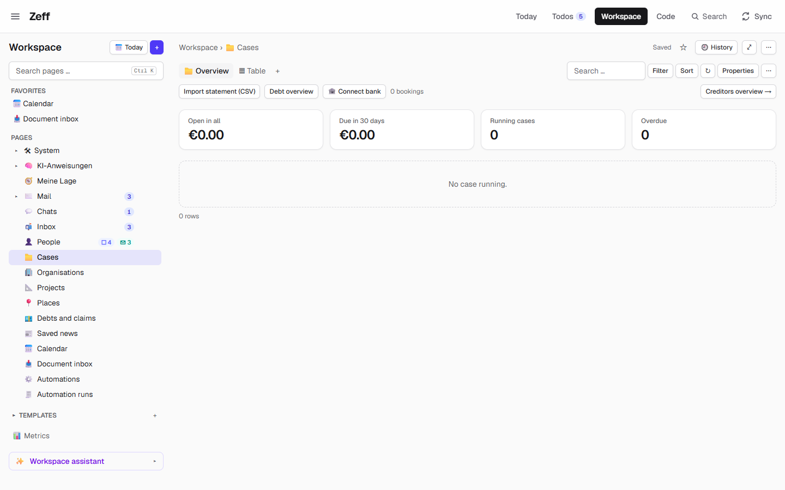

# Revolut

> Reads your Revolut statements (the CSV export, German or English — other banks' CSV too) into the Cases plugin's bank, where payments settle their todos and cases, and adds a "Pay with Revolut" action for people whose RevTag is known. **Category:** connector · **On by default:** no · **Beta:** no · **Needs:** [Cases](cases.md)

## For users

### What it does

Two things, both around money going out:

1. **Statements in.** Revolut lets you export your account as a CSV file. Revolut reads that file — or any bank's CSV
   that has a date and an amount column — and keeps its bookings in the bank of the [Cases](cases.md) plugin. There
   each payment out is matched to what you owe: a booking that fits a todo's transfer (the amount, and the
   recipient, the account or the case number) ticks that todo off with a note and counts for its case; your
   [Finances](finances.md) read your income, spending and recurring payments from the same bookings.
2. **Paying by RevTag.** When a todo asks you to pay a person back and their RevTag is known (the
   [People](people.md) plugin reads it off what was said: "RevTag @chris.b", "revolut.me/chris.b"), the AI can propose
   the action **Pay with Revolut** instead of a bank transfer. Its card shows recipient, RevTag, amount and note to
   copy, a link to their revolut.me page with the amount and note filled in, and two QR codes — one for an iPhone, one
   for Android.

Zeff never sends money. You confirm the payment in the Revolut app or page.

The demo has no statements and no RevTags, so there is nothing imported to show; the screenshot shows the bank bar where
the import button sits.

### Getting started

1. **Menu → Plugins → Revolut** (installs [Cases](cases.md) with it).
2. Export a statement of your account as CSV from Revolut (the file is usually named `account-statement_….csv`).
3. In Zeff, open the Workspace database **Cases** and click **Import statement (CSV)** in the bank bar above the
   overview. A message says how many bookings were new, how many payments matched and how many warnings were made.
4. Or put the CSV in a folder the [Documents](documents.md) plugin reads (a local folder or your
   [Google Drive](google-drive.md) folder): after the next briefing its bookings are read by themselves, each file once.

### Using it

**Importing.** Import as often as you like — a booking already kept is never kept twice (same account, day, amount,
text and position among identical ones). Bookings not yet completed (Revolut's `PENDING`) are skipped; import again
later to get them. After an import Zeff matches payments, makes warnings for instalments ten days late, and (with
[Knowledge](knowledge.md)) refreshes the monthly bank pages.

**What the documents see.** A statement among your documents is not treated as a letter: its text is replaced by a
short German note ("Kontoauszug (Revolut), 120 Buchungen vom … bis …") so the bookings don't reach the knowledge, the
people and the cases as if they were letters.

**Paying with Revolut.** On a todo with the action, *Pay* opens `https://revolut.me/<tag>?currency=EUR&amount=<cents>&note=…`.
On a phone the Revolut app would catch that link and drop the amount and note, so the card's QR codes open the page in
the phone's browser instead (iPhone: Safari via `x-safari-https`, iOS 17+; Android: an intent for Chrome, falling back
to the plain page).

For a bank transfer instead (an IBAN known, no RevTag), the [Cases](cases.md) plugin's *Transfer (GiroCode)* action
opens Zeff's `/pay` page with a GiroCode.

### Settings

None. The plugin has no settings page; the import is a button, and documents are read when the Documents plugin brings
them.

### Tips & limits

- **Columns recognised** (first found wins, case-insensitive): date — *Completed Date*, *Datum des Abschlusses*,
  *Buchungstag*, *Buchungsdatum*, *Datum*, *Date*, *Booking date*, *Started Date*, *Valutadatum*, *Wertstellung* …;
  amount — *Amount*, *Betrag*, *Umsatz* …; text — *Description*, *Beschreibung*, *Buchungstext*, *Details*;
  counterparty — *Empfänger*, *Auftraggeber*, *Name*, *Counterparty*, *Begünstigter/Zahlungspflichtiger* …; reference
  — *Verwendungszweck*, *Reference* …; IBAN; currency; state. Comma or semicolon separated; `1.234,56` and `1,234.56`
  both read. A file without a date and an amount column is refused.
- Revolut writes the other side into the description ("To Wagner Dienstkonto", "Transfer to …", "From …"); the name
  is taken from there when there is no counterparty column.
- An IBAN is kept only when its check digits are valid.
- A file is "Revolut" when its name starts with `account-statement_` or contains "revolut", or its header starts with
  `Type,Product,` / `Art,Produkt,`; otherwise the account is the file name.
- **Privacy:** parsing and matching run locally; nothing is sent to Revolut. The revolut.me link is opened only when
  you click or scan it. For automatic fetching instead of files, use the Enable Banking connection in [Cases](cases.md).
- The revolut.me prefill (`amount`, `note`) is what Revolut's page reads, not a documented API — it may change.

## Technical reference

### Overview

A thin connector on top of Cases. `statement.ts` parses CSV into `Booking`s and hands them to Cases'
`addBookings(bookings, account)` (table `bank_transactions`). Two entry points: the button `ImportStatement` (rendered
by Cases' `BankBar` when Revolut is installed) → `importStatementAction()` → `importStatement()` + `matchPayments()` +
`overdueWarnings()`; and `importStatementDocuments()`, run after each briefing (`lib/runs/run.ts`) and when the cases
overview opens, which reads every CSV document not yet in `bank_documents`. `server.ts` contributes `statementNote` to
the Documents plugin's `documentTexts` point so a statement's text is replaced by a note. The `revolut-pay` action
(`actions.ts`) and its card (`ui/RevolutCard.tsx`, rendered by `components/boards/OpChips.tsx`) cover paying by RevTag.

### Manifest

| Field | Value |
| --- | --- |
| id | `revolut` |
| category | `connector` |
| order | 177 |
| defaultInstalled | `false` |
| dependsOn | `cases` |
| routes / settings / syncSteps / features | none |
| actions | `revolut-pay` (*Pay with Revolut*) |

### Files

| File | What it is |
| --- | --- |
| [plugin.ts](../../src/plugins/revolut/plugin.ts) | the manifest |
| [server.ts](../../src/plugins/revolut/server.ts) | contributes `statementNote` to `documentTexts` |
| [statement.ts](../../src/plugins/revolut/statement.ts) | CSV parsing (`parseStatement`), `accountOf`, `importStatement`, `statementNote`, `importStatementDocuments` |
| [server-actions.ts](../../src/plugins/revolut/server-actions.ts) | `importStatementAction(csv, fileName)` |
| [actions.ts](../../src/plugins/revolut/actions.ts) | the `revolut-pay` action, `revtagOf`, `revolutLink`, `revolutPhoneLinks` |
| [ui/ImportStatement.tsx](../../src/plugins/revolut/ui/ImportStatement.tsx) | the *Import statement (CSV)* button |
| [ui/RevolutCard.tsx](../../src/plugins/revolut/ui/RevolutCard.tsx) | the action's card: fields to copy, two QR codes, the link |

### Data

| Table | Fields |
| --- | --- |
| `bank_transactions` (Cases) | the bookings: `account` ("Revolut" or the file name), `date`, `amount` (out negative), `currency`, `text`, `counterparty`, `iban`, `reference`, plus Cases' matching columns — see [Cases](cases.md#data) |
| `bank_documents` | `doc_id` (a CSV document already read), `added` (bookings added), `at` |

The RevTag is a People detail (`revtag` in `plugins/people/details.ts`), kept as `@tag`.

### Sync, jobs & AI tasks

No sync step and no AI task of its own. After each briefing, with Cases and Revolut installed,
`importStatementDocuments()` runs before the bank sync and the payment matching. After an import with new bookings,
the Knowledge sync is triggered in the background (when Knowledge is installed).

### MCP tools & actions

- **Action** `revolut-pay` — fields `name`, `revtag` (without @, 3–31 characters), `amount` (euro, empty: you type
  it), `note` (≤ 64 characters used in the link). Offered to the AI only when the person's RevTag is known ("never
  invent a RevTag"); `href` is the prefilled revolut.me link.
- Server action `importStatementAction(csv, fileName)`.
- No MCP tools, no API routes.

### Extension points

Contributes to `documentTexts` (Documents' `text-point.ts`): `statementNote(name, text)` returns the note for a
statement, `null` for anything else. Uses Cases' `addBookings` and its bank matching; renders inside Cases' bank bar
and the todo action chips.

### Tests

`tests/bank.test.ts` (statement parsing and matching), `tests/income.test.ts`, `tests/people-details.test.ts`
(RevTag detection). Run one with `node --import tsx --test tests/bank.test.ts`.
