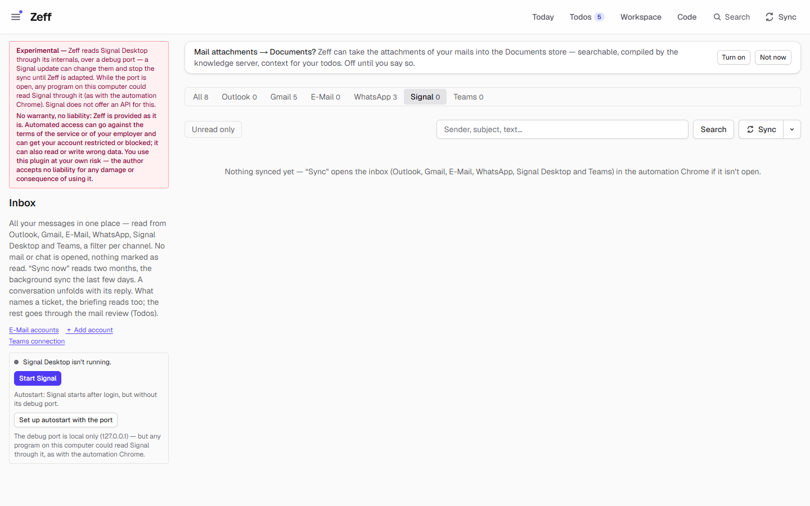
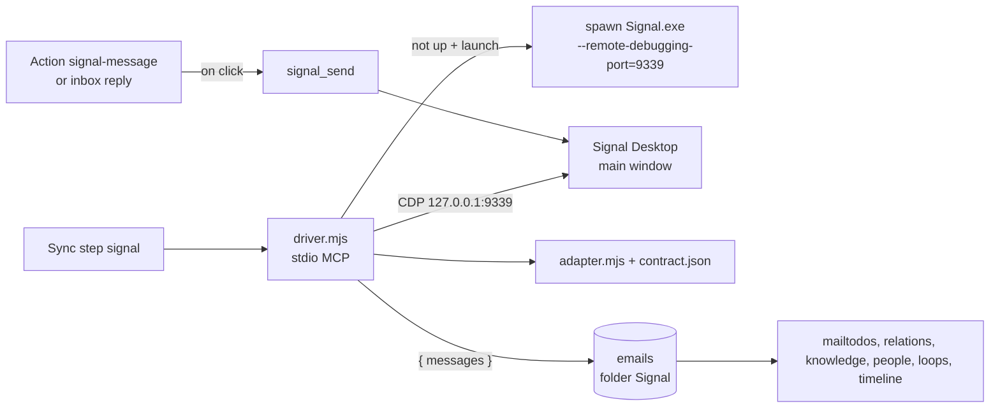

# Signal

> Reads your Signal chats from Signal Desktop on this computer, over its local debug port, without opening a chat, and puts the messages in the inbox, the mail review, matching and knowledge. On your click it sends a reply. **Category:** connector · **On by default:** no · **Beta:** no, but **experimental** (see below) · **Needs:** Signal Desktop on this computer, linked to your phone and running with its debug port; works with [Mail client](mail-client.md), [Todos](todos.md), [Auto actions](auto-actions.md)

> **Experimental: use at your own risk.** Signal has no API for this. Zeff reads Signal Desktop through its internals,
> over a debug port. **A Signal update can change those internals and stop the sync** until Zeff (or its contract
> file) is adapted. **While the debug port is open, any program on this computer could read Signal through it**, the
> same as with the automation Chrome. The port listens on 127.0.0.1 only, so other computers can't reach it. Automated
> access can go against Signal's terms. Zeff comes without warranty, and its author accepts no liability for any damage
> or consequence of using this plugin. The Plugins page and the inbox's Signal filter show this warning too.

## For users

### What it does

The Signal plugin does for Signal what the [WhatsApp](whatsapp.md) plugin does for WhatsApp:

- The **Inbox** (`/mail`, filter **Signal**) lists your Signal chats with their messages, next to mails and other
  chats.
- The **mail review** makes [todos](todos.md) from what the messages ask of you; **mail matching** attaches them to the
  todos they belong to; the [knowledge](knowledge.md), [people](people.md), [loops](loops.md) and
  [timeline](timeline.md) read them.
- **Today** lists Signal chats waiting for your answer (last word not yours in the last 7 days; a group only when
  something in it is addressed to you).
- You **reply** from the inbox or from a todo's suggested message. It is sent only when you click.

Reading never opens a chat, so nothing is marked as read and no read receipt goes out. Zeff does not touch Signal's
encrypted database and does not extract its key. It reads what Signal Desktop already has loaded in memory.

The demo has no Signal messages, so the screenshot shows the empty Signal filter with its status box.

### Getting started

Signal has no web version, so this plugin does **not** use the automation Chrome. It talks to Signal Desktop directly.

1. Install **Signal Desktop** on this computer and link it to your phone (Signal on the phone → *Settings → Linked
   devices* → scan the QR code). Zeff never links it for you.
2. **Menu → Plugins** (`/plugins`), section *Connectors*: switch on **Signal** (you are shown the experimental warning).
3. Open the inbox's **Signal** filter (`/mail?channel=signal`). The status box on the left says one of three things:
   - *Signal Desktop is running with its debug port (9339).* Ready.
   - *Signal Desktop is running without its debug port.* Quit Signal once (tray icon → *Quit*), then start it from Zeff.
   - *Signal Desktop isn't running.* Press **Start Signal**. Zeff starts it in the tray with the debug port.
4. Optional, Windows only: **Set up autostart with the port**. Signal's own "open at login" entry gets the debug port
   added, so Signal is readable after every login. Signal rewrites that entry when you change its tray or autostart
   setting; then press the button again.
5. Press **Sync** (inbox or Sync menu). The first sync reads two months (60 days), later ones the last 3 days.

On **Settings → Connections** (*Browser sign-ins*), Signal's **Sign in** does the same as *Start Signal*, and **Check**
asks the driver whether Signal runs with the port and is linked.

On macOS and Linux, Zeff has no default path to Signal: start Signal yourself with `--remote-debugging-port=9339`, or
set `SIGNAL_EXE` so Zeff can start it.

### Using it

**Read.** Click a chat in the inbox to unfold it. Nothing changes in Signal.

**Reply.** Type into the reply line under a chat, or press **Draft with AI**. **Send** asks "Send to “…” via Signal?",
then opens the chat in Signal Desktop (which marks it read), types the text and sends it. Zeff checks that the message
appears; if not, it asks you to look.

**Suggested messages on todos.** With the extension *Send message* (on by default once [Auto actions](auto-actions.md)
are installed), the AI suggests Signal messages on todos (accept, decline, propose a time, ask back), ready-worded and
sent only on your click. The todo then notes "Signal message sent to … on …".

**Load the whole history.** A button on an unfolded chat loads all its messages that Signal Desktop has, so the
knowledge can read them. Unlike WhatsApp, this does not open the chat. Signal Desktop only has what it received since
it was linked; nothing older comes from the phone.

### Settings

| Setting | Where | What it changes |
| --- | --- | --- |
| Plugin on/off | Menu → Plugins | Off: no sync, no Signal filter, no suggestions; messages already read stay. |
| *Send message* extension | Menu → Plugins, under Auto actions | Whether auto actions suggest Signal messages (on by default). |
| Signal sync interval | Settings → Connections → *Sync settings* | Every 5, 10, 15 (default), 30 minutes … 24 hours, or *manual only*. Runs only while Signal Desktop runs, and not between 19:00 and 08:00. |
| Autostart with the port | Inbox, Signal filter (Windows) | Adds `--remote-debugging-port=9339` to Signal's login autostart entry in the registry. |
| `SIGNAL_CDP_ENDPOINT`, `SIGNAL_EXE` | Environment | Another debug endpoint than `http://127.0.0.1:9339`; where Signal Desktop's program is. |

### Tips & limits

- **The debug port is the main risk.** While it is open, any program running on this computer under your user could
  read your Signal chats through it. Only use this plugin on a computer you trust. To close it, quit Signal and start it
  normally (and don't set up the autostart with the port).
- **What leaves the machine:** nothing goes to Signal except messages you send. The messages are kept in Zeff's
  database; the AI (your chosen [LLM](llm.md)) sees them in the mail review, matching, reply drafts and the knowledge.
- A Signal Desktop update can move its internals. The **Check** (status) also runs the contract check; a drift shows as
  a note on the Connections page, the Sync menu and Today before a sync breaks.
- Sending finds the chat by its name. Signal's "Note to self" is recognised.
- The scheduled sync only runs while Signal Desktop runs ("Signal Desktop isn't running — later" otherwise). A sync by
  hand starts Signal when it isn't running (in the tray, with the port). Both fail with a message if Signal runs
  without the port; then quit it once.

## Technical reference

### Overview

[driver.mjs](../../src/plugins/signal/driver.mjs) is a stdio MCP server that Zeff starts per operation. It checks that
Signal Desktop answers on its debug port (`SIGNAL_CDP_ENDPOINT`, default `http://127.0.0.1:9339`). If not and the call
may launch, it spawns `Signal.exe --start-in-tray --remote-debugging-port=9339` and waits up to a minute; if Signal runs
without the port it fails with a clear message. It then attaches to Signal's main window over CDP. Everything that knows
Signal Desktop's insides (the `ConversationController`, the redux store, the chat loaders, the selected-conversation
path that Signal 8 moved) is in [adapter.mjs](../../src/plugins/signal/adapter.mjs) and
[contract.json](../../src/plugins/signal/contract.json) (verified against Signal Desktop 8.30). Reading loads messages
into Signal's in-memory store only. See [docs/automation.md](../automation.md) for adapters, contracts and the
self-test.

The sync step `signal` (`syncSignal()` in [mail/sync.ts](../../src/lib/mail/sync.ts)) calls `signal_messages` and saves
the result with the mails (folder `Signal`). After it, as for every chat source, the registry runs the workspace
pipelines, closes todos your replies settled and indexes the timeline; `mailtodos` and `relations` follow with the
briefing.

### Manifest

| Field | Value |
| --- | --- |
| id | `signal` |
| category | `connector` |
| order / actionsOrder | 285 / 90 |
| defaultInstalled | `false` |
| experimental | Internals over a debug port; an update can stop the sync; any local program could read Signal through the open port; no API |
| requires | Signal Desktop on this computer, linked, running with its debug port |
| dependsOn | none |
| apps | `/mail` (Inbox) |
| routes | `/mail`, `/apps/signal` (redirects to `/mail?channel=signal`), `/api/boards/mail-relations` |
| syncSteps | `signal`, `mailtodos`, `relations` |
| services | `signal` |
| extensions | `send-action` for `auto-actions`: *Send message*, action `signal-message`, on by default |

### Files

| File | What it does |
| --- | --- |
| [plugin.ts](../../src/plugins/signal/plugin.ts) | The manifest. |
| [driver.mjs](../../src/plugins/signal/driver.mjs) | Stdio MCP server: starting Signal with the port, `signal_status`, `signal_selftest`, `signal_messages`, `signal_chats`, `signal_history`, `signal_send`. |
| [adapter.mjs](../../src/plugins/signal/adapter.mjs) | CDP attach and the in-app functions: state, chats, messages, find chat, composer, sent check, self-check. |
| [contract.json](../../src/plugins/signal/contract.json) | What the adapter expects: `globals`, `states` (redux), `paths`, `selectors`, `texts`. |
| [endpoint.ts](../../src/plugins/signal/endpoint.ts) | `SIGNAL_PORT` (9339), `signalCdp()`, `signalUp()`, `signalRunning()` (Windows `tasklist`). |
| [autostart.ts](../../src/plugins/signal/autostart.ts) | Reads and sets Signal's `HKCU\…\Run` entry with the port (Windows). |
| [open.ts](../../src/plugins/signal/open.ts) | "Sign in" / *Start Signal*: `signal_status { launch: true }`. |
| [SignalStatus.tsx](../../src/plugins/signal/SignalStatus.tsx), [SignalButton.tsx](../../src/plugins/signal/SignalButton.tsx) | The status box in the inbox's Signal filter and its buttons. |
| [server-actions.ts](../../src/plugins/signal/server-actions.ts) | `syncSignalAction`, `pullSignalHistoryAction`, `startSignalAction`, `setupSignalAutostartAction`. |
| [history.ts](../../src/plugins/signal/history.ts) | `pullSignalHistory`: one chat's whole history as far as Signal Desktop has it. |
| [actions.ts](../../src/plugins/signal/actions.ts), [run.ts](../../src/plugins/signal/run.ts) | The `signal-message` action and its run on a click. |
| [sync-settings.ts](../../src/plugins/signal/sync-settings.ts) | Its row in the sync settings. |

### Data

- **`emails`** ([schema.ts](../../src/db/schema.ts)): one row per message, `folder = 'Signal'`, `convId = "sg:<chat
  name>"`, `subject` = chat name, `fromName`, `preview` = text, `receivedAt`, `unread`, `isGroup`, `toMe`, plus the
  shared `resolvedAt` / `reviewedAt`.
- **Sync state:** the step's record and interval (`stepMinutes("signal")`, default 15).
- **Outside Zeff:** the Windows registry value `org.whispersystems.signal-desktop` under
  `HKCU\Software\Microsoft\Windows\CurrentVersion\Run`, changed only by *Set up autostart with the port*.
- **Contract override:** `data/automation/signal.json` (folder of `ZEFF_AUTOMATION_DIR`), merged over `contract.json`.

### Sync, jobs & AI tasks

| Step | What it does |
| --- | --- |
| `signal` | `signal_messages` for the chats active in the last 3 days (60 the first time, while no Signal message is stored), up to 3 (8) loads of earlier messages per chat. May start Signal Desktop. One run at a time (`__zeffSignalSyncing`). The scheduler (`whileSignalRuns` in [sync-scheduler.ts](../../src/lib/sync-scheduler.ts)) starts it only while Signal Desktop runs. |
| `mailtodos` | The mail review: todos from new messages (AI). Signal messages are chats: never filtered out of the review, never "must-do" mails; the review's prompt mentions Signal only when there are Signal messages. |
| `relations` | Mail matching (AI). |

No AI task of its own. The `signal-message` offer text in [actions.ts](../../src/plugins/signal/actions.ts) tells the AI
when to suggest a message (todo from a Signal chat, or someone you write with there; same language and tone; 1–3
sentences; not if already answered).

### MCP tools & actions

**Driver tools** (stdio):

| Tool | What it does |
| --- | --- |
| `signal_status {launch}` | Running, with the port, linked, loaded; with `launch` it starts Signal; includes contract `drift`. |
| `signal_selftest` | The contract against the live app (types and counts only). |
| `signal_messages {days, maxLoads, maxMessages, launch}` | Messages of the chats active in the last days. |
| `signal_chats {days, launch}` | Each active chat's last message. |
| `signal_history {chat}` | One chat's whole history, as far as Signal Desktop has it. |
| `signal_send {chat, text}` | Opens the chat (marks it read), types and sends. The only writing tool; called only on your click. |

**Action:** `signal-message` `{ chat, body }` (*Send Signal message*). **Server actions:** see Files. Zeff's own MCP
server has no Signal tool; agents see the messages through the general context tools.

### Extension points

- `signal-message` action for [Auto actions](auto-actions.md) (extension `send-action`).
- The `signal` sync step and its sync-settings row.
- A channel of the [Mail client](mail-client.md) inbox (`channel=signal`; the status box is rendered there) and a
  source for the workspace pipelines, [timeline](timeline.md), [people](people.md), [loops](loops.md), data boundaries
  and source health (drift via `noteDrift`).

### Tests

| Test | Covers |
| --- | --- |
| [signal.test.ts](../../tests/signal.test.ts) | Waiting chats (a group only when something is to you), messages are chats in the review, the proposed message cleaned like WhatsApp's, the review told about Signal only when there are messages. |
| [automation-adapters.test.ts](../../tests/automation-adapters.test.ts) | The adapter against a fake Signal Desktop: reading, the open chat at either path (Signal 8 nav or older), states (chats, link, loading), the self-check naming what broke. |
| [automation-probe.test.ts](../../tests/automation-probe.test.ts) | Probe, contract merge, MCP loop. |
| [cdp-endpoint.test.ts](../../tests/cdp-endpoint.test.ts) | The debug endpoint address (`cdpEndpoint`, used by `signalCdp()`): 127.0.0.1 on the host, a bridge in a container. |

Run one: `node --import tsx --test tests/signal.test.ts`.
