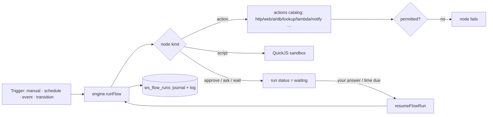

# Studio

> Builds what your Zeff apps do: flows of nodes drawn on a canvas, lifecycles for status fields, lambdas, screens and secrets — by hand or with a copilot. **Category:** app · **On by default:** no · **Beta:** yes · **Needs:** [Workspace](workspace.md)

## For users

### What it does

The [Workspace](workspace.md) gives you pages and databases. The Studio is where you make them *do* something:

- **Flows** — a sequence of steps (nodes) that run on Zeff's server: fetch a web page or an API, look something up,
  let the AI pick out fields, write rows, branch, loop, run a bit of JavaScript in a sandbox, wait for your approval or
  for a time, ask you a question. Every node's input and output is shown in the run console.
- **Automations** — flows that start by themselves: on a schedule ("every hour from 8 to 22"), when a row is added or
  changed, when a form is submitted, when a row moves along its lifecycle.
- **Apps & screens** — a database with screens of its own (views drawn from a template), the flows those screens call,
  and a detail page for its rows.
- **Lifecycles** — a status field becomes a state machine: which state may follow which, under what condition, with
  which fields filled, and which flow runs on the way.
- **Lambdas & lookup sources** — small Node.js functions (with their npm packages) that a flow or a `<lookup>` in a
  view can call; Zeff's own lookup sources (TMDB, Wikipedia, Open Library, Google, the web search) are lambdas too and
  can be changed here.
- **Secrets** — API keys that flows use as `{{ secrets.NAME }}`, never shown again and never written into a log.

An example from the starts that come with it: **"Ask me regularly"** is an automation of three nodes — every hour
from 08:00 to 22:00 it asks you "How are you, from 1 to 10?" (a scale and a note, as a card on any Zeff page), makes
sure a *Check-ins* database exists under *Journal*, and writes your answer into it with the time. The journal's
reviews then read that database. You can change any of the three blocks in the editor.

The demo data has no flows of its own; the screenshots show the Studio as you find it the first time. Its
*Apps & screens* list does show the demo's Workspace databases — Mail, Chats, Inbox, People, Cases, Debts and
claims, Calendar, Document inbox (each marked *app*: they have a screen of their own) and plain ones like Sent.

### Getting started

1. **Menu → Plugins**, switch on **Workspace** (if it isn't) and **Studio**. Studio is marked *beta*: it works but
   still changes.
2. Open **Studio** from the menu (under *Apps*), or go to `/studio`.
3. The page opens on **A new automation**. Pick a start, or describe what you want in words and let the assistant
   build it from the same blocks with **Build it** (this needs an AI backend — see [LLM](llm.md) / [AI backends](ai-backends.md)).

Nothing has to be set up beforehand. If a flow calls a web API that needs a key, put the key under **🔑 Secrets**
first.

### Using it

**The sidebar** lists, top to bottom: the three buttons **+ Automation**, **+ App**, **+ Flow**; a search box;
**Apps & screens** (every database, those with a screen of their own first, marked *app*); **Flows** (⚡ an ordinary
flow, 🔎 one that is a lookup source; a switched-off flow is struck through); and four fixed entries: **✋ Waiting for
you**, **λ Lambdas & lookup sources**, **⟳ Lifecycles**, **🔑 Secrets**.

#### Make an automation

**+ Automation** shows the ready-made starts — *Ask me regularly* (hourly check-in), *Evening question into the
journal* (21:00: "What were you grateful for today?" as the day's journal entry), *Ask before doing it*,
*Morning digest* (every weekday at 7:30: the open rows of a database summed up by the AI into a todo) — and a
**Describe it** box ("Every evening at 9 ask me what I'm grateful for and put it into the journal entry of the day").
A start is made at once; one with a schedule runs once immediately ("see the corner"), then on its schedule. It
opens in the flow editor, where every block can be changed.

#### Make a flow

**+ Flow** asks for a **name** — lowercase, parts joined by dots (`movie.enrich`), which is how views and other
flows call it — and a start:

| Start | What it gives you |
| --- | --- |
| Empty | nothing yet |
| Read a web API | `http.request` with a query and an `authorization: Bearer {{ secrets.EXAMPLE_KEY }}` header, then a script that keeps the first ten results |
| Web page as a lookup source | a flow called with `mode: search` (fetch a search page, pick hits out with CSS selectors) or `mode: details` (read the page, let the AI extract title, year, summary) |
| AI fills a row | reads the row, `ai.extract` makes *Summary* and *Category*, writes them back |
| Ask before doing it | an approval (*yes* / *no*), then a notification only on *yes* |
| Morning digest | queries open tasks, the AI sums them up in three sentences, notifies you with a todo |

**The flow editor** has five tabs:

- **Canvas** — the nodes top to bottom joined by a line; an *if*'s *then | else*, a *switch*'s cases and a
  *parallel*'s branches side by side; a loop's and a *try*'s nodes in a frame. Each node shows its last run (✓ ✗ …
  and how long). **+** between two nodes inserts one there. Click a node to edit it in the **inspector**: an action's
  inputs come from its catalog entry, each a text that may hold `{{ expressions }}`; the paths the node can read
  (inputs, earlier steps, a loop's item, variables) stand under it as chips — a click inserts `{{ path }}` at the
  cursor.
- **Inputs & triggers** — what a run is given (a button's `with=`, a form, another flow; in the nodes
  `input.<name>`), the output (an expression, else the last node's output), the triggers, and whether the flow is a
  **lookup source** (then a `<lookup>` in a view can search it).
- **Permissions** — what the flow may reach: **The web** (domains, `*` for any public address; your own network
  stays out of reach), **Databases it may write**, **Make databases**, **The AI** (costs), **Sending out** (POST/PUT/
  DELETE requests, mail, messages), **Every plugin method**, **Most steps per run**. When the AI wrote the flow, what
  it *asked for* shows here under **The AI asks for**, with **Grant** / **Refuse**.
- **JSON** — the whole definition, editable.
- **Runs** — the run console (below).

**Run** runs the flow with the inputs you give; **Dry run** runs it without writing anything ("Dry run done: nothing
was written."). **Copilot** takes a request in words ("look the film up at TMDB, then put its rating and poster into
the row") and changes the flow; **Take over** puts its version into the editor ("save to keep it").

**The run console** lists runs newest first with their status (done, failed, waiting, running, cancelled). Opening
one shows every node it went through, nested as in the flow, each with its input, output, error and a script's log
lines — and, while it waits for you, the choices that let it go on. Secrets appear as `•••`.

#### Waiting for you

**✋ Waiting for you** collects every run that waits on an *approve* or *ask* node, with its form. Asks also appear as
a card on any Zeff page (and as a notification if you allowed them); an approval also becomes a todo.

#### Make an app

**+ App** makes a database and everything around it in one go:

| Kind | What you get |
| --- | --- |
| 🔎 Web search | searches the web as you type and keeps the hits you want — a flow for the search, one for keeping, two panes |
| 🎬 Catalogue | films found at TMDB as you type, added with poster, year and rating — a gallery with your own rating |
| 📋 Tracker | items that move New → In progress → Done on a board, only along their lifecycle; details beside it |
| ✨ Empty | a table and a screen of its own to build on — with the AI or by hand |

Under each database in the sidebar, its views are listed (`</>` for one drawn from a template). A template view opens
with its code beside a live preview and the AI to change it; **Detail page** gives the rows a page of their own
(their fields, their lifecycle's buttons and history), edited on one of its rows.

#### Lifecycles

**⟳ Lifecycles** picks a database with a status or select field and draws its values as states, transitions as
arrows (forward above, back below). Each transition has: from which states, to which, a condition over the row
(guard), fields that must be filled, a flow run after it, a question asked before it. **Strict** means the field
can only change by a transition — its buttons, a flow, or a card dragged on the board when a transition fits. A
state can also run a flow when a row **enters** or **leaves** it. Every transition is kept (who, when, from, to, a
note).

#### Lambdas

**λ Lambdas & lookup sources** lists Zeff's own lambdas and yours. A new one starts as a **lookup** (search → hits,
details → fields) or a **function** (JSON in, JSON out, called by a flow's `lambda.invoke`). One opens in an IDE: its
files on the left (`lambda.json` — the manifest — `index.mjs`, others), the VS Code editor (Monaco) with completion
for `event`, `context` and its npm packages and the manifest checked against its schema; a test pane runs what is
in the editor with an event and shows the output (checked against the kind), the log and the time. **Ctrl+S** saves,
**Ctrl+Enter** runs the test. A changed built-in wins over Zeff's until you reset it.

#### Secrets

**🔑 Secrets**: a name in capitals (`TMDB_KEY`) and a value. They stay on this computer, are never shown again, and
a run's log shows them as `•••`. Remove one with 🗑.

### Settings

The Studio has no settings page of its own. What a flow may do is set per flow under **Permissions**; triggers under
**Inputs & triggers**; whether it runs at all by its *enabled* switch.

### Tips & limits

- **Beta.** The plugin warns: a flow only reaches what you grant it, but check a flow before you let it run on a
  schedule.
- **Nothing beyond reading unless granted.** Web addresses, writing databases, making databases, the AI, sending out
  and non-safe plugin methods must each be granted. When the AI (the Workspace assistant, an agent, an MCP client)
  writes a flow, it can only *request* permissions; you grant them in the Studio. No prompt can give a flow more
  than you did.
- **Scripts are sandboxed**: QuickJS compiled to WebAssembly — no network, no files, no timers, no access to Zeff, a
  memory and a time limit (an endless loop is interrupted). Data goes in and out as JSON.
- **Lambdas** run in their own Node process: they read only their own folder, write nothing, start nothing; their
  `fetch` goes through Zeff and only to the domains their manifest names, never to a private address.
- **What leaves the machine:** only what a flow's granted web requests, AI nodes (to your configured AI backend) and
  send actions do.
- **Flows run without the Studio.** The engine belongs to the Workspace: scheduled flows and waiting runs are driven
  by the sync scheduler while Workspace is installed. Switching Studio off hides the editor, not the flows.
- A new *ask* of the same flow replaces one still open, so an hourly check-in doesn't pile up; unanswered for
  `expiresMinutes`, the run ends without it.
- A run takes at most 500 nodes unless *Most steps per run* says otherwise.

## Technical reference

### Overview

The Studio is a UI plugin: it owns the `/studio` page and a few server actions; the flow engine, the stores and the
MCP tools belong to the [Workspace](workspace.md) plugin (`src/plugins/workspace/flows/`, `…/lambdas/`). A flow is a
Workspace page (its title and place in the tree — an app's flows sit under the app's page) with a JSON definition
(`FlowDef`) in `ws_flows`.

A run is started by hand (Run / Dry run, a view's `<button run=…>`, `<data flow=…>`, another flow's `call` node, the
MCP), by a schedule (`runDueFlows` from the sync scheduler), by an event (`fireFlowEvent`: row added/changed/removed,
form submitted, transition, signal) or by a lifecycle transition. The engine walks the node tree, evaluates
`{{ expressions }}` against `input`, `steps`, `vars`, `row`, `env` and `secrets`, checks every action against the
flow's permissions, and journals each node's output so a run that waited (approve, ask, wait) resumes where it
stopped (`resumeFlowRun`, `resumeDueFlows`).

### Manifest

| Field | Value |
| --- | --- |
| id | `studio` |
| category | `app` |
| order | 129 |
| defaultInstalled | `false` |
| dependsOn | `workspace` |
| beta | "New and still changing. A flow only reaches what you grant it …" |
| apps | `/studio` — "Flows, lifecycles and secrets of your apps" |
| routes | `/studio` |
| settings, syncSteps, features | none |

### Files

| File | What it is |
| --- | --- |
| [plugin.ts](../../src/plugins/studio/plugin.ts) | the manifest |
| [server-actions.ts](../../src/plugins/studio/server-actions.ts) | screens (databases and views), new view, detail page, new app, sample row, lambda CRUD/test/install/typings |
| [apps.ts](../../src/plugins/studio/apps.ts) | `createApp(kind, title)` — database, template screen, flows, lifecycle, detail page; `detailTemplate(schema)` |
| [starters.ts](../../src/plugins/studio/starters.ts) | the starts for a new flow / automation (`STARTERS`) |
| [tree.ts](../../src/plugins/studio/tree.ts) | pure node-tree edits: find, insert, move, remove, update, `pathsBefore` (what a node can read) |
| [ui/Studio.tsx](../../src/plugins/studio/ui/Studio.tsx) | the page: sidebar, sections, new flow, secrets, waiting runs |
| [ui/FlowEditor.tsx](../../src/plugins/studio/ui/FlowEditor.tsx) | one flow: tabs, run / dry run, copilot |
| [ui/Canvas.tsx](../../src/plugins/studio/ui/Canvas.tsx) | the flow drawn as a canvas with last-run marks |
| [ui/Inspector.tsx](../../src/plugins/studio/ui/Inspector.tsx) | editing the picked node; path chips |
| [ui/RunConsole.tsx](../../src/plugins/studio/ui/RunConsole.tsx) | runs and their node log |
| [ui/Automations.tsx](../../src/plugins/studio/ui/Automations.tsx) | "A new automation": starts and "Describe it" |
| [ui/Screens.tsx](../../src/plugins/studio/ui/Screens.tsx) | screen editor, detail page editor, new app |
| [ui/LifecycleEditor.tsx](../../src/plugins/studio/ui/LifecycleEditor.tsx) | lifecycle diagram and transitions |
| [ui/Lambdas.tsx](../../src/plugins/studio/ui/Lambdas.tsx), [ui/LambdaIDE.tsx](../../src/plugins/studio/ui/LambdaIDE.tsx), [ui/lambda-editor-types.ts](../../src/plugins/studio/ui/lambda-editor-types.ts) | lambda list, Monaco IDE, typings and manifest schema |
| [workspace/flows/types.ts](../../src/plugins/workspace/flows/types.ts) | `FlowDef`, node kinds, permissions, triggers, normalization |
| [workspace/flows/engine.ts](../../src/plugins/workspace/flows/engine.ts) | `runFlow`, resume, events, schedules |
| [workspace/flows/actions.ts](../../src/plugins/workspace/flows/actions.ts) | the action catalog |
| [workspace/flows/sandbox.ts](../../src/plugins/workspace/flows/sandbox.ts) | QuickJS sandbox for script nodes |
| [workspace/flows/lifecycle.ts](../../src/plugins/workspace/flows/lifecycle.ts) | `canTake`, transitions and their history |
| [workspace/flows/store.ts](../../src/plugins/workspace/flows/store.ts) | flows, runs, secrets tables |
| [workspace/flows/mcp.ts](../../src/plugins/workspace/flows/mcp.ts) | MCP tools for flows |
| [workspace/lambdas/](../../src/plugins/workspace/lambdas/) | lambda store, runner (own Node process), validation, typings |

### Data

All in the account's SQLite file, created on first use:

| Table | Fields |
| --- | --- |
| `ws_flows` | `page_id` (its Workspace page), `name` (unique), `def` (JSON `FlowDef`), `enabled`, `last_run_at`, `next_run_at` |
| `ws_flow_runs` | `id`, `page_id`, `name`, `trigger`, `status` (running/waiting/done/failed/cancelled), `input`, `output`, `error`, `def` (the definition it ran with), `journal` (each node's output, for resuming), `log` (per node: status, ms, input, output, error, script log lines, depth), `waiting` (what it waits for: approve/wait/ask), `wake_at`, `dry`, `started_at`, `ended_at` |
| `ws_flow_secrets` | `name` (`^[A-Z][A-Z0-9_]{1,63}$`), `value`, `updated_at` |
| `ws_transitions` | `row_id`, `db_id`, `transition`, `from_state`, `to_state`, `by`, `note`, `at` — the lifecycle history |
| `ws_lambdas` | `name`, `manifest`, `files` (JSON), `builtin` (a changed built-in), `updated_at` |

A lifecycle lives in the database's schema (`DbSchema.lifecycle`: `field`, `transitions[]` with `from`, `to`,
`guard`, `require`, `flow`, `confirm`; `strict`; `enter` / `leave` maps of option id → flow name).

**Node kinds:** `action`, `set`, `if`, `switch`, `foreach`, `parallel`, `try`, `script`, `ask`, `approve`, `wait`,
`call`, `return`, `fail`. **Actions (24):** `http.request`, `web.read`, `web.html`, `web.search`, `extract.css`,
`extract.regex`, `ai.extract`, `ai.ask`, `ai.classify`, `lookup.search`, `lookup.details`, `lambda.invoke`,
`db.ensure`, `db.query`, `db.get`, `db.insert`, `db.update`, `db.archive`, `row.transition`, `todo.add`,
`signal.send`, `api.call`, `notify`, `time.now`. **Triggers:** `manual`; `schedule` (`everyMinutes` with optional
`from`/`to`, or `at` + `days`); `event` (`row.added`, `row.changed`, `row.removed`, `signal`, `form.submitted`,
`transition`, filtered by `db`, `field`, `equals`, `name`).

### Sync, jobs & AI tasks

- No sync step of its own. The sync scheduler calls `runDueFlows()` (scheduled flows and runs whose wait is over)
  on every tick while Workspace is installed (`src/lib/sync-scheduler.ts`).
- No `llm-tasks.ts`. AI is used by flows' `ai.*` nodes (only with the `ai` permission), by the copilot and by
  "Describe it" (both go through the Workspace assistant, `askWorkspace`).

### MCP tools & actions

The flow tools are registered by the Workspace's MCP server
([workspace/flows/mcp.ts](../../src/plugins/workspace/flows/mcp.ts)): `workspace_flow_docs` (the reference: flow
shape, nodes, expressions, filters), `workspace_flows`, `workspace_read_flow`, `workspace_save_flow`,
`workspace_run_flow`, `workspace_flow_runs`, and for lifecycles `workspace_set_lifecycle` and `workspace_transition` (move a
row along its lifecycle). A flow written over MCP keeps what it asked for in `requested`; it is not granted until you click **Grant**.

The Studio brings no todo actions. Its server actions are listed under Files; the flow actions it calls
(`createFlowAction`, `saveFlowAction`, `runFlowAction`, `checkFlowAction`, `flowCatalogAction`,
`pendingAsksAction`, `setFlowSecretAction` …) live in `src/plugins/workspace/actions`.

### Extension points

- Uses the Workspace's `workspace.lambdas` point (`builtinLambdasPoint` in
  [lambdas/store.ts](../../src/plugins/workspace/lambdas/store.ts)): plugins bring folders of built-in lambdas — the
  [Lookups](lookups.md) sources are brought that way and show in the Studio's lambda list.
- A flow with `lookup` becomes a lookup source `flow.<name>` that `<lookup>` in a view can search.
- `api.call` calls any method of the plugin API registry (`docs/plugin-system.md`); methods not marked safe for
  automations need the `api` permission.
- The Studio itself defines no points.

### Tests

- [tests/workspace-flows.test.ts](../../tests/workspace-flows.test.ts) — engine, permissions, nodes, resume
- [tests/workspace-checkins.test.ts](../../tests/workspace-checkins.test.ts) — the check-in automation (ask nodes)
- [tests/workspace-lambdas.test.ts](../../tests/workspace-lambdas.test.ts) — lambdas: isolation, fetch rules, secrets

Run one with `node --import tsx --test tests/workspace-flows.test.ts`.
