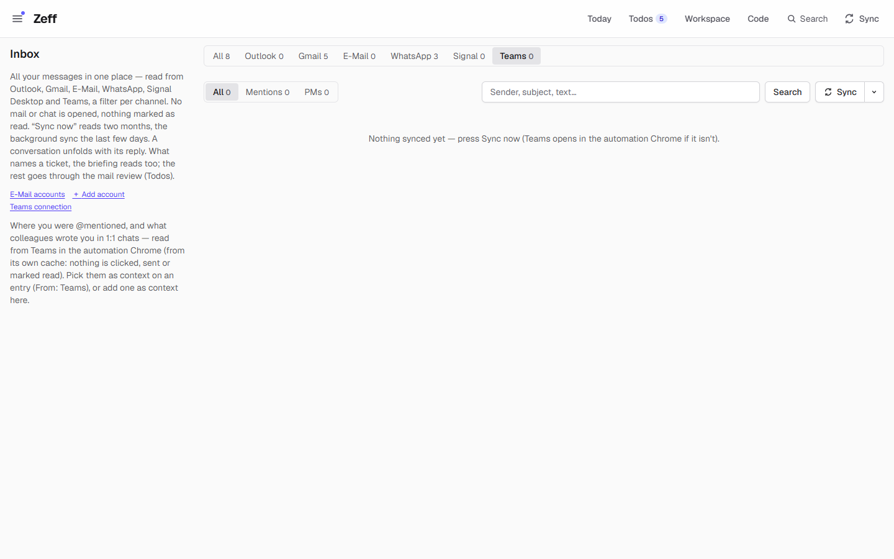
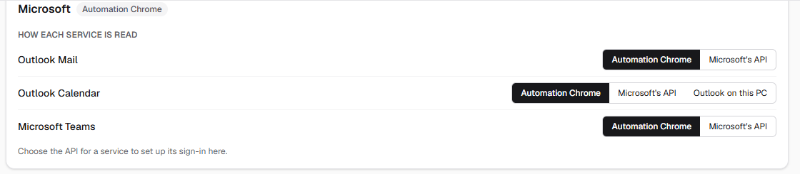
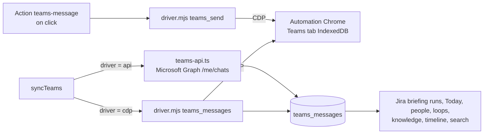

# Microsoft Teams

> Reads where you were @mentioned and what colleagues wrote you in Teams, as context for the briefing, your todos and time entries; sends a 1:1 Teams message when you click. **Category:** connector · **On by default:** yes · **Beta:** no · **Needs:** Teams Web signed in in the automation Chrome, or a Microsoft sign-in (Settings → Connections); works with [Mail client](mail-client.md), [Jira briefing](jira-lage.md), [Todos](todos.md), [Auto actions](auto-actions.md)

## For users

### What it does

At work, many requests come by Teams chat, not by mail: a tester asks a question on a ticket, a colleague @mentions
you in a channel. The Teams plugin keeps these messages in Zeff so they are not lost and can be used:

- The **Inbox** (`/mail`, filter **Teams**) lists them, with tabs **All**, **Mentions** and **PMs** (1:1 messages), a
  search box and **Sync**. Each message shows the sender, where it was written ("Team › Channel", a group chat's name,
  "Chat with …"), the text (shortened, *Show more*), an *unread* badge for unread mentions, **Open in Teams ↗**, and
  **Add as context** (keeps it as a context item with its link, to attach to time entries).
- The **briefing** (the [Jira briefing](jira-lage.md)) reads the Teams messages that name a ticket key into that
  ticket's analysis, and the todos it makes cite them.
- **Today** lists 1:1 chats waiting for your answer: one line per chat (not per message), while the last word in the
  last 3 days isn't yours.
- [People](people.md), [loops](loops.md) ("I owe you" / "you owe me"), the [knowledge](knowledge.md), the
  [timeline](timeline.md) and the search read them too.
- On a todo, the AI can suggest a short **Teams message** to a colleague (a question, a follow-up). It is sent only when
  you click.

Reading changes nothing in Teams: nothing is clicked, sent or marked as read. The demo has no Teams data, so the
screenshot shows the empty Teams filter.

### Getting started

Teams is on by default. You choose how Zeff reaches it on **Settings → Connections** (`/settings/connections`), card
**Microsoft**, row *Microsoft Teams*:

**Automation Chrome** (the default):

1. Start the automation Chrome (the separate Chrome profile Zeff uses for this account).
2. Under *Browser sign-ins*, press **Sign in** next to Teams. Teams Web comes to the front there; sign in yourself.
   Zeff never types credentials.
3. Press **Check**, then **Sync** in the inbox's Teams filter. A sync by hand may start Chrome and open Teams in a tab.

**Microsoft's API** (Microsoft Graph):

1. Pick *Microsoft's API* for Microsoft Teams. Set your own OAuth client on the card (client ID, secret, tenant) and
   sign in. One Microsoft sign-in serves Outlook and Teams.
2. Zeff asks for read rights only (`Chat.Read`, plus `User.Read`, `Mail.Read`, `Calendars.Read`, `offline_access`).
3. With the API, the sync runs in the background at any time, without Chrome. **Channel messages are not read this way**
   (they need an administrator's consent), so @mentions in channels are missed. Mentions in chats, 1:1 messages and
   chats are read.

Sending a message always goes through Teams Web in the automation Chrome, whichever way is chosen for reading.

### Using it

**Sync.** The sync reads your @mentions (Teams' Activity feed), what colleagues wrote you 1:1 in the last 90 days, and
the last 3 days of all your chats (yours too, group chats), so the briefing sees agreements in context. Press **Sync**
in the inbox, or use the Sync menu; it also runs by itself (see Settings).

**Add as context.** On a message, **Add as context** keeps it as a context item (from Teams, with its link and date).
You can then link it to time entries; the message gets a *✓ in Context* badge.

**Mark done.** A message marked done (by hand, or with the todo it led to) makes no new todos.

**Send a Teams message.** When a todo suggests *Send Teams message* (to a colleague by full display name, 1–3 sentences
with the ticket key), click **Send**. Zeff then:

1. finds the person in Teams' own profile cache (the name must be unique) and your 1:1 chat with them;
2. opens that chat in the automation Chrome (a new chat if there is none) and checks the window title names them;
3. stops without sending if the chat holds another draft;
4. types and sends the text;
5. notes on the todo "Teams message sent to … on …", with a link to the sent message. If the chat shows an
   out-of-office note, it is added.

### Settings

| Setting | Where | What it changes |
| --- | --- | --- |
| Plugin on/off | Menu → Plugins | Off: no sync, no Teams filter, no Teams suggestions; synced messages stay. |
| How Teams is read | Settings → Connections → Microsoft → *Microsoft Teams* | *Automation Chrome* or *Microsoft's API*. |
| Microsoft OAuth client, tenant, sign-in | Settings → Connections → Microsoft | Needed for the API. |
| Teams sync interval | Settings → Connections → *Sync settings* | 5, 10 (default), 15, 30 minutes … 24 hours, or manual only. With the Chrome: only while the automation Chrome runs; with the API: always. Never between 19:00 and 08:00. |

### Tips & limits

- **What leaves the machine:** with the Chrome way, nothing extra: Zeff reads Teams' local cache (IndexedDB) in the
  tab. With the API, Zeff calls Microsoft Graph with your token. Messages are kept in Zeff's database; the AI (your
  chosen [LLM](llm.md)) sees them in the briefing, todo suggestions, people and knowledge work.
- **Your employer's rules:** Teams is usually a work account. Check that reading it with a tool like this is allowed.
- The Chrome way needs Teams to have finished loading in its tab ("Teams hasn't stored its data in this tab yet" means
  wait and sync again). A background sync never starts the automation Chrome.
- When Teams wants you to sign in again, Zeff asks you (a sign-in prompt) and never signs in for you.
- Pictures in messages aren't shown; the message says how many there are and links to Teams.
- Sending only works with the Chrome way and for 1:1 chats, to a person whose display name Teams knows uniquely.

## Technical reference

### Overview

Two readers fill the same table:

- **Chrome driver** ([driver.mjs](../../src/plugins/teams/driver.mjs)): a stdio MCP server that attaches over CDP to
  the automation Chrome (`TEAMS_CDP_ENDPOINT`, else `CHRONO_CDP_ENDPOINT`, else the account's Chrome) and runs
  `readTeams` inside the Teams tab. It opens Teams' own IndexedDB databases (`activity-manager`, `replychain-manager`,
  `conversation-manager`) in read-only transactions, joins the Activity feed's mentions and the 1:1 chats with their
  messages and places, and builds "Open in Teams" deep links. No clicks, no requests, no token touched.
- **Graph reader** ([teams-api.ts](../../src/lib/microsoft/teams-api.ts)): `readTeams({ pmDays, chatDays })` lists
  `/me/chats` and each chat's messages (up to 10 pages of 50), classifying each as `mention`, `pm` or `chat`.

`syncTeams()` in [teams/sync.ts](../../src/lib/teams/sync.ts) picks the reader by `driverOf("teams")`, saves with
`saveTeamsMessages` and records the result in `teams_settings`. Sending is always the Chrome driver's `teams_send`.

### Manifest

| Field | Value |
| --- | --- |
| id | `teams` |
| category | `connector` |
| order / actionsOrder | 350 / 30 |
| defaultInstalled | `true` |
| requires | The automation Chrome with Teams Web, signed in, or Microsoft's API with your own sign-in |
| dependsOn | none |
| settings | `/settings/connections` (how it is reached) |
| apps | `/mail` (Inbox) |
| routes | `/teams` (redirects to `/mail?channel=teams`), `/mail` |
| syncSteps | `teams` |
| services | `teams` |
| features / extensions | none (its action `teams-message` is part of the plugin itself) |

### Files

| File | What it does |
| --- | --- |
| [plugin.ts](../../src/plugins/teams/plugin.ts) | The manifest. |
| [driver.mjs](../../src/plugins/teams/driver.mjs) | Stdio MCP server: `teams_status`, `teams_messages`, `teams_send`; in-page readers `readTeams`, `findPerson`, `findSent`. |
| [actions.ts](../../src/plugins/teams/actions.ts) | The `teams-message` action `{ to, body }` and its offer text for the AI. |
| [run.ts](../../src/plugins/teams/run.ts) | Runs it on a click: `teams_send`, keeps the sent message, notes it on the todo. |
| [server-actions.ts](../../src/plugins/teams/server-actions.ts) | `syncTeamsAction`, `findTeamsMessagesAction` (links → messages), `searchTeamsMessagesAction` (the context form's picker), `setTeamsResolvedAction`. |
| [sync-settings.ts](../../src/plugins/teams/sync-settings.ts) | Its row in the sync settings (wording depends on the driver). |
| [lib/teams/sync.ts](../../src/lib/teams/sync.ts) | `syncTeams`: 90 days of PMs, 3 days of chats, one sync at a time, sign-in prompts. |
| [lib/teams/store.ts](../../src/lib/teams/store.ts) | Save, list, search, counts, `teamsChatsWaiting`. |
| [lib/teams/shared.ts](../../src/lib/teams/shared.ts) | `TeamsKind`, `TeamsMessageView`, link keys (client-safe). |
| [lib/microsoft/teams-api.ts](../../src/lib/microsoft/teams-api.ts) | The Graph reader. |
| [TeamsMessageList.tsx](../../src/components/TeamsMessageList.tsx) | The message list in the inbox (Open in Teams, Add as context). |

### Data

**`teams_messages`** ([schema.ts](../../src/db/schema.ts)):

| Column | Meaning |
| --- | --- |
| `key` | `<conversationId>\|<messageId>` |
| `kind` | `mention`, `pm` (a colleague's 1:1 message) or `chat` (other recent chat messages, yours too) |
| `mention_type` | For mentions: person, tag, team, channel, everyone (Graph: person or chat) |
| `conversation_id`, `reply_chain_id`, `message_id` | Teams' ids |
| `place` | "Team › Channel", a group chat's name, "Chat with …" |
| `sender_name`, `sender_id`, `sent_at`, `subject` | As Teams has them |
| `html`, `text` | The message as Teams stores it (shown converted to Markdown) and plain text for search |
| `link` | "Open in Teams" deep link |
| `is_read` | Whether Teams has the mention as read |
| `synced_at`, `resolved_at` | Last sync; marked done (kept across syncs) |

**`teams_settings`**: `sync_minutes` (default 10), `last_sync_at`, `last_result` ("12 new · 140 in all" or why not),
`last_ok`. **`connectors`** rows `teams` (driver) and `microsoft` (OAuth client and tokens), see
[connectors/store.ts](../../src/lib/connectors/store.ts).

### Sync, jobs & AI tasks

- **Step `teams`** (registry entry in [sync/registry.ts](../../src/lib/sync/registry.ts), `ownRecord`): runs
  `syncTeams()`. The scheduler ([sync-scheduler.ts](../../src/lib/sync-scheduler.ts)) calls `syncTeams({ background:
  true })` every `sync_minutes`; with the Chrome driver it skips quietly ("later") when Chrome isn't running. After a
  successful step the registry runs the workspace pipelines, closes reply todos your answers settled
  (`closeTodosByEvidence`) and indexes the timeline.
- **AI:** no task of its own. The `teams-message` offer (German, like all prompts) asks for a short question, request or
  follow-up by Teams chat with the ticket key, not when the person is away or has already answered. Teams messages
  containing a ticket key are put into that ticket's run context ([runs/collect.ts](../../src/lib/runs/collect.ts),
  cited as `[teams:<key>]`).

### MCP tools & actions

**Driver tools** (stdio):

| Tool | What it does |
| --- | --- |
| `teams_status` | Chrome reachable, Teams open and signed in. |
| `teams_messages {pmDays, chatDays, openIfMissing, launch}` | Mentions, 1:1 messages of the last `pmDays`, chat messages of the last `chatDays`; JSON `{ tenantId, userId, messages, unresolved }`. |
| `teams_send {to, text, dryRun}` | A 1:1 message by display name; `dryRun` only opens and checks the chat. The only writing tool, called only on your click. |

**Action:** `teams-message` `{ to, body }` (*Send Teams message*, `comms: true`). It is also the write channel `teams`
of Workspace message inboxes ([capabilities.ts](../../src/plugins/workspace/capabilities.ts)).

Zeff's own MCP server has no Teams-specific tool; agents reach Teams messages through `search_context` and the other
context tools (the context index includes `teams_messages`).

### Extension points

- Brings the `teams` sync step and its sync-settings row; the `teams` service in the sign-in list
  ([logins.ts](../../src/lib/logins.ts)).
- A channel of the [Mail client](mail-client.md) inbox and a write channel for [Workspace](workspace.md) inboxes.
- A source for the context index, data boundaries, source health, [people](people.md), [loops](loops.md),
  [correlations](correlations.md), the knowledge export and work/ticket briefs.

### Tests

| Test | Covers |
| --- | --- |
| [teams-waiting.test.ts](../../tests/teams-waiting.test.ts) | A Teams chat waits for you once, not per message, and not after your answer. |
| [microsoft-api-driver.test.ts](../../tests/microsoft-api-driver.test.ts) | Teams via Graph saves the mention, the 1:1 message and the chat's own messages. |

Run one: `node --import tsx --test tests/teams-waiting.test.ts`.
