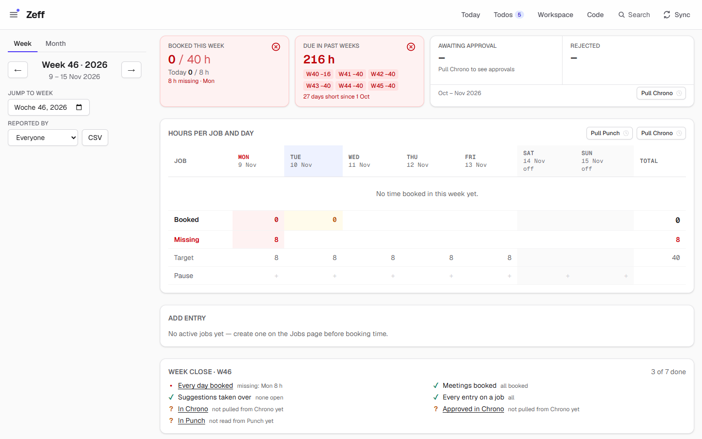
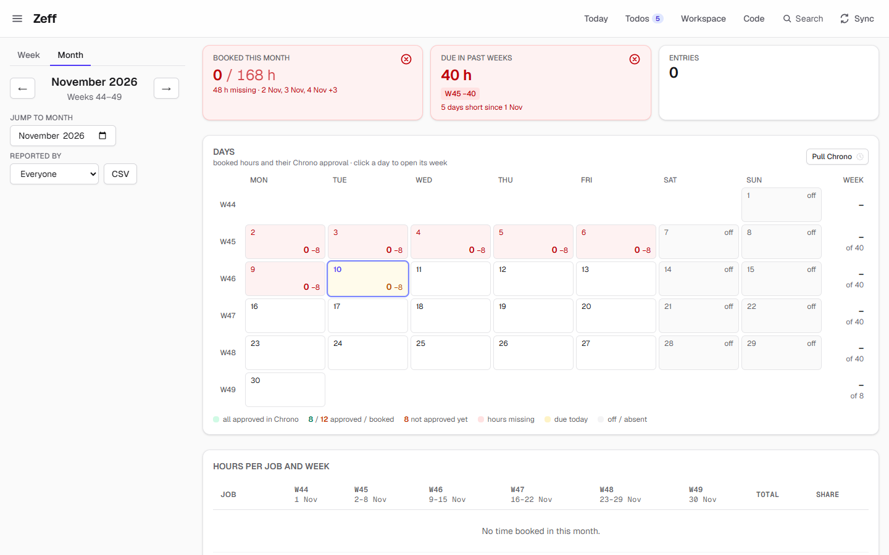
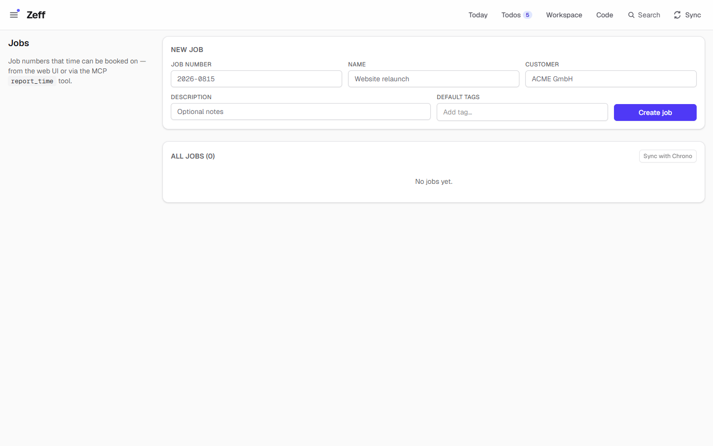
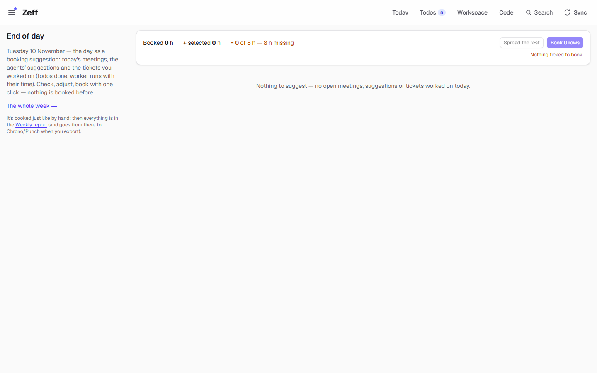
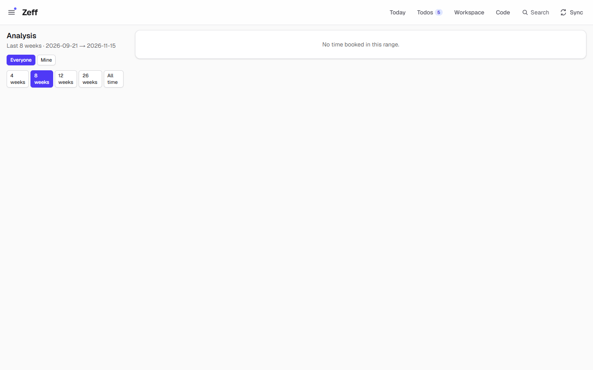
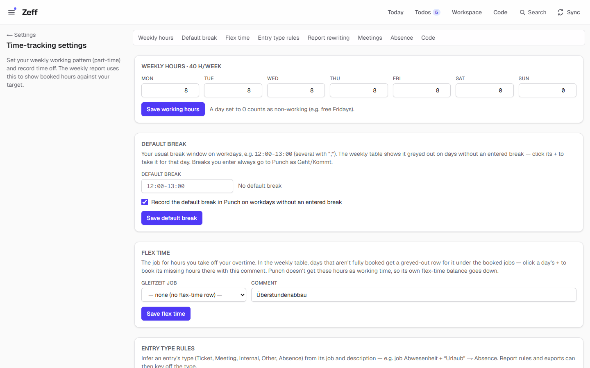
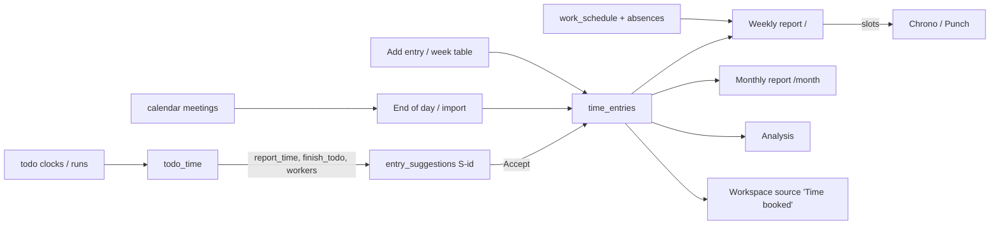

# Time tracking

> Book your working time on jobs and projects, against your working hours and absences — with the Weekly report and the Monthly report as its parts. **Category:** app · **On by default:** yes · **Beta:** no · **Needs:** nothing (the time-sheet systems [Chrono and Punch](timesheets.md) build on it)

*The demo data has mails, chats, todos and a workspace but no jobs or bookings yet — so the screenshots show the empty
week: 0 of 40 h booked, Monday 8 h missing, “No active jobs yet” in the entry form, and the week close 3 of 7 done.*

## For users

### What it does

Time tracking is the part of Zeff that books hours. Every entry is a number of hours on a **job** (a job number such as
`2026-0815`) for a day, with one line of what was done, an optional ticket key (`PROJ-337`), a type (Ticket, Meeting,
Internal, Other, Absence …) and tags. Zeff measures these hours against your **schedule** — how many hours each weekday
should have, minus vacation, sick days and holidays — and tells you what is still missing.

It is made of three plugins that switch on and off independently:

| Plugin | Id | What it brings |
| --- | --- | --- |
| **Time tracking** | `zeiterfassung` | Jobs, Projects, Schedule (working hours, breaks, flex time, absences, rules), Analysis, End of day |
| **Weekly report** | `weekly-report` (part of Time tracking) | The home page `/`: the week with hours per job and day, the entry form, suggestions, “Done today”, the week's close and the report text |
| **Monthly report** | `monthly-report` (part of Time tracking) | `/month`: the month as a calendar and per job, with what's booked, missing and approved |

The hours do not have to be typed in. Most come from elsewhere in Zeff and only wait for your click:

- **Agents and workers** working on your [todos](todos.md) measure their time with clocks; when they report it, it becomes
  a **suggested entry** (S-12) — a grey shadow row in the Weekly report that you accept or skip. See [Code](work.md).
- **Done today** collects the todos you ticked off today and the time measured on todos today, grouped by ticket.
- **Meetings** from the calendar can be imported as entries (with rules that pick their job).
- **End of day** (`/feierabend`) drafts the whole day — meetings, suggestions, tickets you worked on — as one list to book.

At the end of the week the **week's close** lists what is still open (days not fully booked, meetings, suggestions,
entries without a job, and — with [Chrono/Punch](timesheets.md) installed — what is not yet in those systems or not yet approved).

### Getting started

1. Time tracking, the Weekly report and the Monthly report are installed by default. If they are missing, open
   **Menu → Plugins** (`/plugins`) and switch on *Time tracking* (the two reports are its parts).
2. Open **Menu → Jobs** (`/jobs`) and create the job numbers you book on (number, name, customer). Without an active job
   the entry form says “No active jobs yet — create one on the Jobs page before booking time.”
3. Open **Menu → Schedule** (`/settings/time`) and set your weekly hours (part-time: lower or zero a weekday), your usual
   break and, if you use one, the flex-time job.
4. Book: the **Report** entry of the menu (`/`) is the week; the toggle in its corner switches to the month.

The menu entries it adds: *Jobs*, *Projects*, *Schedule*, *Analysis*, *End of day* (Time tracking) and *Report* (the
Weekly report — or, without it, the Monthly report).

### Using it

#### The week (`/`)

The page is built top to bottom:

- **Cards.** *Booked this week* shows the hours against the week's target, with one colored bar per day (green: reached,
  amber: short, red: missing) and today's hours when the week holds today. *Due in past weeks* shows hours left unbooked in
  the weeks before, since the start of last month, with a chip per week (`W45 −40`). Chrono adds an *Awaiting approval / Rejected* card when it is installed.
- **Hours per job and day** — the week table: one row per job, one column per day, totals, the *Target*, *Booked* and
  *Missing* rows, and a **Pause** row for the day's breaks. Click a cell to change its hours. Days without an entered
  break show your default break greyed out; its **+** takes it for that day. If a flex-time job is set, days that are not
  fully booked get a greyed-out row for it; a day's **+** books the missing hours there.
- **Add entry** — date, job or project (*Book on*), hours, start time (optional), type, ticket, the report line, tags, a
  comment of your own (kept beside the entry, never part of what is booked) and context (Teams messages, merge requests, a
  note). *Group entry* makes an entry that collects the day's work (a mob-programming day): work that runs parallel to it
  is itemized under it instead of being booked on top.
- **Week close · W46** — every step of closing the week with its state (done / open / not known / not due yet) and a link
  to where it is done. “✓ Week closed” when all are done.
- **Suggested entries** — what agents reported, not booked yet. Each row shows hours, line, ticket, job and who reported it,
  with its **evidence** (the todos, runs and time records behind it). Adjust the hours by a quarter hour, edit the line,
  then *Accept* (it becomes a real entry, with the evidence attached as context) or *Dismiss*.
- **Done today** — todos ticked off today and todo time tracked today, by ticket. Adjust and *Add*, or *Skip*.
- **Parallel work** — tasks done at the same time but booked on top of each other (“5 h booked, but the stretch is 3 h”).
  Book the stretch once: *combine* (one spanning entry), *divide* (the stretch's hours shared) or *sequential* (each its
  full hours).
- **Report · week 46** — the week rewritten for output: grouped per day by ticket, type or tag, meetings collapsed into one
  line — following your report rules. Copy it as text; Chrono/Punch put their *Export to …* links here.
- **Entries in week 46** — every entry as a table, collapsible.

The side column holds the **Week / Month** toggle, the arrows and *Jump to week*, the *Reported by* filter (everyone, or
one reporter — an agent's or a person's name) and **CSV** (the week's entries as a file). In the URL: `?week=2026-W46`,
`?by=<name>`.

#### The month (`/month`)

The month as a **calendar** of booked hours (click a day to open its week; with Chrono, each day's approved hours too),
**Hours per job and week**, *Hours by type* and *Hours by tag*, the month's report per job (“What each job's time went to,
named by your report rules”, with *Copy report*) and all entries of the month.

#### Jobs and projects

**Jobs** (`/jobs`) are the job numbers time is booked on. *New job* takes a number, name, customer, description and
**default tags** (added to every entry booked on the job). The list shows each job's customer, total hours and entries; deactivate a closed one
(it disappears from the pickers, its entries stay). A job's own page (`/jobs/<id>`) lists its entries. With Chrono installed,
a *Sync with Chrono* button and a Chrono column show whether Chrono's job search knows each number.

**Projects** (`/projects`) group work under a name (e.g. “TYPO3 Training”) and book it on the project's job. The job is
optional: entries of a project without one sit on the built-in **No job yet** placeholder until it is set, and move along
whenever the project's job changes. Entries on *No job yet* are never exported.

#### End of day (`/feierabend`)

*In the demo nothing is booked yet and no meeting, suggestion or worked ticket is open today, so the page shows only its totals bar and the empty state.*

The day drafted for booking: today's finished meetings not booked yet (with their job by your meeting rules), the agents'
open suggestions for the day, and the tickets you worked on (todos done, worker runs with their time, or — without
measured time — an estimate from your commits' span, marked as such). Tick, adjust, and book with one click; nothing is
booked before. *The whole week →* (`/feierabend?week=current`) does the same for each day of the week.

#### Analysis (`/analysis`)

*The demo has no booked time, so the charts are empty here; with bookings the panel on the right fills with the charts below.*

Charts over the last 4, 8, 12 or 26 weeks or all time: total booked, meetings and meetings per day, distinct tickets,
average per active week, the time split by type, hours by job and by tag, weekly hours and tickets worked/closed. With
[Jira](jira.md) synced, ticket metrics (open, done, closed in range, average reaction and resolution time, parallel
tickets) — for everyone's tickets or only those you booked time on.

### Settings

All on **Schedule** (`/settings/time`), one section each:

| Section | Setting | What it changes |
| --- | --- | --- |
| Weekly hours | Hours per weekday (Mon–Sun; default 8 h Mon–Fri) | Each day's target; part-time by lowering or zeroing a weekday |
| Default break | Window(s), e.g. `12:00-13:00` (several with `;`) | Shown greyed out on days without an entered break; with Punch: whether it is recorded there on such days |
| Flex time | Job and comment (default “Überstundenabbau”) | The greyed-out flex row in the week table; its **+** books a day's missing hours on that job. Punch does not get them as working time |
| Entry type rules | Job + words in the description → type | Infers an entry's type (e.g. job *Abwesenheit* + “Urlaub” → Absence) |
| Report rewriting | Rules: condition on an entry → output label (and tags) | How the *Report* view and the Chrono export group and name lines; group by ticket, type or tag; collapse meetings per day |
| Meetings (only with [Outlook calendar](outlook.md)) | Meeting → job rules, default job, exclude rules | Which job an imported meeting gets; which meetings start unticked |
| Absence | From, to, type (vacation, sick, holiday, other), hours per day (empty: full day), note; optionally repeated weekly until a date | Lowers the days' targets; Chrono and Punch book vacation days themselves |
| Code (only with [Code](work.md)) | Sessions and workers | See [Code](work.md) |

Elsewhere: **Settings → General** (`/preferences#parallel`) sets the default mode for parallel work (combine / divide /
sequential), used when Zeff groups work that ran at the same time; `/preferences#touch` can make real exports to
Chrono/Punch wait for a security-key touch.

### Tips & limits

- **Only measured time is suggested.** Agents never type hours: their suggestions are built from todo clocks and run logs
  (see the MCP tools below). A suggestion with no evidence says so (“No evidence — only the agent's word.”).
- Correcting an agent's suggestion through the MCP can only **lower** its hours; booked entries are yours and cannot be
  changed by agents at all.
- Nothing leaves the machine from Time tracking itself. The AI sees your entries only where you use it (e.g. agents
  calling `get_weekly_report`, the Workspace's AI on the “Time booked” source). Exports to Chrono/Punch happen only on your click.
- A week's CSV: `/api/report?week=2026-W46` or `?month=2026-11` (`&by=` to filter).
- The “Past weeks” card looks back only to the start of last month.

## Technical reference

### Overview

The plugin folder is small: the time-tracking logic is Zeff's core and lives in `src/lib` and `src/app`. The manifest
gives the plugins their places (menu entries, routes, the two report features); the pages check `isInstalled(...)` and
show `PluginNotInstalled` (or redirect home to the first app tab) when a part is off.

An entry is a row of `time_entries`. Reading goes through `lib/entries.ts` (`listEntries`, `listBookedEntries` — booked
view, grouped parallel work counted once — `getWeeklyReport`), targets through `lib/schedule.ts` (weekly pattern minus
absences → `getWeekTargets` / `getDayTargets`), and the output text through `lib/report.ts` (report rules → `RewrittenReport`).
Parallel work is modelled by **spans** (`entry_spans`, `lib/entry-spans.ts`, `lib/entry-parallel.ts`): each task keeps
its real hours (`worked_hours`) and start; the span's mode decides the booked `hours`.

Suggestions come from the work side: todo clocks write `todo_time` records; `report_time` / `finish_todo` (MCP) and the
workers turn them into `entry_suggestions` rows (`lib/work/suggestions.ts`), which the Weekly report shows and
`acceptSuggestion` turns into entries with the todos' context attached.

The time-sheet systems are **mounted integrations** ([timesheets.md](timesheets.md)) and plug into the week, month, jobs
page and week close through slots (`lib/integrations/slots.ts`).

### Manifest

| Field | Time tracking | Weekly report (feature) | Monthly report (feature) |
| --- | --- | --- | --- |
| id | `zeiterfassung` | `weekly-report` | `monthly-report` |
| category | app | (part of Time tracking) | (part of Time tracking) |
| order | 10 | 20 | 30 |
| defaultInstalled | yes | yes | yes |
| dependsOn | — | — | — |
| settings | `/settings/time` — “Working hours, absences, rules for meetings and reports” | — | — |
| nav | Jobs `/jobs`, Projects `/projects`, Schedule `/settings/time`, Analysis `/analysis`, End of day `/feierabend` | — | — |
| apps | — | Report `/` | Report `/month` (only without `weekly-report`) |
| routes | `/jobs`, `/projects`, `/settings/time`, `/analysis`, `/feierabend` | `/` | `/month` |
| syncSteps | none | none | none |

The two reports were plugins of their own and keep their ids (and what was set for them) as features.

### Files

| File | What it holds |
| --- | --- |
| [plugin.ts](../../src/plugins/zeiterfassung/plugin.ts) | The manifest, with the two report features |
| [server.ts](../../src/plugins/zeiterfassung/server.ts) | Contributes the Workspace source and the review-queue link “Suggested entries” |
| [workspace-source.ts](../../src/plugins/zeiterfassung/workspace-source.ts) | The “Time booked” Workspace source: one record per booked entry |
| [src/app/page.tsx](../../src/app/page.tsx) | The Weekly report |
| [src/app/month/page.tsx](../../src/app/month/page.tsx) | The Monthly report |
| [src/app/jobs/](../../src/app/jobs/page.tsx), [src/app/projects/](../../src/app/projects/page.tsx) | Jobs and projects, with detail pages |
| [src/app/settings/time/page.tsx](../../src/app/settings/time/page.tsx) | Schedule and rules |
| [src/app/analysis/page.tsx](../../src/app/analysis/page.tsx) | Analysis charts |
| [src/app/feierabend/page.tsx](../../src/app/feierabend/page.tsx) | End of day / the week to book |
| [src/app/entries/[id]/page.tsx](../../src/app/entries/[id]/page.tsx) | One entry with its context |
| [src/app/actions/](../../src/app/actions/entries.ts) | Server actions: `entries.ts`, `jobs.ts`, `projects.ts`, `schedule.ts`, `report-settings.ts`, `booking.ts` |
| [src/lib/entries.ts](../../src/lib/entries.ts) | Create, update, delete, list entries; the weekly report data |
| [src/lib/schedule.ts](../../src/lib/schedule.ts) | Weekly pattern, default breaks, flex time, absences, day/week targets |
| [src/lib/report.ts](../../src/lib/report.ts) | Report rules and settings, the rewritten report, job summaries, meeting rules |
| [src/lib/entry-spans.ts](../../src/lib/entry-spans.ts), [src/lib/entry-parallel.ts](../../src/lib/entry-parallel.ts) | Parallel work: spans and their modes, detection, auto-grouping |
| [src/lib/week-close.ts](../../src/lib/week-close.ts) | The week's close checklist |
| [src/lib/feierabend.ts](../../src/lib/feierabend.ts) | End of day: `proposeDay`, `proposeWeek` |
| [src/lib/flex-time.ts](../../src/lib/flex-time.ts) | Booking missing hours on the flex-time job |
| [src/lib/monthly.ts](../../src/lib/monthly.ts), [src/lib/month.ts](../../src/lib/month.ts) | Month report data, past weeks due |
| [src/lib/analysis.ts](../../src/lib/analysis.ts) | Analysis aggregates (with Jira metrics) |
| [src/lib/jobs.ts](../../src/lib/jobs.ts), [src/lib/projects.ts](../../src/lib/projects.ts) | Jobs (incl. the *No job yet* placeholder), projects |
| [src/lib/entry-types.ts](../../src/lib/entry-types.ts), [src/lib/type-rules.ts](../../src/lib/type-rules.ts) | Entry types and type rules |
| [src/lib/pauses.ts](../../src/lib/pauses.ts), [src/lib/day-status.ts](../../src/lib/day-status.ts) | Breaks per day; a day's shortfall state |
| [src/lib/work/suggestions.ts](../../src/lib/work/suggestions.ts), [src/lib/work/booking.ts](../../src/lib/work/booking.ts) | Suggested entries; “Done today” |
| [src/mcp/tools/time.ts](../../src/mcp/tools/time.ts) | The time MCP tools |
| [src/app/api/report/route.ts](../../src/app/api/report/route.ts) | CSV export of a week or month |

### Data

From [src/db/schema.ts](../../src/db/schema.ts):

| Table | What it keeps |
| --- | --- |
| `jobs` | `number` (unique), `name`, `customer`, `description`, `active`; Chrono lookup columns (`chrono_found`, `chrono_name`, `chrono_client`, `chrono_checked_at`) |
| `projects` | `title`, `description`, `customer`, `job_id` (optional), `start_date`/`end_date`, `active` |
| `time_entries` | `job_id`, `project_id`, `date`, `hours`, `description`, `comment` (own note, not booked), `type`, `ticket`, `reported_by`, `source` (`mcp`/`web`/`calendar`), `start` (HH:MM), `is_group`/`group_kind`, `span_id`, `worked_hours`, `external_id` (calendar event — no double imports) |
| `entry_spans` | Parallel work: `date`, `mode` (combine, divide, sequential, collect, remainder), `head_id`, `head_auto` |
| `work_schedule` | One row: hours `mon`…`sun`, `default_pauses`, `punch_default_pauses`, `flex_job_number`, `flex_comment` |
| `absences` | `start_date`, `end_date`, `type` (vacation, sick, holiday, other), `hours` per day (null: whole day), `note` |
| `pauses` | Breaks entered for a day: `date`, `start`, `end` |
| `entry_types` | `key`, `label`, `color`, `sort` (built-in keys ticket, meeting, other, absence, internal can't be deleted) |
| `tags`, `entry_tags`, `job_tags`, `project_tags`, `ticket_tags` | Tags and the default tags of jobs, projects and tickets |
| `entry_contexts` | Which context items (messages, MRs, notes) back which entries, in order |
| `report_settings` | One row: `group_by`, meeting grouping, `ticket_template`, `rules` (JSON), meeting job/exclude rules, `type_rules`; also Chrono's `chrono_workcodes` and Punch's `punch_config` |
| `entry_suggestions` | Suggested entries: `date`, `hours`, `description`, `ticket`, `job_number`/`project_id`, `type`, `tags`, `reported_by`, `todo_ids`, `run_ids`, `time_ids`, `status` (open/accepted/skipped), `entry_id` |
| `todo_time` | Time measured on todos (owned by [Todos](todos.md)/[Code](work.md)); `suggestion_id` and `entry_id` link it to what it became |

Prefs: the default parallel mode (`lib/entry-parallel.ts`); open/closed state of collapsible sections (`ui-state`).

### Sync, jobs & AI tasks

No sync steps and no LLM tasks of its own. `openSuggestions()` creates suggestions for your open todos due today (with a
ticket) each time the week is shown (`suggestDueTodos`). Report rules, type rules and meeting rules are re-applied to
existing entries when they are saved (`applyReportRuleTagsToEntries`, `applyTypeRulesToEntries`, `reapplyMeetingJobRules`).

### MCP tools & actions

MCP tools in [src/mcp/tools/time.ts](../../src/mcp/tools/time.ts) (served at `/api/mcp`):

| Tool | What it does |
| --- | --- |
| `report_time` | Suggest one booking of the time **measured** on the named todos (no hours given) → `S-<id>` |
| `list_jobs` | Job numbers with hours booked; search, include inactive |
| `list_projects` | Projects with their jobs |
| `create_job` | Create a job number |
| `get_weekly_report` | Hours per job and weekday for an ISO week, plus its entries |
| `list_time_entries` | Booked entries, newest first, with filters |
| `update_time_entry` | Correct an open suggestion (hours can only go down) |
| `delete_time_entry` | Withdraw an open suggestion |

The todo clock tools (`todo_clock_start/stop/ping`, `todo_time`, `finish_todo` …) that feed suggestions belong to
[Todos](todos.md) and [Code](work.md).

Server actions (no public API): entries (`createEntryAction`, `updateEntryAction`, `updateEntryHoursAction`,
`deleteEntryAction`, `copyEntryAction`, `setPausesAction`, `setTicketTagsAction`), jobs, projects (incl.
`bookProjectDaysAction`), schedule (`saveScheduleAction`, `saveDefaultPausesAction`, `saveFlexTimeAction`,
`bookFlexTimeAction`, `createAbsenceAction`, `deleteAbsenceAction`), report settings, and booking (`bookDayAction`,
`undoBookDayAction`, `acceptSuggestionAction`, `skipSuggestionAction`, `bookDoneTodayAction`).

API route: `GET /api/report?week=…|month=…[&by=…]` — CSV (date, job number/name, customer, hours, description, ticket,
reported by, source, project).

No todo actions (`actions.ts`).

### Extension points

Contributes (in [server.ts](../../src/plugins/zeiterfassung/server.ts)):

- **Workspace sources** (`workspaceSources`, owned by [Workspace](workspace.md)): `time` — “Time booked”, read-only and
  relation-only, columns Date, Hours, Ticket, Job, Project, Type, Reported by. A tickets/projects/jobs database adds it up
  with a matching relation and a rollup.
- **Review links** (`reviewLinks`, `lib/review/point`): “Suggested entries” under `weekly-report`, counting open suggestions
  and linking to `/#suggestions`.

Provides (for the time-sheet integrations, defined in `src/lib/integrations/types.ts`): the **week slot** (card, actions,
exports, entry/cell/day marks), **month slot** (approvals per day, pull), **jobs slot** (toolbar, column) and **week close**
items. See [timesheets.md](timesheets.md).

### Tests

| Test | Covers |
| --- | --- |
| [tests/report.test.ts](../../tests/report.test.ts) | Report rewriting |
| [tests/entry-spans.test.ts](../../tests/entry-spans.test.ts) | Parallel work, span modes |
| [tests/entry-comment.test.ts](../../tests/entry-comment.test.ts) | An entry's own comment |
| [tests/entry-timeline.test.ts](../../tests/entry-timeline.test.ts) | Entries on the timeline |
| [tests/week-close.test.ts](../../tests/week-close.test.ts) | The week's close |
| [tests/feierabend.test.ts](../../tests/feierabend.test.ts), [tests/week-proposal.test.ts](../../tests/week-proposal.test.ts) | End of day and the week to book |
| [tests/todo-time.test.ts](../../tests/todo-time.test.ts), [tests/suggest-due-todos.test.ts](../../tests/suggest-due-todos.test.ts) | Measured time → suggestions |
| [tests/workspace-time-source.test.ts](../../tests/workspace-time-source.test.ts) | The “Time booked” Workspace source |
| [tests/review-point.test.ts](../../tests/review-point.test.ts) | The review-queue link |
| [e2e/absences.e2e.mjs](../../e2e/absences.e2e.mjs) | Weekly absences on the Schedule page |

Run one: `node --import tsx --test tests/week-close.test.ts`. The e2e suite: `npm run e2e`.
