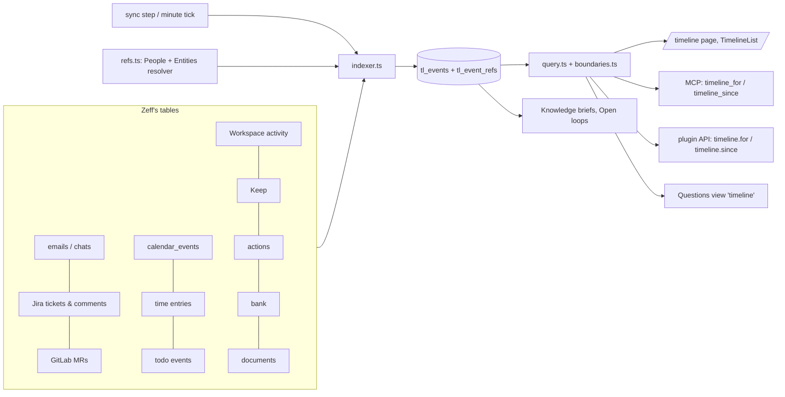

# Timeline

> One log of what happened across all your sources (mails, chats, tickets, appointments, time, todos, Workspace rows, payments, documents), each event tied to the people, tickets, pages and projects it concerns. **Category:** app · **On by default:** yes · **Beta:** no · **Needs:** nothing. It gets richer with [People](people.md), [Organisations, projects & places](entities.md), [Workspace](workspace.md) and [Finances](finances.md).

## For users

### What it does

Your day happens in a dozen places: Jonas asks about the barbecue on WhatsApp, Lena mails about the slides, a ticket moves to
Done, you tick off a todo, a payment comes in. Each of those already sits in Zeff, but in its own list. The Timeline puts
them on **one time axis**, newest first, grouped by day ("Today", "Yesterday", then the date), and records for each event
*who and what it concerns*. That gives you two questions you can answer in a second:

- **What happened with X?** Everything with Jonas, with ticket `PROJ-7`, with a Workspace page or a project, across all
  channels, in one list.
- **What changed since I last looked?** A line in the list marks where your last visit was, and the side panel lists the
  people, tickets and pages with the most going on since then.

The Timeline is filled **by rules, without AI**: after every sync, and every minute in the background, Zeff reads what is
new in each source and records it. It costs nothing to run and never sends anything anywhere.

### Getting started

The Timeline is on by default. If it was switched off: **Menu → Plugins → Timeline**. It needs no account or key; it reads
what your other extensions have already synced.

Where it shows up:

- **The Timeline page** (`/timeline`, under *Apps* in the menu: "What happened, and with whom").
- **On a person's page** ([People](people.md)) and on a case's row ([Cases](cases.md)), as a "Timeline" section.
- **As a module of a Workspace row's detail view**, showing the row's own changes and what concerns the person, case or ticket it stands for.
- **As a block on any Workspace page**: type `/timeline` in a page (also found as "Zeitleiste", "history", "what happened").
- **For AI agents** over MCP (`timeline_for`, `timeline_since`), for structured questions ("When did I last talk to Jonas?"),
  and in the briefs of [Knowledge](knowledge.md).

On a fresh installation the page says "Nothing yet — what happens shows up here after the next sync." The first runs read
every source from its beginning, a few batches per run, so a large mailbox fills in over a few minutes.

### Using it

**Browse everything.** Open the Timeline. Each event has its kind's sign (✉️ mail, 💬 message, 🎫 ticket, 📅 appointment,
⏱️ time booked, ☑️ todo done, ✏️ row changed, 💶 payment …), its time, its title (a link to where it is: in Zeff, or in its
source in a new tab), a short summary and chips for the other people and things it concerns. **Show more** loads older
events.

**Filter.** The first row of chips filters by kind (Mails, Messages, Tickets, Comments, Merge requests, Appointments, Time,
Todos, Workspace rows, Pages, Notes, Actions, Payments, Documents); the second by source (Mail, WhatsApp, Signal, Teams,
Jira, GitLab, Calendar, Time entries, Todos, Workspace, Pages, Keep, Actions, Bank, Documents). Several chips combine. The
filters can be put in the address too: `/timeline?kind=mail,message&source=whatsapp`.

**About one person or thing.** Type into **About** a person's name or alias ("Jonas"), a ticket key, a project, or a page
title, and press **Show**. The name is resolved to one entity (shown under the box, with an **all** link back); if nothing
matches, the page says "Nothing known by …". Refs work too: `person:12`, `ticket:PROJ-7`, `page:31`.

**What's new.** On the left, *Since your last visit* (or *The last 7 days* on a first visit) lists the entities with the most
events since then, each with a count; click one to see its timeline. In the list, a line marks where your last visit was.
The visit is counted a few seconds after the list is shown, so the line stays put while you read.

**On a page.** Insert the block with `/timeline`. Leave the field empty for the page's own timeline (for a row: the row, and
the person or case it stands for), or type a name, a ref, or `all`. The block is read when the page is shown and is never
stored in the page.

**Health note.** When a source the timeline reads is stale, silent or failing (source health from the Sync menu), an amber
line under the count says so: "WhatsApp (stale) — the timeline may miss what they brought lately."

### Settings

The Timeline has no settings page of its own.

| Where | What it changes |
| --- | --- |
| Menu → Plugins → Timeline | On or off. Off: the page shows "not installed", the sections on person and case pages disappear, the MCP tools answer that the plugin isn't installed, and the indexer stops. |
| Sensitivity of sources and databases (see [Workspace](workspace.md) and the data boundaries) | What the timeline shows: events from a **secret** source or database are shown to nobody, not even you; **personal** ones only to you and to agents whose routine may read personal data. WhatsApp, Signal and the bank are personal by default. |

### Tips & limits

- **Nothing leaves your machine.** The indexer is plain rules over Zeff's own database; no AI reads your events to build it.
  Agents only see the timeline when they call its MCP tools, and then only what their clearance allows.
- **Who an event concerns is matched by rule:** a person by mail address, name, alias, chat name, phone number or Jira user;
  ticket keys found in the text (only for projects Zeff knows, and not lookalikes like `ISO-9001` or `UTF-8`); organisations
  by mail domain (never freemail), places by an appointment's location, projects by ticket. A person mentioned only by a
  nickname Zeff doesn't know isn't linked; add the alias on their People page.
- **Events are small**: a title (200 characters), a summary (400) and a link. The source stays the truth; opening an event
  takes you there.
- **Each event is recorded once** per source and id, so re-running the indexer changes nothing. A day's edits to one
  Workspace row are gathered into one "Row changed" event.
- **Only what Zeff has synced appears.** A mail account that isn't connected, or a chat that wasn't read, has no events.
- The timeline does not delete events when their source is deleted.

## Technical reference

### Overview

The Timeline is a small event store (`tl_*` tables) and an **indexer** that fills it from the tables the syncs and Zeff
itself keep. Each source has a reader that turns new rows into events and remembers how far it read (a mark: a time and
key, or an id) in `tl_marks`. A run reads at most 4 batches of 500 rows per source; a source read for the first time is
backfilled over several runs. `recordEvent` is idempotent per `(source, source_ref)`; with `merge` an existing event takes
the new title, summary, time and data (used for a day's row changes, Keep notes and documents).

The **refs** (`person:12`, `ticket:PROJ-7`, `page:31`, `project:3`, `org:…`, `place:…`, `todo:88`, `job:…`, `doc:…`) are
found by rule in `refs.ts`, using the People plugin's one person resolver and the Entities plugin's organisations, places
and projects (none without it). Readers ask the store **by entity** (`eventsFor`), **by time** (`eventsBetween`) or
**grouped by entity since a time** (`changesSince`). Every reader filters events through the **data boundaries**
(`boundaries.ts`): an event's label comes from its source (a mail from its account, a row change from its database's
sensitivity, a payment also from the case row it was matched to), and `visibleEvents` pages on until enough visible events
are found, so hidden events don't shorten the list.

### Manifest

| Field | Value |
| --- | --- |
| id | `timeline` |
| category | `app` |
| order | 172 |
| defaultInstalled | `true` |
| dependsOn | none |
| apps | `/timeline` — "Timeline", hint "What happened, and with whom" |
| routes | `/timeline` |
| settings | none |
| syncSteps | none of its own (the indexer runs after the sync steps and on the scheduler's minute tick) |
| features / extensions | none |

### Files

| File | What it does |
| --- | --- |
| [plugin.ts](../../src/plugins/timeline/plugin.ts) | The manifest. |
| [store.ts](../../src/plugins/timeline/store.ts) | The tables, `recordEvent`, `eventsFor`, `eventsBetween`, `eventCounts`, `changesSince`, `lastSeen`/`markSeen`, `timelineStats`. |
| [indexer.ts](../../src/plugins/timeline/indexer.ts) | The source readers (`SOURCES`) and `indexTimeline()`; marks per source, batching, backfill. |
| [refs.ts](../../src/plugins/timeline/refs.ts) | Who/what a text concerns (`makeResolver`), a free text to a ref (`resolveQuery`), a ref's label and link (`labelOf`, `hrefOf`), a Workspace row's refs (`refsOfRow`). |
| [query.ts](../../src/plugins/timeline/query.ts) | What callers ask: `timelineFor`, `timelineSince`, `timelineAll`, `parseSince` ("7d", "24h", a day), `eventLines` for agents. |
| [boundaries.ts](../../src/plugins/timeline/boundaries.ts) | Each event's sensitivity label and `visibleEvents` paging. |
| [shared.ts](../../src/plugins/timeline/shared.ts) | Client-safe: kinds and sources for the filters, icons and labels, `byDay`, `seenIndex`. |
| [health-note.ts](../../src/plugins/timeline/health-note.ts) | The "a source isn't well" line, mapping timeline sources to sync steps. |
| [api.ts](../../src/plugins/timeline/api.ts) | Plugin API methods `timeline.for`, `timeline.since` and the permission `timeline.read`. |
| [mcp.ts](../../src/plugins/timeline/mcp.ts) | MCP tools `timeline_for`, `timeline_since`. |
| [question-view.ts](../../src/plugins/timeline/question-view.ts) | The `timeline` view for structured questions (count, last, group by day/week/month). |
| [server.ts](../../src/plugins/timeline/server.ts) | Registers the API contribution and the question view. |
| [server-actions.ts](../../src/plugins/timeline/server-actions.ts) | `timelineAction` (an entity's, a row's, or all events) and `markTimelineSeenAction`. |
| [ui/TimelineList.tsx](../../src/plugins/timeline/ui/TimelineList.tsx) | The self-loading list with filters, paging and the last-visit line. |
| [ui/TimelineView.tsx](../../src/plugins/timeline/ui/TimelineView.tsx) | Draws events by day. |
| [ui/node.tsx](../../src/plugins/timeline/ui/node.tsx) | The `zeffTimeline` Tiptap block for Workspace pages. |
| [src/app/timeline/page.tsx](../../src/app/timeline/page.tsx) | The Timeline page. |

### Data

All tables are created on first use (not in the Drizzle schema).

| Table | Fields |
| --- | --- |
| `tl_events` | `id`; `at` (ISO, UTC); `kind` (`mail`, `mail.sent`, `message`, `ticket.created`, `ticket.status`, `ticket.updated`, `comment`, `mr.opened`/`merged`/`closed`/`comment`, `meeting`, `time`, `todo.created`/`done`/`dismissed`/`reopened`/`merged`, `row.added`/`changed`, `page.added`/`changed`, `note`, `action`, `payment`, `document`); `source`; `source_ref` (unique with `source`); `title` (≤200); `summary` (≤400); `actor_ref` (who did it; `me:you` for you); `url`; `data` (JSON, e.g. a ticket's status, a payment's amount). |
| `tl_event_refs` | `(event_id, ref)`: the entities an event concerns. Indexed by ref. |
| `tl_seen` | `(ref, at)`: when you last looked at an entity's timeline; `all` for the Timeline page. |
| `tl_marks` | `(source, mark)`: how far the indexer has read each source. |

Sources read (`indexer.ts`): `emails` (mail, minus WhatsApp/Signal conversations), WhatsApp and Signal chats, Teams
messages, Jira tickets and comments, GitLab merge requests, `calendar_events`, time entries, todo events, Workspace
activity (rows and pages), Keep notes, actions you clicked, bank transactions (with [Finances](finances.md): recurring
payments get a `recurring:` ref and a matched case row), and documents.

### Sync, jobs & AI tasks

- **After each sync run** (`src/lib/sync/registry.ts`): `indexTimeline()` reads what the run brought.
- **Every minute** (`src/lib/sync-scheduler.ts`): the same, to pick up what Zeff made itself (todos, rows, entries) and to continue the backfill.
- A run that is already going is skipped ("already running"). A failing source is reported and left for the next run; the others go on.
- **No AI tasks.**

### MCP tools & actions

| Tool | What it does |
| --- | --- |
| `timeline_for` | One entity's events, newest first. `ref`: a ref or free text (name, ticket key, project, page title); optional `since`/`until` (a day, ISO time, or `24h`/`7d`/`2w`), `kinds` (prefixes), `sources`, `limit` (≤300). Read-only. |
| `timeline_since` | What changed since a time, grouped by entity, busiest first; optional `kinds`, `sources`, `refKinds` (person, ticket, page …), `limit`, `perGroup`. Read-only. |

Plugin API (for external plugins, permission `timeline.read`): `timeline.for` and `timeline.since` with the same
parameters. Structured questions: the view `timeline` (filters `from`, `to`, `entity`, `kind`, `source`, `text`; dimensions
`kind`, `source`). No todo actions, no API routes of its own.

### Extension points

- **Contributes** to the plugin API (`apiPoint`) and to the Questions plugin's views (`questionViews`, see [Knowledge](knowledge.md), which covers structured questions).
- **Used by** People (person page section `person.timeline`), Cases (`case.timeline`), the Workspace (row detail module
  `timeline`, the `/timeline` slash block), Knowledge (`know/brief.ts` reads recent interactions) and Open loops
  (`loops/*` read events to find and close loops). These callers hide the section while the plugin is off (`hideWhenOff`).
- It provides no point of its own; a new source is added as a reader in `indexer.ts` `SOURCES`.

### Tests

- [tests/timeline-store.test.ts](../../tests/timeline-store.test.ts) — recording once, merge, by entity, by time, changes since, seen marks.
- [tests/timeline-indexer.test.ts](../../tests/timeline-indexer.test.ts) — each source's reader, refs, marks and backfill.
- [tests/timeline-api.test.ts](../../tests/timeline-api.test.ts) — API methods, MCP tools, free-text resolution.
- [tests/timeline-view.test.ts](../../tests/timeline-view.test.ts) — the question view.
- Related: `tests/data-boundaries.test.ts`, `tests/know-brief.test.ts`, `tests/person-page.test.ts`, `tests/case-page.test.ts`, `tests/open-loops.test.ts`, `tests/intel-glue.test.ts`.

Run one: `node --import tsx --test tests/timeline-store.test.ts`.
