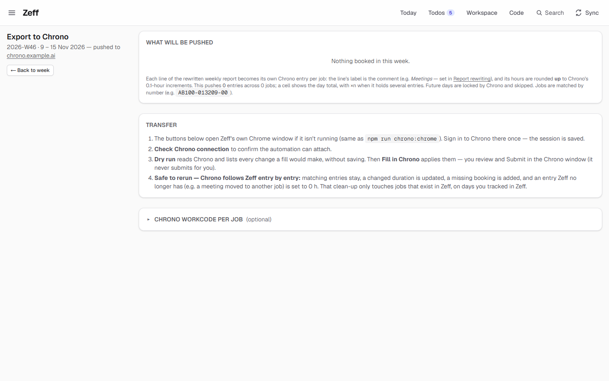
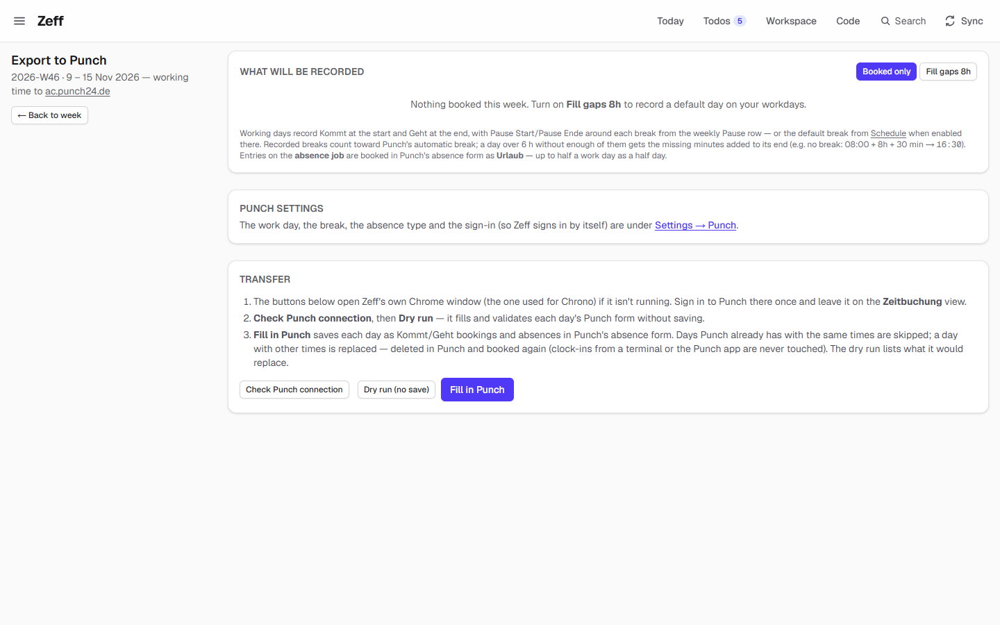
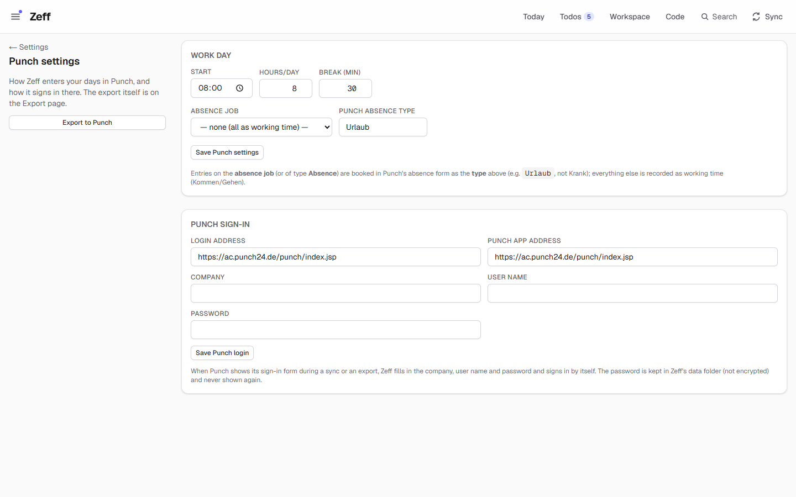
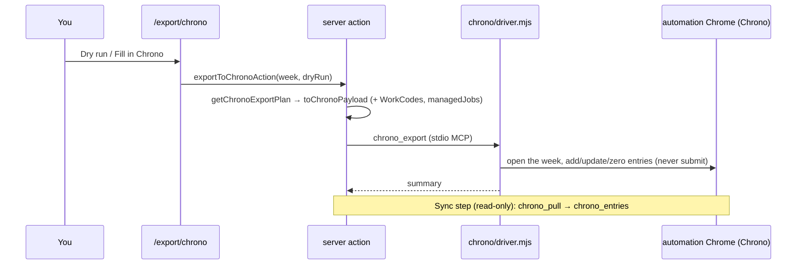

# Time-sheet systems: Chrono and Punch

> Export your booked week to the employer's time-sheet systems Chrono (entries per job) and Punch (arrival, departure, breaks, absences), and read back what's there and what's approved. **Category:** timesheet · **On by default:** yes (when mounted) · **Beta:** experimental — they fill in another company's web pages · **Needs:** [Time tracking](time-tracking.md), [Browser](browser.md) (the automation Chrome, signed in)

## For users

### What it does

Zeff is where you book; the company's systems are where the time has to end up. Two of them are built in:

- **Chrono** — the project time sheet. Every line of your rewritten weekly report becomes one Chrono entry on its job, with the
  line's text as the comment and the hours rounded **up** to Chrono's 0.1-hour steps. Zeff also reads back each entry's
  **approval status** (Approved, Submitted, Rejected …, with the approver and a rejection comment) and shows it as ticks in
  the Weekly and Monthly report.
- **Punch** — the attendance system. Zeff turns each day's booked hours into *Kommt/Geht* (arrival/departure) around your
  breaks, books absence days (e.g. vacation) in Punch's absence form, and reads back what Punch has on each day.

Both are driven through their web pages in Zeff's **automation Chrome**, the way you would do it by hand. Nothing is
ever sent unless you click: the background sync only **reads**.

Both are **experimental**. Chrono and Punch are probably your employer's systems — check that automated bookings are allowed
there. If their pages change, an export can fail or book wrongly; always check the result in Chrono/Punch before it is
approved. Chrono's export never submits: you review and *Submit* in the Chrono window yourself.

### Getting started

1. Chrono and Punch live in a separate repository mounted under `integrations/booking/` (see
   [docs/integrations.md](../integrations.md)). A Zeff without that mount simply has no Chrono and no Punch.
2. With the mount, both plugins are on by default; switch them on or off in **Menu → Plugins** (`/plugins`), category
   *Time-sheet systems*. Both need [Time tracking](time-tracking.md).
3. Start the automation Chrome (the export page's buttons open it if it isn't running) and **sign in** to Chrono and Punch
   there once — the session is kept. When a step finds you signed out, Zeff shows a sign-in prompt.
4. Punch only: open **Settings → Punch** (`/settings/punch`) and set your work day (start, hours, break), the absence job and
   absence type, and — if you want Zeff to sign in by itself — company, user name and password.

Where they show up:

- **Weekly report** (`/`): Chrono's *Awaiting approval / Rejected* card, the *Pull Chrono* and *Pull Punch* buttons above the
  week table, Chrono marks on cells and entries, Punch marks on the days, and *Export to Chrono →* / *Export to Punch →* next to
  the report.
- **Monthly report** (`/month`): each day's Chrono-approved hours in the calendar, and *Pull Chrono* for the month.
- **Jobs** (`/jobs`): *Sync with Chrono* and a Chrono column (found / not found in Chrono's job search).
- **Week close**: *In Chrono*, *Approved in Chrono* and *In Punch*.
- **Sync menu**: the steps *Chrono* and *Punch* (read-only).

### Using it

#### Export a week to Chrono (`/export/chrono?week=2026-W46`)

The page shows **What will be pushed**: one row per job, one column per day, with a cell's hours and `×n` when a day holds
several entries for that job, and the totals. Above it, warnings when hours are booked on projects without a job (they are
not pushed — set the job on *Projects*), and which vacation days go to Chrono as entries on the absence job.

The **Transfer** steps:

1. *Check Chrono connection* — confirms the automation can attach and Chrono is signed in.
2. *Dry run (preview changes)* — reads Chrono and lists every change a fill would make, without saving.
3. *Fill in Chrono* — applies them. Then review and **Submit** in the Chrono window (Zeff never submits).

Rerunning is safe: Chrono follows Zeff entry by entry — matching entries stay, a changed duration is updated, a missing one
is added, and a Chrono entry Zeff no longer has (e.g. a meeting moved to another job) is set to 0 h. That clean-up only
touches jobs that exist in Zeff, on days you tracked in Zeff, and never on a reporter-filtered export (`&by=…`), which only
adds. Future days are locked by Chrono and skipped. Jobs are matched by number.

*Chrono WorkCode per job* (collapsed, optional): most jobs pre-fill a WorkCode from your role; some (e.g. *Abwesenheit*) start
empty and need a code before Chrono will save — set it here and the export picks it automatically.

#### Export a week to Punch (`/export/punch?week=2026-W46`)

(In the screenshot the demo week has no bookings, so the table is replaced by a hint to turn on *Fill gaps 8h*. The Chrono
page shows its buttons only once there is something to push.)

**What will be recorded** lists each day: start, break, end, hours and where they come from (booked, *default*, *from the
schedule*, an absence with its type, ½ day). *Booked only* records only days with bookings; *Fill gaps 8h* records a default
day on workdays without any. Entries on the absence job go to Punch's absence form as the configured type (up to half a work
day as a half day). Flex-time hours are not recorded as working time, so Punch's flex balance goes down by them.

Transfer: *Check Punch connection*, then *Dry run (no save)* — it fills and validates each day's Punch form and closes it
without saving — then *Fill in Punch*. Days Punch already has with the same times are skipped; days with other times are
replaced (deleted and booked again), except clock-ins from a terminal or the app.

How a day is laid out: from your start time, work until a break, pause, carry on — Punch gets *Kommt/Geht* around each
break. Punch deducts its automatic break by German working-time law (none up to 6 h, your configured break above that, at
least 45 min over 9 h); a break you entered counts toward it, and only what's missing is added at the end
(`08:00–16:30` is an 8 h day with a 30 min break).

#### Read back (pull)

- **Pull Chrono** (week, month, or the approvals of last and this month) reads your Chrono entries with their status — nothing is
  changed in Chrono. The week table then marks each cell (approved, waiting, rejected, not in Chrono), the Monthly report's
  calendar shows the approved hours per day, and the approvals card counts what's waiting.
- **Pull Punch** reads what Punch has on the week's days and marks each day as in Punch, differing or missing.
- **Sync with Chrono** on the Jobs page looks every job number up in Chrono's job search (read-only — the dialog is closed
  again, nothing is added).

### Settings

**Settings → Punch** (`/settings/punch`):

| Setting | Default | What it changes |
| --- | --- | --- |
| Start | `08:00` | When each recorded day begins |
| Hours/day | 8 | Net hours of a default day (*Fill gaps*) |
| Break (min) | 30 | The break added so Punch's net matches the hours |
| Absence job | none (all as working time) | Entries on this job (or of type Absence) go to Punch's absence form; everything else is working time |
| Punch absence type | `Urlaub` | The absence type (`art`) used for them |
| Login address | `https://ac.punch24.de/punch/index.jsp` | Where the sign-in happens |
| Punch app address | preset | Where Zeff books and reads |
| Company, User name, Password | empty | When Punch shows its sign-in form, Zeff fills these in and signs in itself. The password is never shown again; “Forget the saved password” removes it |

Elsewhere:

| Where | Setting | What it changes |
| --- | --- | --- |
| Export to Chrono → *Chrono WorkCode per job* | Job → WorkCode | Forces a WorkCode on export |
| Schedule → *Default break* | “Record the default break in Punch” | Whether the default break goes to Punch on workdays without an entered break |
| Schedule → *Report rewriting* | Report rules | The lines (and so Chrono's comments) the Chrono export books |
| Schedule → *Absence* | Vacation days | Days off without a booked absence are exported as absences (Chrono: on the absence job; Punch: absence form) |
| Sync settings | Interval for *Chrono* and *Punch* | How often the read-only pull runs, while the automation Chrome runs |
| Settings → General → *Touch to approve* (`/preferences#touch`) | Guard booking exports | When set, a real fill (not a dry run) waits for a touch of the security key |

### Tips & limits

- **Only your click exports.** Background sync reads; `chrono_export` and `punch_export` are called only from the export
  pages' server actions — a test (`integrations/booking/tests/safety.test.ts`) fails if any other code calls them.
- Always do a **dry run** first, and check the result in Chrono/Punch yourself. Chrono entries stay unsubmitted until you submit.
- Entries on the *No job yet* placeholder are not exported.
- What leaves the machine: the week's entries (job numbers, hours, comments) go to Chrono; the day times and absences to
  Punch — through the browser, as if typed. No AI is involved; the drivers are plain Playwright scripts.
- The Punch password is kept in Zeff's data folder (account prefs), not encrypted — like the backup password. Only enter it on
  a computer you alone use.
- The Week close's Chrono/Punch steps are as fresh as their last pull; a week never pulled is “not known”, not done.

## Technical reference

### Overview

Chrono and Punch are an **integration**: a repository of their own mounted as a git submodule at `integrations/booking/`.
`npm run integrations` generates `src/lib/integrations/mounted-*.ts` from its three entry modules:

- [meta.ts](../../integrations/booking/meta.ts) — client-safe catalog entries (`IntegrationMeta`), added to `PLUGINS`;
- [server.ts](../../integrations/booking/server.ts) — an `IntegrationServer` per plugin: sync settings and step, driver,
  sign-in service, pages, and the slots for the week, month, jobs page and week close;
- [client.ts](../../integrations/booking/client.ts) — the marks shown in Zeff's week table and entries list.

Each system has a **driver** (`chrono/driver.mjs`, `punch/driver.mjs`): a minimal MCP stdio server that drives the automation
Chrome with Playwright over CDP. Zeff starts it per call (`callChrono` / `callPunch` → `runStdioSession`), wrapped in
`watchSignIn` so a signed-out page becomes a sign-in prompt. A real export first passes `requireTouch("booking-export", …)`.

### Manifest

| Field | Chrono | Punch |
| --- | --- | --- |
| id | `chrono` | `punch` |
| category | timesheet | timesheet |
| defaultInstalled | yes | yes |
| experimental | yes (warning text) | yes (warning text) |
| needs (integration) | `browser` | `browser` |
| dependsOn | `zeiterfassung` | `zeiterfassung` |
| requires | The automation Chrome with Chrono, signed in | The automation Chrome with Punch, signed in |
| settings | — | `/settings/punch` |
| routes | `/export/chrono` | `/export/punch`, `/settings/punch` |
| syncSteps | `chrono` | `punch` |
| services | `chrono` | `punch` |

Pages are served by Zeff's generic routes `src/app/export/[integration]` and `src/app/settings/[integration]`.

### Files

| File | What it holds |
| --- | --- |
| [meta.ts](../../integrations/booking/meta.ts) | Catalog entries (manifests, warning texts) |
| [server.ts](../../integrations/booking/server.ts) | The `IntegrationServer` of both |
| [client.ts](../../integrations/booking/client.ts) | Cell, entry and day marks |
| [vacation.ts](../../integrations/booking/vacation.ts) | Vacation days without a booked absence, exported by both |
| [chrono/driver.mjs](../../integrations/booking/chrono/driver.mjs) | Chrono's browser driver: `chrono_status`, `chrono_pull`, `chrono_jobs`, `chrono_export` |
| [chrono/call.ts](../../integrations/booking/chrono/call.ts) | One driver call, with sign-in watch and the touch check |
| [chrono/lib/chrono.ts](../../integrations/booking/chrono/lib/chrono.ts) | The export plan (rows per job and day, rounding, comments) and payload |
| [chrono/lib/status.ts](../../integrations/booking/chrono/lib/status.ts), [chrono/lib/pull.ts](../../integrations/booking/chrono/lib/pull.ts) | Pulled statuses, approval summary, matching to entries |
| [chrono/lib/lookup.ts](../../integrations/booking/chrono/lib/lookup.ts), [chrono/lib/settings.ts](../../integrations/booking/chrono/lib/settings.ts) | Job lookups; WorkCode overrides |
| [chrono/server-actions.ts](../../integrations/booking/chrono/server-actions.ts) | Export, pulls, job sync, status, WorkCodes |
| [chrono/week.tsx](../../integrations/booking/chrono/week.tsx), [chrono/month.tsx](../../integrations/booking/chrono/month.tsx), [chrono/jobs.tsx](../../integrations/booking/chrono/jobs.tsx), [chrono/weekclose.ts](../../integrations/booking/chrono/weekclose.ts) | The slots in the week, month, jobs page and week close |
| [chrono/pages/export.tsx](../../integrations/booking/chrono/pages/export.tsx) | `/export/chrono` |
| [chrono/toasts.mjs](../../integrations/booking/chrono/toasts.mjs) | Closes Chrono's notes instead of waiting them out |
| [chrono/scripts/](../../integrations/booking/chrono/scripts/chrono-chrome.ps1) | `chrono-chrome.ps1` (start the Chrome), `chrono-mcp.mjs` (old driver path) |
| [punch/driver.mjs](../../integrations/booking/punch/driver.mjs) | Punch's browser driver: `punch_status`, `punch_days`, `punch_export` |
| [punch/call.ts](../../integrations/booking/punch/call.ts), [punch/login.ts](../../integrations/booking/punch/login.ts), [punch/login-fields.mjs](../../integrations/booking/punch/login-fields.mjs) | Driver call; stored sign-in and its environment; finding the login fields |
| [punch/lib/punch.ts](../../integrations/booking/punch/lib/punch.ts) | The export plan: day layout around breaks, Punch's automatic break, absences |
| [punch/lib/status.ts](../../integrations/booking/punch/lib/status.ts), [punch/lib/pull.ts](../../integrations/booking/punch/lib/pull.ts), [punch/lib/settings.ts](../../integrations/booking/punch/lib/settings.ts) | Day states vs. Punch; pulls; the work-day config |
| [punch/server-actions.ts](../../integrations/booking/punch/server-actions.ts) | Export, pull, status, login and config saves |
| [punch/week.tsx](../../integrations/booking/punch/week.tsx), [punch/weekclose.ts](../../integrations/booking/punch/weekclose.ts) | The week slot and week-close item |
| [punch/pages/export.tsx](../../integrations/booking/punch/pages/export.tsx), [punch/pages/settings.tsx](../../integrations/booking/punch/pages/settings.tsx) | `/export/punch`, `/settings/punch` |
| [src/lib/integrations/types.ts](../../src/lib/integrations/types.ts) | The contract (in Zeff) |

### Data

Kept in Zeff's own schema ([src/db/schema.ts](../../src/db/schema.ts)) so mounting or unmounting never touches data:

| Where | What |
| --- | --- |
| `chrono_entries` | A week's Chrono entries as last pulled: Chrono `id`, `week_start`, `job_number`, `date`, `hours`, `comment`, `status`, `rejection_comment`, `approver`, `approved_by`, `submitted_at`, `approved_at`, `pulled_at` |
| `punch_days` | Per date: `work` (JSON of attendance rows `{start, end, net}`), `absence` (JSON of absence names), `pulled_at` |
| `jobs.chrono_found`, `chrono_name`, `chrono_client`, `chrono_checked_at` | The last *Sync with Chrono* lookup |
| `report_settings.chrono_workcodes` | JSON `{jobNumber: workCode}` |
| `report_settings.punch_config` | JSON `{startTime, workdayHours, breakMinutes, absenceJobNumber, absenceType}` |
| `work_schedule.punch_default_pauses` | Record the default break in Punch |
| pref `punch:login` | `{url, appUrl, company, username, password}` |

`CHRONO_CDP_ENDPOINT` is the (legacy-named) environment variable pointing every driver at the automation Chrome.

### Sync, jobs & AI tasks

| Step | What it does | Default schedule |
| --- | --- | --- |
| `chrono` | Pulls the approvals of last and this month's weeks (`chrono_pull`, read-only) into `chrono_entries` | Interval from Sync settings, while the automation Chrome runs |
| `punch` | Reads what Punch has on this and last week's days (`punch_days`, read-only) into `punch_days` | Same |

No LLM tasks.

### MCP tools & actions

The drivers are MCP servers for Zeff's own use, not exposed to agents:

| Driver tool | Writes? |
| --- | --- |
| `chrono_status`, `punch_status` | no — Chrome reachable, signed in |
| `chrono_pull`, `punch_days` | no |
| `chrono_jobs` | no — job search, dialog closed again |
| `chrono_export` | **yes** — adds, updates, zeroes entries (`dryRun` only reads); never submits |
| `punch_export` | **yes** — Kommt/Geht and absences (`dryRun` fills and validates without saving) |

Server actions: Chrono — `exportToChronoAction`, `pullChronoAction`, `pullChronoMonthAction`, `pullChronoApprovalsAction`,
`syncChronoJobsAction`, `chronoStatusAction`, `saveChronoWorkcodesAction`; Punch — `exportToPunchAction`, `pullPunchAction`,
`punchStatusAction`, `savePunchLoginAction`, `savePunchConfigAction`. No todo actions, no API routes of their own.

### Extension points

They contribute to Zeff's integration slots (`src/lib/integrations/types.ts`):

| Slot | Chrono | Punch |
| --- | --- | --- |
| `syncSettings`, `syncStep` | interval + step `chrono` | interval + step `punch` |
| `driver`, `service` | `chrono/driver.mjs`, sign-in at Chrono's timesheet | `punch/driver.mjs`, sign-in at Punch, with `env` (login) |
| `pages` | `export` | `export`, `settings` |
| `week` (`WeekSlot`) | approvals card, *Pull Chrono*, export link, entry statuses | *Pull Punch*, export link, day states |
| `month` (`MonthSlot`) | approved hours per day, pull, statuses | — |
| `jobs` (`JobsSlot`) | *Sync with Chrono* toolbar, Chrono column | — |
| `weekClose` | *In Chrono*, *Approved in Chrono* | *In Punch* |
| client marks | `CellMark`, `EntryMark` | `DayMark` |

They provide no points of their own.

### Tests

In the integration's own repository, run by Zeff's `npm test`:

| Test | Covers |
| --- | --- |
| [chrono-export.test.ts](../../integrations/booking/tests/chrono-export.test.ts) | The Chrono export plan |
| [chrono-toasts.test.ts](../../integrations/booking/tests/chrono-toasts.test.ts) | Closing Chrono's notes |
| [safety.test.ts](../../integrations/booking/tests/safety.test.ts) | Exports only called from click paths |
| [punch-login.test.ts](../../integrations/booking/tests/punch-login.test.ts) | Punch sign-in fields and address |
| [vacation-export.test.ts](../../integrations/booking/tests/vacation-export.test.ts) | Vacation days exported as absences |
| [week-close.test.ts](../../integrations/booking/tests/week-close.test.ts) | Chrono/Punch week-close steps |
| [tests/integration-drivers.test.ts](../../tests/integration-drivers.test.ts) | Drivers resolved from mounts (Zeff side) |

Run one: `node --import tsx --test integrations/booking/tests/chrono-export.test.ts`.
