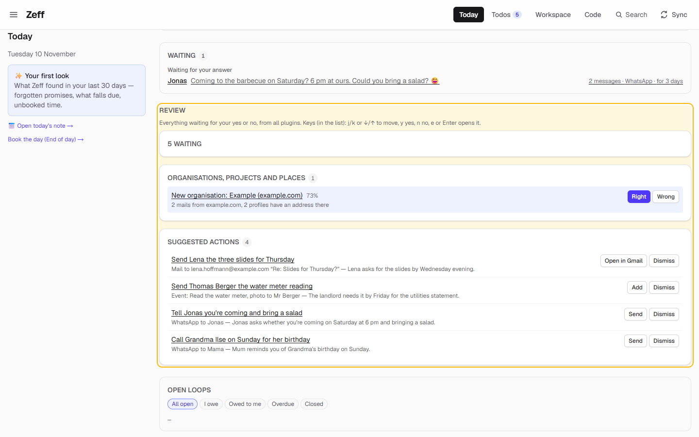
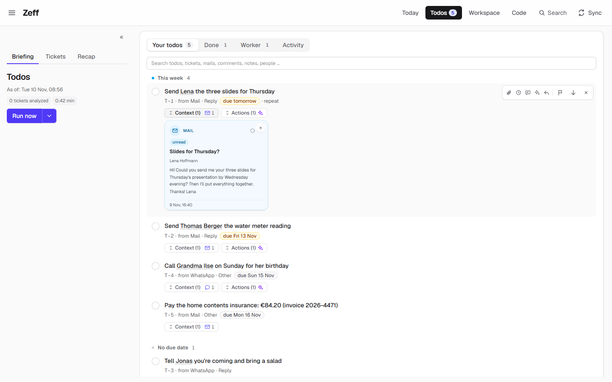
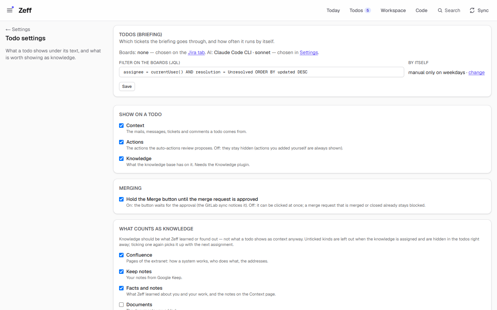
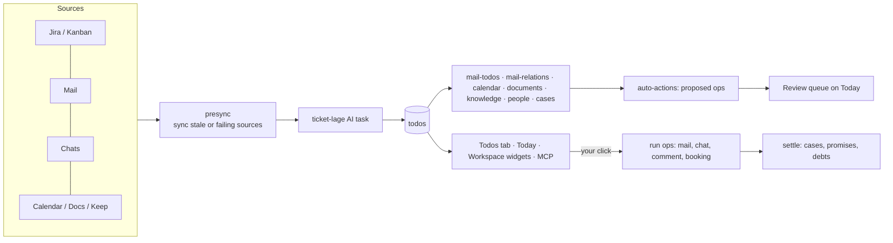

# Todos

> Zeff's todo list and its Today page: everything that reaches you — tickets, mails, chats, appointments — read by the AI and turned into concrete todos, each with where it came from, when it is due and a ready action. **Category:** app · **On by default:** yes · **Beta:** no · **Needs:** nothing to be installed; the briefing needs an AI provider ([AI models](llm.md), e.g. [Claude Code](ai-backends.md)), and its todos come from whatever sources you connect ([Jira](jira.md), [Gmail](gmail.md), [Outlook](outlook.md), [WhatsApp](whatsapp.md) …)

Todos brings two tabs to the header — **Today** (`/heute`) and **Todos** (`/todos`) — and one part that can be switched on or
off by itself, **Tickets** (a view inside the Todos tab).

## For users

### What it does

Your day is spread over many channels. Todos reads them for you and turns what is yours to do into one list. In the demo,
Lena asked by Gmail for "your three slides for Thursday's presentation by Wednesday evening", Thomas Berger needs the water
meter reading by Friday, Jonas asked on WhatsApp whether you are coming to the barbecue and could bring a salad, Mum
reminded you of Grandma's birthday, and Hausrat Direkt sent an invoice for €84.20. The Todos tab shows these as five
todos (T-1 … T-5):

- each todo is one sentence, verb first ("Send Lena the three slides for Thursday");
- under it: its reference (`T-1`), where it came from (`from Mail · Reply`), its due date (`due tomorrow`) and whether it
  repeats;
- **Context** unfolds the mails, messages, tickets and comments it rests on;
- **Actions** unfolds the step that finishes it — a ready reply mail to Lena, a WhatsApp message to Jonas, an
  appointment, a transfer — which runs on your click.

Todos settle themselves where Zeff can see that they are done: a reply you sent, a ticket that moved, a payment that
arrived on the bank statement (with [Cases](cases.md)). What is left stays on the list, with the reason.

The **Today** page is the start of the day: "Start here" (the one thing to do first), a short summary, appointments,
what is due, promises, who is waiting for your answer, what is new since yesterday, and the **review queue** — everything
from every plugin that waits for your yes or no.

**Tickets** shows the same briefing per ticket (Jira tickets and Kanban cards): where it stands, what happened, its
todos, comments, mails, merge requests and suggested actions.

### Getting started

1. Todos is on from the start. If it was turned off: **Menu → Plugins**, switch on **Todos** (Tickets is listed under it).
2. Connect sources, so there is something to read: a mail account (**Settings → E-Mail accounts**), [WhatsApp](whatsapp.md),
   [Signal](signal.md), [Teams](teams.md), [Jira](jira.md), a calendar.
3. Choose an AI provider in the settings ([AI models](llm.md)). The briefing, the mail review, the reply drafts and the
   day plan are AI tasks; each can have its own backend and model.
4. Open **Todos** and press **Run now**. The first run takes a minute or two. Afterwards it runs by itself as often as you set
   (see Settings), on weekdays 8:00–19:00.

The header shows the number of open todos on the Todos tab (the "5" in the screenshots).

### Using it

#### The Today page (`/heute`)

From top to bottom (a section only shows when it has something):

| Part | What it shows |
| --- | --- |
| Greeting and **Start here** | The most pressing thing across everything (a meeting now, an agent asking, overdue or due today, someone waiting long, a birthday, booking the day when it is late), the briefing's summary, and a link **To the briefing →**. On the right a ring with the hours booked today against your target (with [Time tracking](time-tracking.md)). |
| Your first look | On a new install: what Zeff found in your last 30 days — forgotten promises, what falls due, unbooked time. |
| Syncs with problems | Sources whose sync fails, needs a sign-in, or whose automation Chrome is not running. |
| Metrics | The metrics you put on Today ([Workspace](workspace.md) → Metrics, "Show on Today"). |
| Day lists | Your Workspace day lists (medicines, a routine) and what is still open in them today. |
| Meeting soon | Before a meeting: what you should know about it ([Knowledge](knowledge.md)). |
| Appointments | Today and tomorrow morning, with whom, and what to prepare; links to the [Calendar](calendar.md). |
| Due and overdue | Todos due today or earlier. |
| Promises | What you promised, and what was promised to you and is overdue ([People](people.md)). |
| Waiting | **Waiting for your answer** (chats and mails where you have not replied — e.g. Jonas, "2 messages · WhatsApp · for 3 days") and **Waiting on others**. |
| New since yesterday | Things learned about people to confirm, new news items ([News](news.md)). |
| Plan | **Plan my day**: the AI orders today's todos into time blocks around your appointments. Applied, the blocks become *proposed* appointments in your Zeff calendar. Shown when the Calendar and an AI provider are installed and something is due. |
| Agents ask you / Reported done by workers / Reminders | Todos an agent waits on you for, todos a worker says are done, birthdays and dates from People. |
| **Review** | The review queue (below). |
| Open loops | What you owe and are owed ([Open loops](loops.md)). |

The left column has a link to today's note in the Workspace and **Book the day (End of day) →**, which leads to booking
your hours.

#### The review queue

Everything that waits for your yes or no, from all plugins, in one list (it used to be the page `/review`, which now leads
here). Todos brings four groups to it:

- **Done? — please confirm**: a worker or agent says a todo is done; **Done** closes it, **Not done** keeps it open.
- **Suggested actions**: actions the auto-actions step proposed for a todo (a reply mail, a calendar entry, a WhatsApp
  message). The button runs them; **Dismiss** drops the proposal.
- **Prepared — one click**: next steps Zeff worked out itself (after a delivery, a worker's follow-up, telling the person
  who asked).
- **Rules from repetition**: when you dropped the same kind of todo from the same sender again and again, Zeff proposes a
  rule to leave those alone.

Other plugins add their own groups (in the demo, [Organisations, projects & places](entities.md) proposes an
organisation). Keys in the list: `j`/`k` or ↓/↑ to move, `y` yes, `n` no, `e` or Enter opens the item.

#### Working a todo

1. **Tick the circle** to mark a todo done. Things it rests on (a comment, a message) count as done with it.
2. **Context** unfolds its sources as cards — here the mail "Slides for Thursday?" from Lena Hoffmann. **×** on a card takes
   it out for good.
3. **Actions** shows what finishes it. A suggested action carries the reason ("Suggested: Lena asks for the slides by
   Wednesday evening"); ✎ changes its text, ✓ runs it, × removes it, **Suggest again** has the AI propose anew with what it
   knows now. Writing actions (a mail, a message, a comment, a booking) only happen on your click.
4. The **toolbar** that appears on hover: attach a document or picture, add time, add a note (context for the next
   briefing, workers and agents), have the AI suggest actions, draft a reply, flag as important (top of the list, urgent
   for the briefing), move to the bottom (it comes back when something new happens on it or after a while), dismiss
   ("doesn't apply").
5. Set a **due date** or make it **repeat** (daily, weekly, monthly, yearly — the next one is worded by the AI without what
   only held the first time).

The tabs above the list: **Your todos**, **Done**, **Worker** (todos a work session made — they are not in your list; one
click on "Create todo" makes one yours) and **Activity** (what happened to the todos: made, done, dropped, merged, and by
whom). The search box above the list is an omnibar: type a word, a ticket, a mail, a person; pick it, and the list shows
only the todos that belong to it.

Each todo has a short link: `/t/<id>` (e.g. `/t/1` for T-1) opens it on the Todos tab, or on the Done tab when it is
settled. Duplicates are merged into the oldest todo, which keeps its id; links to the duplicate follow it.

#### Briefing, Tickets and Recap

The left column of the Todos tab has three views:

- **Briefing** — the todos (above). **Run now** starts a run; its ▾ menu shows the run's steps and which sources are
  synced first. While it runs, the step it is on is shown with **Cancel**. Under the heading: when it ran, how many tickets it
  analysed, the model, the time and the cost.
- **Tickets** (the Tickets part) — the briefing per ticket, with filter chips by state, the briefing's summary text, a
  chat with the AI about a ticket, and whether you follow a ticket. In the demo there is no Jira, so the list says
  "No open tickets on the chosen boards" and only the briefing text shows:

  

- **Recap** — what you did on a day (the last workday unless you pick another with the arrows or the calendar): a summary,
  then per ticket, written by the AI from your bookings, done todos, workers' runs, Jira, commits and GitLab. Made each
  weekday morning for the day before, or by hand with **Summarize**; every one is kept. (Not on a phone.)

### Settings

**Settings → Todos** (`/settings/todos`):

| Setting | What it changes |
| --- | --- |
| Filter on the boards (JQL) | Which Jira tickets on the boards chosen on the [Jira](jira.md) tab the briefing goes through. Default `assignee = currentUser() AND resolution = Unresolved ORDER BY updated DESC`. |
| By itself (Sync settings → Briefing) | How often the briefing runs on its own: never (manual only), every 15, 30, 60, 120, 240, 480 minutes or once a day — on weekdays, 8:00–19:00. |
| Recap (Sync settings) | Runs every weekday morning for the last working day (follows the briefing; not separately timed). |
| Show on a todo: Context / Actions / Knowledge | What a todo shows under its text. Actions off hides the auto-actions' proposals (actions you added yourself always show). Knowledge needs the [Knowledge](knowledge.md) plugin. |
| Merging: Hold the Merge button until the merge request is approved | On: a "Merge" action waits for the approval (the [GitLab](gitlab.md) sync notices it). Off: it can be clicked at once. |
| What counts as knowledge | Which kinds are shown as knowledge on a todo: Confluence, Keep notes, Facts and notes, Documents, Todos, Jira tickets, Mails and messages, GitLab, Work records; plus Concepts and System addresses. Unticked kinds are left out when knowledge is assigned. |
| Repo summaries | The rules (a prompt, editable in the Workspace) by which the AI picks a repo's Prod, Test and Dev addresses for a todo. Needs Knowledge. |
| Run now ▾ → sync first | Which sources are synced before a manual run (only when their last sync is older than set, or when they are failing). |

Which AI provider and model each task uses is set in [AI models](llm.md) (tasks: Briefing, Recap, Mail review, Mail
matching, Repeat wording, Day plan, Reply draft).

### Tips & limits

- **Nothing is sent behind your back.** The briefing and the auto-actions only read and propose. A mail, a chat message,
  a Jira comment or a booking happens on your click. Mail actions open a draft in Gmail/Outlook unless the account can send
  from Zeff.
- **What the AI sees:** the briefing sends your tickets and their context (comments, history, linked mails and messages,
  your notes on todos) to the AI provider you chose. With a cloud provider that leaves your machine; with [Local AI](ai-backends.md)
  it does not. Sources marked *secret* are kept from the AI.
- If a source was failing when the briefing ran, the Tickets view says so under the briefing ("Not up to date when this
  ran: …").
- A failed run keeps the last good briefing on screen with an error line above it.
- Without tickets there is no ticket briefing, but mails, chats, appointments and documents are still gone through for
  todos.
- A worker's own todos (Worker tab) never mix into your list.
- Moved-down todos come back up when something new happens on them; a repeating one stays down until a week before it is
  due.
- On a phone, the Todos page is the list only; Briefing text, Tickets and Recap stay on a computer.

## Technical reference

### Overview

The Todos plugin is a thin manifest over code that lives in the core, because almost every other plugin hangs on todos:

- **The briefing run** (`lib/runs/run.ts`, "Ticket-Lage") reads the tickets matching the JQL (Jira tickets and Kanban
  cards), collects their context (`lib/runs/collect.ts`), and asks the AI (`ticket-lage` task) for a summary, per-ticket
  state and concrete todos. The todos are written to the `todos` table (`lib/todos/store.ts`) — new ones created, still-open
  ones kept, gone ones closed with a reason. After the AI step the run continues with the other plugins' steps while they
  are installed: mail and WhatsApp review (`mail-todos`), mail matching (`mail-relations`), Keep notes, calendar todos and
  matching, documents, knowledge relations, people normalisation, cases and bank payments, the Workspace's "Meine Lage"
  database, and finally the auto-actions review that proposes actions. Each phase is published (`__zeffBoardRun` account
  flag) so the UI shows the step it is on.
- **Todos** carry operations (`ops`, typed `TodoOp`) that the actions catalog (`plugins/actions`) knows how to run, planned
  follow-ups (`planned`), refs to their sources (`refs`, `mailRefs`), and state flags (flagged, deferred, worker-done,
  needs-input). Triggers on the table write `todo_events`, so no way of closing one goes unrecorded.
- **Settling** (`lib/todos/settle.ts`): ticking a todo off is proof that settles what hangs on it (a case's instalment, a
  promise, a debt); reopening takes it back.
- **Today** (`app/heute/page.tsx`) gathers data from many plugins lazily (only those installed) and ranks "Start here" with
  the pure `lib/heute-next.ts`.
- **The review queue** (`lib/review/point.ts`) is an extension point: each plugin contributes `ReviewSource`s.

### Manifest

| Field | Value |
| --- | --- |
| id | `todos` |
| category | `app` |
| order | 40 |
| defaultInstalled | true |
| dependsOn | — |
| tabs | Today (`/heute`), Todos (`/todos`, also `/tickets`) |
| settings | `/settings/todos#boards` — "The briefing's JQL filter" |
| routes | `/heute`, `/todos`, `/t`, `/api/boards` |
| syncSteps | `boards` (the briefing), `recap` |
| features | `tickets` — Tickets (order 50, on by default, route `/tickets`; no tab of its own: `/todos?part=tickets`) |

### Files

Plugin folder `src/plugins/todos/`:

| File | What it is |
| --- | --- |
| [plugin.ts](../../src/plugins/todos/plugin.ts) | The manifest (with the Tickets feature). |
| [server.ts](../../src/plugins/todos/server.ts) | Registers the API, the Workspace source, the review sources and the widgets. |
| [api.ts](../../src/plugins/todos/api.ts) | Plugin API: `todos.list`, `todos.add`, event `todos.changed`, permissions `todos.read` / `todos.write`. |
| [actions.ts](../../src/plugins/todos/actions.ts) / [run.ts](../../src/plugins/todos/run.ts) | The `todo-promote` action: a work session's placeholder becomes your todo. |
| [llm-tasks.ts](../../src/plugins/todos/llm-tasks.ts) | The seven AI tasks. |
| [review.ts](../../src/plugins/todos/review.ts) | Review sources: done?, suggested actions, prepared, rules from repetition. |
| [server-actions.ts](../../src/plugins/todos/server-actions.ts) | The UI's server actions: run/stop the briefing, set status/text/due/recurrence, flag, defer, notes, time, run ops, draft reply, recap, day plan, undo a run. |
| [sync-settings.ts](../../src/plugins/todos/sync-settings.ts) | Its rows in the Sync settings (briefing interval, recap). |
| [widgets.ts](../../src/plugins/todos/widgets.ts) | Workspace widgets `todos.list` and `todos.done`. |
| [workspace-source.ts](../../src/plugins/todos/workspace-source.ts) | Todos as a read-only, relation-only Workspace source (joined by ticket). |

Core code it relies on:

| File | What it is |
| --- | --- |
| [lib/todos/store.ts](../../src/lib/todos/store.ts) | The todos table: list, add, close, merge, notes, ops, worker todos. |
| [lib/todos/shared.ts](../../src/lib/todos/shared.ts) | `TodoView`, `TodoOp` (the operation-type map plugins extend), refs `T-<id>`. |
| [lib/todos/settle.ts](../../src/lib/todos/settle.ts) | What a done todo settles (cases, promises, debts) and taking it back. |
| [lib/todos/dedupe.ts](../../src/lib/todos/dedupe.ts), [merge.ts](../../src/lib/todos/merge.ts) | Duplicates merged into the oldest. |
| [lib/todos/deferral.ts](../../src/lib/todos/deferral.ts) | Moved-down todos and when they come back. |
| [lib/todos/recurring.ts](../../src/lib/todos/recurring.ts), [repeat-text-ai.ts](../../src/lib/todos/repeat-text-ai.ts) | Repeating todos and the next one's wording. |
| [lib/todos/mail-todos.ts](../../src/lib/todos/mail-todos.ts), [mail-relations.ts](../../src/lib/todos/mail-relations.ts) | Mail review and mail matching. |
| [lib/todos/reply-draft.ts](../../src/lib/todos/reply-draft.ts) | The AI's reply draft for a todo's message. |
| [lib/todos/omnibar.ts](../../src/lib/todos/omnibar.ts) | The omnibar's search. |
| [lib/todos/requester.ts](../../src/lib/todos/requester.ts), [delivery-ops.ts](../../src/lib/todos/delivery-ops.ts), [comment-ops.ts](../../src/lib/todos/comment-ops.ts) | Prepared follow-ups, merge-request and review-comment buttons. |
| [lib/runs/run.ts](../../src/lib/runs/run.ts), [ticket-lage.ts](../../src/lib/runs/ticket-lage.ts), [collect.ts](../../src/lib/runs/collect.ts) | The briefing run, its prompt and its context. |
| [lib/runs/recap.ts](../../src/lib/runs/recap.ts) | The Recap. |
| [lib/runs/ticket-chat.ts](../../src/lib/runs/ticket-chat.ts) | Asking the AI about one ticket (Tickets view). |
| [lib/runs/run-undo.ts](../../src/lib/runs/run-undo.ts) | Undoing a briefing run's changes. |
| [lib/heute-today.ts](../../src/lib/heute-today.ts), [heute-next.ts](../../src/lib/heute-next.ts), [heute-plan.ts](../../src/lib/heute-plan.ts) | Today's data, "Start here" ranking, Plan my day. |
| [lib/review/point.ts](../../src/lib/review/point.ts) | The review queue's extension point. |
| [app/heute/page.tsx](../../src/app/heute/page.tsx) | The Today page. |
| [app/todos/page.tsx](../../src/app/todos/page.tsx), [components/boards/LagePage.tsx](../../src/components/boards/LagePage.tsx) | The Todos tab (Briefing, Tickets, Recap). |
| [components/boards/BoardView.tsx](../../src/components/boards/BoardView.tsx), [TodoItem.tsx](../../src/components/boards/TodoItem.tsx) | The list and one todo. |
| [app/t/[id]/route.ts](../../src/app/t/[id]/route.ts) | `/t/<id>` short links. |
| [app/settings/todos/page.tsx](../../src/app/settings/todos/page.tsx) | Todo settings. |
| [mcp/tools/todos.ts](../../src/mcp/tools/todos.ts), [todo-clock.ts](../../src/mcp/tools/todo-clock.ts), [todo-finish.ts](../../src/mcp/tools/todo-finish.ts) | The MCP tools. |

### Data

Tables in [src/db/schema.ts](../../src/db/schema.ts):

| Table | What it holds |
| --- | --- |
| `todos` | One row per todo (`T-<id>`): `ticket` (main ticket, "" for none), `text`, `kind`, `owner` (`me` / `other`), `status` (`open` / `done` / `dismissed`), `source` (what it rests on), `refs` (JSON: the comments/messages it came from), `note` (why closed), `runId`, `draft` + `channel` + `target` (a ready message and where it goes), `parentId` (follow-up of), `workRunId`, `entryId` (booked into), `recurrence` (JSON), `ops` (JSON `TodoOp[]`), `planned` (JSON: paths of next steps, alternatives), `path`, `needsInput` (an agent's question), `userNotes` (JSON), `deferredAt`, `flaggedAt`, `workerDone` (JSON), `alsoTickets`, `mailRefs`, `actionsReviewedAt`, `autoOpsWhy`, `due`, `knowledge` (JSON), `byWorker`, timestamps, `doneAt`, `mergedInto`, `mergedAt`. |
| `todo_events` | Made / done / dismissed / reopened / merged, with the todo as it was, the note, the actor (`lage:<run>`, `work:<run>`, `you`, `agent:<name>`, `jira`, `plan`). Written by triggers. |
| `todo_time` | Time on a todo: minutes, note, who, run, `agent`/`hand`, when, the suggestion and entry it went into. |
| `todo_links` | What belongs to a todo independent of runs: its feature `branch`, or a context item `dismissed` by hand. |
| `board_settings` | The JQL and `autoMinutes` (0 = only by hand). |
| `board_runs` | Each briefing run: status, JQL, model, tickets (JSON facts), result (JSON: lede, tickets, gaps), error, cost, duration. |
| `day_recaps` | Each Recap: the day, status, facts given, result, cost, duration. |

Prefs: the context preferences per AI step (`lib/runs/context-prefs.ts` — which sources a step reads and which are synced
first), the todo display settings, the knowledge kinds.

### Sync, jobs & AI tasks

Sync steps (Sync menu, scheduler):

- `boards` — the briefing run, every *n* minutes on weekdays 8:00–19:00 (0 = only by hand). It syncs stale or failing
  sources first, then runs the phases `jira` → `ai` → `saving` → `briefingdb` → `mailtodos` → `mails` → (`notetodos`,
  `notes`, `calendartodos`, `calendarmatch`, `documents`, `docrelations`, `knowledge`, `people` while their plugins are on)
  → cases → `autoactions`. Stoppable from its button or the Sync menu.
- `recap` — every weekday morning, the Recap of the last working day.

AI tasks (`TODOS_LLM_TASKS`, each with its own backend/model in [AI models](llm.md)):

| Task | What it does |
| --- | --- |
| `ticket-lage` (Briefing) | Reads your tickets with all their context and writes the briefing and the todos. |
| `recap` (Recap) | Sums up a day. |
| `mail-todos` (Mail review) | Finds what you have to do in new mails. |
| `mail-relations` (Mail matching) | Matches each todo with the mails it is about. |
| `repeat-text` (Repeat wording) | Words the next todo of a repeating one. Idempotent. |
| `day-plan` (Day plan) | Orders today's todos into time blocks (Today → Plan my day). |
| `reply-draft` (Reply draft) | Writes the reply to the message a todo is about. |

Prompts are German, editable as system pages in the Workspace.

### MCP tools & actions

MCP tools (Zeff's MCP server, for Claude Code, Copilot, Codex and Zeff's workers; all answer "plugin off" while Todos is
not installed):

| Tool | What it does |
| --- | --- |
| `list_todos` | Open (or done/dismissed/all) todos, optionally of one ticket, with measured time. |
| `start_todo` | Start working on a todo (starts its clock). |
| `todo_context` | A todo's context: sources, notes, knowledge. |
| `ticket_brief` | A ticket's briefing. |
| `todo_attachment` | A todo's attached document or picture. |
| `todo_clock_start` / `todo_clock_ping` / `todo_clock_stop` | Measure work on a todo (ping at least every 10 minutes). |
| `todo_time` / `todo_time_update` / `todo_time_delete` | Time records on a todo (corrections can only lower). |
| `todo_progress` | Report progress on a todo. |
| `todo_needs_input` | An agent asks you something (shows under "Agents ask you" on Today). |
| `todo_note` | Add a note to a todo. |
| `add_todo` | Add a todo. |
| `finish_todo` / `complete_todo` | Close a todo (with its time); a worker's report goes to "Done? — please confirm". |

Plugin API (for external plugins, `docs/plugins/api.md`): `todos.list` (`todos.read`), `todos.add` (`todos.write`, also
offered to the AI as the action "Make a todo"), event `todos.changed`.

Actions: `todo-promote` ("Create todo") — a work session's placeholder becomes your todo. All other actions on todos come
from the plugins that own them (mail, WhatsApp, Jira, calendar …, see [Auto actions](auto-actions.md), [Actions](actions.md)).

Routes: `/heute`, `/todos` (`?todos=done|activity|worker`, `?part=tickets`, `?view=recap&day=YYYY-MM-DD`), `/t/<id>`,
`/review` (leads to `/heute#review`), `/settings/todos`, `/api/boards/*`.

### Extension points

Todos provides:

- **`TodoOpMap`** (`lib/todos/shared.ts`) — plugins add operation types to it by module augmentation in their
  `actions.ts`; the catalog runs them.
- **The review queue** (`lib/review/point.ts`, `reviewSources`) — any plugin contributes `ReviewSource`s (`list`, `act`);
  they show in Today's Review section.
- **Settling** (`lib/todos/settle.ts`) — plugins say how to find what a proof settles (Cases, People, Finances).
- The briefing's phases call the other plugins' steps by `stepAvailable` (Keep, Calendar, Documents, Knowledge, People,
  Cases).

Todos contributes:

- `apiPoint` — its API methods.
- `workspaceSources` — `todos` (relation only, no new rows: a database can count a ticket's open todos).
- `reviewSources` — `todo-done`, `todo-actions`, `todo-prepared`, `ai-rule`.
- `workspaceWidgets` — `todos.list` (a todo list, filterable by words, ticket, status; ticked off in place) and
  `todos.done` (what you got done this week).

### Tests

Run one with `node --import tsx --test tests/<file>`; `npm run e2e` runs the browser tests on a test server of their own.

- Todos: `todo-dedupe`, `todo-dup-gate`, `todo-merge-gate`, `todo-groups`, `todo-links`, `todo-recurring`,
  `todo-recurrence-text`, `todo-repeat-guard`, `todo-refresh`, `todo-settle`, `todo-time`, `todo-clock`, `todo-block`,
  `todo-case-number`, `session-todo`, `worker-todos`, `work-session-todos`, `agent-todos`, `suggest-due-todos`,
  `girocode-todo`, `cases-todo-paid`, `calendar-todos-ai`, `mail-review`.
- Briefing and Tickets: `lage-board-run`, `lage-gaps`, `lage-learned`, `lage-questions`, `lage-run-undo`, `items-lage`,
  `items-tickets`, `ticket-brief`, `ticket-chat`, `workspace-lage-fields`.
- Today and review: `heute-day`, `heute-next`, `heute-plan`, `heute-today`, `review-point`, `review-todos`.
- End-to-end: `e2e/heute.e2e.mjs`.
