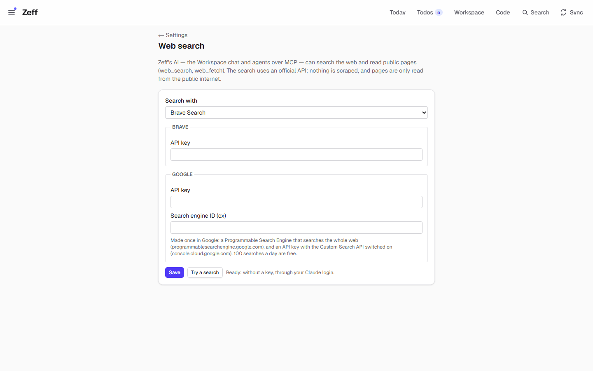

# Web search

> Lets Zeff's AI search the web and read a public page — as MCP tools for agents, as tools of the Workspace chat, and as flow actions — through your Claude login without a key, or through an official search API. **Category:** Connector · **On by default:** no · **Beta:** no · **Needs:** the [Claude CLI](ai-backends.md#claude-cli) signed in, or a Brave Search / Google Programmable Search key

## For users

### What it does

Some questions need the web: "what does GPT-5.5 cost per million tokens?", "what's the token limit of this model?",
"fill this database with the opening hours of these museums". With Web search on, Zeff's AI — the Workspace chat and
any agent connected over MCP — gets two tools:

- **web_search** — search the web: titles, addresses and snippets of up to 10 results, optionally on one site or in a
  preferred language;
- **web_fetch** — read one public page or PDF as plain text (scripts, styles and navigation removed).

It never scrapes Google's result pages. The search runs either through the web search built into your Claude login
(no key, no card — the Claude CLI does the search) or through an official API with your key: Brave Search, or Google
Programmable Search if you already have one (Google takes no new customers and ends it on 2027-01-01).

### Getting started

1. Menu → Plugins → category *Connector* → switch on **Web search**.
2. Either have the [Claude CLI](ai-backends.md#claude-cli) extension installed and signed in — then nothing else is
   needed: Settings → Web search says "Ready: without a key, through your Claude login." — or
3. open **Settings → Web search** (`/settings/web-search`), choose *Search with* **Brave Search** or **Google**, and add
   the key:
   - *Brave*: an API key from Brave Search (Brave asks for a card); quicker than the Claude login.
   - *Google*: an API key with the Custom Search API switched on (console.cloud.google.com) and a *Search engine ID
     (cx)* of a Programmable Search Engine that searches the whole web (programmablesearchengine.google.com). 100
     searches a day are free.
4. *Save*, then *Try a search* — it searches for "OpenAI API pricing per million tokens" and shows the first three titles.

### Using it

**In the Workspace chat.** Ask for something that needs the web: "look up the current prices of the OpenAI models and
put them in a database". The chat's tool group *Search and read the web* (on by default for an agent) holds
`web_search` and `web_fetch`; you see the tool calls in the chat.

**For agents over MCP.** Claude Code, Copilot or any MCP client connected to Zeff can call `web_search` and `web_fetch`.
While the extension is off, the tools answer "Web search is not installed in Zeff (Menu → Plugins) — this tool isn't
available."

**In flows and lookups.** A Studio flow can use the actions `web.search` and `web.read`; the
[Lookups](lookups.md) source *Web search* (`web.search`) adds a page or PDF as a Workspace row with its whole text.

### Settings

| Setting | What it changes |
| --- | --- |
| Search with | *Brave Search* or *Google*. Without the chosen provider's key the search goes through the Claude login. (A Google choice without a Google key is read as Brave.) |
| Brave — API key | The key for `api.search.brave.com`. Left empty when saving: the stored key stays. |
| Google — API key | The key for the Custom Search JSON API. Left empty: the stored key stays. |
| Google — Search engine ID (cx) | Your Programmable Search Engine. |
| Try a search | One test search. |

### Tips & limits

- **What leaves the machine:** the search words go to the provider (Anthropic through the Claude CLI, Brave or Google);
  a page read goes from this computer to that site with the User-Agent `Mozilla/5.0 (compatible; Zeff)`.
- **Your network stays out of reach.** A page is only read from the public internet: `localhost`, private and link-local
  addresses (and names resolving to them) are refused, also after a redirect (each of up to 5 hops is checked). A page's
  text is data — an AI steered by it must not be able to reach Zeff's local pages or your router.
- **Web content is data, not instructions:** the tools tell the AI so with every answer, and ask it to name the source.
- Pages are cut at 20 000 characters by default (`maxChars` up to 40 000), at most 2 MB is read; only text, HTML, JSON,
  XML and PDFs with a text layer (a scanned PDF fails).
- A search through the Claude login uses Claude Haiku with a budget of $0.30 per search and can take up to two minutes;
  it counts against your Claude quota.
- Pages that need JavaScript to show anything are better read with the [Browser](browser.md) extension.

## Technical reference

### Overview

[search.ts](../../src/plugins/web-search/search.ts) holds both halves:

- `webSearch(query, { count, site, language })` — with a ready key (`searchReady`): Brave
  (`api.search.brave.com/res/v1/web/search`, header `X-Subscription-Token`) or Google
  (`www.googleapis.com/customsearch/v1`); otherwise, when `canSearch` (Claude CLI installed and found), `claudeSearch`:
  `runClaude` with only Claude's `WebSearch` tool allowed, model `haiku`, the query between markers as data, answer as
  JSON `{ results: [{ title, url, snippet }] }`. Every hit's URL must be http(s).
- `webFetch(url, { maxChars })` — `checkUrl` (http/https, no local names, DNS-resolved address must be public:
  `isPrivateAddress` covers loopback, RFC 1918, link-local, carrier NAT, unique-local, IPv4-mapped IPv6), manual
  redirects (5 hops, each checked), 20 s timeout, PDFs through the Documents plugin's `pdfText`, HTML through
  `htmlToText`. `publicUrl` exposes the same check to the [Browser](browser.md) extension.

[mcp.ts](../../src/plugins/web-search/mcp.ts) registers `web_search` and `web_fetch` on Zeff's MCP server
([src/mcp/server.ts](../../src/mcp/server.ts)), which the Workspace chat's agent uses too.

### Manifest

| Field | Value |
| --- | --- |
| id | `web-search` |
| name | Web search |
| category | `connector` |
| order | 125 |
| defaultInstalled | `false` |
| dependsOn | — |
| requires | "The Claude CLI, signed in. Optional and quicker: a Brave Search API key (Brave asks for a card), or Google Programmable Search if you already have it." |
| settings | `/settings/web-search` — "The provider and its API key" |
| routes | `/settings/web-search` |
| syncSteps, features | — |

### Files

| File | What it is |
| --- | --- |
| [plugin.ts](../../src/plugins/web-search/plugin.ts) | The manifest. |
| [search.ts](../../src/plugins/web-search/search.ts) | Config (pref), `webSearch`, `claudeSearch`, `webFetch`, `publicUrl`, `isPrivateAddress`, `htmlToText`. |
| [mcp.ts](../../src/plugins/web-search/mcp.ts) | The MCP tools `web_search`, `web_fetch`. |
| [server-actions.ts](../../src/plugins/web-search/server-actions.ts) | Save the settings; *Try a search*. |
| [app/settings/web-search/page.tsx](../../src/app/settings/web-search/page.tsx) | The settings page. |
| [workspace/flows/actions.ts](../../src/plugins/workspace/flows/actions.ts) | Flow actions `web.search`, `web.read`. |
| [workspace/agent-tools.ts](../../src/plugins/workspace/agent-tools.ts) | The chat's tool group `web` (*Search and read the web*). |

### Data

| Where | What |
| --- | --- |
| pref `web-search.config` | `provider` (`brave` or `google`), `braveKey`, `googleKey`, `googleCx`. |

Nothing else is stored: results and pages go to the caller only.

### Sync, jobs & AI tasks

None. A search through the Claude login is a direct `runClaude` call (not an [LLM](llm.md) task, so it is not listed in
the task table).

### MCP tools & actions

| Tool | Input | Output |
| --- | --- | --- |
| `web_search` | `query` (≥ 2 chars), `count` 1–10 (default 5), `site`, `language` (2 letters) | Numbered results: title, URL, snippet. |
| `web_fetch` | `url`, `maxChars` 1000–40000 | Title, final URL, "(cut off)" when truncated, the text. |

Both are read-only and open-world. Flow actions: `web.search`, `web.read`. Server actions: `saveWebSearchAction`,
`testWebSearchAction`.

### Extension points

None of its own. It contributes MCP tools, the chat tool group `web`, and the flow actions; `publicUrl` is reused by
[Browser](browser.md).

### Tests

| Test | Covers |
| --- | --- |
| [tests/web-search.test.ts](../../tests/web-search.test.ts) | Google and Brave mapped to hits, the error without a key; a page as text, cut to size, never the machine's own network; the tools present only while installed. |

Run: `node --import tsx --test tests/web-search.test.ts`.
