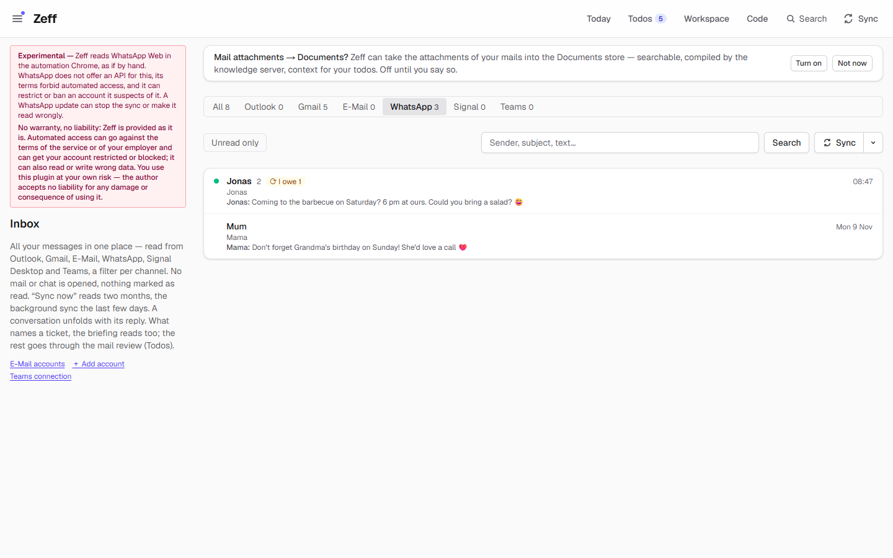
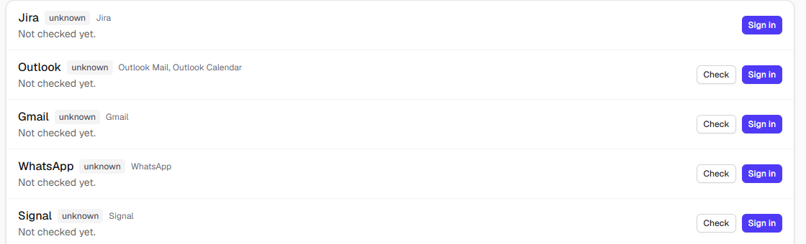
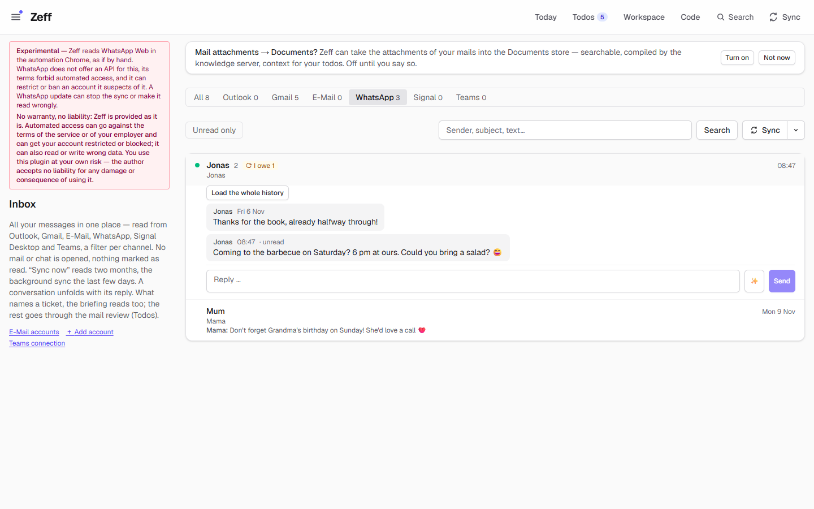
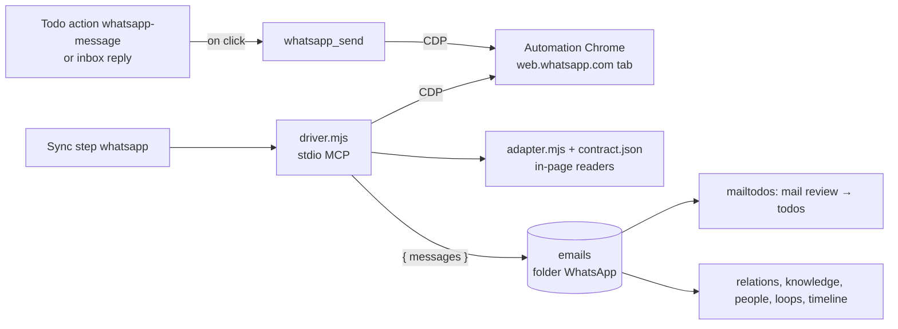

# WhatsApp

> Reads your WhatsApp chats from WhatsApp Web in the automation Chrome, without opening a chat, and puts the messages in the inbox, the mail review, matching and knowledge. On your click it sends a reply. **Category:** connector · **On by default:** no · **Beta:** no, but **experimental** (see below) · **Needs:** the account's automation Chrome with WhatsApp Web linked to your phone; works with [Mail client](mail-client.md), [Todos](todos.md), [Auto actions](auto-actions.md)

> **Experimental: use at your own risk.** WhatsApp has no API for this. Zeff reads WhatsApp Web in the automation
> Chrome the way you would by hand. **WhatsApp's terms forbid automated access, and WhatsApp can restrict or ban an
> account it suspects of it.** A WhatsApp Web update can stop the sync or make it read the wrong data until Zeff (or
> its contract file, see [Technical reference](#technical-reference)) is adapted. Zeff comes without warranty, and its
> author accepts no liability for any damage or consequence of using this plugin. The Plugins page and the inbox's
> WhatsApp filter show this warning too.

## For users

### What it does

Messages from WhatsApp are often the ones that ask something of you: a friend asks you to bring a salad, your mother
reminds you of a birthday. The WhatsApp plugin brings these chats into Zeff next to your mails:

- The **Inbox** (`/mail`, filter **WhatsApp**) lists every chat with its newest message, who wrote it and when. In the
  demo: *Jonas* ("Coming to the barbecue on Saturday? 6 pm at ours. Could you bring a salad?", unread, with the
  "I owe 1" loop badge) and *Mum* ("Don't forget Grandma's birthday on Sunday! She'd love a call").
- The **mail review** (a sync step after each briefing) reads new WhatsApp messages like mails and makes
  [todos](todos.md) from what they ask of you, for example "Bring a salad to Jonas's barbecue".
- **Mail matching** attaches the messages to the todos they belong to, and the [knowledge](knowledge.md),
  [people](people.md), [loops](loops.md) and [timeline](timeline.md) read them as well.
- **Today** lists chats waiting for your answer: one line per chat while the last word in the last 7 days is not
  yours. In a group, only when something in it is addressed to you (a mention or a quote of your message).
- You can **reply** from the inbox or from a todo's suggested action. The message is sent only when you click.

Zeff never opens a chat to read it. Opening a chat in WhatsApp Web marks its messages as read and sends blue ticks,
so the senders don't see that Zeff read them.

### Getting started

1. **Menu → Plugins** (`/plugins`), section *Connectors*: switch on **WhatsApp**. You are shown the experimental
   warning first.
2. Make sure the **automation Chrome** runs. This is the separate Chrome profile Zeff uses for every browser-based
   connector of this account. Each Zeff account has its own.
3. **Settings → Connections** (`/settings/connections`), section *Browser sign-ins*: press **Sign in** next to
   WhatsApp. This brings WhatsApp Web to the front in the automation Chrome. Link it yourself with your phone:
   WhatsApp → *Linked devices* → scan the QR code. Zeff never links it and never types anything for you.
4. Press **Check**. It says *Signed in* (or what is missing: Chrome not running, page not open, QR code shown).

   

5. Press **Sync** in the inbox (WhatsApp filter) or in the Sync menu. The first sync reads the last two months (60
   days). After that, each sync reads the last 3 days.

Keep WhatsApp Web open in the automation Chrome. If you use WhatsApp Web in another window, WhatsApp shows "use
here" in one of them. Zeff does not take over the other window. Press the button there yourself.

### Using it

**Read a chat.** Click a chat in the inbox to unfold its messages. This happens in Zeff only. Nothing is opened in
WhatsApp Web.

**Reply.** Below an unfolded chat is a reply line. Type a message, or press the sparkle button (**Draft with AI**) for
a draft in the chat's language and tone. **Send** (or Enter; Shift+Enter for a new line) asks "Send to “Jonas” via
WhatsApp?" and then sends it through WhatsApp Web: the chat is opened there (which marks it as read), the text is
typed and sent, and Zeff checks that the message shows up in the chat. If it doesn't see it, it tells you to check.

**Suggested messages on todos.** With the extension *Send message* (on by default once [Auto actions](auto-actions.md)
are installed), the AI suggests WhatsApp messages on todos: accept, decline, propose a time, ask back. They are
ready-worded and sent only when you click **Send** on the todo. The todo then notes "WhatsApp message sent to … on …".

**Load the whole history.** The button on an unfolded chat loads all its messages from the beginning, so the knowledge
can read them. Zeff asks first because this one **does open the chat** in the automation Chrome (its unread messages
then count as read) and fetches older messages from your phone, which has to be online. A long chat can take several
minutes (at most 45). Old messages are not gone through for todos; the mail review only reads recent ones.

**Mark done.** A message marked done (by hand, or by the todo it led to) makes no new todos.

### Settings

WhatsApp has no settings page of its own. What you can set:

| Setting | Where | What it changes |
| --- | --- | --- |
| Plugin on/off | Menu → Plugins | Off: no sync, no WhatsApp filter, no suggestions; the messages already read stay. |
| *Send message* extension | Menu → Plugins, under Auto actions | Whether auto actions suggest WhatsApp messages on todos (on by default). |
| WhatsApp sync interval | Settings → Connections → *Sync settings* | Every 5, 10, 15 (default), 30 minutes … 24 hours, or *manual only*. Runs only while the automation Chrome runs, and not between 19:00 and 08:00. The more often, the fewer messages are missed between two syncs when only the chat list can be read. |
| Mail review, mail attachments | Same section, listed as followers of the sync | They run with each briefing on the new messages (mails and WhatsApp alike). |

### Tips & limits

- **What leaves the machine:** nothing goes to WhatsApp except the messages you send. The messages are kept in Zeff's
  database. The AI (your chosen [LLM](llm.md)) sees them when it reviews messages for todos, matches them to todos,
  drafts a reply, or works on the knowledge.
- **No chat is opened while reading.** Only *Send* and *Load the whole history* open a chat, and both say so.
- **Fallback to the chat list.** Normally Zeff reads all messages of the chats active in the last days from what
  WhatsApp Web has decrypted for display. If an update moved those internals, it falls back to the chat list: only
  each chat's last message. The log then names what is missing.
- **Background syncs** run only while the automation Chrome runs. They never start it. A sync by hand may start it and
  open WhatsApp Web in a new tab.
- **Drift warning.** The sign-in check also tests whether WhatsApp Web still looks the way Zeff expects. A change shows
  as "Signed in." plus a drift note on the Connections page, the Sync menu and Today, before a sync breaks.
- Sending finds the chat by its exact name as WhatsApp shows it. If another chat opens, nothing is sent.
- Zeff never touches your phone link, your contacts, or WhatsApp's encrypted local database.

## Technical reference

### Overview

The plugin is a **driver** (`driver.mjs`): a stdio MCP server that Zeff starts for each operation. It attaches over
the Chrome DevTools Protocol (CDP) to the account's automation Chrome (`WHATSAPP_CDP_ENDPOINT`, else
`CHRONO_CDP_ENDPOINT`, else the account's Chrome endpoint, see `automationEnv()` in
[drivers.ts](../../src/plugins/drivers.ts)) and finds the `web.whatsapp.com` tab. Everything that knows WhatsApp Web's
insides is in [adapter.mjs](../../src/plugins/whatsapp/adapter.mjs) (functions that run in the page) and
[contract.json](../../src/plugins/whatsapp/contract.json) (module names, selectors, words). An update of WhatsApp Web
is fixed in the contract, not in the code. See [docs/automation.md](../automation.md).

The sync step `whatsapp` (`syncWhatsapp()` in [mail/sync.ts](../../src/lib/mail/sync.ts)) calls `whatsapp_messages`
and falls back to `whatsapp_chats` when the driver answers `{ error: "no-internals" }`. The messages are saved with the
mails (`saveMails`, folder `WhatsApp`). After a successful step the registry runs the workspace pipelines, closes reply
todos your answers settled (`closeTodosByEvidence`) and indexes the timeline. The mail review (`mailtodos`) and
matching (`relations`) follow with the briefing.

### Manifest

| Field | Value |
| --- | --- |
| id | `whatsapp` |
| category | `connector` |
| order / actionsOrder | 280 / 80 |
| defaultInstalled | `false` |
| experimental | WhatsApp has no API, its terms forbid automated access, it can restrict or ban accounts; updates can break the sync |
| requires | The account's automation Chrome with WhatsApp Web, linked to your phone |
| dependsOn | none |
| apps | `/mail` (Inbox) |
| routes | `/mail`, `/apps/whatsapp` (redirects to `/mail?channel=whatsapp`), `/api/boards/mail-relations` |
| syncSteps | `whatsapp`, `mailtodos`, `relations` |
| services | `whatsapp` (sign-in prompts, Connections page) |
| extensions | `send-action` for `auto-actions`: *Send message*, action `whatsapp-message`, on by default |

### Files

| File | What it does |
| --- | --- |
| [plugin.ts](../../src/plugins/whatsapp/plugin.ts) | The manifest. |
| [driver.mjs](../../src/plugins/whatsapp/driver.mjs) | Stdio MCP server: `whatsapp_status`, `whatsapp_selftest`, `whatsapp_messages`, `whatsapp_chats`, `whatsapp_history`, `whatsapp_send`; result shaping (`toMail`). |
| [adapter.mjs](../../src/plugins/whatsapp/adapter.mjs) | In-page functions: state (chats / QR / elsewhere / loading), rows, messages, history, header, sent check, self-check. |
| [contract.json](../../src/plugins/whatsapp/contract.json) | What the adapter expects: `modules` (collections, load, me), `selectors`, `texts`. |
| [actions.ts](../../src/plugins/whatsapp/actions.ts) | The `whatsapp-message` action `{ chat, body }` and the AI's instructions for offering it. |
| [run.ts](../../src/plugins/whatsapp/run.ts) | Runs the action on a click: `whatsapp_send`, the note on the todo. |
| [history.ts](../../src/plugins/whatsapp/history.ts) | `pullWhatsappHistory`: one chat's whole history, from the phone too (45-minute limit, one at a time). |
| [history-actions.ts](../../src/plugins/whatsapp/history-actions.ts), [HistoryButton.tsx](../../src/plugins/whatsapp/HistoryButton.tsx) | The *Load the whole history* button and its server action. |
| [server-actions.ts](../../src/plugins/whatsapp/server-actions.ts) | `syncWhatsappAction`: the inbox's Sync, through the registry's step. |
| [sync-settings.ts](../../src/plugins/whatsapp/sync-settings.ts) | Its row in the sync settings (interval) and the mail followers. |
| [mail/sync.ts](../../src/lib/mail/sync.ts) | `syncWhatsapp`, `whatsappRead` (messages, else chat list). |
| [mail/store.ts](../../src/lib/mail/store.ts) | `saveMails`, `whatsappChatsWaiting` / `chatsWaiting` (Today's "waiting for your answer"). |
| [ChatReply.tsx](../../src/plugins/mail-client/ui/ChatReply.tsx) | The reply line under a chat (shared with Signal and Teams). |
| [scripts/automation/](../../scripts/automation) | `probe.mjs`, `contract.mjs` (merge + report), `mcp-stdio.mjs` (shared MCP loop). |

### Data

- **`emails`** ([schema.ts](../../src/db/schema.ts)): one row per message, `folder = 'WhatsApp'`, `convId = "wa:<chat
  name>"`, `subject` = the chat's name, `fromName` = the sender, `preview` = the text, `receivedAt`, `unread`. Specific
  to chats: `isGroup` (written in a group) and `toMe` (in a group: it mentions you or quotes you). `resolvedAt` (marked
  done) and `reviewedAt` (gone through by the mail review) are kept across syncs. A message's id is WhatsApp's
  `_serialized` id, else `chat|time`, so a message read again is the same row
  ([whatsapp-ids.test.ts](../../tests/whatsapp-ids.test.ts)).
- **Prefs:** `whatsapp:messages-read`, set after the first full read (60 days); then 3 days per sync.
- **Sync state:** the step's last run and interval in the sync registry's records (`stepMinutes("whatsapp")`, default 15).
- **Contract override:** `data/automation/whatsapp.json` in the folder of `ZEFF_AUTOMATION_DIR`, merged over
  `contract.json` entry by entry (`null` removes one).

### Sync, jobs & AI tasks

| Step | What it does |
| --- | --- |
| `whatsapp` | Reads the chats active in the last 3 days (60 the first time): `whatsapp_messages` with up to 3 (8) loads of earlier messages per chat, else `whatsapp_chats` (100 / 300 chats). Background runs only while the automation Chrome is up; by hand it may launch Chrome and open WhatsApp Web. One run at a time per account (`__zeffWhatsappSyncing`). |
| `mailtodos` | The mail review, with each briefing: todos from new mails and WhatsApp messages (AI). WhatsApp messages are chats, never "must-do" notification mails. |
| `relations` | Mail matching: attaches messages to open todos (AI). |

No AI task of its own (`llm-tasks.ts`). The AI writes the `whatsapp-message` action from the offer text in
[actions.ts](../../src/plugins/whatsapp/actions.ts) (in German, like all prompts): only when the todo came from a
WhatsApp chat or concerns someone you write with there, in the chat's language and tone, 1–3 sentences, not when the
answer is already in the chat.

### MCP tools & actions

**The driver's own MCP tools** (stdio, used by Zeff; any MCP client can call them against the automation Chrome):

| Tool | Reads / writes |
| --- | --- |
| `whatsapp_status` | Chrome reachable, tab open, linked; with a linked tab, the contract check (`drift`). |
| `whatsapp_selftest` | The contract against the live tab: `ok`, `drift`, `warn`, `fail`, `skip` per item. Types and counts only, never a name or a text. |
| `whatsapp_messages {days, maxLoads, maxMessages}` | Messages of the active chats from WhatsApp Web's store; no chat opened. `{ error: "no-internals" }` when not available. |
| `whatsapp_chats {days, maxChats}` | The chat list: each chat's last message. |
| `whatsapp_history {chat, maxLoads, fromPhone}` | One chat's whole history; `fromPhone` opens the chat and fetches older messages from the phone. |
| `whatsapp_send {chat, text, dryRun}` | Opens the chat, checks the header names it, types and sends. The only writing tool; Zeff calls it only on your click. |

**Action:** `whatsapp-message` `{ chat, body }` (*Send WhatsApp message*, `comms: true`), offered by auto actions,
run by [run.ts](../../src/plugins/whatsapp/run.ts).

**Zeff's MCP server** has no WhatsApp-specific tool. Agents see WhatsApp messages through the general tools that read
mails and context (for example `search_context`, the timeline).

**Server actions:** `syncWhatsappAction`, `pullWhatsappHistoryAction`. **Routes:** `/apps/whatsapp?chat=…` redirects
into the inbox ([moved-pages.ts](../../src/lib/moved-pages.ts)).

### Extension points

- Contributes the `whatsapp-message` action to [Auto actions](auto-actions.md) via its extension `send-action`.
- Contributes the `whatsapp` sync step and a row in the sync settings (`syncSettings` with `follows: MAIL_FOLLOWERS`).
- Its messages are a channel of the [Mail client](mail-client.md) inbox (`channel=whatsapp`) and a source of the
  workspace's mail pipelines, the [timeline](timeline.md), [people](people.md), [loops](loops.md), data boundaries and
  source health.
- Service `whatsapp` in the sign-in list ([logins.ts](../../src/lib/logins.ts)); a drift found by the status check is
  passed to source health (`noteDrift`).

### Tests

| Test | Covers |
| --- | --- |
| [automation-adapters.test.ts](../../tests/automation-adapters.test.ts) | The real in-page functions against a fake WhatsApp Web: reading messages, a renamed loader found by what it can do, `no-internals`, history, states (chats, QR, elsewhere, loading), the self-check's data shapes, message ids. |
| [automation-probe.test.ts](../../tests/automation-probe.test.ts) | Probe, contract merge, the MCP loop. |
| [whatsapp-ids.test.ts](../../tests/whatsapp-ids.test.ts) | A message read again with its own id stays one row. |
| [whatsapp-waiting.test.ts](../../tests/whatsapp-waiting.test.ts) | A chat waits for you once; a group only when something is to you. |

Run one: `node --import tsx --test tests/whatsapp-waiting.test.ts`.
