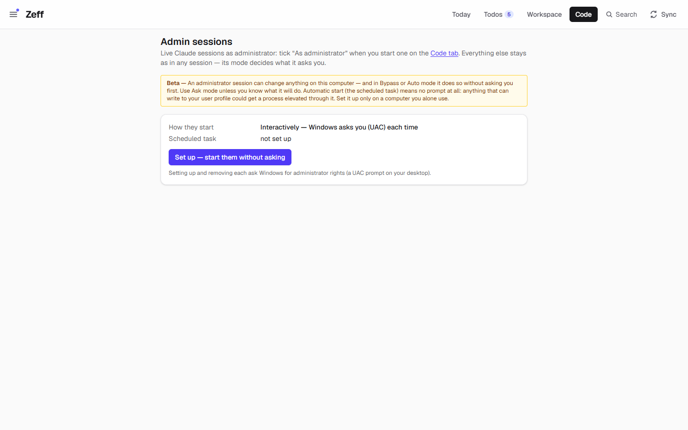
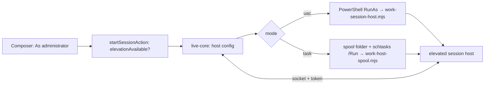

# Admin sessions

> Live Claude sessions on the Code tab that run as Windows administrator — Windows asks each time (UAC), or a scheduled task set up once starts them without asking. **Category:** app · **On by default:** no · **Beta:** yes · **Needs:** [Code](work.md), Claude Code ([AI backends](ai-backends.md)); Windows and an administrator account



## For users

### What it does

Some work needs administrator rights: installing software, setting up a Windows service, changing system settings.
A normal Code session can't do that. With this plugin the composer on the [Code](work.md) tab gets a tick box
**As administrator**: that session's Claude Code process starts elevated, and everything else stays as in any session —
its permission mode decides what it asks you.

There are two ways the elevated process is started:

- **Interactively (default)** — each admin session makes Windows show the UAC prompt on your desktop. Decline it and
  the session fails with "Administrator rights were declined (UAC)".
- **Automatically** — a scheduled task (`\Zeff\Elevated work sessions`, highest privileges) set up once starts admin
  sessions without a prompt.

If Zeff itself already runs as administrator, every session does — ticked or not; the page says so.

### Getting started

1. **Menu → Plugins → Admin sessions** (off by default; marked beta). It needs [Code](work.md) and the Claude Code
   plugin (`claude-cli`).
2. Open **Code → Admin sessions** (`/work/admin`, also the plugin's settings link). It shows how sessions start and
   whether the scheduled task is set up.
3. Optional: **Set up — start them without asking** registers the scheduled task (Windows asks for administrator rights
   once). **Remove — ask each time again** removes it (asks once more).

On anything other than Windows the page only says that admin sessions are for Windows: start Zeff itself with the rights
its sessions need.

### Using it

1. On the Code tab, write the task in the composer.
2. Tick **As administrator** ("Runs as administrator (Windows asks you, or the Admin sessions task starts it)").
3. Send. With UAC, confirm the prompt on your desktop (Zeff waits up to three minutes for the session to come up).
4. The session is marked *Administrator* in its pane and works like any other live session.

### Settings

| Setting | Where | What it changes |
| --- | --- | --- |
| How they start: interactive (UAC) / automatic (scheduled task) | `/work/admin`, buttons *Set up* / *Remove* | Pref `workElevated.mode` (`uac` or `task`); setting up the task switches to `task`, removing it back to `uac`. |

The permission modes and Bypass come from the Code settings, as for every session (see [Code](work.md#settings)).

### Tips & limits

- **Read the beta warning.** An administrator session can change anything on this computer — and in Bypass or Auto
  mode it does so without asking you first. Use Ask mode unless you know what it will do.
- **The scheduled task removes the prompt for everything:** anything that can write to your user profile could get a
  process elevated through it (it picks up config files from a spool folder). Set it up only on a computer you alone
  use.
- Claude only: the composer offers the tick box only when the Claude backend runs the session.
- An elevated session runs under its own host, not the launcher's work host; Zeff can't kill its process tree directly
  and ends it over its socket.
- Nothing extra leaves the machine compared with a normal session.

## Technical reference

### Overview

A live session's process normally runs on the launcher's work host. With `SessionOptions.elevated`, the live core
(`src/lib/work/live-core.ts`) instead writes a host config (command, args, folder, log files, token) and calls
`startElevatedHost()` from this plugin:

- `uac` mode: PowerShell `Start-Process … -Verb RunAs` runs `scripts/work-session-host.mjs` with the config, hidden.
- `task` mode: the config is copied into the spool folder (`<BASE_DIR>/work-elevated-spool`) and `schtasks /Run` starts
  the task, whose action is `node scripts/work-host-spool.mjs <spool> <claude-cli>` — it starts a session host per
  spooled config.

Zeff then connects to the host over 127.0.0.1 with the token, as to any session host (waiting up to 180 s instead of
45 s). Setting up and removing the task run a PowerShell script elevated (`Register-ScheduledTask` /
`Unregister-ScheduledTask`) and read its result from a temp file.



### Manifest

| Field | Value |
| --- | --- |
| id | `work-elevated` |
| name | Admin sessions |
| category | app |
| order | 90 |
| defaultInstalled | false |
| beta | yes (warning text above) |
| requires | Windows, and an administrator account (UAC). |
| dependsOn | `work`, `claude-cli` |
| settings | `/work/admin` |
| routes | `/work/admin` |
| syncSteps, features | none |

### Files

| File | What it is |
| --- | --- |
| [plugin.ts](../../src/plugins/work-elevated/plugin.ts) | The manifest. |
| [elevate.ts](../../src/plugins/work-elevated/elevate.ts) | Mode pref, `elevationAvailable`, `startElevatedHost`, `installTask`/`removeTask`, `taskInstalled`, `zeffElevated`. |
| [app/work/admin/page.tsx](../../src/app/work/admin/page.tsx) | The Admin sessions page. |
| [AdminSessionsForm.tsx](../../src/components/work/AdminSessionsForm.tsx) | Set up / remove buttons with confirmations. |
| [server-actions.ts](../../src/plugins/work/server-actions.ts) | `setAdminSessionsAction` (in the Code plugin) and the `elevated` check on start. |
| [live-core.ts](../../src/lib/work/live-core.ts) | Starts the elevated host. |
| `scripts/work-session-host.mjs`, `scripts/work-host-spool.mjs` | The session host and the scheduled task's spool runner. |

### Data

- Pref `workElevated.mode`: `uac` (default) or `task`.
- Folder `work-elevated-spool` in Zeff's base data folder: host configs waiting for the task.
- Windows scheduled task `\Zeff\Elevated work sessions` (outside Zeff; removed with *Remove*).

### Sync, jobs & AI tasks

None.

### MCP tools & actions

None of its own. The Code plugin's server action `setAdminSessionsAction` sets the mode or installs/removes the task;
`startSessionAction` accepts `elevated: true` only while `elevationAvailable()`.

### Extension points

None provided. It hooks into [Code](work.md) through `SessionOptions.elevated` and the composer options
(`composer-options.ts`: `admin: elevationAvailable()`).

### Tests

No dedicated test file. The live session host is covered by `tests/work-live-host.test.ts` and `tests/work-live.test.ts`:

```
node --import tsx --test tests/work-live-host.test.ts
```
