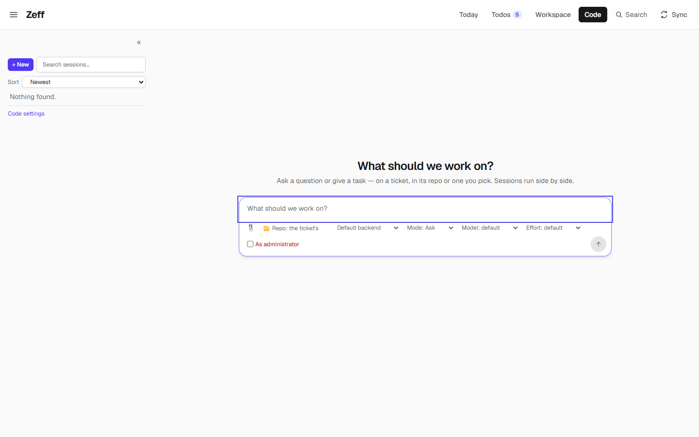
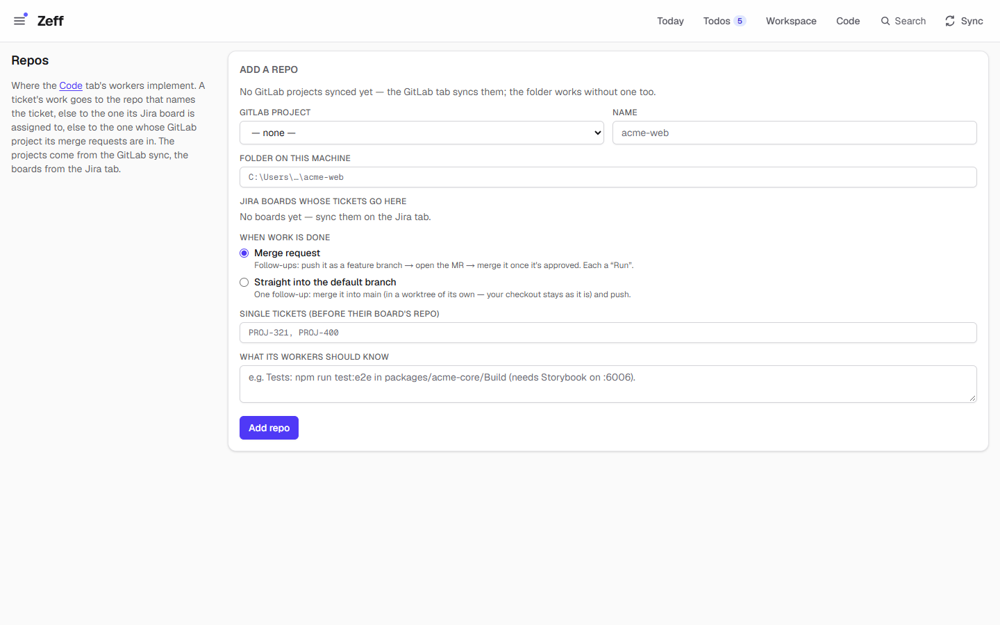
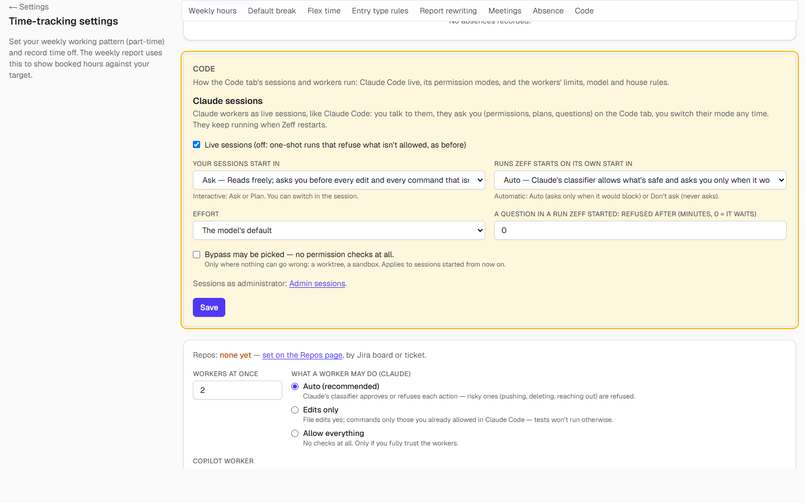
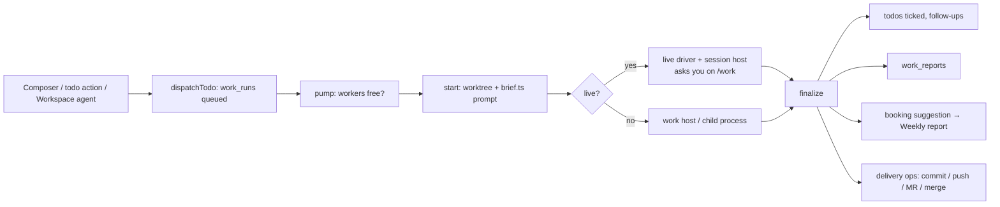

# Code

> AI workers and live coding sessions on your todos and tickets: a Claude Code–like chat per ticket, in its repo and branch, with delivery (commit, push, merge request, merge) on your click. **Category:** app · **On by default:** yes · **Beta:** no · **Needs:** [Todos](todos.md), [LLM](llm.md) (and an AI command-line tool from [AI backends](ai-backends.md): Claude Code, Copilot CLI or Codex)



## For users

### What it does

Code is where Zeff hands work to an AI. A *worker* is an AI command-line tool (Claude Code, the GitHub Copilot CLI or
Codex) that Zeff starts on your computer, in the right repository, with everything Zeff knows about the task: the todo,
its Jira ticket, the messages it came from, the merge request comments, the branch. You can:

- **start a session** on the Code tab — type what should be done ("What should we work on?"), pick a ticket (or none),
  the repo or any folder, the branch and how isolated the work is, and talk to the worker like in Claude Code;
- **hand a todo to a worker** — e.g. the todo's action "To Copilot" (`work-instruct`); what the worker does follows
  from the todo (`workModeOf` in shared.ts): *implement* a code todo, *write the draft* of a reply, *post to Jira* a drafted
  comment, *open the MR* for a merge todo, or *run* the todo's operations (no AI needed);
- **let Zeff's own automations use workers** — Workspace agents and routines run as workers too (see
  [Workspace](workspace.md)).

When a run ends, the worker answers in a fixed shape (done / partial / blocked, a Markdown report with *Erledigt*,
*Offen*, *Geprüft*, *Ort*, one line for the time entry, the todos it finished, follow-ups with ready drafts). Zeff turns
that into: todos ticked off, new follow-up todos, a full report kept per run, and a **booking suggestion** on the
Weekly report (workers never book time themselves — see [Time tracking](time-tracking.md)).

In the demo, Code is installed but has no runs: the sidebar is empty and the page shows the composer for a new session.

### Getting started

1. **Menu → Plugins → Code** (on by default). It needs [Todos](todos.md) and [LLM](llm.md).
2. Install at least one AI command-line tool and its plugin — Claude Code (`claude-cli`), Copilot CLI (`copilot-cli`) or
   Codex (`codex-cli`), see [AI backends](ai-backends.md). The default backend is the one set under Settings → AI.
3. Install **git** — without it the Code tab and the Repos page show a "git missing" notice.
4. **Menu → Repos**: add the repositories workers may work in (see below). A session can also be started in any folder
   on your computer, but a ticket finds its repo only through the Repos page.
5. Optional: tune the workers in **Settings → Code** (`/settings/time#work`).

### Using it

**Starting a session.** On `/work` the right pane is the composer. Type the task, then choose:

| Choice | What it means |
| --- | --- |
| Ticket | A Jira ticket with work on it, or *No ticket*. A ticket's repo is preselected (from the Repos page). |
| Folder | A registered repo, or any folder (a folder picker over your own disk; it shows whether a folder is a git repo and on which branch). |
| Branch + workspace | *worktree*: a new branch from the chosen one in a git worktree of its own · *branch*: the chosen branch itself, in a worktree · *checkout*: right in the repo. Default: the Code settings' isolation. |
| Backend, model, effort, permission mode | The installed backends that run live sessions and what each offers (Claude: default/Ask, Plan, acceptEdits, Auto, Bypass if allowed …). |
| As administrator | Only with the [Admin sessions](work-elevated.md) plugin, on Windows. |
| Attachments | Images and documents pasted, dropped or attached; the CLI reads them (Claude reads images and PDFs itself). |

Send it: the run is queued and starts as soon as a worker is free (Settings: *Workers at once*). Several sessions run
side by side.

**In a session.** The conversation streams in. A live session (Claude Code, Codex, interactive Copilot) asks you on the
page — a permission, its plan, a question — and you answer there. You can change the mode, the model and the effort,
interrupt it, send the next message (queued if it is still working), or stop it. Beside the conversation, like Claude
Code's own panes:

- **Changes** — every file changed since the session began (committed or not), as a diff; *Commit all* with a message,
  *Push* the branch, open a *Merge request* on GitLab. Each step is your click; nothing is pushed by itself.
- **Preview** — the dev servers from the repo's `.claude/launch.json` (the same file Claude Code uses): start, stop,
  their output.
- **What the worker was told** — the exact prompt (brief + task), also at `/api/work/<id>/prompt`.

The sidebar lists tickets with sessions, the ones at work on top; a session is *working*, *waiting for you*, *asks for
permission*, *queued*, *done*, *failed*, *stopped* or *interrupted*. Its ⋯ menu archives a session (back with *Show
archived*) or deletes it (its runs and logs; the todo stays). "Kill all dangling sessions" appears while runs count as
running without working (left over from a restart, or a worker process that is gone).

**Delivery.** After an implementation Zeff plans the delivery from the repo's *When work is done* setting and puts it on
the todo as operations, each a *Run* button: *Commit changes* (`git-commit-branch`), *Push branch* (`git-push`), then
*Open merge request* and *Merge* (GitLab, see [GitLab](gitlab.md)) — or, for a repo set to *Straight into the default
branch*, *Merge into the main branch* (`git-merge-main`: merged in a worktree of its own, so your checkout stays as it
is, then pushed).

**Repos** (`/repos`): one card per repo with its folder, current branch, the Jira boards and single tickets assigned to
it, the systems the AI read from the knowledge for it (Prod / Test / Dev), and the form below.



A ticket's work goes to the repo that names the ticket, else the one its Jira board is assigned to, else the one whose
GitLab project its merge requests are in.

**Agents outside Zeff.** A Claude Code session or VS Code Copilot you run yourself can work on a Zeff todo through
Zeff's MCP server (`start_todo`, `todo_clock_*`, `finish_todo` …). It then shows as a worker of its own (provider
`agent`), its notes as the log — on top of Zeff's own workers, not counted against *Workers at once*.

### Settings

Settings → Code (`/settings/time#work`) has two parts.



**Claude sessions** (stored in the pref `workClaude`):

| Setting | What it changes |
| --- | --- |
| Live sessions | On (default): Claude workers run as live sessions you talk to; they keep running when Zeff restarts (with the launcher's work host). Off: one-shot runs that refuse what isn't allowed. |
| Your sessions start in | The permission mode of sessions you start (interactive: Ask or Plan). Default: `default` (Ask). |
| Runs Zeff starts on its own start in | Mode for automatic runs: Auto (asks only when it would block) or Don't ask. Default: `auto`. |
| Effort | The model's default, or low … max. |
| A question in a run Zeff started: refused after (minutes) | 0 = it waits for you; otherwise an unanswered question is refused after that many minutes. |
| Bypass may be picked | Allows *Bypass permissions* as a mode (no checks at all). Turning it off moves sessions set to Bypass back to Ask / Auto. |

**Workers** (columns of `app_settings`):

| Setting | What it changes | Default |
| --- | --- | --- |
| Workers at once | How many runs work at the same time (1–8). Live sessions waiting for you don't hold a worker. | 2 |
| What a worker may do (Claude) | Auto (Claude's classifier approves or refuses each action; risky ones like pushing are refused) · Edits only (file edits, and only commands you allowed in Claude Code) · Allow everything (no checks at all). | Auto |
| Copilot worker | Interactive (asks you on the Code tab) · Autopilot (allows everything) · No questions (one-shot `-p` run). | Interactive |
| Where code work happens | A worktree of its own (recommended) · In the checkout (your current branch, one code run per repo at a time, no commits). | worktree |
| Model | The workers' model; empty = the model set under Settings → AI for that provider. | — |
| Copied instruction — code todos / other todos | What a click on a todo's label (T-35) copies for an agent; `$todo.id`, `$todo.ticket`, `$todo.text` are filled in. | "Implement $todo.id using strict TDD in a separate worktree" / "Do $todo.id" |
| House rules for every worker | Appended to Zeff's own rules in every worker's prompt (editable in the Workspace as the prompt `work-rules`). | empty |

**Per repo** (Repos page): name, folder, GitLab project, Jira boards, single tickets, *What its workers should know*
(added to the prompt), *When work is done* (merge request or straight into the default branch), ignored branches.

### Tips & limits

- **What leaves the machine:** the worker is an AI CLI; it sends the brief (todo, ticket text, messages, MR comments,
  knowledge snippets) and the code it reads to that CLI's provider (Anthropic, GitHub, OpenAI). Nothing else is sent by
  Code itself.
- Workers **never book time** and never post outside on their own: a drafted message becomes a todo with a one-click
  operation; Teams drafts can't be posted by a worker at all (copy and send them yourself). Deploys are always yours.
- A Claude worker gets Zeff's MCP server for **its own account only** (`/api/mcp/<account>` with that account's token),
  so a private worker cannot reach the work account's data.
- Without the launcher (plain `npm run dev`) workers are children of the Zeff server: restarting Zeff interrupts them.
  With the launcher they run on its work host and survive a restart.
- "In the checkout" means one code run per repo at a time and no commits — changes stay for you to review.
- Copilot in Interactive/Autopilot mode: restarting Zeff ends a running session.

## Technical reference

### Overview

A **run** (`work_runs`, shown as `W-<id>`) is one turn of work on one todo: a mode (`code`, `draft`, `send`, `mr`,
`ops`, `instruct`), a provider, where it works (repo, worktree, branch, base), its process, its result. A **session** is
all runs on one todo — the conversation. `dispatchTodo()` (runner.ts) queues a run; `pump()` starts queued runs while
workers are free (live sessions waiting for you and outside agents don't count; in-checkout code runs are one per
repo). `start()` picks the folder (worktree / branch / checkout / scratch), builds the prompt from `brief.ts` (todo,
ticket, last briefing, comments, sources, branch context, house rules, repo instructions) and starts the CLI.

Processes run on the **work host** (`scripts/work-host.mjs`, started by the launcher; `ZEFF_WORK_HOST`) so they outlive
a server restart, and the host reports the end at `POST /api/work/exit`. Live sessions use a **live driver** per
provider (`live-driver.ts`; Claude's in `plugins/claude-cli/live.ts`, Codex's in `plugins/codex-cli/live.ts`) on top of
`live-core.ts`, each session under a session host (`scripts/work-session-host.mjs`) that Zeff talks to over a local
socket. On the phone companion's server (a "web" server) runs are not started there: it hands them to Zeff's own via
host ops (`work.pump`, `work.liveDo`).

At the end `finalize()` reads the result (`outcome.ts`, schema `WORK_RESULT_SCHEMA`), ticks todos, adds follow-ups (and
has their actions looked at, `ensure-actions.ts`), writes the report (`report.ts` → `work_reports`), plans the delivery
(`deliveryPlan()`), and records a booking suggestion (`suggestions.ts`).



### Manifest

| Field | Value |
| --- | --- |
| id | `work` |
| name | Code |
| category | app |
| order / actionsOrder | 80 / 60 |
| defaultInstalled | true |
| dependsOn | `todos`, `llm` |
| tabs | `/work` (Code) |
| nav | `/repos` (Repos — "Where workers implement") |
| settings | `/settings/time#work` |
| routes | `/work`, `/api/work`, `/repos` |
| syncSteps, features | none |

### Files

| File | What it is |
| --- | --- |
| [plugin.ts](../../src/plugins/work/plugin.ts) | The manifest. |
| [server.ts](../../src/plugins/work/server.ts) | Registers the API methods, the Workers widget and the runs source. |
| [api.ts](../../src/plugins/work/api.ts) | Plugin API methods, permissions and events. |
| [actions.ts](../../src/plugins/work/actions.ts) | Actions `work-instruct`, `git-push`, `git-merge-main`, `git-commit-branch`. |
| [run.ts](../../src/plugins/work/run.ts) | Runs those actions (git delivery, handing a todo to a worker). |
| [server-actions.ts](../../src/plugins/work/server-actions.ts) | Server actions: start/continue a session, switch branch, archive/delete, retry, stop, save settings and repos, admin-session setup. |
| [branch-actions.ts](../../src/plugins/work/branch-actions.ts) | Add/delete branch-knowledge artifacts (Settings → AI → Branch names). |
| [llm-tasks.ts](../../src/plugins/work/llm-tasks.ts) | The AI task `worker`. |
| [widgets.ts](../../src/plugins/work/widgets.ts) | Workspace widget `work.runs` (Workers, with Stop). |
| [workspace-source.ts](../../src/plugins/work/workspace-source.ts) | Workspace source `runs` (Worker runs, joinable by ticket). |
| [runner.ts](../../src/lib/work/runner.ts) | Queue, start, finalize, cancel, resume after restart, dangling runs, delivery plan. |
| [store.ts](../../src/lib/work/store.ts) | `work_runs` access, work and Claude-session settings. |
| [shared.ts](../../src/lib/work/shared.ts) | Client-safe types: modes, statuses, `workModeOf`, result schema, permission modes. |
| [brief.ts](../../src/lib/work/brief.ts) | Everything a worker should know about a todo, as Markdown. |
| [live-core.ts](../../src/lib/work/live-core.ts), [live-driver.ts](../../src/lib/work/live-driver.ts), [live-actions.ts](../../src/lib/work/live-actions.ts), [live-state.ts](../../src/lib/work/live-state.ts) | Live sessions: process, host, events, what you do in them. |
| [host.ts](../../src/lib/work/host.ts), [session-host.ts](../../src/lib/work/session-host.ts) | The launcher's work host and the per-session host. |
| [git.ts](../../src/lib/work/git.ts), [session-git.ts](../../src/lib/work/session-git.ts), [branch-naming.ts](../../src/lib/work/branch-naming.ts), [branch-context.ts](../../src/lib/work/branch-context.ts) | Git: start branch, worktrees, a session's diff/commit/push/MR, branch names (`feature/PROJ-432-…`). |
| [outcome.ts](../../src/lib/work/outcome.ts), [report.ts](../../src/lib/work/report.ts) | A finished run's answer → todos, drafts, the kept report. |
| [suggestions.ts](../../src/lib/work/suggestions.ts), [booking.ts](../../src/lib/work/booking.ts) | Booking suggestions on the Weekly report from runs and time records. |
| [todo-clock.ts](../../src/lib/work/todo-clock.ts), [todo-time.ts](../../src/lib/work/todo-time.ts), [agent.ts](../../src/lib/work/agent.ts) | Measured time per agent on a todo; outside agents as workers. |
| [mcp.ts](../../src/lib/work/mcp.ts) | The MCP servers a Claude worker gets (`--mcp-config`). |
| [ticket-brief.ts](../../src/lib/work/ticket-brief.ts) | The MCP tool `ticket_brief`'s content. |
| [session-procs.ts](../../src/lib/work/session-procs.ts) | Dev servers from `.claude/launch.json`. |
| [attachments.ts](../../src/lib/work/attachments.ts) | Files sent with a message. |
| [sessions.ts](../../src/lib/work/sessions.ts), [session-admin.ts](../../src/lib/work/session-admin.ts) | Sidebar data; archive and delete. |
| [app/work/page.tsx](../../src/app/work/page.tsx), [app/repos/page.tsx](../../src/app/repos/page.tsx) | The Code tab and the Repos page. |
| [components/work/](../../src/components/work/) | Sidebar, panes, composer, session workspace (diff, preview), settings forms. |

### Data

| Table / pref | What it holds |
| --- | --- |
| `work_runs` | One row per run: `ticket`, `todo_id`, `mode`, `provider`, `model`, `permission_mode`, `status` (queued, running, done, failed, cancelled, interrupted), `repo`, `cwd`, `branch`, `base`, `base_sha`, `workspace` (worktree/branch/checkout), `session_id` (the CLI's, for resuming), `after_run` (a message queued behind a running turn), `pid`, `prompt`, `result` (JSON), `outcome`, `summary`, `entry_line`, `git_summary`, `error`/`error_seen_at`, `cost_usd`, `duration_ms`, `turns`, `denials`, `entry_id` (the time entry it went into), timestamps. |
| `work_reports` | One report per run: outcome, title, summary, full Markdown body, changes, checks, open items, completed todos, repo, branch, `by_who` ("W-45 · model"). Read by the knowledge server. |
| `repos` | Name, path, `gitlab_project`, `boards` and `tickets` (JSON), `instructions`, `delivery` (`mr` / `direct`), `ignored_branches`. |
| `todo_time` | Time records on todos (agent or by hand), with the run they belong to. |
| `app_settings` | `work_parallel`, `work_permission_mode`, `work_isolation`, `work_copilot_mode`, `work_model`, `work_instructions`, `agent_instruction_code`, `agent_instruction_other` (`work_repos`, `work_max_budget_usd`: unused). |
| pref `workClaude` | Claude session settings (live, mode, autoMode, effort, allowBypass, askTimeoutMin). |
| Files | `work/` next to the database (`data/work/`, per account in its folder): run logs, attachments (`attachments/<id>/…`), session host files. |

### Sync, jobs & AI tasks

- No sync step. On start `resumeWork()` follows live sessions that are still running and re-queues what was lost; the
  queue is pumped whenever a run ends.
- AI task `worker` ("Works on a todo — in the repo, with tools"), with its own backend and model under the LLM settings
  ([LLM](llm.md)).
- The worker's prompt is built in `brief.ts`; Zeff's rules are the prompt `work-rules` plus your house rules.

### MCP tools & actions

**Actions** (on todos; see [Todos](todos.md)): `work-instruct` "Hand to Copilot" (offered to the AI), and the delivery
steps `git-commit-branch`, `git-push`, `git-merge-main` (made by Zeff after an implementation, not in the AI's
dictionary).

**Plugin API** (for external plugins, `docs/plugins/api.md`): permissions `work.read`, `work.write`; methods
`work.runs.list`, `work.runs.get`, `work.runs.log`, `work.sessions.start`, `work.sessions.send`, `work.runs.cancel`;
events `work.run.started`, `work.run.finished`, `work.changed`.

**MCP**: a Claude worker gets Zeff's MCP server (`/api/mcp/<account>`, header `X-Zeff-Run`) and external plugins' MCP
servers. The tools workers and outside agents use live in [src/mcp/tools](../../src/mcp/tools/): `list_todos`,
`start_todo`, `todo_context`, `ticket_brief`, `todo_attachment`, `todo_clock_start/stop/ping`, `todo_time*`,
`todo_progress`, `todo_needs_input`, `finish_todo`, `todo_note`, `add_todo`, `complete_todo`. Booking tools
(`report_time` …) are kept from workers: Zeff books their runs. A send run also gets Zeff's Jira connection.

**API routes** (`/api/work/…`, only from Zeff's own pages unless noted): `attach` (upload files), `branches?path=`,
`folders?path=`, `dangling` (GET list, POST end them), `exit` (work host only, with its token), `:id/live` (answer,
send, mode, model, effort, interrupt, shell …), `:id/log?from=`, `:id/prompt`, `:id/session` (diff, files, procs;
commit, push, mr, proc-start/stop).

### Extension points

- Contributes to `apiPoint` (the methods above), `workspaceWidgets` (`work.runs`) and `workspaceSources` (`runs`).
- Provides the **live driver** registry (`live-driver.ts`): a CLI plugin registers its driver (Claude Code, Codex,
  Copilot); and **approved tools** (`approved-tools.ts`): a plugin can grant tools a run may use without asking (a
  routine's permissions).
- External plugins can add Code tab panels and worker MCP servers (`src/lib/ext/work.ts`).
- [Admin sessions](work-elevated.md) plugs in through `SessionOptions.elevated`.

### Tests

Under `tests/`: `work-start`, `work-actions`, `work-after-run`, `work-attachments`, `work-branch-name`,
`work-branches`, `work-delivery-plan`, `work-host`, `work-live`, `work-live-host`, `work-mcp`, `work-report`,
`work-result-contract`, `work-resume`, `work-session-admin`, `work-session-todos`, `work-workspace`, `worker-done`,
`worker-finish`, `worker-todos`, `live-driver`, `live-refresh`, `codex-live`, `session-groups`, `session-todo`,
`todo-clock`, `repo-picks`, `branch-knowledge`, `report` (fake CLI: `tests/fake-claude-live.mjs`). Run one:

```
node --import tsx --test tests/work-start.test.ts
```
