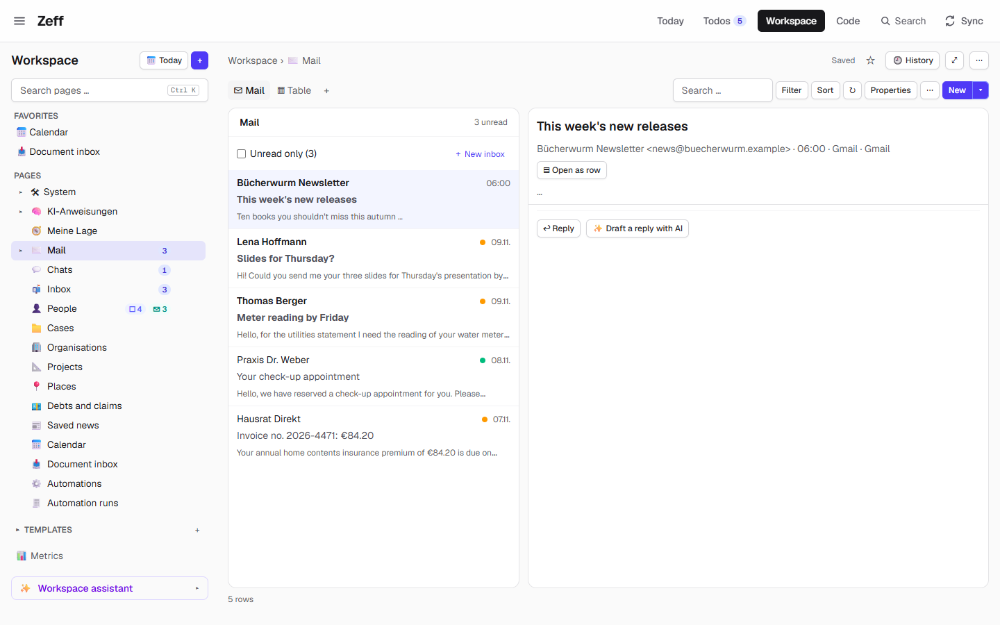
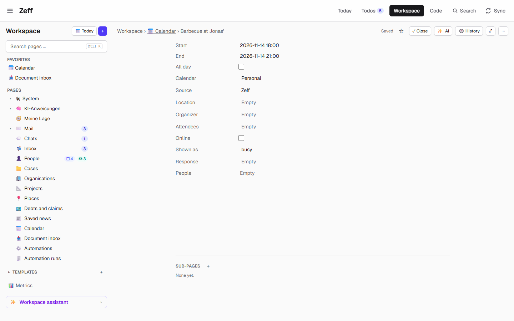
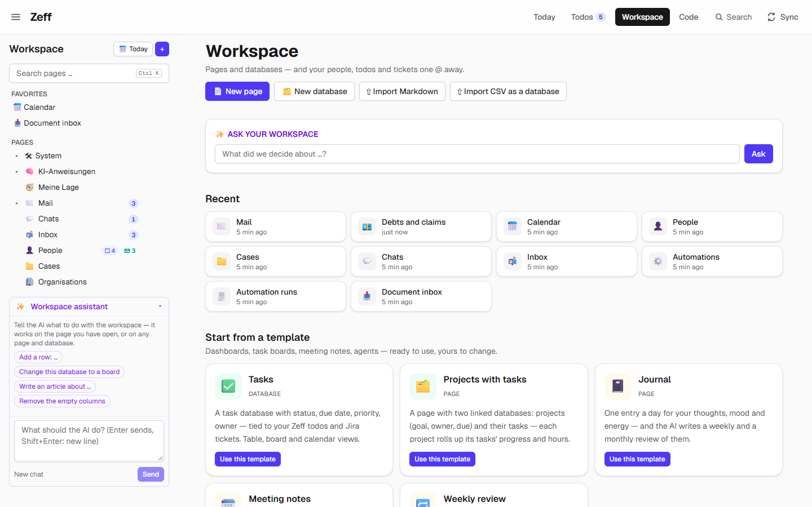
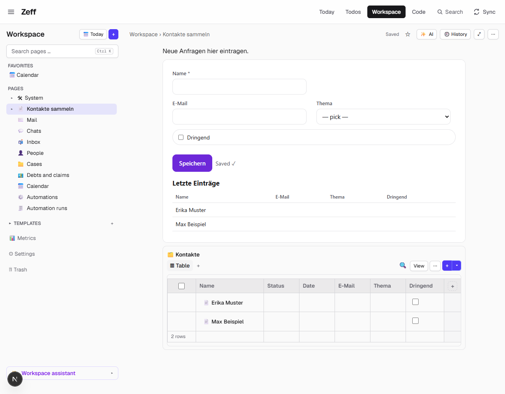
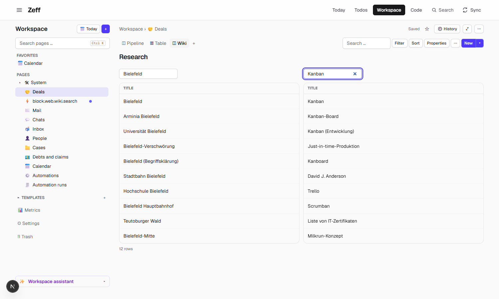
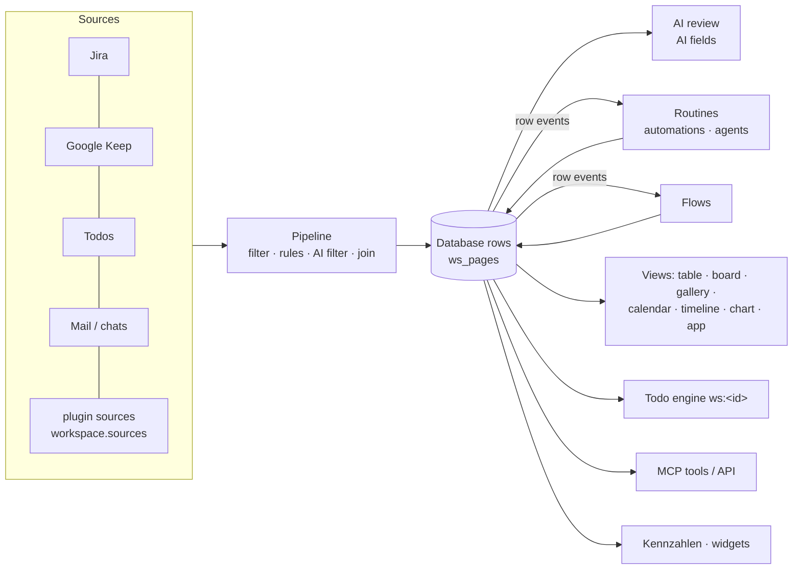

# Workspace

> Pages and databases like Notion — wired into Zeff: your people, todos and tickets one `@` away, databases filled by
> pipelines from your mail, chats, Jira and notes, automations, agents and flows that work on them, and every page
> readable by AI agents over the MCP. **Category:** app · **On by default:** yes · **Beta:** no (its Google Keep part is
> experimental) · **Needs:** nothing; its AI parts use [LLM](llm.md), Google Keep needs the automation Chrome


## For users

### What it does

Zeff derives your todos from what comes in — but some things don't come in, you write them: meeting notes, a project
plan, a list of contracts, a journal, what you decided last week. The Workspace is where they live, and unlike a
separate notes app it knows the rest of Zeff:

- **Pages** in a tree, written in a block editor (headings, lists, to-do lists, toggles, callouts, code, tables with
  spreadsheet formulas, pictures, embedded pages and databases). Type `/` for blocks and `@` for a person, a page, a
  todo or a ticket — the mention becomes a link, and the person's page shows the backlink.
- **Databases** whose rows are pages too: typed fields (text, number, select, status, date, person, relation, rollup,
  formula, AI field, button …) and views (table, board, list, gallery, calendar, timeline, chart, a to-do list, or the
  view of an app such as the mail client).
- **What other plugins keep is here too.** In the demo the tree already holds *Mail*, *Chats* and *Inbox* (the
  [Mail & Chat](mail-client.md) client's databases), *People* ([People](people.md)), *Cases* ([Cases](cases.md)),
  *Organisations*, *Projects* and *Places* ([Entities](entities.md)), *Debts and claims* ([Finances](finances.md)),
  *Saved news* ([News](news.md)), *Calendar* ([Calendar](calendar.md)) and the *Document inbox*
  ([Documents](documents.md)). The appointment "Barbecue at Jonas'" on Saturday is a row of the Calendar database
  with its start, end, calendar and attendees as fields.
- **Pipelines** fill a database from a source (Jira tickets by criteria, Google Keep, your todos, mails, chats, another
  database, the knowledge base, or a source another plugin brings), filter it — by rules or by an AI that reads each
  record — and let the AI fill fields or write a summary.
- **Automation:** *automations* (fixed steps: set a field, create a row, notify …) and *agents* (an AI worker that
  runs on a page's instructions), *rules* (WHEN … THEN …), *jobs for agents*, *flows* (the engine behind
  [Studio](studio.md) apps), rows that repeat by themselves and fields that fill themselves.
- **AI where you write:** "✨" on any page — *Think along*, *Write* (improve, shorter, translate, continue, summarize),
  *Ask about this page*; AI blocks that keep a section of a page up to date; *Make Zeff todos* from a page; the
  *Workspace assistant* in the sidebar that changes rows, views and pages for you.
- **Kennzahlen (metrics):** named numbers — your own formulas, a column's sum, or a number a plugin knows — readable in
  any formula, any page (`@Sparrate`) and by agents.

### Getting started

The Workspace is installed by default (Menu → Plugins → *Workspace* under Apps). Its tab is **Workspace** in the header
(`/workspace`); the old `/kanban` and `/keep` addresses lead here. Nothing has to be set up for pages and databases.
For the rest:

| To use | Do this |
| --- | --- |
| The AI parts (Think along, AI fields, AI filters, the assistant) | Install and set up [LLM](llm.md) (Menu → Plugins) |
| Mail / chat databases | Install a mail or chat connector ([Gmail](gmail.md), [Outlook](outlook.md), [IMAP](imap-mail.md), [Teams](teams.md), [WhatsApp](whatsapp.md), [Signal](signal.md)) — the *Mail* and *Chats* databases are made once |
| Jira boards as databases | [Jira](jira.md) + [Jira Lage](jira-lage.md), then switch boards on under **Workspace settings → Data sources** |
| Google Keep | Turn on the feature *Google Keep Sync* under the Workspace on the Plugins page, sign in to keep.google.com in the account's automation Chrome, pick the account under **Data sources** |
| Agents | A worker: [Claude CLI](ai-backends.md), [Codex CLI](ai-backends.md) or [Copilot CLI](ai-backends.md) (an agent without a choice uses the LLM plugin's worker) |

The settings live at **Workspace settings** (`/workspace/settings/sources`, linked from the menu and the Plugins page): *Data sources*,
*Outputs*, *Pipelines*, *History*, *Apps*.


### Using it

#### Pages and the tree

The left sidebar is the page tree: *Favorites* on top, then *Pages*, then *Templates* (your own) and *Metrics*. A badge
beside a page says what waits there — unread mails (*Mail 3*), open todos about people and unread messages from them
(*People ☐4 ✉3*), a date that is due, rows a sync or an agent changed since you last looked. The search box (Ctrl K)
finds pages by title; the global search finds them by their text.

The **+** at the top of the sidebar makes a *Page*, a *Database* or a *Form*; a *Day list* (Medicines — dose + time,
Routine — tick + time, Habits — tick); *Automation …*; or, *From channels*, a database over your mail and chats
(Inbox, Mail, Chat) or over a source a plugin brings — in the demo Calendar, Cases, Documents, Organisations,
Projects, Places, Debts, Recurring payments, Saved news, People and Automations. **Today** leads to the Today page
([Todos](todos.md)), where today's note is made.


On a page: click the icon or *Add cover* to dress it; `/` opens the block menu (text, headings, lists, to-do list,
toggle, quote, callout, formula, divider, code, table, image, sub-page, database, linked database, embed page, embed a
to-do list, form, widget, calendar, tabs, button, AI block, *Make Zeff todos* …); `@` mentions a person, page, todo,
ticket or Kennzahl. Markdown typed or pasted is turned into blocks. The page saves itself (*Saved* at the top right).

The **⋯** menu of a page: add to favorites, full width, small text, lock, duplicate, copy the link, *Export as
Markdown*, *Share as a read-only file (HTML)* (one self-contained file, pictures inside), *Export as package*, *Save as
template*, *Make this an agent* / *Make this an automation*, *Make Zeff todos (AI)*, move to trash. **History** shows the
earlier versions (one kept every ten minutes you edit) to look at and restore; the **Trash** (`/workspace/trash`)
brings pages back or deletes them for good.

#### Databases

*New database* (or `/database` in a page) makes one; *Import CSV as a database* types the columns by what is in them.
The bar above a database has its views as tabs (**+** adds one), *Search*, *Filter* (rules nested with and/or),
*Sort*, a grouping, *Properties*, ⋯ and **New**.

A database of a type an app knows is shown by that app as one of its views. The demo's *Mail* database opens in the
mail view — the five mails of the demo (the Bücherwurm newsletter, Lena Hoffmann's "Slides for Thursday?", Thomas
Berger's "Meter reading by Friday" …) with *Reply* and *Draft a reply with AI* — and has a plain *Table* view beside
it:



The same database in its *Table* view: one row per mail with Subject, From, Account, Folder, Received and Unread
as fields, a coloured dot where a todo came from the mail (amber open, green done), and chips above to filter by
person (Nobody 3, Lena Hoffmann 1, Thomas Berger 1):


A row opens as a page of its own (below: the appointment "Barbecue at Jonas'" from the Calendar database): its fields
on top, edited in place, then its text and sub-pages. On a board or gallery a row opens over the view (*peek*)
instead. A table has a sum row (sum, average, min, max, count per
column) whose result can be *published* as a value type or Kennzahl ("Fixkosten"); cells of formula columns open a
formula editor that colours the columns they name.



Field types: text, long text (Markdown), number (number, percent, euro, dollar, hours, unit), select, multi-select,
status (grouped to do / doing / done), date (with a range and a reminder), checkbox, URL, e-mail, phone, person,
relation (one- or two-way, to a database or to a Zeff source like the booked time), rollup, formula, created/updated
time, todo, ticket, AI field (an instruction the AI fills it by, optionally with fixed choices), button (runs an
automation on the row), and field types plugins bring (rating, percentage …).

The database's **⋯** menu, in five sections:

| Section | What is there |
| --- | --- |
| Fields & forms | *Edit properties …*, *Entry form …* (what **New** opens), *Make a form from this table*, *Repeating rows …*, *Use as a day list* |
| Data & sources | *Sources & steps …* (the pipeline), *Refresh from the sources*, *Derived database …*, *Receive tickets …* (rows sent from other databases arrive as linked copies), *Export as CSV* |
| Automation | *AI review* — the AI reads the rows that changed and fills the AI fields (*Review now*); *Agents …*; *Start all open jobs* on a jobs database |
| Sharing & protection | *Sensitivity* (open / personal / secret), *Data boundaries …*, *Outputs …*, *Share for formulas …*, *Protection …* (lock the rows, what the AI may do: everything / only add / nothing, fields whose values may not repeat) |
| View | *View name*, *Card* (a card template for boards and galleries), *Code* (the view's template), *Navigation beside the view / in the Workspace tree*, *Only mine in this view*, *Show hidden rows*, *Hide empty groups*, duplicate / delete the view, *Reset to default* |

Several ticked rows can be changed at once (set a field, move to another database, to the trash — with *Undo*). Every
change is in the row's *Activity* — who did it: you, the AI, an automation or a source.

#### Templates

*Start from a template* on the start page (or **+** in the sidebar) offers ready-made pages and databases. Each opens
first as a read-only preview of what it would make, with *Use* and *Duplicate as my template*.


| Template | What it makes |
| --- | --- |
| Tasks | A task database (status, due, priority, owner) tied to your Zeff todos and Jira tickets; table, board and calendar views |
| Projects with tasks | Two linked databases; each project rolls up its tasks' progress and hours |
| Journal | One entry a day (headline, mood, energy, gratitude); agents write a weekly and a monthly review |
| Agenda | Notes on a timeline as in the Agenda app — only while [Agenda](agenda.md) is installed |
| Meeting notes | Attendees, agenda, notes, decisions, action items, a 1:1 section |
| Weekly review | Done / not done / next, the week's figures live, an agent drafts it on Fridays |
| Reading list | Articles and books with status, rating, tags, link; a gallery |
| Contracts and subscriptions | Cost a month and a year, runs until, cancel by (with a reminder), customer number |
| Decision log | What was decided, by whom, when |
| Ticket cockpit | Your tickets with booked hours, open merge requests, todos, worker runs and days since the last comment, joined live — only with [Jira](jira.md) |

Plugins can add whole *packages* (an app of pages, databases and routines); any page tree can be exported as a package
and installed elsewhere. A page marked *Save as template* moves to *Templates* in the tree.

#### Pipelines: databases that fill themselves

*Sources & steps …* in a database's ⋯ menu shows its pipeline as blocks:

1. **Source** — Jira tickets (mine / followed / in the briefing, moved within N days, open, of these projects), Google
   Keep (by label), the todos, mails (accounts, folders, unread, last N days), messages (channels, chat, last N days),
   another database, addresses from the knowledge base, or a source a plugin brings (people, appointments, cases,
   documents, debts, booked time …).
2. **Filter** — text, open only, changed within N days, a limit; *hide the noise* (newsletters, bots, duplicates);
   rules like Outlook's; an **AI filter** that keeps what its instruction says, with a reason per record.
3. **Rules / set / join / sort** — apply a rules database, set a field where rules match, bring fields from another
   database, sort.
4. **AI** — a field on each row (only the rows that changed are read again), a summary over all rows, or *suggested
   actions* (a draft, a message, something done in Zeff) shown as buttons on each row.
5. **Write** — put what comes out into another database.

A pipeline runs after each sync, on its own clock (every N minutes), or with *Refresh*. What it made shows as rows;
rows that drop out go to the trash. **Workspace settings → Pipelines** lists every pipeline with its runs of the last
seven days, its AI calls and their cost. In the demo every database other plugins keep is a pipeline: *Mail* took 5
new mails, *Chats* 3 messages, *Inbox* 7, *People* 4, the *Calendar* 3 appointments (every 15 min), the *Document
inbox* runs every 10 min — none with an AI step, so 0 AI calls.

 *Derived database …* makes a database under another, read through an AI
filter ("important, urgent, or needs me to act").

#### Automations, agents, jobs and rules

**+** → *Automation …* offers four things:

- **Agent** — a page whose text is the instructions of an AI run. The controls block on top sets when it runs (by
  hand, on a schedule, on an event: a row added / changed / removed, a pipeline run, a signal), what it may touch
  (its own page, its parent's pages, the whole workspace, nothing) and which of Zeff's tools it may use (read todos,
  work on todos, search knowledge, the web, a browser, Gmail, metrics … — writing to other systems is off by default).
  It runs as a worker on a todo of its own, so it shows in the Code tab ([Work](work.md)), and writes a report you
  confirm by ticking the todo.
- **Automation** — fixed steps on the row in hand: set a field, create a row, archive, refresh a pipeline, run another
  routine, notify, call a plugin method that is safe for automations, send a signal, stop, if/else, for each row.
- **Jobs for agents** — a database of jobs (instruction, status *waiting → at work → to check → done / failed*, the
  result). A job runs when you start it; what comes back waits for your check.
- **Rules** — a database of WHEN (field, condition, value) THEN (drop the record, set a field, hand it to an agent as a
  job, or a hint every agent gets), in priority order; a pipeline's *rules* step applies them.

The *Automations* and *Automation runs* databases list every routine (what starts it, on/off, last and next run) and
every run with its steps. Everything an AI answer, an automation run or a bulk edit did can be undone as a whole under
**Workspace settings → History** (kept 30 days, the last 40).

#### Flows

Flows are what [Studio](studio.md) apps do: a sequence of nodes (an action, set, if, switch, for each, parallel,
try/catch, a JavaScript script in a sandbox, *ask* you a question, *approve*, *wait*, call another flow, return,
fail). Actions include web requests and page reading, CSS/regex extraction, AI extract / ask / classify, lookups
(TMDB, books …), lambdas, reading and writing databases, moving a row along its lifecycle, adding a todo and sending a
signal. A flow has inputs, permissions (which web domains, which databases it may write, whether it may use the AI or
send anything), triggers (by hand, a schedule, a row event, a form sent, a transition) and keeps a journal of each
run, so a run that waits goes on where it stopped. Questions a flow or an agent asks you appear as a card in the corner
of every page. A database's status field can be made a **lifecycle**: allowed transitions with guards and required
fields, shown as buttons on the row.

#### Forms, day lists, repeating rows, capture

- **Forms** — a form page (designer with a field palette, steps, rows and columns, conditional parts) fills a
  database; its address `/form/<id>` shows it without the Workspace around it. Forms follow WCAG 2.2 AA.
- **Day lists** — a list you tick through every day (medicines, a routine): *Today*, *History* (each day full,
  partial or empty) and figures; closing a day locks it and starts the next.
- **Repeating rows** — a rule per database: from a row template, every N days, on weekdays every N weeks, or on a day
  of the month.
- **Quick capture** (`/capture`, also on the phone): a note or photo lands as a row of the *Capture* database, to sort
  later.
- **To-do lists in pages** can feed the Todos tab ("Todo engine"): ticking either side ticks the other. A database
  can be a todo list the same way.

#### Kennzahlen (Metrics)

**Metrics** in the sidebar (`/workspace/metrics`) lists every named number with its value now, its last 90 days, a
goal and thresholds (crossing one makes a todo, once); *Show on Today* puts it on the Today page. Three kinds: a formula over other Kennzahlen, a column of
databases aggregated (*∑ → Make available …*), or a number a plugin knows (hours booked, open todos, mails, meetings,
open promises from [Open loops](loops.md), Finances' figures). Yours win over a plugin's of the same name.


#### The Workspace assistant and "Ask your workspace"

*Ask your workspace* on the start page answers a question from the pages that fit, naming them. The **Workspace
assistant** at the bottom of the sidebar does what you tell it — add rows, change a view, write an article, remove a
column — with the same tools agents get over the MCP; it runs in the background, and its changes can be undone as one. It works on the page you have open or on any
page and database, and offers starters (*Add a row: …*, *Change this database to a board*, *Write an article about
…*, *Remove the empty columns*).



#### Widgets the AI builds

Type **/** and pick **AI … → Widget (AI-built)**, then say what it should do: *a form for new contacts that writes
into the table below*, *a chart of the hours per project*, *a VAT calculator*, *a countdown to the holidays*. The AI
builds a small app and puts it right in the page. It knows the databases on the page (their fields and choices) and
uses Zeff's ready parts: a form that adds rows, a table that keeps up, figures side by side.



- **✨** on the block's bar changes it by a sentence (*make the topic required*, *show the last ten*); **</>** shows
  its code to edit by hand.
- **What it may write is yours to allow.** A widget built in a page may write to the databases *on that page* it was
  asked to fill. Anything else, such as another database or a question to the AI, shows a yellow bar *This widget
  wants to …* with **Allow**. While you change a widget, the bar shows what you allowed, and each item can be taken
  back. Changed code counts as a new widget and asks again.
- **The assistant builds them too.** Ask it in the sidebar for a calculator or a form. It shows the widget under its
  answer, and **+ Add to this page** keeps it. It can also put one straight into a page.
- Widgets run sealed off: no internet, no access to Zeff except through the bridge, which reads your
  databases (never secret ones) and writes only where you allowed.

#### Blocks for views — and blocks of your own

A database view of its own design (**+** beside the views → a view from a template, or ask the assistant) is built
from blocks: lists, cards, tables, boards, charts, tiles, panes, forms and more. These came in with the block engine:

- **Tabs with content** (`<tabset>`), a **dialog or side drawer** (`<dialog>`, opened by a button), **inputs** for
  text, numbers, dates and colours and a **slider** — what you type or drag filters the view at once.
- A **month calendar** (`<calendar>`), a **day-by-day heatmap** (`<heatmap>`, like a contribution graph), a **cross
  table** with totals (`<pivot>`: owner × stage, summed as euros), a **ring** (`<gauge>`), **stars** you click to rate a
  row (`<rating>`), a **copy** button.
- Names for values (`<let name="open" value="rows | where(…)"/>`), a `<switch>` with cases, and new filters:
  `groupby`, `distinct`, `offset`, `reverse`, `between`, `where(…, 'in', 'A|B')`.


**Blocks of your own.** Something you want again and again — a deal card, a summary of a pipeline, a finder that
asks a web service — becomes a block: its **parameters**, its **template** (the same view language) and, when it
does something on the server, its own **flows**. Any view then uses it as `<use block="crm.deal-card"/>`. Each use
keeps its own state (two finders side by side search independently), and what you put inside `<use>…</use>` goes
where the block says `<slot/>`.

You don't write them by hand: ask the **Workspace assistant** (*"make a block that shows a deal in one line with its
stars, and use it in the Deals view"*). It reads how blocks are made, saves the block — Zeff draws it on your data
first and refuses it with every mistake named — and puts it into a view. What a block's flow may reach (the web, a
database, the AI) the assistant only **asks for**: you grant it on the flow's page in the Studio (the flows stand
under the page **🧩 Blocks**).

**Widgets as blocks.** A block can also be a **widget** instead of a template: code in the sandbox (a calculator, a 3D
model, a plot — see [Widgets](../widgets.md)). Its parameters reach it as `zeff.context.params` (a list parameter
arrives as the rows, plain objects with their fields). Make one by clicking **🧩** in a widget's toolbar on a page
(*Save as a block*), by asking the assistant, or in the Studio. A view then draws it like any block:
`<use block="calc.sum" values="rows" label="Total"/>`. What the widget may write or ask you grant once, where it is shown.

**The Studio's Blocks screen** lists all blocks: how each is used, its parameters, template (or widget code), flows and
**versions**. Every change — by you, by the assistant, from a package — is kept (the last 40); a version can be brought
back (it becomes the newest), and a removed block comes back from the *Removed* list.

**Packed with the app.** When you pack an app (*Save as plugin*, or a package), the blocks its views use come along —
with the blocks they use and their flows (permissions asked for again where it is installed). A block of the same
name that is there already stays as it is.



### Settings

The Workspace has no global switches beyond its settings pages; most settings sit on the database or page.

| Where | Setting | What it changes |
| --- | --- | --- |
| Workspace settings → Data sources | Jira boards on/off | Each board switched on becomes a read-only board database, kept by every Jira sync |
| | Google Keep account | Which Google account's Keep the sync reads (number in the automation Chrome, or address) |
| | To-do lists: *Todo engine*, *Follow as a database* | Whether a page's list feeds the Todos tab; a database that follows the list |
| | *New database from it*, *Sync now* | Make a database from a source; run its sync |
| Workspace settings → Outputs | *Into the Ticket-Lage* per database | Whether the briefing's AI reads the database's rows as context |
| | Sensitivity per database | open / personal / secret — what the AI, agents, MCP and knowledge may read (the *Data flows* link leads to `/privacy/boundaries`) |
| Workspace settings → Pipelines | (read only) | Every pipeline's runs of the last 7 days, AI calls, cost |
| Workspace settings → History | Undo | Takes back an AI answer, an automation run or a bulk edit |
| Workspace settings → Apps | (read only) | Which app views (Mail, Chat, Inbox, People, Calendar, Documents, Cases, Debts, Agenda) are available — each needs its plugin |
| Plugins page → Workspace | *Note review*, *Note matching*, *Notes in the briefing*, *Create note* | Extensions to Todos / Auto actions (below) |
| Plugins page → Workspace | *Google Keep Sync* | Turns the Keep source on (off by default, experimental) |
| AI settings (`/settings/ai`) | The Workspace's AI tasks and prompts | Model per task; the prompts are pages under *System → Prompts* |

The extensions the Workspace brings (all on by default once their plugins are there):

| Extension | For | What it does |
| --- | --- | --- |
| Note review | [Todos](todos.md), needs [LLM](llm.md) | After every briefing the AI reads new and changed notes and makes todos of what they ask of you (sync step `notetodos`) |
| Note matching | Todos, needs LLM | Attaches to each open todo the notes it is about (sync step `noterelations`) |
| Notes in the briefing | Todos | Notes attached to a ticket's todos or naming it go into the ticket's analysis |
| Create note | [Auto actions](auto-actions.md) | Suggests keeping something as a note on a notes board; one click creates it (action `keep-note`) |

### Tips & limits

- **Privacy.** Everything is in the account's local SQLite file. What reaches an AI: the text you send with ✨, the
  rows an AI filter or AI field reads, the pages *Ask your workspace* picks — to the backend set for that task in the
  LLM settings. A database's sensitivity is honoured by the AI layer, the MCP, agents and the knowledge server: a
  *secret* database is never read by them, a *personal* one only by agents allowed personal data. Databases and pages
  named like a journal, health, money or a private chat, and syncs of WhatsApp, Signal or the bank, are *personal*
  unless you set otherwise.
- **Nothing is sent behind your back.** Automations may only call plugin methods marked safe (inside Zeff); a flow
  needs the *send* permission to send anything, and permissions an AI asked for are granted only by you in the Studio.
  Agents' write access to other systems (merge-request comments, Gmail changes, a browser) is off until you switch it
  on.
- **System pages** (*System*, *KI-Anweisungen* — the AI instructions —, prompts, detail views) stay where they are and
  are read-only for AI tools.
- **Synced databases are read-only** (Jira boards, Google Keep): change the ticket in Jira. To work on a copy, send the
  row to a database that receives rows; the copy stays linked and follows the source.
- **Google Keep** is read through its web page in the automation Chrome — Google offers no API for personal Keep notes.
  If Google changes the page, the sync can fail; Google can object to automated access.
- A row made with **New** and closed empty goes to the trash by itself.
- Page history keeps a version every ten minutes of editing, not every keystroke.
- On a phone the page tree folds behind a *Pages* button.

## Technical reference

### Overview

Everything is a **page** in one table (`ws_pages`): plain pages, databases (`kind = 'database'`, with a JSON `schema`
of properties and views), forms, and rows (pages with `db_id` set, their cells in `props`). A page's content is a
ProseMirror/Tiptap document stored as JSON; [doc.ts](../../src/plugins/workspace/doc.ts) turns it into plain text
(search, `ws_fts`), Markdown both ways (export, agents) and extracts references (`ws_links`: mentions of people,
pages, todos, tickets — the backlinks). [store.ts](../../src/plugins/workspace/store.ts) is the only writer; every
change is logged (`ws_activity`), versioned every ten minutes (`ws_versions`), tracked for undo of whole actions
(`ws_undo`), and announced as a row event to the routines (`events.ts`).

The model ([model.ts](../../src/plugins/workspace/model.ts) and `model/`) is shared by server and views: schema
normalisation, filters, sorts, groups, computed properties (relations, rollups, formulas in their own expression
language — [formula.ts](../../src/plugins/workspace/formula.ts), with units in `units.ts`). Views are React
components under `ui/database/`; *app* views and *template* views are drawn from a small tag language
([view-template.ts](../../src/plugins/workspace/view-template.ts), [card-template.ts](../../src/plugins/workspace/card-template.ts)) —
no script, no raw HTML.

Databases are filled by **pipelines** ([pipeline.ts](../../src/plugins/workspace/pipeline.ts)): source → filters →
rules / set / join / sort → write, materialised as rows (only what differs is changed, what drops out goes to the
trash), then AI steps (AI fields via the review in `review.ts`, summaries, suggested actions). Sources are built in
(Jira, Keep, todos, mail, messages, knowledge, another database) or contributed by plugins through the
`workspace.sources` point.

Two automation engines sit on top: **routines** ([routines.ts](../../src/plugins/workspace/routines.ts) — automations
with deterministic steps, [automation.ts](../../src/plugins/workspace/automation.ts); agents, an LLM worker on a
todo, [routine-agent.ts](../../src/plugins/workspace/routine-agent.ts)) and **flows** ([flows/engine.ts](../../src/plugins/workspace/flows/engine.ts) —
node graphs with a journal, waits, approvals, a QuickJS sandbox, and lambdas run as Node processes with the permission
model). Both are started by triggers (`routine-triggers.ts`, the scheduler) or by hand.



### Manifest

| Key | Value |
| --- | --- |
| id | `workspace` |
| category | `app` |
| order | 195 |
| defaultInstalled | `true` |
| dependsOn | — |
| tabs | Workspace (`/workspace`, short "Space"; also `/kanban`, `/keep`) |
| settings | `/workspace/settings/sources` — "Data sources, outputs, pipelines, the apps that show its databases" |
| routes | `/workspace`, `/api/workspace` |
| actionsOrder | 70 |
| syncSteps | — (its features and extensions bring `keep`, `notetodos`, `noterelations`) |
| extensions | `notes:note-review` (Todos, requires llm, step `notetodos`), `notes:note-relations` (Todos, requires llm, step `noterelations`), `notes:lage-context` (Todos), `notes:note-action` (Auto actions, action `keep-note`) — ids kept from the retired Notes plugin |
| features | `keep` — *Google Keep Sync*: off by default, experimental, sync step `keep`, service `keep`, settings `/workspace/settings/sources` |

Pages outside the manifest's routes that use it: `/form/[id]` (a form on its own), `/capture` and `/api/capture` (quick
capture), `/heute` (day lists, metrics, the daily note), `/kalender`, `/personen`, `/mail` (databases shown by their
apps).

### Files

The plugin has about 280 files; the important ones by area.

| Area | File | What it does |
| --- | --- | --- |
| Manifest | [plugin.ts](../../src/plugins/workspace/plugin.ts) | The manifest |
| | [server.ts](../../src/plugins/workspace/server.ts) | Registers collections, API, widgets, metrics, sources, field types, the todo-done hook |
| Storage | [store.ts](../../src/plugins/workspace/store.ts) | Pages, tree, databases, rows, links, versions, trash, full-text index |
| | [doc.ts](../../src/plugins/workspace/doc.ts) | The page document: text, Markdown both ways, references |
| | [activity.ts](../../src/plugins/workspace/activity.ts) | Per-page change log (who: you, AI, source) |
| | [undo.ts](../../src/plugins/workspace/undo.ts) | Undo of whole actions (AI answer, automation run, bulk edit) |
| | [sensitivity.ts](../../src/plugins/workspace/sensitivity.ts) | open / personal / secret per database |
| | [agent-scope.ts](../../src/plugins/workspace/agent-scope.ts) | System pages read-only for AI tools |
| Model | [model.ts](../../src/plugins/workspace/model.ts), [model/schema.ts](../../src/plugins/workspace/model/schema.ts) | Property and view types, schema normalisation |
| | [model/filters.ts](../../src/plugins/workspace/model/filters.ts), [model/options.ts](../../src/plugins/workspace/model/options.ts), [model/computed.ts](../../src/plugins/workspace/model/computed.ts) | Filters/sorts, grouping, rollups |
| | [formula.ts](../../src/plugins/workspace/formula.ts), [units.ts](../../src/plugins/workspace/units.ts), [page-sheet.ts](../../src/plugins/workspace/page-sheet.ts) | Formula language, units, spreadsheet formulas in page tables |
| | [auto-fill.ts](../../src/plugins/workspace/auto-fill.ts), [recurring.ts](../../src/plugins/workspace/recurring.ts), [subtasks.ts](../../src/plugins/workspace/subtasks.ts), [close-row.ts](../../src/plugins/workspace/close-row.ts), [fresh-rows.ts](../../src/plugins/workspace/fresh-rows.ts) | Self-filling fields, repeating rows, subtasks, closing a row, empty new rows to the trash |
| | [day-log.ts](../../src/plugins/workspace/day-log.ts), [day-lists.ts](../../src/plugins/workspace/day-lists.ts) | Day lists and their log |
| | [links.ts](../../src/plugins/workspace/links.ts) | Rows sent between databases as linked copies |
| | [csv.ts](../../src/plugins/workspace/csv.ts), [export-html.ts](../../src/plugins/workspace/export-html.ts), [packages.ts](../../src/plugins/workspace/packages.ts) | CSV import, read-only HTML export, packages |
| Pipelines | [pipeline.ts](../../src/plugins/workspace/pipeline.ts), [model/pipeline.ts](../../src/plugins/workspace/model/pipeline.ts) | Pipeline run and step types |
| | [review.ts](../../src/plugins/workspace/review.ts), [lage-fields.ts](../../src/plugins/workspace/lage-fields.ts), [meter.ts](../../src/plugins/workspace/meter.ts) | AI fields review, board briefing fields, cost metering |
| | [sources.ts](../../src/plugins/workspace/sources.ts), [source-point.ts](../../src/plugins/workspace/source-point.ts), [source-table.ts](../../src/plugins/workspace/source-table.ts) | Data sources overview, plugin sources, sources as in-memory tables |
| | [rules.ts](../../src/plugins/workspace/rules.ts), [derived.ts](../../src/plugins/workspace/derived.ts) | Rules databases, derived databases |
| | [mail-databases.ts](../../src/plugins/workspace/mail-databases.ts), [people-database.ts](../../src/plugins/workspace/people-database.ts), [calendar-database.ts](../../src/plugins/workspace/calendar-database.ts), [document-databases.ts](../../src/plugins/workspace/document-databases.ts), [news-database.ts](../../src/plugins/workspace/news-database.ts), [automation-databases.ts](../../src/plugins/workspace/automation-databases.ts) | The databases made once for other plugins' data |
| Routines | [routines.ts](../../src/plugins/workspace/routines.ts), [automation.ts](../../src/plugins/workspace/automation.ts), [routine-triggers.ts](../../src/plugins/workspace/routine-triggers.ts), [routine-run.ts](../../src/plugins/workspace/routine-run.ts) | Config, the automation engine, triggers, running |
| | [routine-agent.ts](../../src/plugins/workspace/routine-agent.ts), [agent-tools.ts](../../src/plugins/workspace/agent-tools.ts), [routine-reports.ts](../../src/plugins/workspace/routine-reports.ts), [routine-methods.ts](../../src/plugins/workspace/routine-methods.ts) | Agents, their tool groups, reports, methods safe for automations |
| | [jobs.ts](../../src/plugins/workspace/jobs.ts), [row-button.ts](../../src/plugins/workspace/row-button.ts), [automation-new.ts](../../src/plugins/workspace/automation-new.ts) | Jobs for agents, button fields, the "Automation …" menu |
| Flows | [flows/types.ts](../../src/plugins/workspace/flows/types.ts), [flows/engine.ts](../../src/plugins/workspace/flows/engine.ts), [flows/actions.ts](../../src/plugins/workspace/flows/actions.ts) | Flow definitions, the engine, the action catalog |
| | [flows/expr.ts](../../src/plugins/workspace/flows/expr.ts), [flows/sandbox.ts](../../src/plugins/workspace/flows/sandbox.ts), [flows/lifecycle.ts](../../src/plugins/workspace/flows/lifecycle.ts), [flows/store.ts](../../src/plugins/workspace/flows/store.ts), [flows/mcp.ts](../../src/plugins/workspace/flows/mcp.ts) | Expressions, QuickJS sandbox, lifecycles, storage, MCP tools |
| | [lambdas/types.ts](../../src/plugins/workspace/lambdas/types.ts), [lambdas/run.ts](../../src/plugins/workspace/lambdas/run.ts), [lambdas/store.ts](../../src/plugins/workspace/lambdas/store.ts) | Lambdas: Node functions with a manifest and npm dependencies |
| | [asks.ts](../../src/plugins/workspace/asks.ts) | Questions to you (flows, agents) |
| AI | [ai-entry.ts](../../src/plugins/workspace/ai-entry.ts), [assist.ts](../../src/plugins/workspace/assist.ts), [ai-block.ts](../../src/plugins/workspace/ai-block.ts), [agent.ts](../../src/plugins/workspace/agent.ts) | ✨ entry, Think along, AI blocks, the Workspace assistant |
| | [dossier.ts](../../src/plugins/workspace/dossier.ts), [instructions.ts](../../src/plugins/workspace/instructions.ts), [prompts.ts](../../src/plugins/workspace/prompts.ts), [ai-feedback.ts](../../src/plugins/workspace/ai-feedback.ts) | Dossiers, AI instruction pages, prompts, corrections of AI fields |
| | [view-template-actions.ts](../../src/plugins/workspace/view-template-actions.ts) | Views written by the AI |
| Blocks | [blocks.ts](../../src/plugins/workspace/blocks.ts), [block-store.ts](../../src/plugins/workspace/block-store.ts), [block-check.ts](../../src/plugins/workspace/block-check.ts), [mcp-blocks.ts](../../src/plugins/workspace/mcp-blocks.ts), [ui/use-blocks.ts](../../src/plugins/workspace/ui/use-blocks.ts) | Blocks of your own: definition and parameters, storage (their flows are `block.<name>.<flow>` under the page "🧩 Blocks"), the check before saving (drawn on a database's rows, at the top and in a row), the MCP tools, the views' shared read |
| | [ui/view-blocks-more.tsx](../../src/plugins/workspace/ui/view-blocks-more.tsx) | The tabset, dialog, input, slider, calendar, heatmap, pivot, gauge, rating and copy blocks |
| Views | [view-template.ts](../../src/plugins/workspace/view-template.ts), [card-template.ts](../../src/plugins/workspace/card-template.ts), [view-tree.ts](../../src/plugins/workspace/view-tree.ts), [app-views.ts](../../src/plugins/workspace/app-views.ts), [row-views.ts](../../src/plugins/workspace/row-views.ts) | View/card template languages, visual builder tree, app and row views |
| | [forms.ts](../../src/plugins/workspace/forms.ts), [form-spec.ts](../../src/plugins/workspace/form-spec.ts) | Form pages |
| Todos | [todo-engine.ts](../../src/plugins/workspace/todo-engine.ts), [task-lists.ts](../../src/plugins/workspace/task-lists.ts), [task-source.ts](../../src/plugins/workspace/task-source.ts), [todo-marks.ts](../../src/plugins/workspace/todo-marks.ts) | Databases and page lists as todos, both ways |
| Metrics | [metrics.ts](../../src/plugins/workspace/metrics.ts), [values.ts](../../src/plugins/workspace/values.ts), [metrics-core.ts](../../src/plugins/workspace/metrics-core.ts) | Kennzahlen, value types, Zeff's own numbers |
| Templates | [templates.ts](../../src/plugins/workspace/templates.ts), [templates-databases.ts](../../src/plugins/workspace/templates-databases.ts), [templates-pages.ts](../../src/plugins/workspace/templates-pages.ts), [templates-journal.ts](../../src/plugins/workspace/templates-journal.ts), [ticket-cockpit.ts](../../src/plugins/workspace/ticket-cockpit.ts) | The template catalog and what each makes |
| Agent access | [mcp.ts](../../src/plugins/workspace/mcp.ts), [mcp-db.ts](../../src/plugins/workspace/mcp-db.ts), [mcp-metrics.ts](../../src/plugins/workspace/mcp-metrics.ts), [api.ts](../../src/plugins/workspace/api.ts), [schema-ops.ts](../../src/plugins/workspace/schema-ops.ts) | MCP tools, plugin API, schema changes by name |
| Server actions | [actions.ts](../../src/plugins/workspace/actions.ts) → [actions/](../../src/plugins/workspace/actions/) | What the pages call, by domain |
| Legacy | [legacy/kanban.ts](../../src/plugins/workspace/legacy/kanban.ts), [legacy/keep.ts](../../src/plugins/workspace/legacy/keep.ts) | Where old Kanban and Keep boards went (moved 2026-10) |
| UI | [ui/Editor.tsx](../../src/plugins/workspace/ui/Editor.tsx), [ui/slash.tsx](../../src/plugins/workspace/ui/slash.tsx), [ui/PageView.tsx](../../src/plugins/workspace/ui/PageView.tsx), [ui/Sidebar.tsx](../../src/plugins/workspace/ui/Sidebar.tsx), [ui/Home.tsx](../../src/plugins/workspace/ui/Home.tsx) | Editor, `/` menu, page, tree, start page |
| | [ui/DatabaseView.tsx](../../src/plugins/workspace/ui/DatabaseView.tsx), [ui/database/](../../src/plugins/workspace/ui/database/), [ui/db-menu.tsx](../../src/plugins/workspace/ui/db-menu.tsx), [ui/db-menus.tsx](../../src/plugins/workspace/ui/db-menus.tsx), [ui/cells.tsx](../../src/plugins/workspace/ui/cells.tsx) | Database views, menus, cells |
| | [ui/pipeline.tsx](../../src/plugins/workspace/ui/pipeline.tsx), [ui/routine-node.tsx](../../src/plugins/workspace/ui/routine-node.tsx), [ui/form-designer.tsx](../../src/plugins/workspace/ui/form-designer.tsx), [ui/view-builder.tsx](../../src/plugins/workspace/ui/view-builder.tsx), [ui/Metrics.tsx](../../src/plugins/workspace/ui/Metrics.tsx), [ui/ChatPanel.tsx](../../src/plugins/workspace/ui/ChatPanel.tsx) | Pipeline editor, routine controls, form designer, view builder, Metrics page, assistant |
| Google Keep | [src/plugins/keep/](../../src/plugins/keep/) | The Keep sync (driver, store), note review / matching / note action extensions |

### Data

All tables are made on first use (`create table if not exists`) in the account's SQLite file.

| Table | Holds |
| --- | --- |
| `ws_pages` | Every page, database, form and row: `parent_id`, `db_id` (row of), `kind`, title, icon, cover, `content` (doc JSON), `body_text`, `props` (a row's cells), `schema` (a database's properties, views, pipeline, settings), position, favorite, full width, small text, locked, template, `archived_at` (trash), `rev`, timestamps, `opened_at` |
| `ws_versions` | Earlier versions of a page (title, content, at) |
| `ws_links` | References out of a page (kind: person, page, todo, ticket …; ref; label) — the backlinks |
| `ws_fts` | FTS5 full-text index (title, body) |
| `ws_activity` | Per page: field changed, old → new, actor (you, AI, source), at |
| `ws_undo` | Undoable actions: label, actor, pages changed, the state before |
| `ws_pipeline_runs` | Per pipeline run: duration, ok/error, records, created/updated/archived, reviewed, judged/kept by the AI filter, AI calls, cost |
| `ws_pipeline_writes` | What a write step put into another database (by content hash) |
| `ws_row_links` | Linked copies of rows sent between databases |
| `ws_routines`, `ws_routine_runs` | Routine config (kind, enabled, triggers, permissions, steps), its runs with their log |
| `ws_routine_reports` | An agent's report per session (draft / final) |
| `ws_rule_jobs` | Jobs a rule made per record |
| `ws_job_claims`, `ws_job_starts` | Jobs taken by agents; auto-starts per day and database |
| `ws_blocks` | Blocks of your own: name, definition (JSON: params, template, example), when it changed |
| `ws_flows`, `ws_flow_runs`, `ws_flow_secrets` | Flow definitions (per page), runs with journal, waits and log, named secrets |
| `ws_transitions` | Lifecycle transitions of rows (from, to, by, note) |
| `ws_lambdas` | Your lambdas (manifest, files) |
| `ws_asks` | Questions to you (fields, source, status, answers, expiry) |
| `ws_digests`, `ws_dossiers` | Per-row digests by text hash, a database's compiled dossier |
| `kanban_moved*`, `keep_moved*` | Where old Kanban and Keep boards/cards went |

Prefs (key/value): `workspace.collections` (per database: briefing, knowledge, sensitivity `labels`),
`workspace.mailDb` / `inboxDb` / `sentDb` / `peopleDb` / `newsDb` / `docInboxDb` (the databases made once),
`workspace.recurring` (repeating-row rules), `workspace.values`, `workspace.valueTypes`, `workspace.metricHistory`,
`workspace.metricSnapshotDay`, `workspace.metricAlerted`, `workspace.instructionsFolder`, `workspace.templatesMade`,
`workspace.favoriteOrder`, `workspace.ftsCells`, `workspace.dayListReset` / `dayListClosed` / `dayListLastClose`,
`workspace.closedNext`, `workspace.overview`, `workspace.autoHideListTitles`. Pictures in pages are files in the
account's data folder ([files.ts](../../src/plugins/workspace/files.ts)), named by the hash of their bytes.

### Sync, jobs & AI tasks

**Sync steps** (only with its feature/extensions on): `keep` (Google Keep, every N minutes while the automation Chrome
runs), `notetodos` and `noterelations` (after each briefing). With the Jira sync, the Jira board databases and *Meine
Lage* are kept (`jira-lage/to-workspace.ts`), then `runPipelinesAfterSync()`. The `boardlage` step (Board briefing)
also refreshes AI blocks and runs the pipelines' AI steps.

**Every scheduler tick** ([sync-scheduler.ts](../../src/lib/sync-scheduler.ts)), per account: due pipelines
(`runDuePipelines`, AI only outside quiet hours), due routines and agents' runs, due flows and runs whose wait is over,
the todo engine for databases and page lists, repeating rows, auto-started agent jobs, and the daily Kennzahlen
snapshot (with threshold todos).

**AI tasks** ([llm-tasks.ts](../../src/plugins/workspace/llm-tasks.ts)), each with its own backend and model in the LLM
settings:

| Task | What it does |
| --- | --- |
| `ai-filter` | Decides per pipeline record whether it stays, with a reason |
| `ai-field` | Fills AI fields for rows that changed |
| `pipeline-summary` | One summary over all rows |
| `editor-ai` | Writes or rewrites text in a page |
| `page-todos` | Finds the todos a page asks of you |
| `workspace-ask` | Answers a question from the pages that fit |
| `workspace-dossier` | Digests rows, compiles a dossier, answers from it |
| `page-assist` | ✨ Think along |
| `workspace-chat` | The Workspace assistant |
| `ai-block` | Writes an AI block's section |
| `workspace-flow` | AI steps of flows (extract, ask, classify) |
| `view-template` | Writes or fixes a view template until it renders |

The prompts are pages under *System → Prompts* ([prompts.ts](../../src/plugins/workspace/prompts.ts)); the code's texts
are their defaults. Instruction pages under *KI-Anweisungen* can be attached to an AI field or step.

### MCP tools & actions

**MCP tools** (registered by [mcp.ts](../../src/plugins/workspace/mcp.ts), [mcp-db.ts](../../src/plugins/workspace/mcp-db.ts),
[mcp-metrics.ts](../../src/plugins/workspace/mcp-metrics.ts), [mcp-report.ts](../../src/plugins/workspace/mcp-report.ts),
[flows/mcp.ts](../../src/plugins/workspace/flows/mcp.ts)); every tool that names a page goes through the sensitivity check:

| Group | Tools |
| --- | --- |
| Pages | `workspace_search`, `workspace_read_page`, `workspace_write_page`, `workspace_append`, `workspace_create_page`, `workspace_update_page`, `workspace_set_page`, `workspace_tree`, `workspace_templates` |
| Databases | `workspace_query_database`, `workspace_database_schema`, `workspace_create_database`, `workspace_update_database`, `workspace_add_row`, `workspace_add_row_from_url`, `workspace_update_row`, `workspace_relation_sources`, `workspace_ask_database`, `workspace_database_dossier`, `workspace_view_template_docs` |
| Routines | `workspace_routines`, `workspace_routine_runs`, `workspace_run_routine`, `agent_report` |
| Blocks | `workspace_block_docs`, `workspace_blocks`, `workspace_save_block` (with its flows; checked on a database's rows before anything is kept), `workspace_delete_block` |
| Flows & lifecycles | `workspace_flows`, `workspace_read_flow`, `workspace_save_flow`, `workspace_run_flow`, `workspace_flow_runs`, `workspace_flow_docs`, `workspace_set_lifecycle`, `workspace_transition` |
| Questions | `zeff_ask`, `zeff_ask_result` |
| Kennzahlen | `metric_list`, `metric_get`, `metric_define` |

**Plugin API** ([api.ts](../../src/plugins/workspace/api.ts), permission `workspace.write` — "Add and change pages and
rows of the Workspace"): `workspace.rows.add`, `workspace.rows.update`, `workspace.pages.create`,
`workspace.pages.append`, `workspace.routines.run`, `workspace.signals.send`, `workspace.dossier.compile`. Most are
also offered to the AI as auto actions ("zeff-do"), with the databases and their fields described.

**Actions:** `keep-note` (Create note, through the *Create note* extension; run in [keep/run.ts](../../src/plugins/keep/run.ts)).
Rows can run Zeff's actions directly ([row-actions.ts](../../src/plugins/workspace/row-actions.ts)): open a draft, send
a message, do something in Zeff.

**API routes:** `POST /api/workspace/ask` (a view's `<ask>`), `POST /api/workspace/lookup` (a view's `<lookup>`), `POST
/api/workspace/files` and `GET /api/workspace/files/[name]` (pictures), `POST /api/capture`. Long view calls go through
these routes instead of server actions, which run one at a time per page.

### Extension points

The Workspace owns these points (other plugins contribute; `src/plugins/<x>/server.ts`):

| Point | File | What a contribution is | Contributors |
| --- | --- | --- | --- |
| `workspace.sources` | [source-point.ts](../../src/plugins/workspace/source-point.ts) | A source `{ id, label, read }` for pipelines and relations | calendar, cases, documents, entities, finances, gitlab, jira, news, people, todos, work, zeiterfassung, workspace |
| `workspace.widgets` | [widget-point.ts](../../src/plugins/workspace/widget-point.ts) | A widget block (live data, options, actions, a badge) | calendar, cases, correlations, finances, mail-client, news, people, todos, work, workspace |
| `workspace.metrics` | [metric-point.ts](../../src/plugins/workspace/metric-point.ts) | Named numbers (Kennzahlen) | cases, finances, loops, workspace |
| `workspace.formulaFunctions` | [formula-point.ts](../../src/plugins/workspace/formula-point.ts) | Formula functions (`Schulden(@Chris)`, `Personen(@Familie)`) | finances, people |
| `workspace.fieldTypes` | [field-point.ts](../../src/plugins/workspace/field-point.ts) | Custom field types (rating, percentage …) | workspace |
| `workspace.rowBadges` | [row-badge-point.ts](../../src/plugins/workspace/row-badge-point.ts) | Tree badges for a source's rows | people |
| `workspace.appNav` | [app-nav-point.ts](../../src/plugins/workspace/app-nav-point.ts) | Navigation entries of an app view | documents |
| `workspace.lambdas` | [lambdas/store.ts](../../src/plugins/workspace/lambdas/store.ts) | A folder of built-in lambdas | lookups |
| `workspace.lookups` | [lookup-point.ts](../../src/plugins/workspace/lookup-point.ts) | Sources for a view's `<lookup>` | (none yet; lookups come as lambdas) |
| `workspace.flowActions` | [flows/actions.ts](../../src/plugins/workspace/flows/actions.ts) | Actions for flow nodes | (none yet) |
| `workspace.packages` | [packages-point.ts](../../src/plugins/workspace/packages-point.ts) | Whole apps offered under templates | (none yet) |
| `workspace.pageApps` | [page-apps-point.ts](../../src/plugins/workspace/page-apps-point.ts) | What a page shows above its text when it is a plugin's own (told from the page) | Learn (a learning space's courses) |
| `workspace.templates` | [page-apps-point.ts](../../src/plugins/workspace/page-apps-point.ts) | Templates made by a plugin's code, offered under templates (*Packages* tab) | Learn (*Learning space*) |

App views and row views are closed lists in [app-views.ts](../../src/plugins/workspace/app-views.ts) (mail, chat, inbox
→ mail-client; people; calendar; documents; cases; debts → finances; agenda) and
[row-views.ts](../../src/plugins/workspace/row-views.ts) (person, case), each shown only while its plugin is installed.

The Workspace contributes: `collectionProviders` (its databases as collections `workspace:<id>`, rows as items
`page:<id>`), `apiPoint` (its API), its own widgets (routines, overview, attention, database cards, metrics), metrics
(Zeff's own numbers, overview numbers, day lists), sources (*Automations*, *Automation runs*, the page to-do lists),
the core field types, and an `onTodoDone` hook (closing a todo ticks the row or list item it came from).

### Tests

About 100 test files cover it; the main ones: `tests/workspace-store.test.ts`, `workspace-views.test.ts`,
`workspace-pipeline.test.ts`, `workspace-ai-filter.test.ts`, `workspace-review.test.ts`, `workspace-routines.test.ts`,
`workspace-routine-triggers.test.ts`, `workspace-automation.test.ts`, `workspace-agent.test.ts`,
`workspace-flows.test.ts`, `workspace-lambdas.test.ts`, `workspace-jobs.test.ts`, `workspace-rules.test.ts`,
`workspace-forms.test.ts`, `workspace-mcp.test.ts`, `workspace-undo.test.ts`, `workspace-links.test.ts`,
`workspace-packages.test.ts`, `workspace-values.test.ts`, `workspace-widgets.test.ts`, `view-template.test.ts`, `view-blocks-engine.test.ts`,
`card-template.test.ts`, `metrics.test.ts`, `day-log.test.ts`, `sheet-formulas.test.ts`, `formula-units.test.ts`,
`keep-to-workspace.test.ts`, `jira-to-workspace.test.ts` (list: `ls tests | grep workspace`).

Run one:

```
node --import tsx --test tests/workspace-pipeline.test.ts
```

End-to-end (starts its own test server): `npm run e2e` — `e2e/editor.e2e.mjs`, `page.e2e.mjs`, `templates.e2e.mjs`,
`forms.e2e.mjs`, `metrics.e2e.mjs`, `assist.e2e.mjs`, `ai-entry.e2e.mjs` cover the Workspace.
